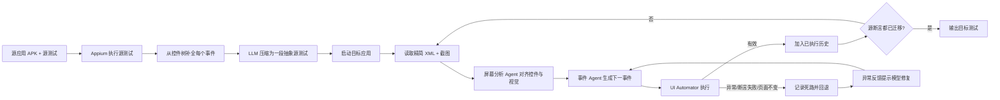

# LLMigrate：用多模态 LLM 在相似 Android 应用间迁移完整 GUI 测试

## 一页读懂

| 问题 | LLMigrate 的回答 |
|---|---|
| 旧方法哪里不够 | 传统跨应用测试迁移按控件或事件逐项匹配；同一功能在两个应用中的步骤数量、页面结构或必填字段不同，便可能无法迁移，已有方法对断言的保留也不稳定。 |
| 本文新增什么 | 先执行源测试并把完整测试压缩成自然语言目标，再在目标应用中结合截图、控件树和执行历史逐步重新实现该目标；无效动作会触发回退、死路记录和修复提示。 |
| 输入与输出 | 输入是源应用 APK、源 GUI 测试和同领域目标应用 APK；输出是由 GUI 事件、系统事件及元素存在/不可见断言组成的目标应用测试。 |
| 怎样验证 | 主实验复用 CraftDroid 中仍可运行的 19 个应用、5 类功能和 120 项迁移；另对 5 个现代流行应用以及 15 个在 GPT-4o 知识截止时间后发布的应用进行补充实验。 |
| 证据能说明什么 | 在主数据上，人工判定 97.5% 的迁移完成源测试目标，序列编辑工作量相对从零编写减少 91.19%；结果支持多模态语义重实现优于一一匹配，但不覆盖复杂业务断言、视觉缺陷或未知功能发现。 |

## 一段话介绍

LLMigrate 研究的是**跨应用 GUI 测试复用**：已有一个购物、邮件或浏览器应用的完整测试时，怎样为同类的另一个应用生成表达相同功能和断言的新测试。它先在源应用中执行脚本，补全被操作控件的文字、资源 ID 和类型，再让 GPT-4o 把整条测试概括为一段自然语言。目标端每一步读取控件树和截图，由屏幕分析 Agent 解释控件语义，再由事件 Agent 根据自然语言目标、当前页面和已执行历史生成点击、输入、系统操作或断言。动作无效时，系统重启并重放有效前缀、记录死路，再把异常反馈给模型修复。主实验的 120 项迁移中，LLMigrate 的 GUI 事件 Precision/Recall 为 98.39%/99.53%，断言事件为 94.71%/94.71%，人工判定的完整目标成功率为 97.5%。这项工作说明测试迁移可以从“复制源步骤”改为“在目标界面重新实现源测试目标”，但其断言仅检查元素存在或不可见，因而不能替代复杂业务或视觉 oracle。

## 关键术语与阅读前提

- **Test transfer / test migration（测试迁移）**：将一个应用已有的 GUI 测试转换为同领域另一个应用的测试。这里不是同一应用升级后的 locator 修复，也不是从零发现测试目标。
- **Source app / target app（源应用/目标应用）**：源应用提供已有测试；目标应用需要生成实现相同功能的测试。两者可以有不同界面和操作流程。
- **Source test / target test / ground-truth test**：源测试是迁移输入，目标测试是工具输出，ground-truth test 是人为为目标应用编写的参考测试，用于计算事件级指标和人工比较。
- **Usage-based UI test（基于使用场景的 UI 测试）**：围绕登录、注册、发邮件、计算小费等具体用户功能组织的端到端事件序列，而不是仅追求随机覆盖。
- **UI event / system event / oracle event**：UI 事件包括点击、输入和滑动；系统事件包括 Android 返回键；oracle 事件是对结果的断言。本文将每个事件统一表示为 `(action, event_type, widget)`。
- **Test augmentation（测试增强）**：执行源脚本并从运行时控件树补全目标控件的 `resource-id`、`content-desc`、文字和类型，使脚本脱离原语言与测试框架。
- **Abstract source test（抽象源测试）**：LLM 将增强后的整条测试压缩成一段自然语言，保留功能、输入值、断言和完成标志。它是目标端迁移的主要目标描述。
- **Current state（当前状态）**：目标应用当前页面的精简 XML 控件树与截图。控件树提供可定位属性，截图补充图标和真实视觉语义。
- **Screen Analyzer Agent（屏幕分析 Agent）**：把截图中的控件与 XML 节点对齐，解释其可交互性、可能动作和功能。
- **Event Agent（事件 Agent）**：根据抽象源测试和当前状态生成下一事件，内部区分初始事件、后续事件和错误修复三种提示。
- **Dead-end event（死路事件）**：在当前迁移步骤中执行失败、断言不满足或不改变页面的事件。系统记录它以防模型再次选择。
- **Backtracking（回退）**：重启应用、清理缓存并重放仍然有效的事件前缀，以撤销无效操作造成的状态。
- **Reduction（人工工作减少率）**：`(ground truth 事件数 − 编辑距离) / ground truth 事件数`。编辑距离估计把迁移结果改成参考测试所需的插入、删除或替换数；它不是实际记录的人工分钟数。
- **Successful transfer rate（成功迁移率）**：人工判断目标测试是否完成源测试目标并执行相应断言。允许存在额外步骤，也允许路径与单一 ground truth 不同。

## 动机

依据：Sections 1–2，PDF 第 1–4 页。

手工编写移动端端到端测试耗时，而同领域应用经常具有注册、搜索、发送邮件等共同功能。已有测试迁移方法通常计算源控件与目标控件的文本、结构或视觉相似度，然后逐个替换事件。这隐含两个应用具有近似流程且事件可以一一对应。

真实应用会破坏这一假设：目标注册页可能新增姓名字段、删除邮编字段，或把源应用的一步拆成多页；相似按钮也可能承担不同功能。分类式 AppFlow 又依赖已有类别训练数据，扩展到新类别需要人工工作。论文据此把迁移改写为：**从源测试提取完整功能目标，再根据目标应用当前界面重新生成测试**。

作者还强调断言是迁移的一部分。只让目标端完成“注册”动作而没有检查账户信息是否出现，得到的是任务执行轨迹，不是完整 GUI 测试。

## 贡献

论文在引言中形成三项主要贡献：

1. 提出首个使用多模态 LLM 进行端到端跨应用 UI 测试迁移的方法 LLMigrate，无需目标应用源码。
2. 设计源测试自然语言抽象、截图与控件树联合理解、动态事件生成以及失败回退修复流程，同时迁移 GUI 事件和有限类型的断言。
3. 在 CraftDroid 基准、现代流行应用和模型知识截止时间之后发布的应用上评价事件准确率、完整目标成功率、编辑工作量、时间和费用，并公开工具与材料。

核心贡献类型是 **method**。补充的新应用和测试用于检验泛化，但论文没有将其建立为独立通用 benchmark。

## 方法

### 1. 执行并增强源测试

Test Augmentor 通过 Appium 逐条执行源脚本。每一步从 XML 控件树中定位被操作控件，补充 `resource-id`、`content-desc`、`text` 和控件类型。事件随后统一为 `(action, event_type, widget)`，摆脱原脚本语言和框架语法。

当前实现沿用既有迁移工作的动作集合。断言主要只有两类：等待某元素出现，以及等待某元素不可见。这一边界决定了实验中的“oracle 迁移成功”不包含数值关系、列表排序、后台持久化或视觉布局检查。

### 2. 将整条源测试抽象为自然语言

Source Test Agent 接收增强事件序列，生成一段简短说明。提示要求保留精确输入值和文字、说明各断言，并标出哪一步完成测试。例如注册测试被概括为：确认首页元素存在，进入注册页，输入指定邮箱与密码，提交后检查邮箱文字出现。

这一抽象保留功能目标而舍弃源应用的具体路径。与 ITeM 为每个源动作分别提取一条意图不同，LLMigrate 用一段整体描述指导目标端在线重建完整测试。

### 3. 用截图和控件树理解目标页面

目标应用从首次安装后的初始页开始。UI Automator 读取 XML 并只保留 15 类常见控件，同时截取页面截图。Screen Analyzer Agent 将截图中的图标与 XML 节点对齐，为每个关键控件说明 locator、是否可点击/长按/输入/滚动以及可能功能。

论文示例中，待办页面有 `fab_add` 与 `fab_add_reminder` 两个无文字 ImageButton。只看资源 ID 容易混淆“添加待办”和“添加提醒”，截图中的勾选与时钟图标帮助模型区分。这也是 LLMigrate 相比只读控件树的 ITeM 更重视视觉信息之处。

### 4. 逐步生成 GUI 事件与断言

初始事件提示包含抽象源测试、当前 XML 和屏幕分析报告；后续提示还加入已执行事件。模型可以输出 GUI、system 或 oracle 事件，并生成目标应用新增必填字段所需的合理值，也可以跳过源应用特有而目标应用不需要的字段。

为了降低随机性，温度设为 0，每次动作选择调用模型三次。系统按字段统计多数结果：某个 JSON 字段至少出现两次才保留，其值取最常见值。迁移循环在所有源断言被迁移后结束，或事件数达到源测试事件数的三倍时停止。

### 5. 检测无效动作、回退并修复

执行后存在四种情况：

1. 动作成功并改变页面，或断言成立：记录事件并继续；
2. UI/system 事件抛出异常：删除该事件并记录死路；
3. 断言条件不成立：同样按失败处理；
4. 事件不报错但前后状态相同：通过状态比较认定为无效。

失败后，系统重启应用、清理缓存并重放有效前缀，把错误事件和异常信息加入修复提示。某一步连续三次失败后，还会再退掉前一个有效事件并将其标为当前步骤的死路，以跳出局部错误路径。

最终输出仍是增强事件序列，可由 UI Automator 按资源 ID、文字等 selector 执行。论文未生成某一具体测试框架的源码脚本。

## 实验

### 主数据与设置

- 从 CraftDroid 的 25 个应用中保留 19 个仍可运行、或更新后测试流程未改变的应用；类别为浏览器、待办、购物、邮件和小费计算器。
- 每类选择两个功能，共 38 条人工测试；源应用与同类其他应用组合形成 120 项迁移。
- 源测试平均 5.9 个事件，其中平均 2.0 个断言；购物注册最长，平均 14.5 个事件和 5 个断言。
- Android 6/API 23 为主，更新应用使用 Android 10/API 29；模型为 GPT-4o。
- 三个参数——同一步最大失败数、多数投票调用数、字段纳入阈值——均通过经验选择，设置为 3、3、2；论文没有独立调参集或消融。
- 转移结果由人工检查，因为同一功能可能存在多条正确路径。

### RQ1：事件级迁移准确率

| 方法 | GUI Precision | Oracle Precision | GUI Recall | Oracle Recall |
|---|---:|---:|---:|---:|
| CraftDroid | 78.54% | 83.59% | 85.65% | 82.29% |
| TREADROID | 88.77% | 91.58% | 93.52% | 87.44% |
| TEMdroid | 71% | 90% | 93% | 89% |
| **LLMigrate** | **98.39%** | **94.71%** | **99.53%** | **94.71%** |

LLMigrate 在购物类的 GUI 事件表现提升最大，但购物类 oracle Precision/Recall 均只有 56.25%。作者观察到模型能直接找到并操作控件时，有时省略用于确认中间页面的断言；逐事件迁移方法反而更容易保留这些位置固定的检查。

CraftDroid 与 TREADROID 的公开结果被重新限制到相同的 19 个应用。TEMdroid 因缺失实现组件和详细输出无法重跑，表中为其论文均值，而且数据集只有 82.6% 重合，因此该行不是完全同条件比较。

### RQ2：完整目标成功率与人工修改量

- 120 项迁移的成功率为 **97.5%**。人工检查测试是否完成源功能并执行合适的迁移断言；路径可以不同于参考测试，也允许存在额外步骤。
- Reduction 为 **91.19%**。它由迁移事件序列与 ground truth 的 Levenshtein 距离计算，表示按事件编辑计数预计减少的工作，并非实际计时的人工节省比例。
- TREADROID 的成功率为 88.33%、Reduction 为 52.90%；CraftDroid 为 76.67% 和 37.70%。旧方法在购物类 Reduction 为负，表示修补迁移结果所需的事件编辑比从零写参考脚本还多。

成功率与事件 Precision/Recall 衡量不同对象。一个测试可以用不同路径完成目标而被判成功，同时因多余步骤降低 Precision；反之，许多事件匹配也不保证最终断言成立。

### RQ3：时间与费用

平均每项迁移耗时 247 秒，输入 118,600 token、输出 5,180 token，按论文当时 GPT-4o 定价为 0.70 美元。平均目标测试 5.5 步，作者折算为每步约 0.12 美元。

论文称比 TEMdroid 快 290 秒、比 CraftDroid 快 5,120 秒；TREADROID 未报告精确均值，作者从其论文结果推断 LLMigrate 更快。这部分比较受到实现陈旧、网络/API 延迟和模型价格变化影响。

### RQ4：现代流行应用

作者把 CraftDroid 旧测试迁移到 Firefox、ToDo、DODuae、Zalando 和 Email 等五个较新应用。表中十组“应用×功能”结果整体报告平均成功率 98%、Reduction 97%、耗时 238 秒；购物应用的 oracle Precision 最低可到 30%，Zalando 注册行成功率为 50%，说明总体均值掩盖了功能差异。

### RQ5：模型知识截止时间之后的应用

作者选择五个新类别，每类三个在 GPT-4o 所称 2023-10 知识截止时间之后发布的应用，并自行编写每类一个场景。三应用之间互迁形成 30 项任务。

| 指标 | 平均结果 |
|---|---:|
| GUI Precision / Recall | 97.8% / 97.8% |
| Oracle Precision / Recall | 89.6% / 92.8% |
| 成功迁移率 | 93.3% |
| Reduction | 88.6% |
| 迁移时间 | 318.41 秒 |

这项实验降低了模型直接记住旧公开脚本的可能，但“发布日期晚于知识截止”不能证明应用的界面模式和功能知识完全未出现在训练数据中；人工新写测试是更强的补充控制。

## 为什么 LLMigrate 97.5% 而 ITeM 只有 54%

两篇都是 ISSTA 2025 的跨应用 Android GUI 测试迁移方法，但数字不能直接比较：

| 维度 | LLMigrate | ITeM |
|---|---|---|
| 主数据 | CraftDroid 中仍可运行的 19 个应用、5 类、120 项迁移 | 35 个应用、7 类、280 项迁移，含补充的新闻和音乐应用 |
| 源测试抽象 | 整条测试压成一段自然语言 | 每个事件和断言分别提取意图 |
| 目标感知 | 截图 + 控件树 | 控件树，不看截图 |
| 失败恢复 | 无效动作检测、死路记录、重启重放、修复提示 | 单意图五步内失败则跳过并恢复到前序意图 |
| oracle 范围 | 元素存在/不可见 | 主要也是元素存在/不可见 |
| 完整成功判定 | 人工确认完成功能目标并有合适断言；允许额外步骤和不同路径 | 人工检查迁移脚本是否保留全部原始测试意图 |
| 最弱类别 | 主集购物成功率 50%，其他四类 96%–100% | 新闻两个功能均 0%，音乐两个功能均 15% |

方法差异可能影响结果，但数据集类别、保留应用和完整成功定义也不同。现有证据不能得出 LLMigrate 普遍比 ITeM 高 43.5 个百分点；公平结论需要两者在统一应用、源脚本、断言和判定标准下重跑。

## 局限

### 作者明确讨论的局限与有效性威胁

- 模型输出非确定；论文用温度 0 和三次查询的多数结果缓解，但没有多次完整迁移的方差。
- 仍会出现动作选择错误、关键步骤遗漏和断言不足，测试能够执行也可能不完整。
- 依赖目标应用 UI metadata；缺少有意义的 `resource-id` 或 `content-desc` 会降低效果。
- toast 等短暂元素可能在系统处理前消失；注册等不可逆操作也难以在失败后恢复。
- 既有工具因实现缺失或依赖失效无法统一重跑；TEMdroid 使用论文均值，比较数据并非完全一致。
- Appium 动作集合沿用既有迁移工作，未覆盖 WebDriver 可支持的全部交互。

### 我们根据方法与实验观察到的问题

1. **oracle 表达力很窄**：存在/不可见只能检查页面元素，不能验证数值计算、数据持久化、顺序、跨页面关系或视觉质量。
2. **整体摘要可能丢细节**：把完整源测试压成一段话有助于摆脱路径，却可能省略中间断言；购物类和邮件类的 oracle 结果已经显示这一风险。
3. **成功判定依赖人工**：97.5% 是人工检查目标是否完成，没有独立自动 oracle 来证明每个迁移测试都保持了全部业务语义。
4. **主数据经过可运行性筛选**：25 个 CraftDroid 应用只保留 19 个；无法更新且流程变化明显的应用被排除，结果偏向较容易恢复的旧基准任务。
5. **参数在评价对象上经验选择**：3/3/2 的失败和投票参数没有独立验证，也没有消融各 Agent、截图或回退机制分别带来的提升。
6. **多数投票成本较高**：每个动作选择调用三次模型，平均单项迁移需要约 124K 输入/输出 token 合计；回归规模扩大后费用与延迟需要重新评估。
7. **不是未知缺陷发现方法**：它复制已知功能和已有断言，没有生成新的测试目标，也没有评价能否发现真实 bug。

## 和我们课题的关系

### 与 UX testing 的关系

LLMigrate 不检测文字截断、遮挡、重叠或溢出。它虽然把截图输入模型，截图只用于理解图标和选择控件；最终 oracle 仍是某元素存在或不可见。因此，页面成功到达并不意味着布局显示正确。

它可以为“复用 UX 测试流程”提供思路：把某个应用中已验证的“进入目标页—调整设置—滑动检查候选—恢复页面”抽象成功能目标，再在同类应用中重新执行。不过，要用于 UX-Agent，必须保留几何、截图区域、滑动前后可见性和缺陷判定条件，不能像本文一样把完整测试压成只强调功能的一段话。其无效动作检测、死路记录和重放恢复更适合直接借鉴到主动 slide 验证流程。

### 与 GUI testing 的关系

LLMigrate 属于 GUI 测试迁移、复用和维护路线。它的重要变化是把迁移从事件一一对应提升到目标级重新实现，并把截图用于弥补控件树的图标语义缺失。失败反馈与状态回退也使输出不仅是一次 Agent 轨迹，而是可重放的事件和断言序列。

同时，这篇论文揭示了迁移中的 oracle preservation 问题：模型容易直接操作页面而省略用于确认中间状态的断言。评价测试迁移时应分别检查 GUI 事件、断言事件、完整目标成功率和后续人工编辑量，不能只看页面任务是否完成。

## 原文摘要关键句（节选）

> “the abstract source test in natural language ... is adapted to the target app”
> — Section 1，正式论文 PDF 第 2 页。

该句体现论文的核心重述：迁移对象是自然语言表达的完整测试目标，而不是源控件与目标控件之间的固定映射。

## 所读版本与核对范围

- 全文来源：PACMSE/ISSTA 2025 正式正文，PDF 24 页，同时标注 arXiv `2411.17933v2`。
- 书目信息：*Proceedings of the ACM on Software Engineering*, Vol. 2, ISSTA, Article ISSTA098，2025-07，DOI `10.1145/3728975`。
- 已逐页读取 Abstract、Sections 1–10、Prompts 1–5、Tables 1–6、Figures 1–7 和参考文献；方法总览、主结果表、成功率/Reduction 图及未见应用表经过页面渲染核对。
- 未运行 LLMigrate，也未独立复核人工 ground truth、120 项迁移或模型 API 费用；`status` 为 `extracted`，不表示合作者已核对。

## 书目与分类（记录用）

展开标题、作者、版本和标签

- title: Automated Test Transfer across Android Apps using Large Language Models
- authors: Benyamin Beyzaei; Saghar Talebipour; Ghazal Rafiei; Nenad Medvidović; Sam Malek
- year: 2025
- era: llm
- venue: ISSTA 2025 Research Papers / Proc. ACM Softw. Eng. 2, ISSTA, Article ISSTA098
- venue_type: conference
- url: https://doi.org/10.1145/3728975
- pdf_url: https://arxiv.org/pdf/2411.17933
- version: PACMSE/ISSTA 2025 formal version; arXiv 2411.17933v2; received 2024-10-31, accepted 2025-03-31
- code_url: https://github.com/seal-hub/llmigrate
- institution: University of California, Irvine; University of Southern California
- aka: LLMigrate
- door: gui
- question: maintain, execute, oracle
- contribution_type: method
- platform: android
- method: multimodal-llm, dynamic-analysis, backtracking
- oracle_type: assertion, human
- bug_type: functional
- benchmark: 19 CraftDroid apps and 120 transfers; modern-app and post-cutoff supplements
- baselines: CraftDroid; TREADROID; TEMdroid
- headline_result: GUI event P/R 98.39%/99.53%, oracle P/R 94.71%/94.71%, successful transfer 97.5%, reduction 91.19%, 247 seconds and $0.70 per transfer
- one_liner: 将完整源测试抽象成自然语言目标，再用截图与控件树逐步在目标应用重建事件和有限断言，并通过死路记录、回退与反馈修复无效动作。
- use_in_survey: LLM GUI 测试迁移主线；与 ITeM 对照整体测试摘要和逐事件意图两种抽象，并突出 oracle preservation 与统一评价口径问题。
- concepts: test transfer; abstract source test; multimodal UI understanding; oracle migration; dead-end event; backtracking; reduction
- priority: must
- read_depth: full
- owner: Codex
- status: extracted

