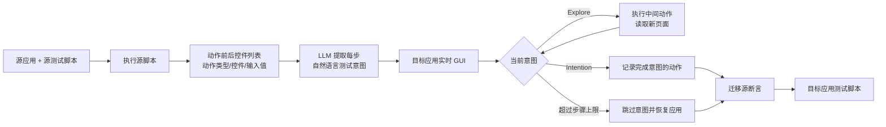

# ITeM：按测试意图在不同移动应用之间迁移 GUI 测试

## 一页读懂

| 问题 | ITeM 的回答 |
|---|---|
| 旧方法哪里不够 | 以往迁移方法主要为源应用与目标应用寻找一一对应的控件；当相同功能在两个应用中需要不同数量或不同类型的操作时，控件匹配无法正确增删步骤。 |
| 本文新增什么 | 先从源测试执行轨迹中提取每一步的自然语言测试意图，再让 LLM 根据目标应用的实时控件信息动态探索、完成或跳过意图，最后单独迁移断言。 |
| 输入与输出 | 输入是源应用、可执行的源测试脚本和目标应用；输出是面向目标应用的事件序列与断言组成的迁移测试脚本。 |
| 怎样验证 | 35 个 Android 应用、7 类功能、280 个跨应用迁移任务；与 CraftDroid、GUIDER、ATM、AdbGPT、TreaDroid 比较，并在较小重合子集上比较 TEMdroid。 |
| 证据能说明什么 | 动作级总体 Precision、Recall、F1 均为 0.86，完整脚本成功率为 54%（150/280）。自然语言意图和动态推理都明显改善迁移，但动作级高分没有转化为同等高的端到端成功率。 |

## 一段话介绍

ITeM 研究的是 **GUI 测试迁移**：已经为一个应用写好的测试，怎样复用到功能相似但界面和操作流程不同的另一个应用。传统方法通常把迁移简化为源控件与目标控件的一一匹配，无法处理“源应用一步完成、目标应用需要两步”或“源应用需要的步骤在目标应用中多余”的情况。ITeM 先执行源测试，结合动作前后控件信息，让 GPT-4-turbo 把每个事件或断言概括为自然语言测试意图；随后在目标应用中逐步读取当前控件列表，由模型判断当前动作是在为意图探索，还是执行后即可完成意图。事件迁移结束后，系统再把源断言映射到目标页面。实验中，ITeM 的动作级 F1 为 0.86，但只有 150/280 个完整迁移脚本保留了全部原始意图，说明测试意图抽象能突破一一控件匹配，同时也会受到错误控件、特殊手势和前序错误传播的影响。

## 关键术语与阅读前提

- **GUI test migration（GUI 测试迁移）**：把应用 A 的已有测试复用于功能相似的应用 B。它不同于从零生成测试；也不同于只在同一应用新版本上修复失效定位器的测试维护。
- **Source app / target app（源应用/目标应用）**：源应用提供已有脚本与执行轨迹，目标应用是需要生成新脚本的被测应用。
- **Test action（测试动作）**：本文分为两类：改变或操作界面的 **GUI event（GUI 事件）**，以及检查结果的 **GUI assertion（GUI 断言）**。测试脚本通常包含两者。
- **Test intention（测试意图）**：测试人员编写某一步动作时希望触发的事件或验证的行为。本文规定一个源测试动作对应一条自然语言意图；在目标应用中完成该意图可能需要零步、一步或多步。
- **1-1 / 1-n / n-1 migration**：源动作与目标动作数量关系。1-1 表示一一对应；1-n 表示源应用的一步在目标应用需要多步；n-1 表示源应用的若干步在目标应用只需较少步骤。
- **Execution trace（执行轨迹）**：运行源脚本得到的状态与动作记录。ITeM 将每一步表示为动作前 GUI、动作类型、关联控件、输入值和动作后 GUI 组成的五元组。
- **GUI context（GUI 上下文）**：通过 Android UIAutomator 获取的当前控件列表，包含资源 ID、文字、内容描述和控件类型等属性。本文不把页面截图输入模型。
- **Transition-aware prompt（转移感知提示）**：同时提供动作前页面、具体动作和动作后页面，使模型根据页面变化推断该动作的真实目的。
- **Dynamic reasoning（动态推理）**：模型每次只决定目标应用中的下一步动作，并根据执行后的新页面继续判断，而不是一次生成完整脚本。
- **Explore / Intention 标签**：`Explore` 表示当前动作只是通往目标功能的中间步骤；`Intention` 表示执行该动作后当前测试意图应当完成。
- **Recovery（恢复）**：某条意图在步骤上限内无法完成时，系统重启目标应用，并重新执行此前已经迁移成功的事件，以恢复到失败意图之前的状态。

## 动机

依据：Sections 1–2，PDF 第 2–5 页。

移动 GUI 测试脚本通常绑定具体控件 ID、文字和页面结构，人工为每个相似应用重新编写脚本成本较高。既有迁移方法尝试在源应用和目标应用之间匹配控件，再将点击、输入和断言替换为目标控件。

这种做法隐含了“相同功能具有相同操作结构”的假设。现实中，即使两个应用都支持查看已发送邮件，源应用可能直接显示“已发送”入口，目标应用却要先展开侧边栏再点击入口。反向迁移时，源脚本中的展开步骤又必须删除。单纯控件匹配不能表达动作数量变化，对 `back`、`swipe` 等不绑定控件的操作也缺少结果判断。

论文据此把迁移问题重新定义为：**保留源测试的意图，在目标应用中重新实现这个意图**。这一表述允许系统根据目标应用交互逻辑增加、删除或替换动作。

## 贡献

作者在 Section 1 列出三项贡献：

1. 提出 ITeM，首次使用 LLM 从源脚本提取自然语言测试意图，并围绕意图完成跨应用 GUI 测试迁移。
2. 实现并公开 ITeM 工具与实验数据，代码仓库为 `Vallxy/ITeM`。
3. 在 35 个真实 Android 应用上的 280 项迁移任务中评价效果与效率，并与多种迁移、修复和缺陷复现方法比较。

核心贡献类型是 **method**，并提供可复用 artifact。数据集整合了既有集合和作者补充应用，但论文没有将其单独声明为新的通用 benchmark。

## 方法

### 阶段一：从源测试执行轨迹提取意图

ITeM 先在源应用上执行已有脚本。每条转移记录为：

`<动作前 GUI，上下文动作类型，关联控件，输入值，动作后 GUI>`。

GUI 上下文来自 UIAutomator 导出的 XML。系统删除布局容器和属性全空的控件，以减少提示长度。模型还会看到包名和 Activity 名，因为其中可能包含邮件、设置等功能线索。

对每一个源动作，提示词同时提供动作前和动作后控件列表。例如，输入网址后页面从搜索框变为网站内容，模型据此生成“在搜索栏输入该网址并导航到网站”，而不只是复述 `input` 和源控件 ID。

测试意图保留自然语言形式，但输出外层用 `<Intent: ...>` 约束。作者认为自然语言可以去掉源应用特有的资源 ID 和文字，使后续模型更关注动作目的。

### 阶段二：动态迁移 GUI 事件

事件迁移逐条处理测试意图。每一轮模型收到：

- 当前测试意图；
- 目标应用当前页面的控件列表；
- 可交互控件的编号；
- 已经为这条意图执行的探索动作；
- 支持的点击、长按、返回、输入、滑动和滚动等事件类型。

模型每次输出一个标签和一个动作：

- `Explore`：该动作只是进入正确页面或暴露目标控件的中间步骤，执行后继续询问模型；
- `Intention`：执行该动作后，模型认为当前意图已经完成，探索动作和最终动作一并写入迁移脚本。

默认最多允许五步探索。若模型在上限内没有产生 `Intention` 动作，系统将该意图视为目标应用不需要或无法完成并跳过，然后重启应用、重放此前迁移事件。这种设计既支持 1-n 迁移，也允许通过跳过实现 n-1 迁移；它同时存在把“尚未找到”误判为“目标应用不需要”的风险。

### 阶段三：迁移断言

事件迁移优先进行，因为只有事件正确，目标应用才能到达应当检查的页面。事件阶段完成后，系统使用执行轨迹定位每条源断言对应的目标页面。

- 与具体控件无关的断言直接迁移；
- 与控件相关的存在/不存在断言，交给 LLM 根据源控件、源页面控件列表和目标页面控件列表选择对应目标控件；找不到则返回 `-1`。

断言匹配只使用 `resource-id`、`content-desc` 和 `text` 三类属性。这一阶段仍是控件匹配，但它发生在意图驱动的事件迁移已经到达正确页面之后。

### 原文案例：两个邮件应用的“进入已发送文件夹”

Figure 1 中，K-9 Mail 从当前页面点击“Sent”即可进入已发送邮件页面；myMail 必须先点菜单按钮展开侧边栏，再点击“Sent”。

从 K-9 Mail 迁移到 myMail 时，ITeM 把源点击概括为“进入已发送文件夹”，在目标应用中先生成一个 `Explore` 的展开菜单动作，再生成一个 `Intention` 的点击已发送动作。反向迁移时，多余的展开意图可以被跳过。该案例说明迁移单位是功能意图，而不是源控件与目标控件的一一对应。

## 实验

### 数据与迁移任务

- **应用规模**：35 个 Android 应用，分为浏览器、待办、购物、邮件、计算器、新闻和音乐播放器七类；每类五个应用。
- **功能规模**：每类包含两个待测功能，共 14 个功能。每个应用都有相应源脚本。
- **任务构造**：对每个功能，从五个应用中依次选择一个源应用并迁移到其余四个目标应用，共 `5×4×14=280` 项迁移任务。
- **动作规模**：所有源脚本共对应 292 个 GUI 事件意图和 138 个 GUI 断言意图。
- **结构分布**：132/280（47%）为 1-1，75/280（27%）为 1-n，73/280（26%）为 n-1。
- **真值**：目标应用原有的人工测试脚本作为参考答案；三名至少有两年 Android 测试经验的研究生参与补充脚本、判定意图和检查完整脚本成功率，结论要求三人一致。

数据主要来自 CraftDroid 和 FrUITeR。一个旧邮件应用被 Gmail 替换；新闻类十个应用中七个已经无法运行，作者保留三个并补充 Google News 和 Mail Online。作者另选取知识截止日期之后发布的五个音乐播放器，降低模型可能见过这些应用的风险。

默认模型是 GPT-4-turbo，设备为 Android API 23 和 30 模拟器。LLM 方法重复三次并报告聚合指标。

### RQ1：意图提取是否准确

138 条断言意图全部被三名评审判为正确。292 条事件意图中有 3 条（约 1%）被判不准确，均来自待办应用中“打开列表项选项菜单”的动作：意图没有说明应当长按还是滑动，而不同应用需要不同手势。

三名评审对这三条并非完全一致；一人认为不准确，另外两人认为正确。论文采用一致同意作为正确标准，因此将其记为错误。作者还报告 ITeM 在源应用中重新执行时能够完成这三条意图，但这不消除人工定义上的歧义。

### RQ2：动作级迁移与完整脚本成功率

| 指标 | CraftDroid | 最佳其他基线值 | ITeM |
|---|---:|---:|---:|
| 总体 Precision | 0.54 | 0.60（TreaDroid） | **0.86** |
| 总体 Recall | 0.56 | 0.56（CraftDroid） | **0.86** |
| 总体 F1 | 0.55 | 0.55（CraftDroid） | **0.86** |
| 完整脚本成功率 | 0.26 | 0.28（TreaDroid） | **0.54（150/280）** |

论文将总体 F1 的提升写成 31%，从表中看是 `0.86−0.55=0.31` 的绝对差，即 31 个百分点；若按相对增幅计算并不是 31%。成功率相对四个迁移基线分别高 28、39、41 和 26 个百分点。

动作级 F1 与完整脚本成功率衡量不同对象：一条脚本中多数动作正确仍可能得到较高 F1，但只要有关键动作或断言错误，整条脚本就不能算成功。因此 0.86 F1 不能解释为 86% 的测试脚本迁移成功。

在与 TEMdroid 可比较的较小子集上，ITeM 总体 F1 为 0.96，TEMdroid 为 0.83。TEMdroid 的公开实现缺失关键文件，作者只能引用其论文数据，比较协议不是重新在统一环境中运行。

### 不同功能上的差异

ITeM 在浏览器、邮件和计算器部分功能上达到接近或等于 1.00 的完整脚本成功率，但在两个新闻功能上均为 **0.00**，两个音乐功能均为 **0.15**。总体 54% 隐藏了明显的领域差异，不能据此断言方法已稳定适用于任意移动应用。

ITeM 独立成功迁移 56 条其他工具均失败的脚本，其中 26 条属于 1-n 或 n-1，支持动态增删动作的设计；另外 30 条是 1-1，主要受益于自然语言意图降低源/目标控件的语义差距。

ITeM 也有其他工具成功而自身失败的案例。Figure 4 中，目标页面存在 `fab_add` 和 `fab_add_reminder` 两个属性近似的无文字按钮。ITeM 误点提醒按钮；作者把按钮图片补给模型后才得到正确匹配，说明只使用控件属性时难以区分图标语义。

### 探索产生的额外动作

150 条成功脚本中有 30 条包含探索动作。其中 22 条的探索动作与真值一致；其余 8 条合计包含 22 个真值脚本没有的额外事件。作者认为这些动作最终仍能导航到正确页面，且可人工删除，因此不影响完整脚本成功判定。

这表明“成功”标准允许存在与源意图无关但没有破坏最终结果的冗余步骤。若迁移结果用于长期回归测试，这些步骤可能增加脆弱性和维护成本，论文没有单独评价。

### RQ3：迁移效率

ITeM 完成全部 280 项任务共耗时 392.51 分钟，快于除 AdbGPT 外的其他工具。AdbGPT 只处理事件、不迁移断言，因此总耗时不能直接比较。

作者将效率优势归因于减少反复重启和控件匹配尝试。ITeM 通常在当前状态继续探索，只有意图超过步骤上限时才重启并重放已有迁移事件。

### RQ4：消融与步骤上限

| 配置 | Precision | Recall | F1 | 成功的 1-n / n-1 / 1-1 脚本 |
|---|---:|---:|---:|---:|
| 去掉意图提取，直接使用结构化动作 | 0.62 | 0.50 | 0.55 | 8 / 8 / 30 |
| 去掉动态推理 | 0.60 | 0.62 | 0.61 | 0 / 0 / 65 |
| 完整 ITeM | **0.86** | **0.86** | **0.86** | **30 / 29 / 91** |

自然语言意图相对结构化动作将 F1 提高 0.31；动态推理相对无推理变体提高 0.25，并且是处理 1-n 和 n-1 的必要组件。

探索上限从 1 增加到 5 时，Precision、Recall 和 F1 提升，时间从 562.18 分钟下降到 392.51 分钟。原因是过小上限导致错误跳过，进而频繁恢复并影响后续意图。超过 5 后效果基本不再提高，时间反而增加，因此默认设为 5。

### RQ5：不同模型

| 模型 | Precision | Recall | F1 |
|---|---:|---:|---:|
| GPT-4-turbo | 0.86 | 0.86 | 0.86 |
| GLM-4 | 0.80 | 0.78 | 0.79 |
| Llama-3.1-70B | 0.78 | 0.79 | 0.78 |

这说明框架并非只能运行在 GPT-4-turbo 上，但不同模型仍有 0.07–0.08 的 F1 差距。论文没有报告 token 数、API 费用或本地部署成本。

## 局限

### 作者在 Section 5 讨论的有效性威胁

- Precision、Recall 和 F1 是否充分代表迁移质量属于构念效度问题；作者增加完整脚本成功率并沿用既有指标定义。
- 工具实现缺陷和模型随机性会影响结果；作者检查实现，并将 LLM 方法运行三次。
- 35 个应用不能代表完整 Android 生态；作者使用两个既有数据来源并增加可能未被模型训练见过的音乐应用，未来仍需更大规模实验。

### 作者在结果分析中明确承认的问题

- 相似控件属性会使模型选错按钮；加入截图可能改善视觉图标识别，但会增加 token 成本。
- 删除列表项等功能在不同应用中可能使用滑动、长按或弹出菜单，模型缺少试探或源码信息时难以确定正确手势。
- 事件迁移错误会把应用带到错误页面，随后断言迁移也会发生连锁误报或漏报。

### 我们根据实验观察到的问题

1. **端到端成功率仍为 54%**：动作级 F1 较高，但近一半完整脚本没有保留全部原始意图。
2. **领域差异很大**：新闻功能成功率为零，音乐功能只有 15%，不能只看总体均值评价实用性。
3. **把超时等同于“不需要”存在风险**：五步内找不到动作时系统直接跳过意图，无法区分目标应用确实没有该步骤，还是模型尚未找到入口。
4. **断言类型有限**：主要迁移控件存在/不存在检查，没有证明可保留数值、排序、持久化或跨页面业务关系等复杂 oracle。
5. **只读取控件属性**：模型看不到实际渲染、图标和遮挡；Figure 4 的错误正是两个无文字图标仅靠属性无法区分。
6. **任务来自已有同类脚本**：目标应用人工脚本既作为真值，也意味着研究问题预先知道要迁移什么；方法不负责发现未知功能或未知缺陷。
7. **应用和系统版本较旧**：实验运行 Android API 23/30，部分既有数据中的应用已失效并被替换；迁移效果能否延伸到现代复杂应用仍需新证据。

## 和我们课题的关系

### 与 UX testing 的关系

ITeM 与 UX-Agent 当前的显示缺陷检测没有直接重合。它只读取控件树属性，不观察截图，因此无法判断文字截断、遮挡、重叠或溢出，也没有主动滑动来验证某个视觉候选能否被正常查看。

它可以为后续“把一次有效 UX 探测流程变成可复用测试”提供方法参考。例如，若某个应用中已经形成“进入设置—调大字体—打开目标页面—执行滑动验证”的测试轨迹，可以先抽象其意图，再尝试迁移到同类应用或不同实现。但 ITeM 当前只支持有限断言，并在跨应用迁移上成功率为 54%；这一用途需要另行验证，不能直接视为现有 UX-Agent 的能力。

### 与 GUI testing 的关系

ITeM 属于 GUI 测试复用、迁移和维护方向。它的研究价值在于把迁移单位从控件改为测试意图，使一个源动作可以在目标应用中展开为多步，也允许删除目标应用不需要的步骤。自然语言意图负责保留“为什么执行”，动态推理负责决定“在目标应用中怎样执行”。

论文还展示了迁移事件与迁移 oracle 的依赖关系：只有事件序列到达正确页面，断言匹配才有意义；前序事件错误会传递到断言。后续阅读迁移论文时，应同时检查完整流程、断言保留和端到端成功率，不能只比较单个控件或动作的匹配准确率。

## 原文摘要关键句（节选）

> “the essence of the test migration task is to perform the same test intentions across different apps”
> — Section 1，正式论文 PDF 第 3 页。

这句话给出 ITeM 的核心重述：测试迁移的目标是保留意图，而不是保持动作与控件的一一对应。

## 原文摘录

> “Only 9% ... successfully preserved the original test intentions across all approaches.”
> — Section 4.3.2，正式论文 PDF 第 16 页。

这项结果说明跨应用测试迁移本身仍然困难；即使多个工具都输出了迁移脚本，也很少有脚本能被所有方法共同正确迁移。

## 所读版本与核对范围

- 全文来源：南京大学软件工程组技术报告封面后的正式 PACMSE/ISSTA 论文正文，共 23 个印刷页、PDF 24 页。
- 书目信息：*Proceedings of the ACM on Software Engineering*, Vol. 2, ISSTA, Article ISSTA101，2025-07，DOI `10.1145/3728978`；已对照 ISSTA 2025 官方 Research Papers 页面。
- 已逐页读取 Abstract、Sections 1–8、Algorithms、Tables 1–9、Figures 1–5 和参考文献；关键流程图、主结果表、成功率表与消融图进行了视觉核对。
- 未运行 ITeM，未重做 280 项迁移，也未独立复核三名评审的判定；`status` 为 `extracted`，不表示合作者已核对。

## 书目与分类（记录用）

展开标题、作者、版本和标签

- title: Intention-Based GUI Test Migration for Mobile Apps using Large Language Models
- authors: Shaoheng Cao; Minxue Pan; Yuanhong Lan; Xuandong Li
- year: 2025
- era: llm
- venue: ISSTA 2025 Research Papers / Proc. ACM Softw. Eng. 2, ISSTA, Article ISSTA101
- venue_type: conference
- url: https://doi.org/10.1145/3728978
- pdf_url: http://www.nju-se.com/people/lxd/papers/ISSTA25.pdf
- version: PACMSE/ISSTA 2025 正式正文；received 2024-10-31，accepted 2025-03-31
- code_url: https://github.com/Vallxy/ITeM
- institution: Nanjing University
- aka: ITeM
- door: gui
- question: maintain, execute, oracle
- contribution_type: method
- platform: android
- method: llm-prompt
- oracle_type: assertion, human
- bug_type: functional
- benchmark: 35 apps, 14 functionalities, 280 cross-app migration tasks
- baselines: CraftDroid; GUIDER; AppTestMigrator; AdbGPT; TreaDroid; TEMdroid on a subset
- headline_result: 动作级总体 Precision/Recall/F1 均为 0.86；完整脚本成功率 54%（150/280）；总迁移时间 392.51 分钟
- one_liner: 从源测试执行轨迹提取自然语言意图，再根据目标应用实时控件上下文动态增删事件并迁移断言。
- use_in_survey: LLM GUI 测试迁移与维护主线；说明意图抽象如何处理 1-n/n-1 操作差异，并提醒动作级准确率不能替代完整测试成功率。
- concepts: GUI test migration; test intention; execution trace; dynamic reasoning; assertion migration; test reuse
- priority: must
- read_depth: full
- owner: Codex
- status: extracted

