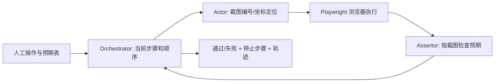

# Are Autonomous Web Agents Good Testers?：把任务执行 Agent 变成按步骤检验结果的测试员

## 一页读懂

| 问题 | 所读预印本的回答 |
|---|---|
| 研究什么 | 已有 Web Agent 能完成用户任务，但能否严格执行人工测试步骤、逐步验证断言，并在正确位置报告失败？ |
| 新增什么 | 提出两种测试 Agent（SeeAct-ATA、PinATA），提供三套可本地部署的 Web 应用与 113 条带人工 verdict 的测试，并引入失败步骤对齐指标。 |
| 输入与输出 | 输入为“操作—预期结果”两列表格和起始 URL；输出通过/失败、停止步骤、动作或断言失败原因及执行轨迹。 |
| 主要结果 | GPT-4o 下 PinATA 的平均 verdict Accuracy 0.71，考虑失败步骤后的 TruAcc 0.61；SeeAct-ATA 为 0.55/0.40。PinATA 灵敏度 0.88，但特异度仅 0.57，仍会把大量可通过测试报为失败。 |
| 证据边界 | 数字来自 arXiv v1 的 113 用例版本。会议页写 100 用例，正式版还新增一名作者；已核实正式 DOI，但未取得正式全文，不能把这些数字无条件当成最终出版结果。 |

## 一段话介绍

这篇论文检查“能做任务”和“会做测试”之间的差距。测试 Agent 必须按给定顺序操作，并检查每一步的预期，而不是自行换路达成最终目标。作者先把 SeeAct 的单提示改成测试员角色，增加步骤状态和断言检查，得到 SeeAct-ATA；再设计 PinATA，用 orchestrator 管理当前步骤，actor 操作页面，assertor 根据截图验证预期。评价集包含 62 条专业测试人员写的可通过用例，以及 51 条通过修改步骤或预期构造的失败用例。论文除了比对最终 pass/fail，还比对失败发生在哪一步：如果 Agent 提前点错而失败，或漏掉错误断言后才失败，即使最终 verdict 与人相同，也不能算真正正确执行。GPT-4o 下 PinATA 的平均准确率为 0.71，而更严格的 TruAcc 为 0.61。对我们而言，它最有价值的贡献是**把执行能力、断言验证和失败原因对齐分开评价**，同时指出只读截图的被动 assertor 无法可靠验证需要滚动或额外操作的条件。

## 关键术语与阅读前提

通用术语参见[术语表](../glossary.md)，本文的[评测概念](../glossary.md#ata-evaluation)已补入公共术语页。

- **AWA（Autonomous Web Agent，自主 Web 操作代理）**：接收目标、观察页面并决定动作，成功标准通常是完成目标。
- **ATA（Autonomous Test Agent，自主测试代理）**：接收既定测试步骤与断言，按序执行、判定每步并给出测试 verdict。路径和中间检查本身也是要求。
- **Assertion（断言）**：来自测试人员的明确预期，例如“评论列表为空”。模型负责检查预期，不是自己决定什么结果算正确。
- **Verdict（测试判定）**：pass 或 fail。相同 verdict 可能来自不同原因，因而还要看失败步骤。
- **Grounding（目标落地/定位）**：把“点击登录”映射到 DOM 元素或屏幕坐标。定位失败属于执行问题，不一定是被测应用缺陷。
- **Set-of-Marks（编号标注）**：在截图上标出可交互元素编号，降低模型直接猜坐标的难度。
- **Specificity / Sensitivity（特异度/灵敏度）**：此处以失败为正类；特异度是可通过测试被正确判通过的比例，灵敏度是应失败测试被判失败的比例。
- **Type III error（本文的第三类错误）**：结果报失败恰好与人相同，但停在错误步骤。它说明 verdict 正确仍可能没有验证目标缺陷。

## 动机

传统 Web 脚本依赖 CSS/XPath 等定位器，界面结构变化后需要维护。用自然语言测试步骤驱动 Agent，理论上可以绕过部分硬编码定位问题；但一般 Web Agent 不保证测试顺序，也没有逐步执行全部断言的义务。因此仅凭 WebArena 等任务完成率，无法说明它能替代人工测试员。

论文图 1 的贯穿例子是二手交易网站：登录、按关键词与类别搜索、选商品、添加评论、确认评论可见、删除评论并确认列表为空。测试必须验证各中间结果。若模型直接跳到最终页面，或评论未删除却宣布完成，整个测试就失去意义。

## 贡献

所读版本明确提出三项产物：

1. **Benchmark**：三套离线应用与 113 条自然语言测试，既有 pass 也有 fail，人工提供 verdict 与预期失败步骤。
2. **方法实现**：SeeAct-ATA 与 PinATA，分别展示最小提示适配与分角色规划/操作/断言架构。
3. **实证评价**：模型与架构比较，加上对 26 个持续失败用例的质性分类。

这篇确实贡献了 benchmark；不能因为其他论文只使用数据集，就给它们同样标签。主要研究问题是测试 Agent 的**执行与判定是否可信**，不是自由发现更多未知缺陷。

## 两种架构具体做什么

### SeeAct-ATA：在一个提示中增加测试职责

原 SeeAct 读取截图、任务、动作历史和候选 DOM 元素，通过选择题把意图对应到元素，再由 Playwright 操作。作者把角色改为人工测试员，将整个 E2E 测试作为输入，并增加：

- 逐步标记 DONE / CURRENT / TODO，明确当前测试步骤；
- 把当前预期拆成原子断言，逐项标记 VERIFIED / NOT VERIFIED。

它仍把计划、动作选择和判断集中在一个提示中。该实现用于检验“只加测试员提示”是否足够，不代表所有单 Agent 方法的最佳结果。

### PinATA：把操作和断言分开

Orchestrator 维护测试模型和进度，指派 actor 执行动作。动作失败则重试或判无法执行；成功后再交给 assertor 检查对应断言。断言未通过则重试或结束测试，全部检查通过后进入下一步。

Actor 用截图编号和模型预测坐标定位，由 Playwright 执行浏览器交互。Assertor 采用 Agent-as-a-Judge，根据应用截图判断明确预期。三个角色共享全局历史，不从互联网检索额外知识。

**Assertor 当前是被动观察者**。论文建议给它独立操作能力，使它可以滚动、展开或读取 DOM 以验证条件；这是未来改进，不能写成现有 PinATA 已实现的功能。角色拆分也没有自动消除模型幻觉或提供形式化正确性保证。

## Benchmark 是怎样构造的

应用是本地 Docker 部署的 Classifieds（二手交易）、Postmill（社交）、OneStopShop（电商），复用 WebArena/VisualWebArena 环境。每次测试前重置，防止前一个用例留下账户、评论或订单状态。

四名有五年以上经验、持 ISTQB Foundation 证书的专业测试人员用三周写出 62 条 passing 测试，表格包含动作和可选预期。作者统一语言、补齐凭证/数据并逐条手动执行；每条用例构造成本约一小时。

两名作者把部分动作或预期改成应用未实现的要求，得到 51 条 failing 测试，并标注应该在哪一步停止。例如要求点击不存在的 Cancel 按钮。这样测的是 Agent 能否识别“现有应用与给定规格不符”，**没有在应用代码中注入 51 个真实 bug**。最终分布为 Classifieds 15+15、Postmill 18+16、OneStopShop 29+20，共 113 条。表 1 对第一、第三个应用的领域文字似有交换，本文按实际功能解释。

## 评测：为什么最终失败还不够

### 最终 verdict

失败为正类：TP 是人和 Agent 都报失败；TN 都通过；FP 为 Agent 错报失败；FN 为 Agent 漏报失败。Accuracy 是全部 verdict 一致率；Specificity 为 `TN/(TN+FP)`；Sensitivity 为 `TP/(TP+FN)`。

### 失败步骤对齐

TP 再分为：

- **AFB**：Agent 比人更早失败，还未到目标失败点，可能只是操作能力不足；
- **AFA**：Agent 比人更晚失败，说明它跳过了应失败的断言；
- **AFC**：在与人相同的步骤失败。

论文定义 `AER=AFB/TP`、`HER=AFA/TP`、`SMER=AER+HER`，并用 `TruAcc=(AFC+TN)/N` 收紧准确率。即便同一步失败，也未必同一原子断言/根因；passing 测试的跳过检查也无法靠停止步骤发现。因此 TruAcc 是比 verdict 更严格的代理，仍非完整正确性证明。

**计算疑点**：第 12 页以上公式与表 2 的数值不能完全对应。按定义应有 `Accuracy−TruAcc=(TP/N)×SMER`；但例如 PinATA/Classifieds 为 0.64−0.48=0.16，而 SMER 为 0.15，即便考虑 TP 占比也无法解释。所读版本未提供足以复算的原始混淆计数，因此下文标为“论文报告值”，不将其当作已独立复现结果。

## 实验结果

### 架构比较：GPT-4o

每个应用重置初态，模型 temperature 为 0；论文没有给出多次重复的方差或置信区间。表中 Average 为三个应用结果的宏平均，不是按 113 条用例直接加权的整体成功率。

| 论文报告的三应用均值 | SeeAct-ATA | PinATA |
|---|---:|---:|
| Accuracy | 0.55 | 0.71 |
| Specificity | 0.59 | 0.57 |
| Sensitivity | 0.48 | 0.88 |
| SMER | 0.28 | 0.11 |
| TruAcc | 0.40 | 0.61 |

作者把 TruAcc 0.40→0.61 称作约 50% 提升。它支持显式规划、操作和判定分工在此实现上的收益，但两种架构还同时改变定位和反馈，不能仅归因于“多 Agent”。低 Specificity 表明许多本来能通过的测试被错误判失败，这可能包含操作失败，也可能包含断言误判。

### 更换基础模型

PinATA 使用 GPT-4o、Claude-3.5-Sonnet、Gemini-2.0-Pro 时，TruAcc 为 0.61/0.58/0.62；Sensitivity 为 0.88/0.94/0.85，Specificity 为 0.57/0.47/0.56。这说明只换模型并未消除结构性失败，也体现漏报与误报的权衡。摘要将 94% 写成 specificity，但正文表 4 明确是 **Sonnet 的 sensitivity**，不能沿用摘要错误。表 3 中的私有模型参数量为作者猜测，本文不记录为事实。

## 五类持续失败：哪些属于 Agent，哪些属于测试

作者对三个模型都无法与人工对齐的 26 个用例，由两位作者独立分组后讨论形成以下分类：

| 类型 | 数量 | 具体问题与研究启示 |
|---|---:|---|
| Action Capacity，动作能力范围 | 6 | 框架无法打开第二标签、打印界面或浏览器设置。没有可用工具，模型再聪明也无法执行。 |
| Action Versatility，交互灵活性 | 6 | 自动补全需逐字输入再选择，整段填值不起作用；复杂下拉菜单也失败。动作 API 语义必须符合真实交互。 |
| UI Observability，界面可观察性 | 5 | 浏览器原生弹窗不在 HTML 页面截图中，小元素编号也不精确。截图覆盖范围本身是限制。 |
| Assertion Verifiability，断言可验证性 | 4 | 将非网格错误认成网格，或没滚到底便无法验证。需要主动取证与多源观察，不能只被动看一帧。 |
| Test Case Conformity，用例遵循 | 5 | 自行加操作、提前检查下一步或跳过指定预期，导致目标路径失效。完成任务不能覆盖用例顺序约束。 |

前 3 类与通用 Web Agent 共通，后 2 类更直接属于测试。分类只来自一种架构在三应用中的 26 例，不代表完整领域分类，也不能据此宣称这些问题在 2026 年仍没有解决。

## 局限

**作者承认的**（Section 5.4）：人类真值可能出错；质性分类有主观性；三应用、少量模型与用例限制泛化；停止步骤无法揭示 passing 测试中的碰巧正确。

**我们的观察**：

1. failing 用例通过修改规格构造，不等于自然缺陷发现，也没有评价新 bug 数量或真实回归检测。
2. 仅以失败步骤定位原因仍粗糙，多个断言可在同一步；需进一步记录错误断言和实际证据。
3. 调整架构时同时改了规划、定位和判断，缺少单独消融；结果不能支持“任何多 Agent 都更好”。
4. 以脚本维护成本为动机，却未做跨版本演化、费用、时延或人工维护量实验，不能声称已证明免维护。
5. 预印本公式、表格和摘要有数字疑点；正式版与所读版的样本量不一致。若要把数值作为后续论文的核心对比，需先对正式版与 artifact 复算。

## 和我们课题的关系

### 与 UX testing 的关系

本文包含布局断言（例如列表是否为网格），所以与 UX 判定有交集，但没有专门检测截断、遮挡、重叠或溢出。对 UX-Agent 最有启发的是 assertor 的失败分析：一张截图不足以验证需要滚动、展开或读取结构的问题。UX-Agent 的主动 slide 与布局树复核可以作为这种主动取证方式的具体实现，但“主动 assertor 更好”仍需我们通过实验验证。

评价也应区分三种失败：Agent 没正确到达/操作页面；候选确有显示异常；Agent 看错正常布局。若只统计任务失败或报告总数，容易把自动补全、定位或滚动错误误当 UX 缺陷。可以借鉴本文的步骤对齐，进一步记录控件、规则、前后截图和主动验证结果，评价失败原因是否与人工一致。

### 与 GUI testing 的关系

这是“GUI Agent 是否构成测试系统”的直接实证证据：已有测试规格必须被严格遵循，中间断言必须逐条执行，失败还要有可检查的原因。与 ScenGen 的场景进度验证相比，PinATA 明确从人工用例获取每步预期并委托 assertor 判断；与 PropGen 不同，它复用人工预期而非从应用运行行为归纳规格。

最值得保留的不是某个旧模型排名，而是**测判定质量时同时测路径和失败原因**。Web 的 DOM/Playwright 与 Android/HarmonyOS 的布局/设备操作不同，113 用例结果不能直接外推到手机；评价逻辑和主动证据设计可以迁移。

## 原文摘录

> “an agent can identify a test as failing similarly to a human, but not for the same underlying reason”
> — Section 4.4，arXiv v1 PDF 第 12 页。

这句话是本篇的关键：测试结论应与证据对应，不能只检查最后的标签。

## 所读版本与核对范围

已逐页读取 arXiv `2504.01495v1`（2025-04-02，23 页），包含正文 Sections 1–8、参考文献、方法提示和 Tables 1–4；指标公式与结果表经渲染核对。未发现参考文献后的方法附录。未运行 Agent 或复算公开执行日志。

正式发表已由 [ISSTA Research Papers 页面](https://conf.researchr.org/details/issta-2025/issta-2025-papers/10/Are-Autonomous-Web-Agents-good-testers-)核实：DOI `10.1145/3728879`，PACMSE 2(ISSTA)，206–228。正式书目有第六作者 Aymeric Cretin，会议摘要写 100 条用例；本地所读预印本只有前五作者、113 条用例。ACM 正文下载返回 403，因此这里保留预印本分析，明确**正式实验与文本差异待核实**。不能把全文阅读状态误解成已对照正式版。

## 书目与分类（记录用）

展开书目与分类

- title: Are Autonomous Web Agents Good Testers?
- authors: Antoine Chevrot; Alexandre Vernotte; Jean-Rémy Falleri; Xavier Blanc; Bruno Legeard; Aymeric Cretin（正式版；所读 v1 无最后一位）
- year: 2025
- era: llm
- venue: ISSTA 2025 Research Papers / Proceedings of the ACM on Software Engineering 2(ISSTA), 206–228
- venue_type: conference
- url: https://doi.org/10.1145/3728879
- pdf_url: https://arxiv.org/pdf/2504.01495v1
- version: read arXiv v1, 23 pages; final-version experimental differences not verified
- code_url: https://github.com/Smartesting/pinata
- artifact_url: https://doi.org/10.5281/zenodo.14937131
- institution: Smartesting; LaBRI, University of Bordeaux（所读版第一作者 Smartesting）
- aka: SeeAct-ATA; PinATA
- door: gui
- question: eval, execute, oracle
- contribution_type: benchmark, empirical, method
- platform: web
- method: multi-agent, llm-prompt, benchmark
- oracle_type: spec, llm-judge, human
- bug_type: functional, display
- benchmark: read version: 3 offline web apps, 62 passing + 51 mutated failing test cases
- baselines: SeeAct-ATA vs PinATA; GPT-4o, Claude-3.5-Sonnet, Gemini-2.0-Pro
- headline_result: v1 reports macro-average TruAcc 0.61 vs 0.40; formula/table consistency unresolved
- one_liner: 严格步骤与中间断言将任务 Agent 变成测试 Agent；用失败位置纠正碰巧正确的 verdict。
- use_in_survey: GUI Agent 与 testing 的边界、断言证据、失败步骤对齐、主动验证研究假设。
- concepts: ATA; assertion; specificity; sensitivity; Type III error; step alignment
- priority: must
- read_depth: full
- owner: Codex
- status: extracted

