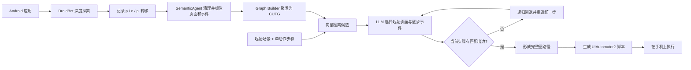

# ProphetAgent：用语义化 GUI 转移图把自然语言测试用例合成为执行脚本

## 一页读懂

| 问题 | ProphetAgent 的回答 |
|---|---|
| 旧方法哪里不够 | 企业积累了大量自然语言测试用例，但仍需测试人员寻找起始页面、把每一步对应到控件并编写脚本；直接让 GUI Agent 在线执行复杂步骤，容易因看不懂控件或猜错点击结果而失败。 |
| 本文新增什么 | 先充分探索应用，把页面、事件及执行前后变化整理成带语义的聚类 UI 转移图 CUTG；再用向量检索缩小候选，由 LLM 将测试起始场景和每条动作逐步匹配到图中的页面与事件，最后生成 UIAutomator2 脚本。 |
| 输入与输出 | 输入是 Android 应用，以及含“起始场景 + 4–15 个单动作步骤”的自然语言测试用例；输出是图中一条匹配路径及对应的可执行 GUI 脚本。 |
| 怎样验证 | 使用抖音、豆包各 30 条真实企业用例，以及 6 个开源应用各 10 条研究者编写用例；与 AppAgent、AutoDroid 比较，每条用例运行 3 次。 |
| 证据能说明什么 | 120 条用例上完成率为 78.1%、动作准确率为 83.3%，高于两个通用 GUI Agent；平台统计称测试人员日处理量由 25+ 增至 90+。结果说明预构建行为图有助于把明确步骤落到具体控件，但不说明脚本能自动判错，也不说明方法能发现未知缺陷。 |

## 一段话介绍

ProphetAgent 面向企业已有自然语言测试用例的脚本化工作。它先用改造后的 DroidBot 遍历应用，记录 `<操作前页面, GUI 事件, 操作后页面>`；SemanticAgent 清理控件树，并结合控件属性、局部截图、OCR 和前后页面差异，为页面和事件生成语义说明；Graph Builder 再把相似页面和事件聚类为 CUTG。收到一条自然语言用例后，GenerationAgent 先用 embedding 从所有页面中筛选与起始场景最相似的 50 个候选，再由 LLM 选定起点；对每个动作步骤，只在当前图节点的出边中选择，并利用候选事件的目标页面预测操作效果。若没有候选匹配，系统递归回退到前一步重新选择，直到得到完整路径和 UIAutomator2 脚本。120 条测试上的完成率从 AppAgent 的 21.4% 和 AutoDroid 的 32.5% 提升到 78.1%。这项贡献属于**给定测试步骤后的脚本合成与执行**：自然语言用例提供要做什么，CUTG 提供应用内可达路径；论文没有生成断言，也没有以真实缺陷、误报率和漏报率评价测试预言。

## 关键术语与阅读前提

- **Natural-language test case（自然语言测试用例）**：本文指一段起始场景说明和一组顺序动作。输入要求每个句子只表达一个动作，并非任意高层任务或完整需求文档。
- **Start scene（起始场景）**：测试开始时应处于的页面，例如“应用主页”。系统先在已有图中找到它，再匹配后续动作。
- **GUI transition tuple（GUI 转移三元组）**：`<p,e,p'>`，其中 `p` 和 `p'` 是操作前后的 XML 页面，`e` 包含动作类型与目标控件。
- **SemanticAgent（语义代理）**：为原始页面和事件补充自然语言语义的模块。它不负责执行测试或判断缺陷。
- **CUTG（Clustered UI Transition Graph，聚类 UI 转移图）**：以聚类后的页面和事件为节点、保存可达关系及语义信息的图。它是应用行为知识库，也是生成脚本时的可行路径约束。
- **GenerationAgent（生成代理）**：把起始场景和动作步骤匹配到 CUTG 节点，形成完整路径并生成代码。
- **Embedding similarity（向量相似度）**：先按语义接近程度筛选候选，减少交给 LLM 的搜索范围；最终选择仍由 LLM 完成。
- **Dynamic recursive rollback（动态递归回退）**：当前步骤没有合适出边时，返回上一节点选择另一事件，而不是在错误路径上继续生成。
- **Completion Rate（CR，完成率）**：人工判断完整脚本是否正确完成输入用例；错误自报成功的结果被人工剔除。
- **Action Accuracy（AAC，动作准确率）**：正确动作数除以生成动作总数。它可以反映部分脚本价值，但不等于完整测试成功率。
- **ATS / ATF**：成功用例和失败用例的平均耗时。ProphetAgent 的失败耗时较短，部分原因是图中无匹配路径时可在真机执行前停止。

## 研究问题与动机

论文描述的工业流程是：测试人员先在应用中找到用例要求的起始页面，再逐条寻找对应控件、写成自动化脚本，最后运行并修复失败。抖音维护数万条自然语言用例；作者引用的内部数据称，新手每季度只能编写和维护约 150 条，熟练人员约 700 条。

以 AppAgent、AutoDroid 为代表的通用 GUI Agent 可以根据任务在线操作应用，但复杂、应用专用的测试步骤暴露出两个问题：截图模型可能漏识别控件；模型也不知道候选控件点击后究竟会进入哪个页面。ProphetAgent 因此不让模型在每一步自由猜测，而是提前探索应用，并把真实执行过的页面转移作为路径边界。

## 贡献

论文的主要贡献可以拆成三点：

1. 提出从自然语言测试用例合成移动 GUI 脚本的工业方法，将应用探索和脚本执行分开。
2. 构建包含页面、事件、前后状态与语义说明的 CUTG，并用向量检索、LLM 选择和递归回退完成路径匹配。
3. 在两个字节跳动应用和六个开源应用的 120 条用例上评价，并报告测试平台使用后的人员效率变化。

核心贡献类型是 **method/tool**。它没有提出测试 oracle、缺陷分类或独立 benchmark；120 条用例中有一半来自企业，另一半由论文作者为开源应用编写。

## 方法

### 1. GUI Explorer：先观察真实转移

GUI Explorer 基于改造后的 DroidBot 遍历目标应用。每次事件保存：

- 操作前页面的 XML 控件树；
- 点击、长按或输入等动作及目标控件；
- 操作后页面的 XML 控件树。

这一步的意义是把“点击此控件可能发生什么”变成实际观察过的转移。后续脚本生成只能选择图中已有事件，因此不会像开放式 Agent 一样任意编造动作；代价是探索没覆盖到的功能也无法生成。

### 2. SemanticAgent：为页面和事件补充可匹配语义

#### 页面语义

原始 XML 中包含大量布局、系统状态和无交互节点。系统删除布局项，将不可见、无功能或不可交互节点的描述合并到父节点，只保留主要 UI 组件。论文报告平均节点数由 148 降到 70；相邻页面变化少于 5 个节点时，重点描述差异节点，使单次页面请求的 token 从约 40,000 降到约 1,500。WebView 缺少有效 XML 信息时，系统用 OCR 补充页面文字。

#### 事件语义

事件说明首先读取目标控件的 `text` 和 `content-desc`；缺失时使用 `resource-id` 与 `class`。系统还检查父子控件：若子控件占目标控件面积超过 75%，或目标控件占父控件面积超过 75%，则把相邻层级的信息一并提供。目标区域截图用于补充图标等视觉语义，操作前后控件树的变化用于解释点击结果。GPT-4o 根据这些信息生成事件语义。

这种设计并非让模型从整张截图自由寻找控件，而是以结构化目标控件和真实页面变化为中心，再用局部视觉补充。

### 3. Graph Builder：把重复页面和事件合并为 CUTG

页面在探索过程中实时聚类。系统根据 XML 复杂度动态选择控件树深度，再用 Activity 以及该深度内控件的 `class`、`resource-id` 形成页面标识并计算哈希。

事件节点由以下信息标识：

- 前一页面的哈希；
- 后一页面的哈希；
- 事件类型；
- 目标控件的 `resource-id`。

CUTG 把页面和事件都设为节点，使一个自然语言动作既能匹配控件语义，也能利用操作后的目标页面信息。图存储在 Neo4j 中。

### 4. GenerationAgent：在图上对齐测试步骤

系统将自然语言用例分为起始场景和顺序动作：

1. 对起始场景，计算它与所有页面节点的 embedding 余弦相似度，取前 50 个交给 LLM，选择最符合描述的页面。
2. 从当前页面读取全部出边，形成下一动作的候选事件。
3. 同时取出每个候选事件到达的页面，使模型能依据“点击后会发生什么”判断它是否符合动作意图。
4. 选定事件后进入其目标页面，继续匹配下一条动作。
5. 若模型认为当前候选集没有合适事件，递归回退并重选此前节点。
6. 所有动作匹配完成后，输出完整路径及 UIAutomator2 脚本，再在设备上执行。

模型在受限候选中进行语义选择，图负责可达性。这与在线 GUI Agent 的主要区别是：ProphetAgent 在执行前就生成整条、可检查的路径，而不是每到一个新页面再自由规划。

### 5. 工具实现

- 探索：改造后的 DroidBot；
- 图数据库：Neo4j；
- 向量检索：豆包 embedding 与余弦相似度；
- 页面/事件语义和候选选择：GPT-4o；
- 脚本执行：UIAutomator2。

方法使用运行时控件树、局部截图、OCR 和动态转移，不读取应用源码，属于黑盒 GUI 脚本生成。

## 实验

### 数据与评价设置

| 应用来源 | 应用 | 用例数量 | 用例来源 |
|---|---|---:|---|
| 字节跳动工业应用 | 抖音 29.7.0、豆包 6.3.0 | 各 30，共 60 | 企业真实测试用例 |
| 开源应用 | AnkiDroid、AmazeFileManager、OmniNotes、NewPipe、ActivityDiary、AntennaPod | 各 10，共 60 | 作者围绕核心页面和功能编写 |

每条用例包含 4–15 个步骤。ProphetAgent 与 AppAgent、AutoDroid 均使用 GPT-4o，每条用例执行 3 次并对四项指标取平均。完整正确性和动作正确性依赖人工判断。

### RQ1：与两个通用 GUI Agent 比较

| 指标 | ProphetAgent | AppAgent | AutoDroid |
|---|---:|---:|---:|
| 完成率 CR | **78.1%** | 21.4% | 32.5% |
| 动作准确率 AAC | **83.3%** | 28.2% | 36.5% |
| 成功平均耗时 ATS | **127 秒** | 138 秒 | 339 秒 |
| 失败平均耗时 ATF | **104 秒** | 202 秒 | 345 秒 |

作者把优势归因于 CUTG：候选事件附带实际到达页面的语义，并且不匹配时可以回退。失败耗时较短也来自一个机制差异：如果图中找不到完整路径，ProphetAgent 可以不在真机上执行脚本。

字节跳动平台的统计显示，使用前测试人员平均每天处理 25+ 条用例，使用后为 90+ 条，即论文所称的 260% 提升；测试人员还表示工具能处理超过 70% 的脚本合成工作。这是部署前后的观察数据，论文没有报告人员数量、用例难度控制、观察周期或显著性检验。

### RQ2：替换基础模型

将 SemanticAgent 和 GenerationAgent 的 GPT-4o 换成 Doubao-pro-128k 后：

- 完成率由 78.1% 降到 69.8%；
- 动作准确率由 83.3% 降到 77.5%；
- 平均执行时间减少 13%；
- 论文称豆包每百万 token 价格约为 GPT-4o 的七分之一。

正文误写为动作准确率“increased from 83.3% to 77.5%”，按数值实际是下降。论文进一步声称结果说明方法不依赖 GPT 系列，并可换用其他开源模型，但实验只替换了一个豆包服务，无法支撑对广泛开源模型的结论。

### 语义标注检查

5 名专业人员核查抖音数据集中的 3,500 条 GUI 转移语义，SemanticAgent 准确率为 88%。论文没有说明标注者一致性、错误类别，以及 12% 错误如何影响最终路径。

## 局限与证据边界

### 作者明确承认的局限

- 只处理具体测试步骤，每个句子必须表示一个动作；不面向“帮我完成某项业务”这类高层目标。
- 只能合成 CUTG 已覆盖场景的脚本；DroidBot 未探索到的页面和转移无法匹配。
- 应用样本与输入文字精度影响外部有效性，语义标注错误影响内部有效性。

### 我们根据实验设计观察到的问题

1. **没有测试预言**：输入主要是起始场景和动作，论文未展示期望结果或断言怎样进入脚本。完成率由人判断动作是否正确，不能说明脚本能够自动发现功能错误。
2. **没有缺陷检测实验**：未报告触发已知缺陷、新缺陷、Precision 或 Recall。结论中的“6.8% false positive rate”在正文没有定义、表格或计算过程，不能作为可靠的 oracle 指标。
3. **预探索成本不透明**：没有报告构建 CUTG 所需时间、事件数、图规模、token/API 成本以及版本更新后的重建成本。127 秒的成功耗时不能证明包含建图的端到端成本更低。
4. **关键组件缺少消融**：没有分别移除语义标注、目标页面信息、聚类、embedding 筛选或递归回退，因此无法量化各组件对 78.1% 的贡献。
5. **基线任务并不完全一致**：AppAgent 和 AutoDroid 是高层移动任务执行 Agent，ProphetAgent 接收细粒度、单动作测试步骤并提前建立专用图；结果说明这套输入和预知识组合更适合脚本合成，不是通用 Agent 能力的公平总排名。
6. **人工判断细节不足**：完成率、动作准确率和假成功过滤都依赖人工，但论文未报告评价人数、盲测方式或一致性。
7. **工业效率证据是观察性的**：每天 25+ 到 90+ 的变化可能同时受人员经验、用例组成、平台流程和统计周期影响，不能仅归因于算法。
8. **图可能快速陈旧**：版本升级改变页面、控件 ID 或路径后，旧 CUTG 可能失效；论文以维护成本为动机，却未评价跨版本更新图和脚本的成本。
9. **聚类会忽略细微状态**：以 Activity、控件类别和 ID 聚类有利于压缩图，但可能合并内容、权限、选择状态或视觉布局不同的页面，从而选择在特定状态下不可用的路径。

## 和我们课题的关系

### 与 UX testing 的关系

ProphetAgent不能检测文字截断、遮挡、重叠或溢出，也没有视觉 oracle。它可以为 UX-Agent 提供两个上游能力：一是用 CUTG 找到自然语言描述的起始页面；二是把明确的“进入页面—执行滑动—打开目标区域”等验证步骤预先编译为可复用路径。这样，UX-Agent 可以把更多调用预算用于缺陷判定和主动验证，而不是重复寻找页面。

直接组合时需要保留真实截图和几何状态。ProphetAgent 的页面聚类主要依据 Activity、控件类别和 resource ID，可能把结构相同但存在截断、遮挡或不同滚动位置的页面合并；SemanticAgent 的压缩也可能删除 UX 判定需要的非交互布局节点。因此 CUTG 适合承担“怎样到达”，UX-Agent 仍要用截图、边界框与滑动前后证据承担“是否存在 UX 缺陷”。

### 与 GUI testing 的关系

ProphetAgent 属于 GUI 测试生命周期中的**脚本生成与执行准备**。测试目标由已有自然语言用例给定，探索器建立应用模型，LLM 将每个步骤落到实际控件和可达路径，最后输出可重复运行的脚本。它不负责自由发现新测试目标，也不负责判定执行结果是否符合业务预期。

与相关路线的区别是：

- GraphDroid、GPTDroid 从当前 GUI 自主提出下一项探索目标，ProphetAgent 严格执行外部给定步骤；
- ITeM、LLMigrate 将已有测试从源应用迁移到另一个应用，ProphetAgent 在同一应用内把文字用例具体化；
- Kea、PropGen 重点生成或执行 `P-I-Q` oracle，ProphetAgent 的脚本没有相应后置条件；
- AppAgent、AutoDroid 在线观察并逐步规划，ProphetAgent 先建立图、生成完整路径，再执行。

这篇论文说明 GUI Agent 的感知和操作能力可以用于测试自动化，但成为完整 GUI testing 系统还需要测试预言、失败证据和缺陷评价。

## 原文关键句（节选）

> “ProphetAgent can only generate executable test scripts for scenarios that are included in our constructed knowledge graph.”
> — Section 5，正式论文 PDF 第 5 页。

这句话给出了方法最重要的边界：CUTG 降低了模型幻觉，同时也把脚本合成上限绑定在预探索覆盖范围内。

## 所读版本与核对范围

- 全文来源：FSE Companion 2025 正式论文 PDF，共 6 页。
- 书目信息：33rd ACM International Conference on the Foundations of Software Engineering，DOI `10.1145/3696630.3728543`。
- 这是一篇 **FSE Companion 短文**，不能在记录中写成 FSE 主会 Research Paper；它仍包含工业应用和平台部署证据，但方法与实验细节受 6 页篇幅限制。
- 已逐页读取 Abstract、Sections 1–7、Figures 1–2 和参考文献；总体架构与分应用结果图经过页面渲染核对。
- 未运行 ProphetAgent、公开仓库或视频，也未复现 120 条用例；`status` 为 `extracted`，不表示合作者已核对。

## 书目与分类（记录用）

展开标题、作者、版本和标签

- title: ProphetAgent: Automatically Synthesizing GUI Tests from Test Cases in Natural Language for Mobile Apps
- authors: Qichao Kong; Zhengwei Lv; Yiheng Xiong; Jingling Sun; Ting Su; Dingchun Wang; Letao Li; Xu Yang; Gang Huo
- year: 2025
- era: llm
- venue: FSE Companion 2025
- venue_type: conference-companion
- url: https://doi.org/10.1145/3696630.3728543
- pdf_url: https://doi.org/10.1145/3696630.3728543
- version: FSE Companion 2025 formal proceedings, 6 pages
- code_url: https://github.com/prophetagent/Home
- institution: East China Normal University; ByteDance; University of Electronic Science and Technology of China
- aka: ProphetAgent
- door: gui
- question: generate, execute
- contribution_type: method, tool
- platform: android
- method: dynamic-analysis, semantic-annotation, transition-graph, llm, retrieval
- oracle_type: human
- bug_type: none evaluated
- benchmark: 120 natural-language test cases over 8 Android apps
- baselines: AppAgent; AutoDroid
- headline_result: 78.1% complete-test success; 83.3% action accuracy; platform throughput reported from 25+ to 90+ cases per tester-day
- open_source: yes
- priority: should
- status: extracted
- read_depth: full

