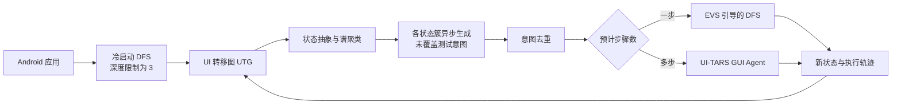

# GraphDroid：用历史状态簇和混合执行提高移动 GUI 测试覆盖率

## 一页读懂

| 问题 | GraphDroid 的回答 |
|---|---|
| 旧方法哪里不够 | 传统遍历缺少功能语义，难以完成多步功能；纯 LLM 方法只保留近期页面细节、同步等待模型生成意图，而且每一步都调用模型，历史利用不足、速度慢、成本高。 |
| 本文新增什么 | 将完整 GUI 历史组织成若干状态簇，从每个簇异步生成尚未覆盖的测试意图；按预计步骤数区分简单与复杂意图，分别交给启发式遍历和 GUI Agent 执行。 |
| 输入与输出 | 输入是运行中的 Android 应用、页面截图、控件树和执行过程中形成的 UI 转移图；输出是扩展后的 UI 转移图、覆盖结果、执行轨迹以及运行期间暴露的异常。 |
| 怎样验证 | 41 个真实 Android 应用，6 个基线，每个工具对每个应用运行 2 小时并重复 3 次；另用 Themis 的 52 个可复现 crash 检查缺陷触发能力。 |
| 证据能说明什么 | GraphDroid 在该实验设置下提高了页面、Activity 和方法级代码覆盖，并以远低于纯 LLM 基线的费用完成更多复杂流程；它没有提供独立的业务或显示缺陷 oracle。 |

## 一段话介绍

GraphDroid 研究的是移动 GUI 测试中的**测试生成与探索效率**：怎样在有限时间和模型费用下覆盖需要多步操作才能完成的应用功能。它先用深度优先遍历建立 UI 转移图，再把视觉或结构相似、导航关系紧密的历史页面聚成若干状态簇。大语言模型可以离开当前页面、根据每个状态簇中的截图和转移记录异步生成尚未覆盖的测试意图；与此同时，传统遍历继续运行，不必等待模型。系统将预计只需一步的简单意图交给覆盖导向的启发式遍历，将多步复杂意图交给 UI-TARS GUI Agent。作者在 41 个 Android 应用上报告 36.94% Activity 覆盖、20.83% 方法级代码覆盖和平均 73.5 个抽象页面状态，并触发 19 个可复现问题。论文证明了“历史组织、异步生成、混合执行”能够改善 GUI 探索，但缺陷终点仍主要是 crash、运行日志和人工复核。

## 关键术语与阅读前提

- **UI state（界面状态）**：应用在某一时刻呈现的页面状态。一个 Android [Activity](../glossary.md#activity) 可以包含多个界面状态，不能把 Activity 数量等同于完整页面状态数量。
- **UTG（UI Transition Graph，界面转移图）**：以界面状态为节点、以点击或输入等操作造成的转移为边的图。它记录“从哪个页面执行什么动作到达哪个页面”，属于 [GUI 状态图](../glossary.md#state-graphs)。
- **Test intent（测试意图）**：描述需要触发的功能目标，例如“创建一个红色日程”，而不是已经写好的逐步脚本。GraphDroid 还为每条意图记录起始状态和预计操作步数。
- **State abstraction（状态抽象）**：将足够相似的截图或控件树归并为同一个抽象状态，以减小状态空间。抽象过细会产生大量近似页面，过粗则可能把有意义的差异合并掉。
- **Cluster-based memory（基于状态簇的记忆）**：不把全部历史压成一段文字，也不把整张大图一次交给模型，而是将相互关联的历史状态分组，每次向模型提供一个组内的完整截图与转移信息。
- **Spectral clustering（谱聚类）**：根据节点之间的连接强度划分图。本文的连接强度同时考虑页面相似度和 UTG 中是否存在直接转移。
- **DFS（Depth-First Search，深度优先搜索）**：优先沿当前路径继续访问未操作控件的遍历策略。GraphDroid 用它完成冷启动和简单意图探索。
- **EVS（Exploration Value Score，探索价值分数）**：GraphDroid 为状态计算的优先级，估计该状态仍有多少简单意图尚未被遍历触发。
- **Asynchronous intent generation（异步意图生成）**：模型根据历史状态簇生成意图时，应用探索仍在并行进行，不需要停在某个页面等待模型返回。
- **Hybrid intent fulfillment（混合意图执行）**：简单意图由低成本遍历处理，复杂意图由 GUI Agent 处理，以平衡覆盖能力、时间和费用。

## 动机

依据：Section 1，PDF 第 1–3 页。

许多移动应用功能需要一串彼此依赖的操作，例如先填写标题和日期、再选择颜色并保存日程。传统随机或模型驱动工具能够快速点击大量控件，却缺少功能语义，难以稳定组织这种多步序列；基于学习的方法又依赖训练轨迹，跨应用泛化有限。

LLM GUI 测试改善了语义规划，但作者认为已有纯 LLM 方法仍有三个问题：

1. **历史细节丢失**：系统通常只保留最近几步的截图和动作，较早页面被压缩成简短文字。模型因而无法重新检查旧页面中尚未覆盖的功能。
2. **生成过程阻塞探索**：意图生成与当前页面绑定，应用必须停下来等待模型回答，模型延迟直接占用测试预算。
3. **所有步骤都调用模型**：打开开关、点击单个按钮等简单功能不需要复杂推理，逐步调用 LLM 会增加成本与延迟。

GraphDroid 的研究问题不是让 Agent 自由完成任意手机任务，而是把测试预算分配给尚未覆盖的功能，并保留覆盖、轨迹和异常证据。

## 贡献

作者在 Section 1 列出三项贡献：

1. 提出意图驱动的移动 GUI 测试框架 GraphDroid，以状态簇记忆、异步意图生成和混合意图执行解决历史、延迟与成本问题。
2. 在 41 个 Android 应用和 Themis 缺陷基准上，与 6 个近期 GUI 测试工具比较覆盖、页面状态、成本与缺陷触发能力。
3. 公开源代码与评价基准，论文给出的 artifact DOI 为 `10.5281/zenodo.21512256`。

核心贡献类型是 **method**；公开代码和实验材料提高可复现性，但论文没有提出一个独立的新缺陷 oracle。

## 方法

### 1. 冷启动：先建立可用的历史图

系统从应用初始页面运行 DFS，优先操作未访问控件。冷启动阶段设置深度上限 3：当当前页面距离初始页面超过三步时便返回。其目的不是完整测试某个功能，而是尽快找到多个功能模块的入口，形成第一版 UTG。

这里采用传统遍历而没有立即调用 LLM，因为初期多数控件尚未点击，便宜的系统遍历已经能够快速扩张状态图。

### 2. 状态抽象：合并近似页面

广告、时间戳或内容流变化可能让同一功能页面产生大量近似状态。GraphDroid 同时计算：

- 控件集合之间的 Jaccard 相似度；
- 截图视觉向量之间的余弦相似度。

两者取较大值；当新状态与某个已有状态的相似度超过 0.95 时，将其映射到同一个抽象节点。取最大值意味着“控件结构相似”或“视觉外观相似”任一条件足够高都可触发合并。

### 3. 状态聚类：在完整历史与有限上下文之间折中

直接把整张 UTG 放进一个模型请求会造成上下文过大；逐页请求又会失去跨页面关系并产生重复意图。GraphDroid 用谱聚类组织历史状态，节点之间的连接权重由两部分相加：

1. 页面在视觉或控件结构上的相似度；
2. 两个状态在 UTG 中是否直接相连。

系统把超过 20 个状态的簇拆开，把只有一个状态的簇并入连接最强的邻近簇，使每簇保持 2–20 个状态。一个簇通常对应设置、通知或个人资料等相互连接的功能区域。

### 4. 异步生成测试意图

对每个状态簇，模型收到簇内所有截图和转移边。边以“源状态—操作—目标状态”表示；已经操作过的控件在截图上用红框标记。提示词要求模型依次：

1. 归纳簇内可能包含的功能模块；
2. 区分已经覆盖和仍未覆盖的功能；
3. 生成具体测试意图，并给出起始状态与预计步骤数。

各簇请求彼此独立，因此可并行调用。模型生成意图时，DFS 在设备上继续探索；生成结果来自历史记录，不要求设备停留在意图的起始页面。

### 5. 两阶段去重

不同状态簇可能生成含义相同的意图。系统先用 Sentence-BERT 的文本向量删除高度相似项，再将剩余意图和已覆盖功能交给 LLM，合并明显重复项并删除已经完成的功能。对于是否等价不明确的意图，系统选择保留，以降低误删有效目标的风险。

### 6. 简单意图：EVS 引导的低成本遍历

预计只需一步的意图被归为简单意图。系统不要求 DFS 理解“打开邮件提醒”的自然语言含义，而是把遍历导航到该意图对应的起始状态，再尝试其中尚未访问的控件。

EVS 结合三个量：某状态生成了多少简单意图、还有多少未访问控件、这一轮已回到该状态多少次。意图越多，初始优先级越高；重复访问会逐步降低分数。当当前位置的 EVS 为零时，系统从其他高分状态中抽取目标，同时偏好导航距离较短的状态。所有状态 EVS 低于 0.1 后，简单意图阶段结束。

### 7. 复杂意图：交给 GUI Agent 完成多步流程

预计需要两步及以上的意图交给 UI-TARS-1.5。GraphDroid 先沿 UTG 导航到意图起点，再允许 Agent 使用最多“预计步骤数的 3 倍”完成任务。超过预算则记为失败。

多个复杂意图之间采用带随机性的近邻选择：多数时候优先选择起点离当前位置较近的意图，少数时候随机选择，以兼顾导航成本和探索多样性。全部意图处理后，新增状态写回 UTG，系统重新聚类并进入下一轮。

### 原文案例：创建红色日程

Figure 3 中，冷启动先访问日程、日期、新建事件、个人资料和通知等页面。模型从通知状态生成四个一步意图，从新建事件页面生成“创建一个红色日程”的五步意图。

简单阶段根据 EVS 多次回到通知页面，让 DFS 依次尝试推送、邮件、其他通知和事件提醒。复杂阶段则导航到新建事件页面，由 GUI Agent 依次填写标题、设置日期、打开颜色选项、选择红色并保存。这个案例说明测试意图只描述功能目标，具体动作可能由两类执行器完成。

## 实验

### 实验设置

- **应用**：41 个真实 Android 应用，来自 LLMDroid 基准 12 个、LLMExplorer 基准 19 个，以及 Google Play 十个类别各随机选择的一个 Top-30 商业应用。
- **覆盖范围**：41 个应用均统计 Activity 覆盖和抽象页面状态；只有 29 个应用能够成功插桩，因此方法级代码覆盖只在这 29 个应用上统计。
- **基线**：无 LLM 的 DQT；纯 LLM 的 GPTDroid、VisionDroid、DroidAgent；LLM 增强传统探索的 LLMExplorer、LLMDroid。
- **模型控制**：意图生成等模块统一使用 GPT-4.1；GraphDroid 和 DroidAgent 的 GUI Agent 都使用 UI-TARS-1.5。
- **预算与重复**：每个工具在每个应用上运行 2 小时，重复 3 次；除缺陷数量外报告三次均值。缺陷结果合并三次运行并按堆栈或人工分析去重。

### RQ1：是否覆盖更多应用状态

| 工具 | Activity 覆盖 | 方法级代码覆盖 | 平均抽象状态数 |
|---|---:|---:|---:|
| LLMDroid（综合最强基线） | 28.36% | 17.19% | 48.7 |
| GraphDroid | **36.94%** | **20.83%** | **73.5** |

相对 LLMDroid，GraphDroid 的三项相对提升分别为 30.3%、21.2% 和 50.9%；相对纯 LLM 基线 DroidAgent，分别提升 49.7%、36.4% 和 87.5%。这些是相对增幅，不能读成百分点差。

作者还在 0.75–0.95 的不同状态合并阈值下重复统计，GraphDroid 的抽象状态数始终最高。六个应用的延长实验显示，在 10 小时预算下，LLMDroid 仍无法完成 Quora 的完整提问流程，而 GraphDroid 能进入提交后编辑或删除问题的后续页面。这支持了论文关于多步功能的主张，但案例仍只代表被检查的应用与流程。

### RQ2：能够触发哪些缺陷

在 41 个应用的主实验中，GraphDroid 暴露 19 个可复现问题：

- 13 个 crashing bugs；
- 6 个 non-crashing bugs；
- 其中 7 个此前未知并提交给开发者；论文投稿时 4 个已经确认并修复。

19 个不是 19 个全部自动判定的业务缺陷。crash 来自 logcat 和等价堆栈去重；六个非崩溃问题是研究者人工检查目标进程的非致命异常/错误日志、操作序列和截图后识别的。因此，这项实验主要证明探索能触发异常状态，没有证明 GraphDroid 已经自动解决非崩溃 oracle。

在 Themis 的 52 个可复现 crash 上，GraphDroid 触发 13 个，高于其余六个工具。主实验中只有 GraphDroid 发现的四个问题往往需要先按特定顺序建立前置条件，例如依次填写三个合法字段后再点击选项按钮。

### RQ3：意图从哪里来、能否完成

- 每个应用平均生成 381 个意图；去掉 37.9% 的重复项或已覆盖功能后，平均保留 237 个。
- 只有 17.7% 的意图来自最近五步访问的状态，82.3% 来自更早历史，支持保留详细历史的设计。
- 59.3% 预计为一步，31.9% 为两步，8.8% 为三步及以上。作者随机抽查 400 条，一步/多步分类与人工判断全部一致。
- 意图执行首次到达 49.2% 的全部页面状态和 30.2% 的 Activity；一步意图贡献 39.4% 的总代码覆盖，多步意图贡献 23.6%。
- 完成率只在 Renpho Health 一个应用上人工检查：159 个有效一步意图完成 131 个（82.4%）；99 个有效多步意图完成 72 个（72.7%）。原本 101 个多步意图中有 2 个指向不存在的功能，被排除在分母外。

去重实验也显示其保守性：三个应用生成 906 个意图，正确删除 208 个重复或已覆盖意图，但保留结果中仍有 235 个重复项。系统降低了误删风险，也付出了重复执行成本。

### RQ4：时间和模型费用

GraphDroid 平均每个动作需要 5.33 秒，每个应用的模型调用费用为 1.41 美元。纯 LLM 基线 DroidAgent 为 16.59 秒/动作、11.97 美元/应用。GraphDroid 的费用略高于 LLMDroid 的 0.75 美元/应用，但作者的长时案例表明 LLMDroid 即使获得更多时间仍可能无法完成某些复杂流程。

这些费用只对应论文使用的模型、定价和调用配置，不能直接当作其他时间或部署环境的固定成本。

### RQ5–RQ6：参数、模型与消融

作者在六个应用上改变复杂意图选择参数和 EVS 停止阈值；在其识别的稳定范围内，覆盖与状态数变化低于 10%。将生成模型替换为 Qwen3-VL-Plus影响较小，将 UI-TARS 替换为 GPT-4.1 后下降更明显，但两个变体仍高于表中具有完整指标的基线。

六个消融变体分别移除状态簇记忆、簇划分、跨状态上下文、异步生成、简单执行或复杂执行，三项覆盖指标均下降。其中：

- 整张 UTG 一次输入模型时，平均意图数从 238 降至 104；
- 逐状态独立请求会产生 400 多个额外重复意图，并使成本从 1.41 美元升至 3.55 美元；
- 同步生成将每动作时间从 5.33 秒提高到 8.21 秒；
- 只用 GUI Agent 或只用 DFS 都比混合执行覆盖更低。

这组实验分别支持了“需要适当历史粒度”“生成应与探索并行”和“简单/复杂意图应采用不同执行器”三项设计主张。

## 局限

### 作者在 Section 4 讨论的有效性威胁

- 41 个应用不能代表全部 Android 应用；作者通过两个旧基准和十个高下载量商业应用增加多样性。
- 结果可能受 LLM 与 GUI Agent 选择影响；作者替换生成模型和执行模型进行了小规模稳健性实验。
- 非崩溃问题与意图分析包含人工判断；三名具有三年以上经验的开发/测试人员交叉核对并报告共识。
- LLM 存在随机性；作者将实验重复三次，但缺陷统计采用三次运行的去重并集，和其他指标的三次均值口径不同。

### 我们根据方法和实验观察到的问题

1. **缺少独立的非崩溃 oracle**：系统主要扩大探索；六个非崩溃问题依靠研究者结合日志、截图和轨迹人工识别，不能自动判断业务结果或显示质量。
2. **代码覆盖只覆盖部分应用**：12 个商业或难插桩应用没有方法级代码覆盖，因此总体比较需要同时看 Activity 和状态指标。
3. **商业应用的绝对覆盖仍低**：在十个 Google Play 应用上，GraphDroid 的平均 Activity 覆盖为 10.01%。相对提升明显，不表示这些应用的大部分功能已被测试。
4. **复杂意图完成率证据范围有限**：72.7% 的多步完成率来自一个应用的案例研究；其余应用没有逐意图人工真值。
5. **历史压缩可能隐藏细微状态**：状态相似度对 DOM 与视觉相似度取最大值并以 0.95 合并。如果页面结构近似但存在细小显示差异，或截图近似但内部数据状态不同，可能被归为同一节点。论文评价关注探索覆盖，没有测这种合并对 UX 或业务缺陷的影响。
6. **意图不是断言**：生成“创建红色日程”只规定要做什么，论文没有自动验证保存后的标题、日期和颜色是否全部正确。

## 和我们课题的关系

### 与 UX testing 的关系

GraphDroid 可以为 UX-Agent 的页面探索部分提供结构性参考。当前 UX 检测只有到达某个页面后才能分析文字截断、遮挡、重叠或溢出；基于完整历史状态簇重新发现未覆盖功能，有机会让检测器访问更多深层页面。简单页面入口可由低成本遍历扩张，只有需要表单填写或复杂前置条件的流程才调用 GUI Agent，也有助于控制测试费用。

它不能直接替代 UX 缺陷判定。GraphDroid 不检查视觉布局是否正确，而且其状态抽象可能把仅有细微视觉差异的页面合并。若未来将该探索策略与 UX-Agent 结合，需要保证主动滑动验证及页面恢复不会与异步探索同时修改设备状态，并单独评价“新增页面覆盖是否确实带来更多真实 UX 缺陷”。这些属于待验证的组合假设，原论文没有实验。

### 与 GUI testing 的关系

GraphDroid 是 2026 年 LLM 辅助 GUI 测试生成与探索方向的代表工作。它把 GPTDroid 一类逐步决策改造成“历史状态组织—未覆盖意图生成—分级执行”的循环，并用覆盖、复杂流程案例、成本与消融说明各模块的作用。

这篇论文也进一步明确探索与 oracle 的边界：测试意图帮助系统决定去哪里、做什么，覆盖反馈说明执行进入了哪些代码和页面；它们都不能单独证明功能结果正确。后续研究若要从高覆盖走向高缺陷检出率，需要把需求、性质、差分关系或显示规则接到已生成的意图和轨迹上。

## 原文摘要关键句（节选）

> “covering complex functionalities ... still remains challenging”
> — Abstract，作者预印本 PDF 第 1 页。

这句话限定了论文的核心问题：重点不是普通单击事件，而是需要多步依赖操作才能覆盖的复杂功能。

## 原文摘录

> “Only 17.7% ... within the most recent five exploration steps”
> — Section 3.4，作者预印本 PDF 第 9 页。

该结果是状态簇记忆最直接的实验依据：多数生成意图依赖较早访问的页面，而不是最近上下文。

> “every ablation degrades performance”
> — Section 3.7，作者预印本 PDF 第 10 页。

这句话概括消融结果，但“性能下降”仍指覆盖、状态数、时间或费用等实验指标，不代表每个组件都提高了独立缺陷判定准确率。

## 所读版本与核对范围

- 全文来源：作者创建的 13 页预印本，arXiv `2609.10031v1`，2026-09-09；PDF 首页明确链接正式 DOI `10.1145/3832783.3837449`。
- 正式身份已对照 ASE 2026 官方 Research Papers 页面，论文题目、作者、摘要、场合和 DOI 一致。
- 已逐页读取 Abstract、Sections 1–7、Tables 1–7、Figures 1–6 与参考文献；关键表格数字按 PDF 原表核对。
- 未运行公开代码，未复现 2 小时×3 次实验，未逐一核验开发者 issue；`status` 因此为 `extracted`，不是合作者已经复核的 `checked`。

## 书目与分类（记录用）

展开标题、作者、版本和标签

- title: GraphDroid: Asynchronous LLM-Based Mobile App GUI Testing via History-Aware Exploration and Hybrid Intent Fulfillment
- authors: Xiaolei Li; Jialun Cao; Zhijian Hou; Yuzhi Zhao; Yepang Liu; Shing-Chi Cheung
- year: 2026
- era: llm
- venue: ASE 2026 Research Papers
- venue_type: conference
- url: https://doi.org/10.1145/3832783.3837449
- pdf_url: https://arxiv.org/pdf/2609.10031v1
- version: arXiv v1, 2026-09-09；正式场合与 DOI 已核实
- code_url: https://doi.org/10.5281/zenodo.21512256
- institution: The Hong Kong University of Science and Technology; Southern University of Science and Technology; Guangzhou HKUST Fok Ying Tung Research Institute; City University of Hong Kong
- aka:
- door: gui
- question: generate, adequacy, execute
- contribution_type: method
- platform: android
- method: hybrid, llm-prompt, search
- oracle_type: crash, human
- bug_type: crash, functional
- benchmark: 41-app evaluation set; Themis 52 reproducible crashes
- baselines: DQT; GPTDroid; VisionDroid; DroidAgent; LLMExplorer; LLMDroid
- headline_result: 36.94% Activity coverage、20.83% method coverage、73.5 abstract states；19 个可复现问题；Themis 52 个 crash 中触发 13 个
- one_liner: 将历史 UI 转移图按功能相关状态聚类，异步生成未覆盖测试意图，并用传统遍历与 GUI Agent 分别执行简单和复杂意图。
- use_in_survey: 2026 年 LLM GUI 测试生成主线；说明长期历史、异步调用和混合执行怎样同时影响覆盖、延迟与成本，并作为“探索不等于 oracle”的新证据。
- concepts: GUI exploration; UI transition graph; state abstraction; cluster-based memory; test intent; asynchronous generation; hybrid fulfillment; coverage
- priority: must
- read_depth: full
- owner: Codex
- status: extracted

