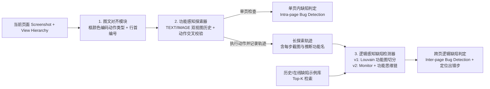

# VisionDroid / Trident：用多模态模型与功能序列切分检测非崩溃功能缺陷

**本文先讲清楚它怎样从“只测崩溃”走向“检测非崩溃功能与显示缺陷”，再保留 arXiv v1（VisionDroid）与 v2（Trident）两个版本的原文数字、方法变化和版本疑点。** 不认识的英文词可查 [术语表](../field.md#gui-terms)；非崩溃功能缺陷见 [functional-bug](../field.md#functional-bug)，显示缺陷见 [display-bug](../field.md#display-bug)，模型当判定器见 [llm-judge](../field.md#llm-judge)。

## 一段话介绍

自动 GUI 测试长期受限于缺乏测试预言（[oracle](../field.md#oracle)）：像 [GPTDroid](liu2024gptdroid.md) 这样的工具虽然能用 LLM 生成连贯操作，但实验主要靠应用异常退出（[crash](../field.md#crash-bug)）来发现缺陷。然而大量真实错误并不会崩溃——例如记账应用里新增一笔收入后总金额没变、删除一条预算后所有历史支出全被清空，或者页面控件重叠遮挡。这篇工作（v1 名为 **VisionDroid**，v2 改题并更名为 **Trident**）将非崩溃缺陷检测建模为多模态问答：先将控件树文本与带框截图对齐辅助探索，再按“功能语义”把长测试轨迹切分成局部连贯的子序列（v1 用 Louvain 社区发现，v2 改为 Monitor 触发与功能感知思维链），交由多模态大模型（MLLM）结合检索到的历史缺陷示例判断页面状态变化是否违背处理逻辑。作者在三组非崩溃缺陷数据集（Odin/RegDroid 基线集、GitHub 真实缺陷集、人工注入缺陷集）及 Google Play 应用上评价了覆盖率、误报/漏报（Precision/Recall）与新缺陷发现能力。

## 关键术语与阅读前提

- **[Non-crash functional bug](../field.md#functional-bug)（非崩溃功能缺陷）**：应用未发生闪退或异常终止，但界面行为或结果违背功能预期。作者将其分为单页内缺陷（**intra-page bugs**，如页面加载失败、控件遮挡重叠、内容缺失、无操作反馈，多与 [display-bug](../field.md#display-bug) 交集）与跨页缺陷（**inter-page bugs**，如增删改数据失败、媒体控制无响应、数值计算错误、设置未生效、跳转链接错误）。
- **Text-Image Alignment（图文对齐提示）**：在截图上按控件可操作类型绘制不同颜色的边界框（[bounding box](../field.md#grounding)）与行首编号，同时提取 [view hierarchy](../field.md#view-hierarchy) 中的文本和属性；要求模型输出动作时同时给出截图编号与控件文本，不一致则触发重试反馈。
- **Sequence Segmentation / Monitor（测试序列切分与触发）**：一次探索可能走过几十步，把全部截图一次性塞给模型既超上下文又引入噪声。v1 用图上的 **Louvain 社区发现算法**（基于相邻步功能名分词余弦相似度的模块度优化）把长轨迹切成同一业务功能的子序列；v2 改为由 **Monitor** 角色监控探索并在功能切换或关键节点触发检测 Agent。
- **[Precision / Recall](../field.md#metrics)（精确率与召回率）**：对于非崩溃 oracle，不能只数“报了多少个 bug”（`Rep`），必须分开看：系统报告的缺陷中有多少是真缺陷（`Bug / Rep = Precision`，衡量误报控制），以及数据集中已知的真缺陷被检出了多少（`Bug / 真值总数 = Recall`，衡量漏报控制）。

## 动机

依据：v1 Section I–II（第 1–3 页）；v2 Section I（第 1–2 页）。

作者在引言与先导研究（Motivational Study，v1 §II）中指出：现有自动 GUI 测试缺乏通用 [oracle](../field.md#oracle)，大多只能依赖明显的异常信号测 [crash](../field.md#crash-bug)。为了说明非崩溃缺陷的普遍性与形态，作者从 Google Play 下载量超 1K、有公开 issue 且维护超 3 年的 3,128 个开源 Android 应用（共 57,326 条报告）中，随机抽样了来自 **576 个应用的 6,000 条含截图/GIF 的缺陷报告**：

- 其中 **4,856 条（81%）** 为功能相关缺陷；在这 4,856 条中，**1,796 条（37%）是 crash**，而 **3,060 条（63%）是非崩溃功能缺陷**。
- 两位有 3 年以上经验的研究者对这 3,060 条非崩溃缺陷做开放编码（分歧由第三人裁决），归纳为 **2 大类、9 小类**（v1 Figure 2，第 3 页）：
  1. **单页内缺陷（Intra-page bugs，占 45%）**：页面加载失败（15%）、控件遮挡/重叠（12%）、内容缺失（11%）、反馈未显示（7%）。
  2. **跨页缺陷（Inter-page bugs，占 55%）**：数据增删改操作失败（14%）、媒体控制无响应（12%）、数值计算错误（11%）、设置与配置失效（10%）、导航与链接错误（8%）。

原文给出的真实案例（v1 Figure 1，第 1 页）：某记账应用中，子图 1 的总收入显示为 `5,030`，但与下方明细记录加总不符（单页数值错误）；子图 1–4 连续执行“新增一笔收支记录”后返回总览页，记录条数仍停留在 4 条而未变成应有的 5 条（跨页数据操作失败）。

作者提出三个核心挑战（v1 §I，第 2 页）：

1. **视觉与结构信息如何对齐**：单靠原始截图很难准确锁定可操作控件与上下文，如何把控件树文本与图像对齐成多模态提示？
2. **如何到达触发缺陷的深层页面**：许多非崩溃缺陷需要先完成前置业务操作才能显现，如何引导功能导向的深度探索？
3. **如何在缺少显式规格时做逻辑判定**：MLLM 缺乏被测应用的具体领域知识，面对长而嘈杂的探索历史，如何切分出逻辑连贯的操作序列并提供参考依据，让模型判断页面变化是否合理？

## 贡献

对应 v1 Section I 末尾（第 2 页）与 v2 Section I（第 2 页），归纳如下：

1. **实证分类**：对 576 个开源 Android 应用的 3,060 条非崩溃功能缺陷进行实证分类，梳理出单页（45%）与跨页（55%）共 9 类视觉/逻辑表现模式。
2. **多模态探索与判定框架（VisionDroid / Trident）**：将非崩溃功能缺陷检测建模为多模态交互问答任务，结合图文对齐提示、功能感知探索器与基于逻辑切分的缺陷检测器。
3. **跨基线与真实应用验证**：在三组非崩溃缺陷数据集（含人工注入缺陷集以规避预训练数据泄露）及 Google Play 应用上评估覆盖率、Precision/Recall，并向开发者提交新发现的非崩溃缺陷。

分类标签上，本篇同时解决“怎样走深”（`generate`）与“怎样在无 crash 时判错”（`oracle`），且核心突破在于非崩溃判定器，因此 `question` 标为 `oracle generate`；包含先导实证分类与完整检测方法，因此 `contribution_type` 标为 `method empirical`。

## 方法

依据：v1 Section III（第 3–7 页，Figures 3–8）；v2 Section II（第 2–6 页）。

整体工作流由三个阶段串联：

图按原文 Section III 流程绘制，用于说明模块关系。下面按模板五个问题拆解：

1. **输入是什么、怎样表示？**
   - 从 `AndroidManifest.xml` 提取应用名与全部 [Activity](../field.md#activity) 名称；
   - 运行时通过 [UIAutomator](../field.md#execution-tools) 获取当前页面的 [view hierarchy](../field.md#view-hierarchy)（提取 `text`、`hint-text`、`resource-id`、`class`、`clickable`、`long-clickable`、`checkable`、`scroll`、`bounds` 九类属性）以及当前屏幕截图（[screenshot](../field.md#image)）。
2. **中间模块怎样处理，模型具体收到什么？**
   - 图文对齐模块在截图上用不同颜色框标出可操作控件并编号；
   - 探索历史维护 **TEXT 视图**（已测功能名及访问次数）和 **IMAGE 视图**（带操作标记与功能 ID 的最近截图）；
   - 检测阶段不把整条长轨迹直接丢给模型，而是先切分成同一业务功能的子序列（2–4 步或相邻相关功能），再检索相似 Activity 的历史 bug 样本作为 few-shot 上下文。
3. **动作怎样选择、由谁执行、失败如何反馈？**
   - 探索器让 MLLM（`gpt-4` 视觉接口）输出操作命令（5 类动作：`click`、`input`、`long-click`、`check`、`scroll`），同时要求返回**截图上的控件编号**与**对应的控件文本**；
   - 若编号与文本无法对齐，系统判定为模型幻觉或定位偏差，通过 `testing feedback` 提示让模型重新选择，校验通过后由 [ADB](../field.md#execution-tools) 执行。
4. **判定依据来自哪里、哪些观察能支持 bug 报告？**
   - 本篇没有人工编写的软件需求规格说明书（SRS），判定依据来自 **MLLM 对页面元素视觉状态与跨页业务逻辑一致性的常识/语义推理**（即 [llm-judge](../field.md#llm-judge)），辅以检索到的真实缺陷示例；
   - 单页观察（如遮挡、加载白屏）在探索过程中直接询问；跨页观察通过对比子序列前后截图的界面信息变化（例如删除某项后列表数据是否异常清空、新增记录后总数是否对应变化）来报告缺陷及具体出错步骤。
5. **何时停止，最终产物是什么？**
   - 实验固定每应用 **50 分钟**预算；产物包括探索轨迹、触发的疑似缺陷报告（含操作子序列截图、出错步编号与原因描述）。

## 核心技术详解

### 1. 图文对齐与交叉校验（Text-Image Alignment，v1 §III-A，第 3–4 页）

如果只给原始截图，MLLM 容易看错控件边界或漏掉不可见属性；如果只给控件树文本（如 GPTDroid），模型又看不到真实渲染出的重叠与遮挡。作者的对齐规则如下：

- **颜色编码可操作类型**：根据控件属性中的 `bounds` 在截图上画框——红色表示可点击（`clickable=true`），蓝色表示文本输入框（`class=EditText`），紫色表示长按（`long-clickable`），粉色表示可勾选（`checkable`），黄色表示可滚动（`scroll`）。
- **行首编号压缩标记**：按从上到下、从左到右给控件从 `1` 开始编号；为了防止密集编号遮挡画面，**同一水平行只标出第一个控件的数字编号**，让 MLLM 自行推算同行后续控件编号。
- **双字段一致性校验（防错反馈）**：受限于输入长度，作者没有把冗长的编号-文本映射表塞进视觉上下文提示，而是在动作输出模板中要求模型同时输出 `widget id`（截图编号）和 `widget text`（控件文本）。系统在后台核对二者是否指向同一控件：若不一致，触发 `testing feedback` 提示重试。
  - *原文编校细节留存*：v1 第 5 页正文第 1 段末尾保留了一句作者未删干净的内部批注：`“widget number” is not accurate, better to use “widget id”, and revise them in other places and the figures.` 阅读时需知图中的 `widget number` 与正文的 `widget id` 指同一概念。

### 2. 双视图功能感知探索（Function-aware Explorer，v1 §III-B，第 4–5 页）

为了到达深层业务页面，系统在每步询问动作的同时，通过 `function inquiry` 提示让 MLLM 概括当前正在测试的功能名称（如 `edit expense`、`delete a budget`）及是否完成，并存入双视图历史库（v1 Figure 5）：

- **TEXT 视图（高层目录）**：记录已探索过的功能名称列表及其访问计数，放进每轮提示的 `explored functions` 字段，避免在已测功能上反复打转。
- **IMAGE 视图（细粒度动作快照）**：保存带操作高亮框的截图序列，每张截图绑定推断出的功能名与唯一子步骤 ID（如 `Delete a budget-1`、`Delete a budget-2`）。每轮探索提示只附带**最近 4 张截图**（`legend of recently tested screenshots`），控制视觉 token 开销。

### 3. 逻辑感知缺陷检测器：从 Louvain 图切分（v1）到 Monitor + 功能思维链（v2）

这是本篇与 GPTDroid 最核心的区别，也是 v1 到 v2 改动最大的模块：

- **v1 的设计（Louvain 社区发现切分，§III-C，第 6 页）**：
  - 探索推断出的功能名粒度较细（通常 2–3 步），而一个完整业务闭环往往跨多个连续子功能（例如 `edit expense` → `delete a budget` → `check budget`）。如果把几百步探索历史直接发给 MLLM，不仅超出窗口，还会被无关跳转（如中途点进 `Setting`）干扰。
  - 作者将探索历史建成一张**有向加权图**：节点是 IMAGE 视图中的每个页面截图，有向边是页面转移，边权 \(A_{ij}\) 是两个节点关联功能名分词后的余弦相似度（完全无关的功能如 `Check budget-2` 到 `Setting-1` 权重为 0）。
  - 随后用 **Louvain 算法**最大化模块度 \(Q = \frac{1}{2m}\sum_{ij}\left[A_{ij}-\frac{1}{2m}\right]\delta(c_i,c_j)\)（注：原文第 6 页公式 (1) 将标准模块度中的 \(\frac{k_i k_j}{2m}\) 印成了 \(\frac{1}{2m}\)，此处按原文记录），将长轨迹切分成内部功能高度相关的子序列图册，再把子序列截图拼接发给 MLLM 询问是否存在逻辑或显示缺陷，并定位出错步。
  - *原文案例（Figure 7，第 6 页 & §V-A，第 8 页）*：在预算页面删除单条支出记录后，切回支出列表页检查时，发现原本的多条支出记录全部消失（跨页数据操作缺陷）。
- **v2 的变化（Monitor 角色 + 功能感知 CoT，v2 §II-B/C，第 4–6 页）**：
  - v2 将系统重命名为 **Trident**，显式拆成三个协作角色：**Explorer Agent**（探索）、**Monitor**（监控探索进度、压缩历史并在适当时机触发检测）和 **Detector Agent**（判定缺陷）。
  - 检测提示升级为 **Functionality-aware Chain-of-Thought（功能感知思维链）**：先让模型根据当前子序列显式推断“该功能预期的测试预言（test oracle）应该是什么”，再对照预期检查实际截图序列是否有 bug。v2 还补充说明单次 API 调用约消耗 `2,000 to 3,000 tokens`。

### 4. 缺陷示例检索增强（In-context Examples，v1 §III-D，第 6–7 页）

为了让 MLLM 了解 Android 应用常见的非崩溃 bug 长什么样，作者从先导研究和运行记录中整理了 **200 个真实缺陷样本**（100 个单页内、100 个跨页），每条包含缺陷描述、缺陷截图和自然语言复现路径。检测时，用 Word2Vec 计算当前被测 Activity 名称与示例库中 Activity 的余弦相似度，检索 **Top-K（默认 \(K=5\)，实验发现 4 个示例时效果最好，超过 4 个反而因信息过载下降，见 Figure 9）** 注入检测 Prompt。

## 实验

依据：v1 Section IV–V（第 7–10 页，Tables I–III）；v2 Section III–V（第 6–10 页，Tables I–IV）。

### 1. 数据集：三组已知缺陷集 + 一组真实应用集

作者特意区分了三组有 Ground Truth 的非崩溃缺陷集，其中第 3 组专门用于回答“MLLM 是不是因为背过了 GitHub 开源仓库的歷史 issue 才检出 bug”（数据泄露疑虑）：

| 数据集名称 | v1 规模与来源 | v2 规模变化 | 评测目的 |
|---|---|---|---|
| **Baseline Dataset** | 来自 Odin 与 RegDroid 论文的 **131 个**可在作者环境复现的非崩溃功能缺陷 | 同 v1（**131 个**，注明覆盖 5 类缺陷） | 在前人公开非崩溃基准上横向对比 |
| **GitHub Dataset** | 从 Google Play 10 个类别每类取前 30 热门且 2024 年 5 月后有更新的 218 个应用，按模拟器可运行、全基线可跑、非崩溃可复现、且**不与先导研究/示例库重叠**过滤后，得 **43 个应用、247 个非崩溃缺陷** | 扩充至 13 个类别每类前 50 应用，过滤后得 **83 个应用、387 个非崩溃缺陷**（覆盖全部 9 类） | 评估在较新、种类更全的真实非崩溃 bug 上的表现 |
| **Bug Injection Dataset** | 取 GitHub 集重打包后仍能正常运行的 **27 个应用**，按先导研究总结的 9 类缺陷根因人工注入代码缺陷（每类 5 个），共 **45 个注入缺陷** | 扩充至 **33 个应用、72 个注入缺陷**（v2 三组总计 590 个已知缺陷） | **防数据泄露验证**：注入缺陷从未出现在互联网上，检验模型真实推理能力 |
| **Real-world (RQ3)** | **105 个**热门 Google Play 应用，向开发者提交新发现缺陷 | 扩充至 **187 个**应用 | 验证真实世界的未知缺陷发现价值 |

*原文排版小瑕疵记录*：v1 第 7 页右栏 GitHub 数据集过滤条件编号从 `(1)(2)(3)(4)` 直接跳到了 `(6)`，漏印了 `(5)`。

### 2. 比较基线、环境与指标

- **环境与预算**：Ubuntu 18.04（64 核 AMD CPU，原文印为 `2GB RAM`）、Android 7.1 模拟器；需登录的应用预先配置独立账号与登录脚本，每次运行前重置账号数据；**每工具每应用运行 50 分钟，重复 3 次取平均值（average）**（注：不同于 GPTDroid 的 3 次取最高）。
- **比较基线（v1 共 10 个缺陷检测器 + 4 个探索器组合 + 原生 GPT-4）**：
  - **4 个单页显示缺陷检测器**：`OwlEyes`、`NightHawk`、`DiffDroid`、`dVermin`。因为它们自身不负责探索，作者将它们分别与 **4 个探索器**组合：`APE (+A)`、`Fastbot (+F)`、`Humanoid (+H)`、`GPTDroid (+G)`，形成 16 行组合基线。
  - **6 个跨页/逻辑缺陷检测工具**：`iFixdataloss`、`SetDroid`、`Genie`、`Odin`、`Android Lint`、`LiveDroid`。
  - **模型基线**：直接使用原生 `GPT-4`（v2 额外增加了 `Monkey (+M)` 组合与多模态 Agent 基线 `AppAgent`）。
- **评价指标**：
  - 探索覆盖：平均 Activity 覆盖率（`Act`）、平均代码覆盖率（`Cod`）。
  - 缺陷检测：工具报告的总缺陷数（`Rep`）、报告中经核实的真缺陷数（`Bug`）、精确率 `P = Bug / Rep`、召回率 `R = Bug / 数据集真缺陷总数`。原文未定义或计算 F1。

### 3. 主实验结果（RQ1，v1 Table I，第 9 页）

下面摘录 v1 Table I 中 **VisionDroid** 与各路线最强代表基线的对比数据：

| 方法 / 配置 | Baseline 集 (131 bugs) `Act / Cod` \| `Rep / Bug / P / R` | GitHub 集 (247 bugs) `Act / Cod` \| `Rep / Bug / P / R` | Injection 注入集 (45 bugs) `Act / Cod` \| `Rep / Bug / P / R` |
|---|---|---|---|
| **VisionDroid (v1)** | **0.57 / 0.55** \| 109 / **55 / 0.50 / 0.42** | **0.65 / 0.56** \| 177 / **127 / 0.72 / 0.51** | **0.61 / 0.59** \| 38 / **29 / 0.76 / 0.64** |
| **Trident (v2 对照)** | **0.57 / 0.55** \| 109 / **55 / 0.50 / 0.42** | **0.65 / 0.62** \| 278 / **201 / 0.72 / 0.52** *(分母 387)* | **0.61 / 0.59** \| 67 / **47 / 0.70 / 0.65** *(分母 72)* |
| `NightHawk + GPTDroid` *(最强单页+LLM探索)* | 0.47 / 0.43 \| 95 / 18 / 0.19 / 0.14 | 0.49 / 0.44 \| 110 / 69 / 0.63 / 0.28 | 0.47 / 0.41 \| 48 / 9 / 0.19 / 0.20 |
| `OwlEyes + GPTDroid` *(单页显示+LLM探索)* | 0.47 / 0.43 \| 99 / 17 / 0.17 / 0.13 | 0.49 / 0.44 \| 104 / 59 / 0.57 / 0.24 | 0.47 / 0.41 \| 77 / 8 / 0.10 / 0.18 |
| `Odin` *(最强跨页规则/蜕变基线)* | 0.33 / 0.30 \| 57 / 22 / 0.39 / 0.17 | 0.44 / 0.40 \| 58 / 29 / 0.50 / 0.12 | 0.43 / 0.39 \| 29 / 6 / 0.21 / 0.13 |
| `Genie` *(跨页独立视图属性蜕变)* | 0.32 / 0.31 \| 55 / 12 / 0.22 / 0.09 | 0.44 / 0.40 \| 61 / 22 / 0.36 / 0.09 | 0.43 / 0.39 \| 27 / 4 / 0.15 / 0.09 |
| `SetDroid` *(设置项专项非崩溃检测)* | 0.31 / 0.27 \| 22 / 8 / 0.36 / 0.06 | 0.44 / 0.40 \| 98 / 44 / 0.45 / 0.18 | 0.43 / 0.39 \| 11 / 2 / 0.18 / 0.04 |
| `Raw GPT-4` *(无本文对齐与切分模块)* | 0.39 / 0.31 \| 55 / 12 / 0.22 / 0.09 | 0.44 / 0.40 \| 61 / 22 / 0.36 / 0.09 | 0.43 / 0.39 \| 18 / 2 / 0.11 / 0.04 |
| `AppAgent` *(仅 v2 Table I 新增)* | 0.41 / 0.38 \| 47 / 6 / 0.13 / 0.05 | 0.44 / 0.43 \| 113 / 12 / 0.11 / 0.03 | 0.39 / 0.37 \| 31 / 4 / 0.13 / 0.06 |

**结果能支持什么、不能支持什么：**

- **能支持的结论**：
  1. 单纯把探索器换成 GPTDroid 并接上传统显示检测器（如 `NightHawk+G`），虽然能把覆盖率提到 0.47–0.49，但对跨页业务逻辑错误无能为力，因此总召回率（0.14–0.28）远低于同时检查单页与跨页逻辑的 VisionDroid（0.42–0.64）。
  2. 在人工注入的 45 个全新缺陷（Injection 集）上，VisionDroid 依然取得了 **0.76 的精确率和 0.64 的召回率（检出 29/45）**，说明其检测能力并非单纯靠背诵 GitHub 历史 issue。
  3. v2 加入的通用任务型 `AppAgent` 在三组数据集上召回率仅 **0.03–0.06**，直接印证了我们在 [field.md](../field.md) 中强调的区分：**能操作手机的通用 GUI Agent 不等于能发现缺陷的 GUI 测试系统**。
- **不能支持的结论**：
  1. 即使在表现最好的数据集上，VisionDroid 的 Precision 为 0.50–0.76（意味着**每报告 3 到 2 个 bug，就有约 1 个是误报**），Recall 为 0.42–0.64（仍有 **36%–58% 的已知非崩溃缺陷未检出**）。不能读成“MLLM 已经解决了非崩溃测试预言问题”。

### 4. 消融实验（RQ2，v1 Table II，第 9 页）

作者分别移除四个核心设计，观察在三个数据集上的变化（下表以 Injection 注入集与 GitHub 集为例）：

| 消融变体 | 移除了什么 | GitHub 集 `Act / Cod` \| `P / R` | Injection 集 `Act / Cod` \| `P / R` | 核心含义 |
|---|---|---|---|---|
| **VisionDroid 完整版** | 无 | 0.65 / 0.56 \| **0.72 / 0.51** | 0.61 / 0.59 \| **0.76 / 0.64** | 基准对照 |
| `w/o Alignment` | 给未标框的原始截图，无图文对齐 | 0.49 / 0.48 \| 0.56 / 0.30 | 0.47 / 0.43 \| 0.62 / 0.40 | 探索覆盖与定位同时下降，连带拉低检出数 |
| `w/o History` | 删除功能感知探索历史 | 0.47 / 0.44 \| 0.49 / 0.26 | 0.44 / 0.31 \| 0.56 / 0.33 | 探索覆盖跌幅最大（代码覆盖从 0.59 跌至 0.31），深层页面到不了 |
| `w/o Community` | 去掉 Louvain 逻辑切分，改为随机切分子序列 | 0.65 / 0.56 \| **0.26 / 0.16** | 0.61 / 0.59 \| **0.17 / 0.16** | 探索覆盖不变，但 **Precision 从 0.76 暴跌到 0.17**，证明长轨迹不按功能逻辑切分会让 MLLM 产生大量误报 |
| `w/o Example` | 去掉相似示例检索，改为随机挑选示例 | 0.65 / 0.56 \| 0.27 / 0.17 | 0.61 / 0.59 \| 0.21 / 0.18 | 不影响探索，但判定准确率大幅下降 |

*(注：v2 Table II 进一步增加了 `w/o Function COT` 消融，Injection 集上 Precision/Recall 从 0.70/0.65 跌至 0.18/0.10，说明先让模型显式写出预期 oracle 再判错至关重要。)*

### 5. 真实应用新缺陷验证（RQ3，v1 §V-C & Table III，第 10 页）与多处原文数字疑点

- **v1 正文 §V-C 的报告口径**：在 105 个热门 Google Play 应用上共发现 83 个非崩溃缺陷（涉及 53 个应用），其中 **37 个是此前从未被发现的新缺陷**（21 个单页内缺陷、16 个跨页缺陷；其中 9 个也能被 Genie 和 Odin 检出）。作者向开发者提交了这 37 个新缺陷，截至交稿有 **19 个获得确认或修复（10 个已修复 `fixed`，9 个已确认 `confirmed`）**，其余 18 个待回应（`pending`），0 个被拒绝。Table III 逐一列出了这 19 个应用的名称、类别、下载量与状态（含 5亿+ 下载量的 `MOMPA`、1亿+ 下载量的 `Calendar`/`DigiCal`/`Expensify` 等）。
- **v2 正文 §IV-C 的报告口径**：应用扩展到 187 个，发现 102 个非崩溃缺陷（涉及 74 个应用），其中 **43 个新缺陷（分布在 42 个应用）**，提交后 **31 个已修复、12 个已确认**。v2 还在 Section V（Table IV，第 10 页）新增了跨平台小规模实验：在 10 个 iOS 开源应用上报告 15 个、真缺陷 9 个（`P=0.60`），在 **10 个 HarmonyOS（鸿蒙）应用**上报告 19 个、真缺陷 13 个（表中印 `P=0.69`）。

**必须保留的原文数字不一致（核对记录，不替作者悄悄修正）：**

1. **v1 摘要/引言 vs 正文 §V-C 的新缺陷总数冲突**：v1 Abstract（第 1 页）写的是 `"identifies 29 new bugs on Google Play, of which 19 have been confirmed and fixed"`，Introduction（第 2 页）甚至误写成了 `"detects 29 new crash bugs with 19 of them being confirmed and fixed"`（把 non-crash 写成了 crash，且总数是 29）；而 Section V-C（第 10 页）正文明确写的是 **37 个新缺陷（21 单页 + 16 跨页 = 37），10 修复 + 9 确认 = 19**。
2. **v1 正文 §V-A 的提升百分比张冠李戴**：v1 第 8 页右栏写 `"achieving between 8% (0.72 vs. 0.67) and 230% (0.76 vs. 0.23) precision and between 27% (0.56 vs. 0.44) and 43% (0.59 vs. 0.41) higher"`——后半句的 `0.56 vs 0.44` 和 `0.59 vs 0.41` 实际上是上一自然段刚刚算过的 **Code Coverage（代码覆盖率）** 数字，被作者误贴到了 Recall 提升的位置；到了 Abstract 和 Introduction 里，又把这两个区间反过来印成了 `"8%-230% and 27%-43% boost in average recall and precision"`。
3. **v1 消融实验（§V-B，第 9 页）的“降幅超过 100%”算法**：作者写移除 Community 后 `"reducing the bug detection performance by 347% (0.17 vs. 0.76) precision"`。这是因为作者用 `(0.76 - 0.17) / 0.17 = 347%`（以消融后的低值为分母算相对差距），却在文字上表述为“降低了 347%”。
4. **v2 鸿蒙实验（v2 §V，第 10 页）的表文不一致**：v2 Table IV 中 HarmonyOS 一行写的是 `Report=19, Real=13, Precision=0.69`（\(13/19 \approx 0.684\)），但紧接着表格下方的正文却写成 `"the precision in Harmony OS is 0.60"`。

因此，我们在引用本篇数据时，**统一使用 Table I–III 中的原始计数与原始 P/R 小数**，不使用作者正文里算错分母或贴错行的相对百分比。

## 局限

**论文明确提及的（v1 §VII / v2 §V）：**
- 论文无论 v1 还是 v2 **均未设置专门的 Threats to Validity 或 Limitations 小节**。仅在结论与讨论中提到未来需进一步提升性能，并适配更多桌面、Web 与嵌入式系统。

**我们的观察：**
1. **误报率仍然较高（Precision 0.50–0.76）且缺乏确定性验证闭环**：模型仅凭静态截图序列与常识做 [llm-judge](../field.md#llm-judge) 推理，当遇到合理的个性化设计、动态内容或单张/少量截图无法消解的视觉歧义（例如无法仅凭静态截图区分“文字被真截断”与“可滚动容器的正常边缘”）时，纯提问式 MLLM 容易产生误报。
2. **评测真值与粒度的边界**：Table I 中的 `Rep` 和 `Bug` 没有拆开报告单页显示缺陷（Intra-page）与跨页逻辑缺陷（Inter-page）各自的 Precision 和 Recall，读者无法从表中直接看出 MLLM 到底是在“看图找重叠”上更准，还是在“跨页算账/检查增删改”上更准。
3. **运行环境与成本边界**：主实验仍在 Android 7.1 模拟器上完成；每步探索与每次子序列检测均需调用 GPT-4V（v2 披露每次调用约 2,000–3,000 tokens），50 分钟长跑的 API 费用与延迟开销未与传统轻量工具做成本-收益折算。

## 和我们课题的关系

这篇论文是我们连接 **[GPTDroid](liu2024gptdroid.md)（LLM 探索）**、**[Yu 综述](yu2025guisurvey.md)（视觉 GUI 测试全景）** 与我们自身 **多设备 UX/GUI 检测课题** 的关键桥梁：

1. **补齐 `field.md` 中 `oracle`、`functional-bug`、`display-bug`、`llm-judge` 的核心实证文献**：此前库里只有测 crash 的 GPTDroid，本篇提供了 3,060 个真实非崩溃 bug 的 9 类分类体系（单页显示 45% + 跨页功能 55%）以及 `Precision / Recall` 的完整评测范式。
2. **直接暴露“纯静态截图 + MLLM 问答做 Oracle”的痛点，引出我们的研究切入点**：
   - VisionDroid/Trident 把截图和控件树框对齐后直接问 GPT-4V“有没有 bug”，在 Baseline 集上 Precision 只有 `0.50`，且无法通过主动微操作去验证一个疑似显示/状态异常到底是真缺陷还是正常可交互状态。
   - **待核查与推进的问题假设**：针对单页显示/UX 缺陷（如多折叠态/多设备下的文本截断、遮挡）以及局部状态歧义，能否用**“视觉候选提案 + 运行时布局树（如 ArkUI/View Hierarchy）几何不变量静态复核 + 主动可逆微操作探测与原位恢复（Active Probing & Restore）”**替代纯开环的 MLLM 猜想，从而把非崩溃检测的误报率压到接近零？同时，针对跨页功能缺陷，能否将它的“功能子序列切分”与底层数据/状态断言结合？这些是我们下一步可与合作者共同深挖的方向。

## 原文摘要

见 arXiv v1 与 v2 PDF 第 1 页 Abstract 原文，此处不整段复制。阅读时注意：v1 摘要末尾写的是“29 new bugs, of which 19 have been confirmed and fixed”，须结合正文 §V-C（37 个新 bug，10 修复 + 9 确认）核对。

## 原文摘录

> Despite the progress in automated Graphical User Interface (GUI) testing, the absence of testing oracles has constrained its efficacy to identify only crash bugs with evident abnormal signals. Nonetheless, there are still a considerable number of non-crash bugs, ranging from unexpected behaviors to misalignments, often evading detection by existing techniques.
> — v1 Section I, PDF p. 1（问题定义：缺乏测试预言使现有自动化测试局限于 crash，大量从异常行为到显示错位的非崩溃缺陷逃逸）

> The pioneering work to formulate the non-crash functional bugs detection problem to an interactive multi-modal question & answering task, enabling the MLLM to identify bugs by comprehending GUI visual information and functional logic.
> — v1 Section I, PDF p. 2（作者自述核心贡献：将非崩溃功能缺陷检测建模为多模态交互问答）

> Based on them, the MLLM detects the bugs potentially by checking whether the GUI information changes between page transitions align with the processing logic.
> — v1 Section III, PDF p. 3（非崩溃 Oracle 的核心判定逻辑：检查跨页转移前后的界面信息变化是否符合处理逻辑）

> The average precision and recall of VisionDroid in three datasets achieve 50%-76%, and 42%-64%, respectively.
> — v1 Section V-A, PDF p. 8（三组数据集上的主实验 Precision 与 Recall 区间）

## 所读版本与核对范围

- **2026-10-15**：完整读取并对照了同一 arXiv 编号下的两个版本全文：
  1. **arXiv v1（`2407.03037v1`，2024-07-03，共 12 页）**：标题为 *Vision-driven Automated Mobile GUI Testing via Multimodal Large Language Model*，系统名为 **VisionDroid**。核对了 Sections I–VII 全部正文、Figures 1–9 与 Tables I–III。
  2. **arXiv v2（`2407.03037v2`，2024-12-04，共 12 页）**：标题改为 *Seeing is Believing: Vision-driven Non-crash Functional Bug Detection for Mobile Apps*，系统更名为 **Trident**，新增作者 Mengzhuo Chen，新增 AppAgent 基线与 iOS/HarmonyOS 跨平台实验（Table IV）。
- 两个版本截至核对日均未标注正式会议或期刊发表信息（v2 页眉仍为 IEEEtran 默认模板占位符 `JOURNAL OF LATEX CLASS FILES`）。未在本地运行其开源仓库代码或独立复现全部 105/187 个真实应用实验。

## 书目与分类（记录用）

展开标题、作者、版本和标签

- title: Vision-driven Automated Mobile GUI Testing via Multimodal Large Language Model (v1) / Seeing is Believing: Vision-driven Non-crash Functional Bug Detection for Mobile Apps (v2)
- authors: Zhe Liu; Cheng Li; Chunyang Chen; Junjie Wang; Boyu Wu; Yawen Wang; Jun Hu; Qing Wang (v2 新增 Mengzhuo Chen)
- year: 2024
- era: llm
- venue: arXiv preprint (cs.SE)
- venue_type: preprint
- url: https://arxiv.org/abs/2407.03037
- pdf_url: https://arxiv.org/pdf/2407.03037v1
- version: 同时核对 arXiv v1（2024-07-03，VisionDroid）与 arXiv v2（2024-12-04，改题并更名为 Trident，https://arxiv.org/pdf/2407.03037v2）；笔记以 v1 结构为主线并逐项注明 v2 的方法与数据扩展
- code_url: https://github.com/testtestA6/VisionDroid (v1) / https://github.com/testtest2024-art/Trident (v2)
- institution: Institute of Software, Chinese Academy of Sciences; University of Chinese Academy of Sciences; State Key Laboratory of Intelligent Game, Beijing
- aka: VisionDroid / Trident
- door: gui
- question: oracle generate
- contribution_type: method empirical
- platform: android
- method: llm-prompt multi-agent hybrid
- oracle_type: llm-judge
- bug_type: functional display
- benchmark: 三个非崩溃缺陷数据集——(1) Odin+RegDroid 基线集（131 bugs）；(2) GitHub 真实非崩溃集（v1: 43 apps/247 bugs；v2: 83 apps/387 bugs）；(3) 人工注入防泄露集（v1: 27 apps/45 bugs；v2: 33 apps/72 bugs）；另有 Google Play 真实应用验证（v1: 105 apps；v2: 187 apps + 10 iOS + 10 HarmonyOS）
- baselines: 单页显示检测器（OwlEyes NightHawk DiffDroid dVermin）分别组合 4–5 个探索器（APE Fastbot Humanoid GPTDroid 及 v2 的 Monkey）；跨页/静态工具（iFixdataloss SetDroid Genie Odin Android-Lint LiveDroid）；模型与 Agent 基线（Raw GPT-4，及 v2 新增的 AppAgent）
- headline_result: v1 三组数据集上 Precision 为 0.50 / 0.72 / 0.76，Recall 为 0.42 / 0.51 / 0.64（均优于最强基线 NightHawk+GPTDroid 与 Odin）；Google Play 上提交 37 个新非崩溃缺陷（摘要误作 29 个），其中 10 个已修复、9 个已确认；v2 扩充至 590 个已知缺陷（P: 0.50–0.72, R: 0.42–0.65）并在 187 个应用中发现 43 个新缺陷（31 修复、12 确认）
- one_liner: 将控件树文本与带框截图对齐驱动功能感知探索，再按功能语义切分长测试轨迹并结合历史缺陷示例，让多模态大模型检测单页显示与跨页非崩溃功能缺陷。
- use_in_survey: 从“LLM 探索测 crash（GPTDroid）”迈向“MLLM 测非崩溃功能与显示缺陷（oracle）”的核心桥梁文献；提供 9 类非崩溃缺陷实证分布与 Precision/Recall 评测基准，同时暴露纯开环视觉问答的误报局限
- concepts: oracle generate gui-exploration gui-state functional-bug display-bug llm-judge gui-grounding eval
- priority: must
- read_depth: full
- owner: ZYY0321
- status: extracted

