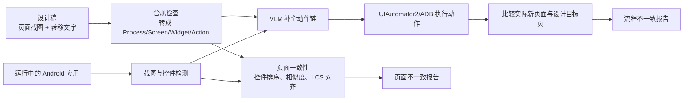

# GUIPilot：用设计稿作为规格检查移动 GUI 的页面与流程一致性

## 一页读懂

| 问题 | GUIPilot 的回答 |
|---|---|
| 旧方法哪里不够 | 许多自动 GUI 测试主要扩大探索并等待 crash；已有设计稿对比方法 GVT 只能比较单个页面，而且按局部位置匹配控件时容易错配，不能自动验证设计稿规定的跨页面流程。 |
| 本文新增什么 | 把设计稿标准化为“页面—控件—动作—流程”模型；用全局控件对齐找页面差异，再用 VLM 把抽象转移说明补成可执行动作并检查是否到达设计稿中的目标页面。 |
| 输入与输出 | 输入是带页面截图和转移说明的设计稿，以及可运行的 Android 应用；输出是缺失/多余/语义变化控件和无法按设计到达目标页面的流程不一致报告。 |
| 怎样验证 | 80 个公开应用、160 份由专家按真实应用反向制作的模拟设计稿；页面实验注入五类控件变化，流程实验在 100 份设计稿中注入转移错误；另在一个金融应用的 19 份真实设计稿上做案例研究。 |
| 证据能说明什么 | 证明“外部设计稿可同时支持显示与流程 oracle”，也证明结构化控件匹配比直接让 VLM 比两张图更稳定。公开集主要是人工注入错误，不能据此推断任意真实业务错误都能被发现。 |

## 一段话介绍

GUIPilot 研究的是 GUI 测试中的 **oracle（测试预言）来源**：当应用没有崩溃时，怎样知道实现仍然违背了产品设计。它不让模型仅凭常识猜“页面是否正常”，而是把设计师制作的高保真 mock-up（设计稿）当作外部规格。一条设计流程既规定目标页面应出现哪些控件，也用文字描述页面之间应怎样转移。GUIPilot 先用目标检测和 OCR 将设计稿截图与实际截图都转成控件集合，再通过带全局顺序约束的动态规划对齐控件；随后让 GPT-4o 根据当前截图和设计中的转移说明补齐点击、输入等动作，执行后检查是否到达预期页面。论文在公开应用的变异实验中报告较高的页面差异检测结果，并在金融应用真实设计稿中发现 8 个页面不一致实例和 1 个流程不一致实例。它说明了“需求一致性验证”在 GUI testing 中可以落成具体技术，但其可靠性取决于设计稿是否最新、是否含完整前置条件。

## 关键术语与阅读前提

- **Design mock-up（GUI 设计稿）**：用 Sketch、Axure 等工具画出的高保真页面和页面连接关系。本文把它当作 [测试规格](../glossary.md#test-spec)，而不是只当视觉参考。
- **Screen inconsistency（页面不一致）**：实现页面相对设计稿出现控件缺失、控件多余，或已匹配控件的类型、文字、颜色发生语义变化。它与一般 [display bug](../glossary.md#display-bug) 有交集，但判定基准是这一个应用自己的设计稿。
- **Process inconsistency（流程不一致）**：按照设计稿描述执行动作后，没有转到设计指定的目标页面。它检查的是页面转移，不等同于所有后台业务结果都正确。
- **Widget alignment（控件对齐）**：在设计稿与实现截图之间确定哪些控件彼此对应。本文先按从上到下、同行从左到右排序，再求累计相似度最高的匹配序列。
- **LCS（Longest Common Subsequence，最长公共子序列）**：在保持顺序的前提下寻找两组元素的最佳对应。GUIPilot 将“是否相同”换成位置、面积、形状、类型的连续相似度，用动态规划求全局匹配。
- **VLM action completion（视觉语言模型补动作）**：设计说明可能只写“买入 100 股”，没有逐步写密码、勾选协议和点击确认。VLM 根据带控件编号的截图补出可执行动作；它在本文中负责执行桥接，最终判错仍以目标页面是否匹配设计稿为准。

## 动机

依据：Section 1–2，PDF 第 2–5 页。

作者把工业移动应用流程分为设计、开发和测试三个阶段。设计稿除了规定字体、颜色、位置等页面外观，还用页面连线及文字说明规定交互流程。测试人员需要反复核对实现与设计，但会遇到三个具体困难：

1. 一个页面有几十个控件，逐项人工比较容易漏掉小图标、文字样式或布局变化。
2. 设计稿中的流程描述通常不完整。论文 Figure 1 的安装例子里，测试者必须先输入密码并勾选协议，安装按钮才可用；设计文字未必逐步写出这些隐含动作。
3. 应用频繁更新，页面比较和流程验证必须重复执行。

最接近的旧方法 GVT 只比较单页，而且主要按相对位置做局部控件匹配。论文 Figure 2 删除最后一行控件后，后续控件整体位移，GVT 错把 `Cancel` 对到 `Create`，从而同时产生误报和漏报。GUIPilot 因此把问题拆成两个 oracle：**页面内部是否与设计相同**，以及**设计规定的页面转移能否在实现中发生**。

## 贡献

对应 Section 1 第 4 页作者列出的四点：

1. 提出面向设计稿的一体化 GUI 一致性测试方法，同时报告页面不一致和流程不一致。
2. 将页面比较转成带全局布局语义的控件对齐优化问题，并将设计说明到实际操作的转换建模为受约束的 VLM 动作补全。
3. 实现并公开 GUIPilot Web 工具及代码/数据产物，供设计稿验证使用。
4. 在公开应用的变异实验和一个真实金融应用案例中评价检测效果。

核心贡献类型是 **method**。论文也提供工具 artifact，但没有建立一个被多种工具共同采用的新 benchmark；使用模拟设计稿做评价不应单独标成 benchmark 贡献。

## 方法

1. **输入与表示**：设计稿被规范化为有向流程图。节点是 screen，边是 action chain；screen 内含 widget。控件用 `<x, y, width, height, type>` 表示，类型分为 TextButton、IconButton、CombinedButton、InputBox、TextView、ImageView、Chart 七类。
2. **页面判定**：YOLOv8-m 从设计稿截图和实现截图中检测控件，OCR 提取文字。算法按纵坐标、再按横坐标形成部分顺序；任意两个控件的相似度是位置、面积、宽高比和类型相似度的乘积；动态规划寻找累计相似度最大的顺序匹配。未匹配设计控件是 missing，未匹配实现控件是 extra；匹配对的类型、文字或颜色越过阈值则是 semantic change。
3. **流程执行**：VLM 收到自然语言转移描述，以及只给可交互控件画框并编号的当前截图。输出空间限定为 `click`、`long_press`、`send_keys`、`scroll`、`swipe`、`drag_and_drop`、`go_back`。若动作后页面不变，系统把失败反馈给模型重试。
4. **流程判定**：动作链执行后，系统仍用控件对齐得到“实际新页面与设计目标页”的相似度；低于阈值 0.73 就报告 process inconsistency。这里 VLM 负责找路，设计目标页才是 oracle。
5. **停止与输出**：逐条验证设计流程的页面和边；流程转移成功则以新页面继续后续边，失败或越过相似阈值则记录不一致。最终报告具体缺失、多余、变化控件及失败的转移。

### 原文案例：抽象的“买入 100 股”怎样落到测试动作

Figure 5–6 给出金融应用设计稿：边上只写“Buy 100 shares”。GUIPilot 先在当前实现截图上标出可操作控件，让 VLM 找到数量输入框、买入按钮以及可能缺失的前置操作，生成逐步动作。执行后，如果实现进入的页面与设计稿目标页面在控件对齐上不相似，才形成流程错误报告。这个例子说明它并非让 VLM 自由探索整个应用，而是在**一条已有规格边**上补全执行细节。

## 核心技术详解

### 1. 统一截图表示：为什么设计稿和实现都走视觉检测

设计稿没有 Android 控件树，若只对实现读取 UIAutomator 结构，两边的数据表示不同。GUIPilot 对两边都运行同一个视觉控件检测器，从而统一得到位置、尺寸和类型；含文字控件再做 OCR。这让方法不依赖设计工具的内部文件格式，也带来一个直接风险：检测器漏掉控件时，下游无法对齐，论文 Figure 8 的漏报案例就是新增控件未被检测。

### 2. 全局对齐：为什么不是逐个找最近邻

GVT 为设计控件在实现中找局部近邻，插入/删除一行后容易把后面每项都错配。GUIPilot 将两边控件按阅读顺序排列，然后用类似加权 LCS 的动态规划选择一组**保持顺序且总相似度最大**的控件对。单对相似度同时考虑：

- 左上角位置及宽高；
- 面积；
- 宽高比表示的形状；
- 控件类型，相同为 1，不同按 0.5 降权。

因此某个控件缺失时，算法可以跳过它并重新对齐后续控件。代价是它隐含“多数布局主要按横向行排列”的假设；若页面结构发生大幅重排，相似形状和类型的邻近控件仍会错配，作者在 Figure 8 明确展示了这类误报与漏报。

### 3. 语义变化：位置匹配后还比较什么

- 文本类控件：字符序列相似度低于 0.95 记为文字变化。
- 图标/图像类控件：比较二值颜色空间的差异像素比例（阈值 20%）及出现最频繁的三种颜色 RGB 差异（阈值 0.05）。
- Chart：只要位置对齐便放宽内容比较，因为设计稿中的图表数据可能只是示例。

这套规则能查“文字、颜色、类型与缺失/多余”，没有完整覆盖字号、字体、边框细节、动画、动态内容正确性等所有设计属性。

### 4. 约束 VLM，而不是让 VLM直接比较两张图

直接把两张带编号截图交给 VLM 检查差异的基线表现很差：表 3 中各类变异的 precision 只有 0.045–0.123，recall 只有 0.078–0.248。GUIPilot只让 VLM做它较擅长的“结合语言说明找控件和补动作”，并通过三种约束降低幻觉：只标可交互控件、限制动作语法、提供 few-shot 输出示例。页面是否一致交给确定性的控件匹配算法。

## 实验

### RQ1：能否检测页面不一致

- **数据**：从 Google Play 的 Business、Communication、Finance、Social 四类中取 80 个应用；4 名至少有两年开发经验的专家为每个应用记录两个流程，得到 160 份模拟设计稿，平均每份约 8 个页面。
- **为什么叫模拟设计稿**：研究者无法获得这些公司的真实设计文件，是从应用实际运行页面反向记录而成；随后在设计稿页面中注入错误。
- **变异**：每页随机改变约 5% 控件（平均 1–2 个），分为缺失、额外、控件交换、文字变化、颜色变化五类。作者称这些覆盖 GVT 文献中 92% 的变异案例。
- **比较对象**：GVT，以及“直接询问 VLM 两张图有何差异”的简单基线。
- **指标**：precision 衡量报告里真差异比例；recall 衡量注入差异被找回比例；Jaccard 同时惩罚误报漏报；classification precision 检查差异类型是否分对。
- **结果**：表 3 中 GUIPilot 对 extra/missing/swap 的 precision 分别为 0.998/0.997/0.987，recall 为 0.986/0.984/0.992；文字和颜色变化与 GVT 基本相当。匹配中位时间约 0.001 秒。
- **原文数字冲突**：所读作者版 PDF 第 1 页摘要写总体 **99.8% precision / 98.6% recall**，第 4 页引言与正式会议页面写 **94.5% / 99.6%**，两组都不能从表 3 的五行直接无歧义复原。笔记保留分类型原始表值，不替作者选择一个“正确总体值”。

### RQ2：能否检测流程不一致

- 160 份设计稿中，有些应用频繁更新或阻止自动交互，最后保留 100 份。
- 每份随机选一条转移，通过两类变异制造错误：让目标回到错误页面，或把动作绑定到错误控件。
- Waydroid 上运行 Android 应用，UiAutomator2/ADB 执行；作者报告 precision 和 recall 均为 100%，转移中位时间 0.193 秒。
- 证据边界：这证明系统能识别该变异协议制造的页面转移错误。相似阈值 0.73 也用这 100 个变异样本选择，论文没有报告独立测试集上的流程泛化结果。

### RQ3：两个关键组件是否可靠

- **控件检测**：1,392 个页面按 7:3 划分训练/测试，YOLOv8-m 总体 `mAP@0.5=0.515`、`mAR@0.5=0.588`。InputBox 为 0.446/0.511，Chart 仅 0.317/0.318，是明显弱项。
- **VLM 动作补全**：100 条转移中，GPT-4o 首次成功 90 条，两次内成功 99 条；唯一失败是目标控件先被检测器漏掉，因此未进入 VLM 的可选集合。

### 工业案例：真实设计稿上发现了什么

合作方是一个拥有约 3,200 万用户的交易应用。23 份设计稿去掉过时稿后保留 19 份，GUIPilot 报告 **8 个页面不一致实例和 1 个流程不一致实例**，均获应用专家确认。页面差异细项共 20 个：3 个额外控件、9 个缺失控件、3 个文字差异、5 个颜色差异。这里“9 个不一致实例”与“20 个控件级差异”是不同计数单位，不能说成发现 20 个独立 bug；论文也没有报告这些问题是否修复。

## 局限

### 作者承认的

- 依赖 OpenAI 第三方服务，网络延迟与稳定性影响动作补全；作者提出未来蒸馏本地 VLM。（Section 5.1）
- 公开实验没有真实企业设计稿，而以真实应用截图反向制作模拟稿；推广要求设计稿符合本文元模型，并给每条转移配说明。（Threats to Validity）
- 真实案例暴露设计稿可能落后于实现，也经常漏写从首页到测试起始页的前置步骤；团队需维护设计稿并补足规格。（Section 5.1）

### 我们根据实验观察到的

- 设计稿提供了比“模型迎合当前实现”更独立的预期，但设计稿过时会反过来把合理改动报成 bug。系统需要版本对应关系，不能默认设计稿永远是真值。
- 页面和流程公开实验都以人工变异为主，且流程阈值在同一批样本上选择；尚不能从 100% 推断真实长流程同样无误报漏报。
- 流程 oracle 最终仍是“是否到达相似页面”。后台交易数值是否真的写入、跨会话持久化是否正确，需要额外业务断言。
- VLM 使用 GPT-4o，但作者版没有给出可复现的具体模型快照、temperature、调用成本和多次随机重复结果。

## 和我们课题的关系

### 与 UX testing 的关系

GUIPilot 为 UX-Agent 提供了一种外部判定依据：如果项目能够取得与当前版本对应的设计稿，就可以比较设计页面与实现页面，识别控件缺失、多余以及文字、颜色或类型变化。与单纯让模型根据常识判断界面相比，设计稿明确给出了该应用原本应当呈现的页面状态。

两项工作的判定目标并不相同。UX-Agent 当前关注文字截断、遮挡、重叠和溢出，并通过布局树与滑动操作判断候选问题能否被正常交互消解；GUIPilot 关注实现是否符合一份给定设计稿。它依赖设计稿存在、内容完整且与软件版本一致，也没有专门处理“内容被遮挡但可以通过滑动查看”这一类交互歧义。因此，GUIPilot 更适合作为可选的设计一致性预言，而不是现有 UX 检测链路的替代方案。

### 与 GUI testing 的关系

GUIPilot 是需求或设计一致性验证方向的代表工作。它将设计稿转化为独立于程序实现的测试预言，用确定性的控件检测与全局对齐算法判断页面差异，再让视觉语言模型补全设计流程中省略的执行步骤。这样的分工使模型主要承担操作生成，最终结果仍由设计目标页与实际页面的匹配关系判定。

论文同时覆盖单页页面检查和跨页面流程检查，说明 GUI testing 可以围绕“规格—动作—执行证据”建立完整链路。其适用性取决于规格质量：过时设计稿会把合理改动报告为缺陷，不完整的流程说明也会影响动作生成和结果解释。

## 原文摘要关键句（节选）

> “Given a design mock-up and the implementation of its application, GUIPilot reports both their screen inconsistencies as well as process inconsistencies.”
> — Abstract，作者版 PDF 第 1 页。

这句话限定了它的必要输入：必须有可用设计稿与应用实现，并明确输出包含页面和流程两类不一致。

## 原文摘录

> “we convert the screen matching problem to an optimizable widget alignment problem”
> — Section 1，作者版 PDF 第 3 页。

> “If the screen has no change, we will provide feedback to VLM and ask it to reflect on its previous answer.”
> — Section 3.3.1，作者版 PDF 第 11 页。

> “the design mock-up can be deprecated with respect to the current implementation”
> — Section 5.1，作者版 PDF 第 19 页。

## 所读版本与核对范围

- 全文来源：ISSTA 2025 官方会议页链接的作者公开 PDF，25 页；逐页读取 Section 1–8（含参考文献），没有用截图代替正文阅读。
- 正式元数据：ISSTA 2025 Research Papers，DOI [10.1145/3728909](https://doi.org/10.1145/3728909)。所读 PDF 仍保留匿名投稿阶段占位 DOI 与部分未统一数字，因此正式场合和作者版正文分开记录。
- 对照范围：会议官方页面用于核对作者、单位、track、正式 DOI 与官方摘要；未运行代码、未复现实验，`status` 仍为 `extracted`，不表示另一位合作者已核对。

## 书目与分类（记录用）

展开标题、作者、版本和标签

- title: GUIPilot: A Consistency-based Mobile GUI Testing Approach for Detecting Application-specific Bugs
- authors: Ruofan Liu; Xiwen Teoh; Yun Lin; Guanjie Chen; Ruofei Ren; Denys Poshyvanyk; Jin Song Dong
- year: 2025
- era: llm
- venue: ISSTA 2025 Research Papers / Proceedings of the ACM on Software Engineering
- venue_type: conference
- url: https://doi.org/10.1145/3728909
- pdf_url: http://linyun.info/publications/issta25.pdf
- version: 25-page author PDF linked by official conference page; formal DOI metadata checked
- code_url: https://anonymous.4open.science/r/guipilot-C65C
- institution: Shanghai Jiao Tong University; National University of Singapore; William & Mary
- aka: GUIPilot
- door: gui
- question: oracle execute
- contribution_type: method
- platform: android
- method: hybrid llm-prompt trained
- oracle_type: spec differential
- bug_type: display functional
- benchmark: 80 public apps / 160 simulated mock-ups; 19 industrial mock-ups
- baselines: GVT; direct VLM comparison
- headline_result: five screen-mutation categories mostly reach about 0.987–1.000 precision and 0.984–0.999 recall; 100 injected process inconsistencies reported with 100% precision/recall; 9 industrial inconsistency instances confirmed
- one_liner: 用应用设计稿提供独立预期，以全局控件对齐检查页面，以受约束 VLM 补动作后检查流程转移。
- use_in_survey: 需求/设计一致性 oracle；确定性算法与 VLM 分工；设计稿过时导致 oracle 失效
- concepts: design mock-up; widget alignment; LCS; visual prompt; screen/process inconsistency
- priority: must
- read_depth: full
- owner: codex
- status: extracted

