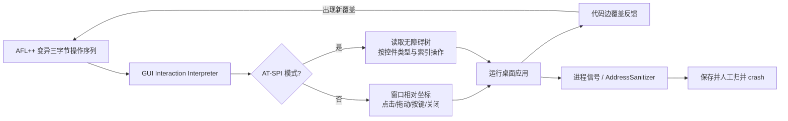

# GUIFuzz++：用代码覆盖反馈驱动桌面 GUI 事件序列模糊测试

## 一页读懂

| 问题 | GUIFuzz++ 的回答 |
|---|---|
| 旧方法哪里不够 | AFL++ 等桌面灰盒 fuzzer 只会变异文件或内存字节，不能操作 GUI；Android Monkey 等移动工具又依赖移动平台 SDK，难以直接测试 Qt/GTK/Xorg 桌面应用。 |
| 本文新增什么 | 定义三字节 GUI 指令语法，将 AFL++ 产生的字节翻译为关窗、按键、点击、拖动等操作；再利用 Linux 无障碍树 AT-SPI 精确选择按钮、输入框、菜单等元素。 |
| 输入与输出 | 输入是经 AFL++ 编译插桩的 Linux 桌面应用和一条随机种子事件序列；输出是覆盖增长后的事件语料库，以及由进程信号/AddressSanitizer 发现并可重放的 crash。 |
| 怎样验证 | 12 个 Qt/GTK/Xorg 开源桌面应用，4 种配置（灰/黑盒 × 有/无 AT-SPI），每种配置每个应用独立运行 5 次、每次 24 小时。 |
| 结论边界 | 灰盒覆盖反馈和无障碍结构能帮助复杂桌面 GUI 走到更深代码，并发现 23 个此前未知的 crash；本文没有非崩溃功能、显示或需求一致性 oracle。 |

## 一段话介绍

GUIFuzz++ 是一篇明确“读代码运行反馈”的 GUI testing 工作。它将成熟灰盒模糊测试器 AFL++ 接到桌面 GUI 上：AFL++ 仍以代码控制流边覆盖率判断某条输入是否值得保留，但输入的字节不再直接喂给文件解析器，而是由一个 GUI Interaction Interpreter 翻译成点击、拖动、按键和窗口操作。为了避免随机坐标总点在空白处，增强模式读取 Linux 的 AT-SPI 无障碍控件树，按控件类型和索引精准操作按钮、文本框、菜单、滚动区等元素。作者在 12 个真实 Linux 桌面应用上对灰盒/黑盒和有/无 AT-SPI 做 5×24 小时实验，最终人工归并出 25 个 GUI 触发错误，其中 23 个此前未知，14 个在论文统计时已经被开发者确认或修复。它解决的是“怎样让传统覆盖导向 fuzzing 真正穿过 GUI 接口”，缺陷判定仍局限于 crash 和 sanitizer 信号。

## 关键术语与阅读前提

- **[Grey-box fuzzing](../glossary.md#black-box)（灰盒模糊测试）**：大量变异测试输入，并读取轻量内部反馈（本文是代码控制流边覆盖）来决定哪些输入值得继续变异。它比纯随机黑盒多看内部执行信息，但不像完整白盒方法那样求解程序路径条件。
- **AFL++**：通用覆盖导向 fuzzer。正常情况下它变异文件字节、执行被测程序、收集代码覆盖和异常信号；本文复用其调度、覆盖、crash 收集，只改造输入如何变成 GUI 动作。
- **GUI Interaction Interpreter（GUI 交互解释器）**：本文新增的中间层，把每组三个字节解析成一条 GUI 操作并用 PyAutoGUI 执行。它使“字节变异器”和“GUI 操作接口”解耦。
- **AT-SPI（Assistive Technology Service Provider Interface）**：Linux 桌面的无障碍接口，为屏幕阅读器等工具暴露按钮、菜单、输入框及层次关系。GUIFuzz++把同类控件拉平成列表，让变异字节按索引选择真实可交互元素。
- **Instrumentation（插桩）**：在编译或运行时加入观测代码，记录哪些控制流边被执行；详见 [代码分析与执行观测](../glossary.md#program-analysis)。本文实验用 AFL++ 编译器构建开源应用。
- **[Crash oracle](../glossary.md#crash-bug)**：程序异常终止、收到 SIGSEGV/SIGFPE 等信号，或 AddressSanitizer 报告非法内存访问时判错。它清晰可自动化，却看不到“没有崩但业务结果错了”。

## 动机

依据：Section I–II，PDF 第 1–3 页。

传统 fuzzer 的输入通道与 GUI 不兼容：AFL++ 擅长把一串字节当成文件内容，libFuzzer 擅长把它当内存缓冲区，但桌面应用的缺陷可能只有在“打开菜单→选择工具→拖动画布→撤销→关窗口”这样的事件序列后才出现。移动平台有 Monkey/XCMonkey 等工具，却依赖 Android/iOS 的统一生命周期和 SDK；桌面环境同时存在 Qt、GTK、Xorg、多窗口、弹窗和鼠标键盘操作，无法直接套用。

作者列出的真实已知案例包括：LibreCAD 在右键移动/复制时段错误、KolourPaint 在新窗口连续撤销时 abort、Umbrello 取消序列图类时段错误。这些不是截图审美问题，而是 GUI 事件把后台代码带入非法生命周期或状态。

## 贡献

对应 Section I 第 2 页作者列出的四点：

1. 分析通用桌面 fuzzer、桌面环境 fuzzing 和移动 GUI fuzzer 为什么都没有覆盖通用桌面 GUI 事件接口。
2. 提出 GUIFuzz++：以交互解释器将现有 fuzzer 的字节输入映射成 GUI 动作，并保留 AFL++ 的覆盖反馈和 crash 检测。
3. 用 AT-SPI 无障碍结构增强事件精度，同时处理第三方窗口、文件对话框、结构化变异与裁剪等工程障碍。
4. 在 12 个真实应用的系统消融中评价灰/黑盒与结构感知效果，发现并公开 23 个此前未知的 GUI 诱发缺陷；发布实现和实验产物。

核心贡献类型记为 **method**：它提出一种可复用的桌面 GUI 灰盒 fuzzing 方法与实现。代码和虚拟机属于 artifact；12 个应用用于本篇实验，不单独宣称为新的标准 benchmark。

## 方法

1. **输入与表示**：一条测试用例是一串三字节指令。第一个字节是 opcode，后两个是操作数；超出已定义范围的 opcode 通过取模映射回合法操作。
2. **基础动作**：`00` 关闭当前窗口，`01` 发一个扩展 ASCII 按键，`02` 按当前窗口宽高百分比点击，`03` 拖到相对坐标。点击和拖动使用相对窗口坐标，因此不同窗口大小仍能执行。
3. **精确动作**：AT-SPI 版新增 11 类操作，包括普通按钮、输入框、复选框、开关、单选、spinner、表格单元、下拉项、组合框、滚动区和滑块。每步执行后重新读取控件树，同类控件组成列表，两个操作数字节决定列表索引，越界则取模。
4. **灰盒反馈**：应用用 AFL++ 编译器插桩。动作序列执行后，AFL++读取控制流边覆盖；能触发新边的用例进入语料库，后续更可能被继续变异。黑盒消融仍记录覆盖用于事后比较，但调度时不使用覆盖。
5. **判错、停止与输出**：AFL++按异常进程信号和可接入 sanitizer 判 crash。每条用例完成后清理应用窗口；最终保存能复现异常的事件序列，并由研究者用 AddressSanitizer 栈分桶和人工检查归并成独立 bug。

## 核心技术详解

### 1. 为什么三字节语法能接上 AFL++

AFL++ 本来只知道修改字节，不理解“点击”。GUIFuzz++把每三个字节固定解释为一条操作：例如 `02 A0 1B` 表示点击窗口横向约 62.5%、纵向约 10.5% 的位置。作者没有重写 AFL++ 的覆盖调度器，而是在中间加解释层；AFL++ 核心只改 8 行，结构化变异/裁剪则通过 Custom Mutator API 实现。

普通位级变异会破坏三字节边界，所以 GUIFuzz++ 的自定义 mutator 只按完整操作做修改、插入和拼接；trimmer 删除测试片段时也保持完整操作。这一点很关键：否则生成的大部分输入都无法解析为有效事件。

### 2. 桌面多窗口为什么是独立难点

手机通常只有一个前台应用；桌面可能弹出浏览器、更新器、崩溃报告器，也会出现被测应用自己的打开/保存对话框。随机点击这些窗口会污染测试甚至误操作文件系统。GUIFuzz++记录被测进程 PID，只在活动窗口属于目标时操作，并在用例结束时终止相关窗口；对同进程文件对话框，再按标题中的 `LOAD`、`SAVE`、`FILE` 等关键词启发式关闭。

这只是工程隔离，不是安全证明：标题关键词可能漏掉本地化或自定义文件对话框，论文没有专门测该启发式的漏报率。

### 3. AT-SPI怎样把“乱点”变成结构感知事件

没有结构时，两个随机字节只落到屏幕坐标，容易点空白。AT-SPI 暴露动态控件树，例如主窗口下有菜单栏、工具栏、`Donate` 按钮和组合框。GUIFuzz++按类型拉平成列表，`push button` 操作只会选择真实按钮，`scrollable field` 操作只会选择可滚动区域。

它与 Android 控件树概念相似，但用途是**提高事件命中率**；AT-SPI 本身不是代码覆盖。本文的灰盒来自 AFL++ 插桩覆盖，结构感知来自无障碍树，这两个维度在四组消融中分别控制。

### 4. 覆盖反馈怎样改变搜索

一条事件序列若进入此前未走过的控制流边，AFL++保留它并继续变异；因此“打开某菜单后进入少见插件代码”的序列不会像纯随机黑盒那样被立刻遗忘。LabPlot 的案例需要先固定一个 dock，再进入 Spreadsheet 菜单并点列数据，只有灰盒配置找到；作者据此认为覆盖反馈帮助抵达深层状态。

覆盖仍不是正确性：它只告诉搜索器“这条序列执行了新代码”。程序是否错误仍由 crash 信号判定，所以不会报告算错结果、按钮没反应但未崩溃、颜色或布局异常。

## 实验

### 协议与比较设计

- **对象**：12 个 Linux 开源桌面应用，覆盖计算器、绘图、动画、数据分析、金融、UML/建模等，使用 Qt、GTK、Xorg 三类 GUI 框架。
- **四组配置**：C1 灰盒+AT-SPI；C2 灰盒无 AT-SPI；C3 黑盒+AT-SPI；C4 黑盒无 AT-SPI。
- **预算与重复**：每个应用/配置运行 5 次，每次 24 小时；总计 12×4×5=240 次 24 小时 campaign，在 20 台 KVM Ubuntu 虚拟机上执行。
- **统一种子**：每个 campaign 从一条含 33 个随机 GUI 操作的种子开始。
- **指标**：速度是单位时间执行测试数；深度是控制流边覆盖；缺陷数是 crash 经 ASan 栈分桶和人工去重后的独立 GUI 诱发 bug。均值用几何平均。

### Q1：灰盒反馈是否优于黑盒随机

- 黑盒配置在 12/12 应用上吞吐量更高，因为不用处理覆盖反馈。
- 灰盒配置在 9/12 应用上得到更高代码覆盖，在 7/12 应用上找到更多错误。
- 表 5 的几何平均边覆盖：C1 `12079.5`，C2 `11409.2`，C3 `11635.3`，C4 `10961`。这些是控制流边数量的几何平均，不是百分比覆盖率。
- 简单计算器 MATE-calc、KCalc 的交互空间较小，黑盒高速随机反而可找到更多 bug；论文据此强调不同复杂度应用可能适合不同配置，而不是“灰盒任何时候都绝对更强”。

### Q2：AT-SPI结构感知是否有用

- AT-SPI 带来读取树和定向操作开销：有 AT-SPI 的配置在 8/12 应用上吞吐较低。
- 但有 AT-SPI 的配置在 9/12 应用上覆盖更高；与灰盒组合的 C1 在 4 个应用上找到该应用最多 bug，C2 只在 2 个应用上领先。
- 证据说明无障碍结构提高了有效交互概率，但论文没有单独与其他视觉/控件定位方法比较，也没有给“每类事件命中控件”的精度指标。

### Q3：发现了哪些新缺陷

- 四种配置合并后得到 25 个独立 GUI 诱发错误，其中 **23 个此前未知**；论文摘要称其中 **14 个已被开发者确认或修复**。表 6 将状态分为 fixed、confirmed-awaiting-fix、pending，没有把 pending 算作确认。
- 错误类型包括 heap-use-after-free、bad free、invalid pointer、SIGSEGV、SIGFPE，分布于 11/12 个应用。
- **LibreCAD 案例**：8 步操作先进入 Same Properties 插件，再画角和未完成的两点线，插件过早释放仍被使用的对象；只在 AT-SPI 增强配置中找到，开发者当天修复。
- **LabPlot 案例**：固定 dock 后再访问 spreadsheet 列，程序访问已销毁的 dock area，发生 use-after-free；只在灰盒配置中找到，开发者一周内确认。
- **Umbrello 案例**：丢弃图表后内部活动图表指针未重置，随后 Print Preview、Bird's Eye、Undo 等多个 GUI 动作分别触发空指针崩溃；说明一个状态管理根因可表现为多个操作入口。

## 局限

### 作者承认的

- GUI 渲染和真实交互使吞吐远慢于普通 fuzzing；怎样普遍跳过启动页等瓶颈仍是未来工作。（Section VI）
- 原型主要支持左键和单按键，右键及组合键尚未实现。（Section VI）
- 当前只在 Linux 验证；macOS/Windows 理论上可替换窗口 API 和底层 fuzzer，但尚未移植与重做实验。（Section VI）
- 封闭源应用在理论上可使用兼容的二进制插桩，但灰盒和 AT-SPI 模式可能需要额外适配；论文未实测。（Section VI）
- 游戏、浏览器、航空软件等领域还需要各自执行与非崩溃 oracle，不能由当前原型直接覆盖。（Section VI）

### 我们根据方法与实验观察到的

- 研究只自动识别 crash/内存错误，不检测无响应、保存结果错误、显示缺陷和需求偏差；23 个新缺陷不能代表完整 GUI 质量。
- 结构动作仍是控件类型和索引，没有功能语义或业务目标。覆盖反馈可保留“走到新代码”的序列，却不保证形成可读业务测试用例。
- 黑盒消融基于改造后的 AFL++：它仍保存覆盖增长样本供事后统计，只是不把覆盖用于调度。因此比较回答的是“是否用覆盖指导”，不是与某个成熟独立桌面黑盒工具的横向排名。
- 发现 bug 后仍需人工去重与根因分析；论文没有评价自动生成的人类可读复现脚本或报告质量。

## 和我们课题的关系

### 与 UX testing 的关系

GUIFuzz++ 不检测文字截断、遮挡、重叠或溢出，也没有使用视觉模型判断界面质量。它对 UX-Agent 的潜在作用发生在检测之前：代码覆盖反馈能够保留到达新程序路径的 GUI 事件序列，从而扩大 UX 检测在随机或纯语义探索难以到达页面上的覆盖范围。论文没有实现这一组合，而且实验对象是 Linux 桌面应用，因此该作用目前只是一项可检验的后续设想。

这篇论文还提醒我们区分“到达更多页面”和“判断页面是否存在 UX 缺陷”。覆盖反馈负责选择事件序列，UX-Agent 的截图、布局树和主动滑动链路负责判断显示问题；两部分需要使用各自的指标进行评价。

### 与 GUI testing 的关系

GUIFuzz++ 证明代码信息可以直接参与 GUI 测试。系统通过编译插桩获得控制流边覆盖，以此指导 AFL++ 保留和变异 GUI 事件序列；屏幕坐标或 AT-SPI 无障碍树负责将事件施加到具体控件；异常信号和 AddressSanitizer 负责判定 crash 与内存错误。这三类信息分别服务于执行、搜索和测试预言。

该方法没有语言模型、自然语言任务或语义规划，仍然构成完整的 GUI 测试方法。它适合放在代码辅助的灰盒测试生成方向，并可与 LLM 方法形成对照：LLM 擅长生成具有功能含义的操作，覆盖反馈擅长判断某条操作序列是否到达新的程序行为；论文尚未验证二者结合的效果。

## 原文摘要关键句（节选）

> “GUIFUZZ++ exclusively targets GUI interactions—clicks, scrolls, key presses, window navigation, and more—to uncover complex event sequences triggering GUI-induced program errors.”
> — Abstract，作者公开版 PDF 第 1 页。

这句话明确其测试输入是 GUI 事件序列，缺陷目标是由这些序列触发的程序错误。

## 原文摘录

> “All other fuzzer execution steps—code coverage collection, crash recognition, and inter-process communication—are left as-is in AFL++’s core”
> — Section IV-A，作者公开版 PDF 第 6 页。

> “we fuzz each benchmark for five 24-hour trials per configuration”
> — Section V，作者公开版 PDF 第 7 页。

> “GUIFUZZ++ uncovers a total of 25 GUI-induced bugs across 11 real-world desktop GUI applications, with 23 being previously-unreported”
> — Section V-C，作者公开版 PDF 第 8 页。

## 所读版本与核对范围

- 全文来源：作者/实验室公开的 ASE 2025 预印本，11 页；逐页读取 Section I–VII 与参考文献，没有用截图代替正文阅读。
- 正式元数据：ASE 2025 Research Papers，页码 1132–1142，DOI [10.1109/ASE63991.2025.00098](https://doi.org/10.1109/ASE63991.2025.00098)；作者仓库和会议页面交叉核对。
- 对照范围：核对了公开代码仓库的论文身份与实现说明；未编译 GUIFuzz++、未执行 5×24 小时复现，`status` 为 `extracted`。

## 书目与分类（记录用）

展开标题、作者、版本和标签

- title: GUIFuzz++: Unleashing Grey-box Fuzzing on Desktop Graphical User Interfacing Applications
- authors: Dillon Otto; Tanner Rowlett; Stefan Nagy
- year: 2025
- era: classic
- venue: 40th IEEE/ACM International Conference on Automated Software Engineering (ASE 2025), Research Papers
- venue_type: conference
- url: https://doi.org/10.1109/ASE63991.2025.00098
- pdf_url: https://futures.cs.utah.edu/papers/25ASE.pdf
- version: 11-page author preprint; formal pages and DOI checked
- code_url: https://github.com/FuturesLab/GUIFuzzPlusPlus
- institution: University of Utah
- aka: GUIFuzz++
- door: both
- question: generate adequacy oracle
- contribution_type: method
- platform: desktop
- method: random hybrid
- oracle_type: crash
- bug_type: crash
- benchmark: 12 Linux desktop GUI applications across Qt/GTK/Xorg
- baselines: four-way ablation of grey-box/black-box and AT-SPI on/off
- headline_result: 5×24h per app/config; grey-box or AT-SPI each raise coverage on 9/12 apps; 25 total GUI-induced errors, 23 new, 14 confirmed or fixed
- one_liner: 把 AFL++ 字节序列翻译成 GUI 事件，并用代码覆盖与无障碍控件树共同引导桌面应用 fuzzing。
- use_in_survey: 代码参与 GUI 探索；桌面 GUI fuzzing；覆盖、交互结构和 crash oracle 的职责分离
- concepts: grey-box fuzzing; AFL++; AT-SPI; accessibility tree; instrumentation; crash oracle
- priority: must
- read_depth: full
- owner: codex
- status: extracted

