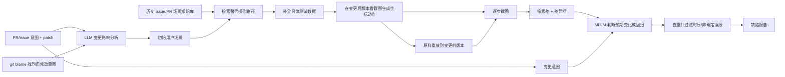

# RippleGUItester：从代码变更出发探索并判定桌面 GUI 回归

## 一页读懂

| 问题 | RippleGUItester 的回答 |
|---|---|
| 旧方法哪里不够 | 既有回归测试局限于预定义路径，无目标探索又不知道代码改动可能影响哪些用户场景；变更引入的缺陷还常需特殊操作组合、测试数据和不规则 GUI oracle。 |
| 本文新增什么 | 读取 PR 意图、代码 diff 和同一代码区域的历史修改意图，生成受影响场景；从历史问题库补充替代操作路径和具体测试数据；在变更前后版本执行相同指令，再结合像素差异和变更意图判断差异是否超出预期。 |
| 输入与输出 | 输入是 PR/issue 描述、修改文件和 patch、历史相关 PR/issue，以及两个版本的可构建程序；输出是可执行用户场景、前后版本截图差异和缺陷报告。 |
| 怎样验证 | 对 Firefox、Zettlr、JabRef、Godot 共 111 个 PR 测试；Firefox 的 30 个 PR 另有已知回归真值，可计算召回。所有报告由人工判定真伪。 |
| 证据能说明什么 | 148 份真阳性报告与 171 份误报，对应 46.4% Precision；Firefox 找回 13/46 个可评价已知回归，Recall 28.3%。作者提交了 26 个仍存在于最新版的候选问题，其中 16 修复、2 确认、6 讨论中、2 被认定为预期行为。方法能发现既有测试漏掉的变更相关 GUI 问题，但误报、漏报和每 PR 约 54.8 分钟/5.99 美元的成本都很明显。 |

## 一段话介绍

RippleGUItester 将一次代码变更视为影响扩散的中心。系统不仅读取 PR 说明和 patch，还用 `git blame` 找出本次修改行此前服务过的功能意图，从而同时测试当前需求和可能被破坏的旧场景。LLM 先做变更影响分析，再从历史 issue/PR 构成的 Scenario Knowledge Base 中检索替代入口和复杂操作路径，并把抽象数据需求实例化为可执行输入。多模态执行器在变更后版本根据截图生成坐标动作，将完全相同的动作重放到变更前版本。检测阶段先用像素差、膨胀和连通域标出变化区域，再让 GPT-5.2 结合变更意图、执行步骤和两版截图区分“本来就应该发生的变化”与“超出需求范围的回归”。111 个真实 PR 上，报告级 Precision 为 46.4%；Firefox 已知回归召回为 13/46。它是目前调研中少见的**代码变更驱动 + GUI 场景生成 + 双版本差分 oracle**完整方案，也直接覆盖部分显示和交互体验回归；但超过一半报告为误报，且变更前版本并不天然代表正确规格。

## 关键术语与阅读前提

- **Change-aware testing（变更感知测试）**：测试选择和生成由具体代码变更驱动，而不是平均遍历全部功能。
- **Change intent（变更意图）**：PR 描述及其解决 issue 的摘要和正文，用于说明本次修改本来要改变什么。
- **Code change / patch（代码变更）**：修改文件、路径、提交说明和逐行 diff。系统直接读代码文本，因而不是纯 GUI 黑盒方法。
- **Preceding change intent（先前变更意图）**：通过 `git blame` 找到当前修改行上一次由哪个提交/PR 引入，再取对应 issue 的目标。它帮助发现当前修改对旧功能的旁路影响。
- **Change-impact analysis（变更影响分析）**：从意图与代码推断可能受影响的终端用户场景，而非只列修改函数。
- **Ripple effect（涟漪效应）**：局部修改对其他入口、状态或业务场景产生的间接影响。
- **Scenario Knowledge Base（SKB，场景知识库）**：从历史 issue 和 PR 中筛选出的用户操作与失败场景，切块、向量化后供 RAG 检索。
- **Event sequence enhancement（事件序列增强）**：为初始场景补充历史资料中的替代入口和操作组合，例如从弹窗的 Page Info 打开密码管理器。
- **Test data enhancement（测试数据增强）**：识别场景所需数据与约束，并生成具体 URL、脚本、文件内容或边界输入。
- **Differential testing（差分测试）**：对两个版本执行可比操作，以行为差异作为候选异常。差异本身不是缺陷，还需判断是否符合变更意图。
- **Pixel-based difference（像素差异）**：逐像素比较两张截图并过滤小变化，再用形态学膨胀与连通域形成差异框。
- **Play/replay**：先在变更后版本由模型生成坐标动作，再把相同 UI 指令原样重放到变更前版本。
- **Report-level Precision（报告级精确率）**：真阳性报告数除以真阳性与误报报告总数。重复触发同一缺陷的报告仍计入 TP/FP 统计。
- **Regression Recall（回归召回率）**：工具找到的已知变更引入缺陷数除以可评价的真值缺陷数；本文只在 Firefox 上计算。

## 研究背景与动机

### 代码变更为什么需要新的 GUI 测试

作者分析 Firefox 在 2019 年 5 月至 2025 年 1 月合并的 97,347 个 PR，其中 11,910 个后来被关联为引入缺陷的变更，占 12.2%。这是保守统计，因为未发现或未关联到引入 PR 的缺陷不会被计入。该结果是研究动机，不是 RippleGUItester 的测试数据规模。

变更引入的缺陷往往不是“旧测试再跑一次”就能发现，原因包括：

1. **替代事件序列**：同一功能从主菜单打开正常，从弹窗或另一个入口打开可能失败。
2. **特殊测试数据**：例如必须找到能产生登录弹窗的网站，才会触发窗口归属错误。
3. **跨场景副作用**：修复设置页滚动条，可能让“搜索无结果”状态中的搜索框发生位移。
4. **不规则 oracle**：页面开错窗口、重复显示密码按钮、搜索框偏移都没有一个统一规则可直接覆盖。

论文的核心想法是同时利用两类信息：代码和历史修改记录决定“重点探索哪里”，变更前后 GUI 与自然语言意图决定“差异是不是错误”。

## 贡献

作者列出四项贡献：

1. 通过真实仓库量化变更引入缺陷的普遍性，并归纳事件序列、测试数据、跨场景副作用与 oracle 难点。
2. 提出首个面向代码变更涟漪效应的 GUI 测试系统，覆盖场景生成、执行和差分判定。
3. 在四个大型桌面系统的真实 PR 上评价，并提交最新版仍存在的问题。
4. 公开实现和数据集。

核心贡献类型是 **method + empirical study + artifact**。它不是单独提出 benchmark，但 Firefox 的 PR—引入缺陷关联被用于召回评价。

## 方法

### 1. 输入准备：当前意图、patch 与旧意图

当前变更意图来自 PR 描述，以及 PR 明确解决的 issue 摘要和正文。代码输入包括提交说明、修改文件路径与完整 patch。

为了捕捉跨场景副作用，系统对每个修改或删除行运行 `git blame`，找到上一次修改这些代码区域的提交、PR 及其解决的 issue。代码重叠越多，旧意图的优先级越高。例如，当前修改滚动条相关代码时，如果同一区域曾为搜索功能修改，系统会同时生成搜索场景，检查新修复是否破坏旧功能。

### 2. 生成受影响的用户场景

GPT-5.2 先解释变更目标，再阅读多语言 patch，执行自然语言形式的变更影响分析。输出覆盖：

- 新增或修改的直接行为；
- 高风险边界和敏感状态；
- 可能被相同代码区域影响的旧工作流。

所有场景必须用终端用户语言描述，排除函数名、内部类和实现术语。这样后续执行器面对的是“打开密码管理器并检查窗口位置”，而非“调用某函数”。

### 3. 用历史场景扩展事件序列

系统从项目全部历史问题中先用规则排除以日志、时间戳或 intermittent 信息为主的报告，再用 GPT-5 Nano 筛选真正描述 GUI 操作的内容。保留内容按固定 token 切成有重叠的片段，同时建立关键词和 embedding 检索，形成 SKB。

对每个初始场景，模型分析哪些步骤需要更多入口或路径，生成定向查询，从 SKB 取回真实历史操作，再将它们融入新场景。如果增强后过于复杂，则拆成独立场景。为避免未来信息泄漏，测试某个 PR 时只检索早于该 PR 创建时间的历史条目。

### 4. 把抽象数据需求变为可执行输入

模型识别每个场景需要的数据类型与约束，验证已有例子，缺失时生成具体实例；在有意义时覆盖边界、有效和无效输入。Firefox 案例中，“从一个会打开登录弹窗的网站开始”被具体化为一段 `window.open(...)` 脚本，使场景能够稳定产生弹窗窗口。

测试数据增强不是简单随机填值，而是让复杂前置条件具备可执行载体。不过生成的数据仍可能依赖外部网站、随机文件或领域假设，论文中的重放失败说明这一层并非完全可靠。

### 5. 在两个版本执行同一组 UI 指令

执行器用 Claude Opus 4.5 查看当前截图，将高层步骤翻译成 11 类结构化动作：点击、右键、长按、双击、三击、输入、滚动、拖动、移动、按键和等待。需要时，它会先生成满足前置条件的额外动作；没有时序依赖的多个动作可一次批量返回。

每个 PR 的变更前和变更后版本都在干净 Docker 容器中构建和执行。系统先在**变更后版本**根据截图生成坐标动作，再把相同指令原样重放到**变更前版本**，以保持比较一致。每个 PR 最多生成 7 个场景；单场景最多调用模型 20 次、执行 35 条 UI 指令。

这一设计保证动作文本相同，却不保证语义控件相同。若修改移动了控件，后版本坐标在旧版本中可能点到错误位置，论文有 11 个误报直接来自这种 replay mismatch。

### 6. 从截图差异推断非预期回归

每一步执行后的两版截图先做像素比较：

1. 用阈值 30 过滤轻微像素变化；
2. 形态学膨胀连接相邻差异像素；
3. 对连通区域生成编号与边界框；
4. 把带框截图和结构化坐标交给检测模型。

GPT-5.2 同时读取变更意图、变更解释、已执行场景、UI 指令和两版截图。它先描述整体界面，再逐一解释元素新增/删除、位置和尺寸变化、文字或属性变化。符合变更意图的差异标为 expected；超出范围并造成错位、重复/缺失元素、状态冲突、交互破坏或可用性/可访问性退化的差异标为 bug。

最后一个 LLM 过滤阶段合并同根因报告，并尝试删除截图未稳定、渲染延迟和非确定布局造成的报告。

## 实验

### 模型、系统与数据

- Generator 与 Detector：GPT-5.2；
- Executor：Claude Opus 4.5；
- SKB 过滤：GPT-5 Nano；
- 检索：`text-embedding-3-large`；
- 实现约 13.4K 行 Python；构建和测试在 Docker 中运行。

| 系统 | SKB 原始数据 | SKB 过滤后 | 评价 PR |
|---|---:|---:|---:|
| Firefox | 246,665 个 bug | 74,625 | 30 个已知会引入缺陷的 PR |
| Zettlr | ID 1–6,035 的 issue/PR | 2,832 | 38 个近期可测试 PR |
| JabRef | ID 1–14,554 的 issue/PR | 3,256 | 18 个近期可测试 PR |
| Godot | ID 1–113,618 的 issue/PR | 35,657 | 25 个近期可测试 PR |
| **合计** | — | — | **111 PR** |

Firefox 30 个 PR 是从“每个至少关联一个引入缺陷”的集合中随机抽取，适合测已知回归召回，但不是普通 PR 的自然分布。其他三个项目从近期 PR 中筛掉非功能或无法测试项，用于寻找未知问题。

### RQ1/RQ2：未知问题与报告精确率

| 系统 | PR | 去重未知问题 | TP 报告 | FP 报告 | Precision |
|---|---:|---:|---:|---:|---:|
| Firefox | 30 | 29 | 52 | 41 | 55.9% |
| Zettlr | 38 | 63 | 67 | 95 | 41.4% |
| JabRef | 18 | 17 | 19 | 21 | 47.5% |
| Godot | 25 | 10 | 10 | 14 | 41.7% |
| **合计** | **111** | **119** | **148** | **171** | **46.4%** |

表中的 `TP` 包含同一缺陷被多场景重复触发的报告，`去重未知问题` 是人工合并后的问题数；Firefox 的已知真值缺陷不计入该列。正文写“detects 111 TP bugs overall”，但表格和 Precision 计算都使用 **148 TP 报告**，`111` 实际是 PR 总数，应视为正文笔误。

119 个去重未知问题中，有 26 个在测试时仍存在于项目最新版并被提交给开发者：16 个已修复、2 个已确认、6 个仍在讨论、2 个被开发者标为符合预期。因此可靠表述是“提交 26 个候选问题，其中 18 个已修复或确认”，不能写成“26 个全部确认的新缺陷”。

### 误报从哪里来

| 原因 | 数量 / 171 | 具体含义 |
|---|---:|---|
| 截图时序与非确定渲染 | 78（45.6%） | 光标、延迟内容、分栏位置和面板顺序在两次执行中不同 |
| LLM 推理与幻觉 | 47（27.5%） | 把差异标注框当成空控件、虚构图标、假设未执行动作或提出无关改进 |
| GUI 操作与重放不稳定 | 26（15.2%） | 坐标定位失败、拖动实现不完整，或后版本动作在前版本点错元素 |
| 本来就应发生的变化 | 17（9.9%） | 例如新验证规则按设计禁用按钮，却仍被模型报错 |
| 其他 | 3（1.8%） | 既有缺陷、领域知识不足、随机文件名导致重放失败 |

最大的误报源不是模型语义判断本身，而是双版本截图没有处于真正可比的稳定状态。这对任何截图差分 UX 测试都很关键：先保证操作对齐和页面稳定，再讨论差异含义。

### RQ3：已知 Firefox 回归的召回

30 个 Firefox PR 共关联 54 个已知引入缺陷。作者排除 6 个只能从日志/栈描述、无法可靠映射到 GUI 的缺陷，以及 2 个重复项，得到 46 个真值缺陷。RippleGUItester 找到其中 13 个，Recall 为 **13/46 = 28.3%**；另找到 29 个不在真值集合中的去重真阳性问题。

33 个漏检原因分为：

- **场景生成没有覆盖关键触发步骤：20/33（60.6%）**。其中 15 个操作难预测，5 个要求严格状态组合。
- **场景已有正确步骤但执行不完整：13/33（39.4%）**。包括 4 个预算耗尽和 9 个动作、定位、构建、拖动或重放错误。

这组结果清楚地区分了“想不到该测什么”和“知道该测但 Agent 做不到”。两者需要不同改进：前者需要更好的场景知识或随机组合，后者需要稳定定位、恢复和环境工程。

### RQ4：时间和费用

SKB 为一次性构建：Zettlr 3.22 小时/0.50 美元，JabRef 5.12 小时/0.73 美元，Godot 46.21 小时/5.43 美元，Firefox 50.28 小时/20.82 美元。

每个 PR 平均 **54.8 分钟、5.99 美元**：

| 阶段 | 时间 | 时间占比 | 费用 | 费用占比 |
|---|---:|---:|---:|---:|
| 场景生成 | 4.10 分钟 | 7.5% | $0.26 | 4.3% |
| 双版本执行 | 24.3 分钟 | 44.4% | $3.72 | 62.0% |
| 差分检测 | 26.4 分钟 | 48.1% | $2.02 | 33.7% |

作者将其解释为使用强模型得到当前能力上界；这也意味着结果不能直接代表更便宜模型或高频 CI 中的成本表现。

## 局限与证据边界

### 作者明确讨论的局限

- 误报较多，并对时序、渲染、LLM、定位、重放和预期差异逐类分析。
- 只评价四个开源桌面应用，不能代表移动、Web 和所有 GUI 框架。
- 使用 GPT-5.2 与 Claude Opus 4.5，较弱或较便宜模型的结果可能不同。
- 场景数量、模型调用和动作数设有预算，严格组合与长前置条件可能漏检。

### 我们根据实验设计观察到的问题

1. **Precision 只有 46.4%**：人工要审核超过一半报告。LLM 过滤并没有解决截图差分最基本的稳定性问题。
2. **已知回归 Recall 只有 28.3%**：漏检以触发场景缺失为主，说明代码和历史文本仍不足以预测多数特殊交互组合。
3. **变更前版本不是绝对真值**：旧版也可能已有缺陷，或新行为虽未写入 PR 文本但确属合理设计。系统实际使用的是“旧行为 + 当前意图”联合 oracle。
4. **执行次序不对称**：动作在后版本生成、在前版本按坐标重放。布局变化恰是检测对象，却也会破坏动作对齐并制造误报。
5. **真值集合并不完整**：Firefox issue 关联只覆盖已发现且正确追踪的引入缺陷；29 个额外真阳性也说明已知集合不是完整 oracle。
6. **未知问题状态需要谨慎表述**：26 个提交项中 2 个被判为预期行为，6 个尚未定论；不能把它们全部计为已确认缺陷。
7. **缺少传统/组件基线**：论文没有与回归测试选择、纯 diff、去掉历史意图或去掉 SKB 的版本做量化比较，也没有消融各生成与检测模块。
8. **模型和提示可能接触公开历史**：虽然 SKB 检索限制到 PR 创建前，基础模型是否见过后续公开 issue 无法排除。论文以最新版本仍存在问题缓解未知缺陷部分，但已知回归召回仍可能受训练数据影响。
9. **可扩展性受构建与 GUI 环境限制**：每个 PR 要构建两个版本、运行多个 Docker GUI 场景并分析高分辨率截图，尚未证明适合每次提交实时运行。

## 和我们课题的关系

### 与 UX testing 的关系

RippleGUItester 与 UX-Agent 的重叠比此前大多数论文更直接。它显式检查位置/尺寸变化、元素缺失或重复、布局错位、交互混乱以及可用性/可访问性退化；Zettlr 案例中的文本间距、脚注标记缺失和不完整渲染都属于可见体验问题。它还用代码变更把 UX 检查聚焦到高风险页面，回答了“源码信息怎样帮助 GUI/UX testing”：patch 和历史意图用于决定**测哪些场景**，截图差分用于决定**哪里发生变化**。

与 UX-Agent 的关键差异是：

- RippleGUItester 检测**版本间新出现的回归**，需要可构建的变更前版本；UX-Agent 也希望发现当前版本长期存在的截断、遮挡、重叠和溢出。
- RippleGUItester 把旧版截图作为比较基线；UX-Agent 用几何规则和主动 slide 判断当前界面是否真的有问题。
- RippleGUItester 的相同坐标重放导致大量错位；UX-Agent 的页面恢复、重新定位和操作后复核可用于提高双版本语义对齐。

可借鉴的组合方式是：先用代码 diff、`git blame` 和历史需求生成受影响页面与交互场景，再在两个版本分别做语义定位和稳定等待；像素差只负责提出候选，最后调用 UX-Agent 的布局规则与主动滑动验证。这样既能发现版本回归，也能避免把所有视觉差异都当成 UX 缺陷。

### 与 GUI testing 的关系

这篇论文属于**变更感知回归测试**，同时覆盖三问：

- **测什么**：由 PR 意图、patch、旧意图和历史场景生成新测试；
- **怎么知道错了**：比较变更前后 GUI，并用变更意图区分预期与非预期差异；
- **测得够不够**：报告 Precision、已知回归 Recall、未知问题状态与运行成本。

它也说明“GUI testing 只能看屏幕”是错误理解。RippleGUItester 在生成端直接读取源码 diff 和版本历史，执行端使用截图，oracle 端联合像素差与自然语言需求，是典型的跨层灰盒方案。与 Kea/PropGen 从单版本行为归纳性质相比，它的预期多了旧版本和变更意图；与 GUIPilot 的设计稿 oracle 相比，它不要求设计稿，但旧版错误和不完整 PR 描述会成为新的偏差来源。

## 原文关键句（节选）

> “The final ground-truth set used for evaluation contains 46 bugs.”
> — Section 4.4，arXiv v1 PDF 第 15 页。

这句话提醒我们，Recall 的分母不是 54 个原始关联缺陷，也不是全部现实回归，而是排除日志型和重复项后的 46 个可评价 GUI 缺陷。

## 所读版本与核对范围

- 实际阅读文件：arXiv `2603.03121v1`，提交于 2026-03-03，共 20 页；PDF 仍显示占位 DOI `10.1145/nnnnnnn.nnnnnnn`。
- 录用状态：作者[个人主页](https://suyanqi.github.io/)和[合作者发表列表](https://chunyang-chen.github.io/publications.html)均列为 **ISSTA 2026**；截至记录时，DBLP 仍只收录 arXiv 版本。因此目录写“ISSTA 2026（已录用；所读为 arXiv v1）”，不虚构正式 DOI。
- 已逐页读取 Abstract、Sections 1–7、Figures 1–9、Table 1 和参考文献；架构、结果表、召回集合与开销图经过页面渲染核对。
- 未运行代码、Docker 环境或 replication package，也未复核 111 个 PR 和开发者 issue；`status` 为 `extracted`，不表示合作者已核对。

## 书目与分类（记录用）

展开标题、作者、版本和标签

- title: RippleGUItester: Change-Aware Exploratory Testing
- authors: Yanqi Su; Michael Pradel; Chunyang Chen
- year: 2026
- era: llm
- venue: ISSTA 2026, accepted; read arXiv v1
- venue_type: conference
- url: https://arxiv.org/abs/2603.03121
- pdf_url: https://arxiv.org/pdf/2603.03121
- version: arXiv:2603.03121v1, 20 pages, placeholder ACM metadata
- code_url: https://github.com/RippleTester/RippleGUItesting
- institution: Technical University of Munich; CISPA Helmholtz Center for Information Security
- aka: RippleGUItester
- door: gui, code-change
- question: generate, execute, oracle, evaluate, regression
- contribution_type: method, empirical-study, artifact
- platform: desktop
- method: change-impact-analysis, retrieval-augmented-generation, multimodal-agent, differential-testing
- oracle_type: differential, requirement, visual, human
- bug_type: functional, visual, usability, regression
- benchmark: 111 PRs over Firefox, Zettlr, JabRef, Godot; 46 evaluable known Firefox regressions
- baselines: none
- headline_result: report precision 46.4%; known-regression recall 13/46; 26 latest-version reports with 16 fixed and 2 confirmed
- open_source: yes
- priority: must
- status: extracted
- read_depth: full

