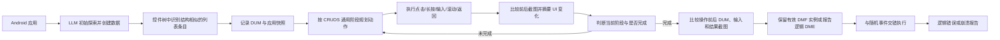

# LDMDroid：围绕数据增删改查构造移动 GUI 测试与逻辑错误预言

## 一页读懂

| 问题 | LDMDroid 的回答 |
|---|---|
| 旧方法哪里不够 | 通用 GUI 探索难以完成应用特有的增删改查流程；已有数据操作测试要么依赖人工脚本与属性，要么使用固定规则且主要检测崩溃，难以发现“操作完成但数据结果错误”的非崩溃缺陷。 |
| 本文新增什么 | 将页面中结构相似的重复条目识别为“被操作数据容器”，用增、删、改、查、搜五类通用步骤引导 LLM 生成操作，并把操作前后的容器状态、输入数据和截图交给 LLM 判断结果是否符合该操作的逻辑。 |
| 输入与输出 | 输入是 Android 应用、运行时截图和控件树；中间产物是数据容器、数据操作实例及其事件序列；输出是可复现的崩溃或非崩溃数据操作错误报告。 |
| 怎样验证 | 24 个近期维护的开源应用、137 个由人工确认的数据操作功能；比较 Guardian、DMSDroid、Genie、Odin、Fastbot2、PBFDroid，并做数据容器、界面变化摘要和进度跟踪消融。 |
| 证据能说明什么 | 在该数据集中，LDMDroid 更容易触发目标数据操作，并通过聚焦数据容器提高报告真阳性率；它仍依赖人工过滤误报，只适用于能够在界面上观察到、且主要以列表形式呈现的数据变化。 |

## 一段话介绍

LDMDroid 研究的是移动 GUI 测试中的**特定功能探索与非崩溃逻辑预言**。它把文件、笔记、待办事项等数据的创建、读取、更新、删除和搜索统称为数据操作功能。系统先在控件树中寻找由结构相似条目组成的数据容器，再让多模态 LLM 按五类操作的通用阶段逐步规划点击、输入、滚动等动作。每执行一步，系统比较前后截图并生成界面变化摘要，用这些变化判断当前进行到哪个阶段；完成操作后，它把操作前后的数据容器、用户输入、结果截图和对应逻辑规则交给 LLM 判定。24 个应用上的实验报告平均每应用数据操作覆盖率 75.7%、生成序列成功率 62.5%，最终得到 17 个可复现缺陷，其中 6 个为非崩溃缺陷；14 个获开发者确认，11 个已修复。论文的关键贡献是缩小 LLM 判定时需要理解的状态空间，而非让模型仅凭整个页面自由猜测是否存在错误。

## 关键术语与阅读前提

- **DMF（Data Manipulation Functionality，数据操作功能）**：应用对自身数据执行的创建、读取、更新、删除和搜索功能，合称 CRUDS。例子包括创建文件、编辑笔记、删除待办事项和搜索已有记录。
- **DME（Data Manipulation Error，数据操作错误）**：DMF 的执行结果违背预期语义。它可能导致崩溃，也可能表现为新数据未出现、删除后仍显示、修改值错误等非崩溃逻辑问题。
- **DUM（Data Under Manipulation，被操作数据）**：一次 DMF 直接作用的数据及其界面容器。本文主要把包含多个结构相似条目的列表识别为 DUM，例如文件列表、笔记列表或习惯列表。
- **CRUDS**：Create、Read、Update、Delete、Search 的缩写。本文没有把五类操作当作五条完全固定的脚本，而是为每类提供通用阶段供 LLM 对齐。
- **UI hierarchy / view hierarchy（控件树）**：Android 运行时页面的树状控件结构，包含控件类型、文字、位置和层级。LDMDroid 用它识别列表条目，并枚举可执行动作。
- **Structural similarity（结构相似度）**：两个控件子树之间的归一化树编辑距离。值越小，表示组成结构越相似。
- **Positional alignment（位置对齐度）**：综合控件中心坐标和宽高差异，判断多个条目是否沿同一方向整齐排列。结构相似且位置对齐的条目才会被聚成候选数据容器。
- **State-aware action planning（状态感知动作规划）**：记录每个动作实际造成的页面变化，并据此判断任务进度、规划下一步。这里的“状态”指可观察的界面变化，不是程序内部完整业务状态。
- **DMF coverage（数据操作覆盖率）**：工具触发的不同 DMF 数量除以人工确认的 DMF 总数。它衡量功能种类覆盖，不是代码覆盖。
- **SR（Success Rate，触发成功率）**：成功触发目标 DMF 的事件序列数除以生成序列总数。它衡量所生成序列是否有效。
- **TPR（True Positive Rate，报告真阳性率）**：人工可复现为真实缺陷的报告数除以全部报告数。本文实际用法接近 precision，不能解释为应用发现缺陷的概率。
- **Interleaved testing（交错测试）**：把已收集的 DMF 序列与随机 GUI 事件交替执行，以测试数据操作在不同应用状态下是否仍然正确。

## 动机

依据：Sections 1–3，PDF 第 1–6 页。

数据操作遍布文件管理、笔记、待办和健康记录等应用。很多错误不会令应用崩溃：用户完成“创建文件”的全部步骤后，文件可能没有出现在列表中；删除条目后，旧条目也可能仍停留在页面上。若测试系统只监控异常退出，这些问题不会被报告。

已有方法存在两类缺口：

1. **难以触发操作**：随机或一般模型驱动探索不了解应用特有语义，长序列的触发概率低。DMSDroid 以“点击包含 add 的按钮—填写输入框—点击 submit”等固定规则识别操作，无法覆盖还需选择文件类型等应用特有步骤。
2. **难以判断结果**：PBFDroid 等方法要求人工提供事件序列和属性；直接让 LLM 看整个页面判断又会面对过大的语义空间。模型既要找到与本次操作有关的数据，又要区分真正错误与正常显示差异。

论文因此把问题拆成两步：先用通用操作阶段和运行反馈触发 DMF，再只围绕本次操作的数据容器构造 oracle。

## 贡献

作者在 Section 1 列出三项贡献：

1. 首次系统研究利用 LLM 自动验证移动应用数据操作功能的逻辑正确性，并提出 LDMDroid。
2. 从既有 81 个真实 DMF 中归纳五类操作的通用阶段，提出基于界面变化的状态感知规划和基于数据容器前后状态的判定机制。
3. 在 24 个真实 Android 应用上与多类工具比较，并公开实现、DMF 实例和缺陷报告。

核心贡献类型是 **method**，同时包含支撑方法设计的经验归纳和公开 artifact。论文没有提出覆盖所有 GUI 功能的新 benchmark；实验数据集中只保留含有 DMF 的应用。

## 方法

### 1. 识别数据容器

系统先让 LLM 像普通用户一样探索应用并创建一些数据。每次到达新页面，它遍历控件树中的子树，将结构相似且在横向或纵向对齐的控件聚类：

- 结构相似度采用归一化树编辑距离，阈值为 0.2；
- 位置对齐综合中心坐标和尺寸差异，阈值为 100，尺寸权重为 0.5；
- 若一个簇中的所有文字都来自 APK 内的固定字符串资源，则将其过滤，因为取消、确认等固定按钮不是动态数据条目。

剩余的重复结构被视为候选 DUM。发现 DUM 后，系统保存当前应用快照，后续每次尝试均从同一状态恢复。这里既用了截图，也用了控件树和反编译得到的字符串常量，因此不是纯屏幕黑盒方法。

### 2. 用通用阶段约束 DMF 探索

作者由三人独立分析既有 81 个 DMF，再讨论形成五类操作的通用阶段。例如：

| 类型 | 通用阶段 |
|---|---|
| Create | 打开创建页 → 选择创建类型 → 输入信息 → 提交保存 → 返回 |
| Update | 选择目标数据 → 打开编辑页 → 修改信息 → 提交保存 → 返回 |
| Delete | 选择目标数据 → 删除 → 确认 → 返回 |
| Read | 选择目标数据 → 打开详情页 → 读取详情 |
| Search | 打开搜索页 → 输入关键词 → 读取结果 |

这些阶段覆盖既有 81 个实例中 88.9% 的步骤；在实验数据人工标注的 DMF 中，平均覆盖实际步骤的 77.6%。它们是规划提示，不要求界面严格逐项对应，所以应用可以省略某一步或加入额外步骤。

每轮模型收到当前截图、可交互控件、动作历史和当前阶段，输出 Click、LongClick、InputText、Scroll 或 Back。系统过滤本轮历史中已经执行过的动作以减少循环；这也意味着需要重复同一动作的流程可能被漏掉。

### 3. 用动作造成的变化记录真实进度

只记录“点击了某个 ImageButton”不能说明该动作打开了创建菜单还是进入了其他页面。LDMDroid 将动作前后截图、本次动作和 DUM 交给模型，请它概括控件更新、文字变化、布局调整或页面跳转。随后，另一提示根据“动作 + 实际变化”的历史与通用阶段判断当前进度。

进度可以跳过中间阶段；模型认为目标操作完成时停止。该机制把动作的结果加入历史，减少只靠动作名称造成的语义丢失，但任务是否完成仍由模型推断。例如，实验中模型曾把“是否保存分组”的确认对话框误判为创建已经结束。

### 4. 以 DUM 前后状态构造逻辑 oracle

当一次 DMF 被认为完成后，系统向模型提供：

- 操作前和操作后的 DUM 控件结构；
- 被操作目标和用户输入；
- 最终结果截图；
- 与当前 CRUDS 类型对应的错误定义。

Create 检查目标数据是否正确加入容器；Update 检查目标值是否更新；Delete 检查目标是否移除；Read 检查详情是否正确显示；Search 检查目标是否出现在结果中。温度设为 0，每个用例执行三次；至少两次判为错误才产生报告。

这里的 oracle 不是纯固定断言，也不是无约束的视觉判断。固定的 CRUDS 逻辑规定“应该发生哪类变化”，运行时 DUM 将判断范围限制在相关数据，LLM负责将具体输入和界面内容与该规则对齐。

### 5. 收集兄弟操作并进行交错测试

首个操作成功后，模型分析历史并生成同类“兄弟目标”，例如由创建文件推断创建文件夹。收集到的 DMF 实例会与随机事件交错执行，每次仍用上述 oracle 验证；系统同时监控日志以发现崩溃。

因此 LDMDroid 的最终流程包含两种预言：崩溃由日志直接判断，非崩溃逻辑错误由 CRUDS 规则、DUM 状态和 LLM共同判断。

## 实验

### 数据集与实验设置

- 从 F-Droid 中托管在 GitHub 的 2,552 个应用开始，经近期一年有更新、至少 50 stars、未出现在 PBFDroid/DMSDroid 数据集等条件筛到 735 个候选。
- 随机抽取 50 个应用后，排除 7 个无法通过脚本绕过登录/注册的应用和 19 个不含 DMF 的应用，最终为 24 个应用。
- 12 名有至少一年 Android 经验的软工研究生参与人工标注；每个应用由 6 人探索并通过讨论解决分歧，共确认 137 个 DMF。
- 运行环境为 Android 9 模拟器、Windows 11；默认模型为 GLM-4V-Plus。
- 触发实验对每个应用、每类 DMF 生成 10 条最长 10 步的序列，重复 3 次；DMSDroid 因接口不同，每应用运行 90 分钟并重复 3 次。
- 缺陷检测工具每应用运行 90 分钟、重复 3 次，汇总报告后由两名作者独立复现，分歧交给第三人。

### RQ1：能否更有效地触发数据操作

| 方法 | 平均每应用 DMF coverage | 序列成功率 SR | 每成功触发一个 DMF 的 token / 成本 / 时间 |
|---|---:|---:|---:|
| Guardian | 54.2% | 29.9% | 49.1K / $0.034 / 293.3 秒 |
| DMSDroid | 11.6% | 5.9% | 不使用 LLM，未按该口径报告 |
| **LDMDroid** | **75.7%** | **62.5%** | **43.5K / $0.026 / 153.4 秒** |

DMF coverage 的分母是人工确认的 137 个不同功能；SR 的分母是工具生成的事件序列。二者分别回答“覆盖了多少种功能”和“生成的序列有多少真正完成目标”，不能合并解释。

LDMDroid 仍有 24.3% 的 DMF 不能可靠触发。四个应用的数据不是普通列表：三个以地图节点或画布元素呈现，一个是单对象结构，因而 DUM 识别失败。

### RQ2：界面变化摘要和进度跟踪是否有效

| 配置 | DMF coverage | SR |
|---|---:|---:|
| 完整 LDMDroid | **75.7%** | **62.5%** |
| 去掉界面变化摘要 | 64.4% | 33.3% |
| 去掉进度跟踪 | 54.7% | 36.3% |

论文引言中的 87.6% 是完整方法相对“去掉界面变化摘要”配置的 SR 相对增幅：`(62.5−33.3)/33.3≈87.7%`，因原始数值精度而与正文相差 0.1 个百分点。去掉模块后 token 与时间更少，作者解释为复杂 DMF 更常触发失败，而不是这些变体更高效地完成相同任务。引言中的另一个 55.9% 则来自下一项 DUM oracle 消融的 TPR 相对增幅，不属于本表的动作规划消融。

### RQ3：能否发现真实缺陷

| 方法 | 报告数 | 可复现的不同缺陷数 | TPR |
|---|---:|---:|---:|
| **LDMDroid** | 255 | **17** | **61.6%** |
| LDMDroid 去掉 DUM | 281 | 11 | 39.5% |
| Guardian | 180 | 3 | 25.6% |
| Genie | 43 | 2 | 32.6% |
| Odin | 89 | 2 | 29.2% |
| DMSDroid | 0 | 0 | 不适用 |
| Fastbot2 | 3,602 | 4 | 不适用，工具只报 crash |

17 个不同缺陷包括 6 个非崩溃错误和 11 个崩溃，分布在 10 个应用中；所有缺陷均提交给开发者，14 个获确认，11 个已修复，尚无被明确拒绝者。其他基线发现的缺陷均包含在 LDMDroid 的结果中。

DUM 消融使 TPR 从 61.6% 降至 39.5%，完整方法的相对增幅为 `(61.6−39.5)/39.5≈55.9%`，同时报告数反而增加。这支持“把模型注意力约束到相关数据容器能够减少误报”的设计判断。仍有约 38.4% 的报告不能人工复现为真实缺陷，说明 oracle 远未达到无需审核的程度。

论文给出的真阳性案例是 Table Habit 删除习惯后条目仍留在列表；假阳性案例是 LinkHub 列表摘要中的数字没有出现在详情页，模型把合理的信息层级差异误判为数据不一致。

### RQ4：与人工定义属性的 PBFDroid 比较

| 方法 | 人工工作 | 平均每应用人工时间 | 缺陷数 |
|---|---|---:|---:|
| LDMDroid | 过滤误报 | 173.9 秒 | 17 |
| PBFDroid | 为全部 137 个 DMF 编写属性 | 627.7 秒 | 18 |

两者有 16 个重合缺陷。LDMDroid 少写人工属性，但没有消除人工：研究者仍需检查其报告。两种人工任务的性质不同，时间差只能说明该受试流程中的审核成本较低，不能推导为完全自动化。

### 模型敏感性

GLM-4V-Plus、GPT-4o 和 Qwen2.5-VL 的 DMF coverage 分别为 75.7%、78.6% 和 69.3%，SR 分别为 62.5%、67.3% 和 58.7%，TPR 分别为 61.6%、70.1% 和 55.9%。框架可以更换多模态模型，但性能并非与模型无关。

## 局限

### 作者明确讨论的局限与有效性威胁

- 24 个开源应用不能代表完整 Android 生态；作者通过近期更新、star 分布和排除旧数据集应用降低偏差。
- 人工标注 DMF、判断序列和复现缺陷可能带来主观性；作者用多人独立判断和分歧裁决缓解。
- DUM 主要建立在列表式重复结构上，地图、画布和单对象数据不适用。
- 状态感知机制不能消除 LLM 幻觉，模型仍会提前判断任务完成。
- 未来工作还需处理数值计算、时序逻辑等列表前后变化难以表达的逻辑错误。

### 我们根据方法与实验观察到的问题

1. **oracle 仍需人工过滤**：255 份报告的 TPR 为 61.6%，不能直接进入无人值守回归流程。
2. **预期并非完全独立于实现**：CRUDS 规则提供外部语义，但具体目标数据、页面对应和合理显示差异仍由同一个模型从被测界面推断，存在迎合或误读实现的风险。
3. **筛选后的任务较理想化**：登录不可绕过和不含列表式 DMF 的应用被排除；实验结论不覆盖这些常见真实条件。
4. **只验证可观察到的界面结果**：后台数据已正确写入但界面未刷新会被报告；界面暂时正确但持久化失败，则可能要在重启或跨会话后才暴露，论文没有系统评价。
5. **重复动作过滤可能漏路径**：同一轮中不允许重复历史动作可以减少循环，也可能错过需要反复点按、分页或多次滚动的操作。
6. **通用阶段来自有限样本**：81 个既有实例和 24 个评价应用支持当前五类流程，但不能证明覆盖所有复杂业务操作。
7. **版本状态需谨慎记录**：所读 arXiv PDF 仍保留 ACM 投稿占位信息；正式书目信息应以 TOSEM DOI `10.1145/3815426` 为准，ASE 2026 只是 Journal First 展示场合。

## 和我们课题的关系

### 与 UX testing 的关系

LDMDroid 与 UX-Agent 当前检测文字截断、遮挡、重叠和溢出的目标不相同。它关心的是数据操作后的**功能结果**，数据列表只被当作业务状态载体；列表条目的间距、文字是否被遮挡或滑动后能否完整查看并不是其判错目标。

其最有价值的借鉴是“主动操作前后对比 + 聚焦相关区域”：UX-Agent 可在候选缺陷出现前后保存控件树与截图，通过滑动或页面恢复验证状态变化，并把判定范围限制在候选控件及其容器。LDMDroid 的 DUM 规则不能直接移植为 UX oracle，因为结构相似的列表并不覆盖悬浮层、单对象详情和自由布局；其 61.6% TPR 也说明 LLM 即使获得局部运行证据仍会误判合理界面差异。

### 与 GUI testing 的关系

LDMDroid 横跨测试生成、执行和 oracle 三个环节，但主价值在**面向特定功能的非崩溃 oracle**。它没有满足于让 LLM 自由探索和报告异常，而是先定义 CRUDS 操作语义，再从控件树抽取与本次操作相关的数据容器，将“创建后数量和值应怎样变化”等规则落到具体运行状态。

这篇论文说明，LLM GUI testing 可以把灰盒结构信息用于两处：一是识别数据容器并缩小 oracle 的观察范围，二是将动作造成的界面变化写回规划历史。它也表明路径触发与结果判断必须分别评价：75.7% DMF coverage、62.5% 序列成功率和 61.6% 报告 TPR 描述的是三个不同阶段。

## 原文摘要关键句（节选）

> “the correctness of a DMF is mainly related to the state changes of the DUM”
> — Section 3，arXiv PDF 第 6 页。

这句话概括论文的核心抽象：系统不要求模型理解整张页面的所有信息，而是比较本次操作相关数据容器的前后状态。

## 所读版本与核对范围

- 全文来源：arXiv `2604.00458v2`，PDF 23 页，版本日期 2026-05-09。
- 正式书目信息：ACM Transactions on Software Engineering and Methodology，DOI `10.1145/3815426`；入选 ASE 2026 Journal First 展示。所读 PDF 首页仍显示投稿占位 DOI，因此没有沿用其占位信息。
- 已逐页读取 Abstract、Sections 1–9、Algorithms 1–2、Tables 1–10、Figures 1–3 和参考文献；方法总览、触发结果表与缺陷结果表经过页面渲染核对。
- 未运行 LDMDroid，也未独立复现 17 个缺陷或人工标注 137 个 DMF；`status` 为 `extracted`，不表示合作者已核对。

## 书目与分类（记录用）

展开标题、作者、版本和标签

- title: LDMDroid: Leveraging LLMs for Detecting Data Manipulation Errors in Android Apps
- authors: Xiangyang Xiao; Huaxun Huang; Rongxin Wu
- year: 2026
- era: llm
- venue: ACM Transactions on Software Engineering and Methodology; ASE 2026 Journal First
- venue_type: journal-first
- url: https://doi.org/10.1145/3815426
- pdf_url: https://arxiv.org/pdf/2604.00458
- version: arXiv 2604.00458v2, 2026-05-09; official TOSEM DOI verified from ASE 2026 page
- code_url: https://github.com/runnnnnner200/LDMDroid
- institution: Xiamen University
- aka: LDMDroid
- door: gui
- question: generate, execute, oracle
- contribution_type: method
- platform: android
- method: hybrid, llm-prompt, layout-analysis, vision
- oracle_type: assertion, specification, human
- bug_type: functional, crash
- benchmark: 24 open-source Android apps; 137 manually identified DMFs
- baselines: Guardian; DMSDroid; Fastbot2; Genie; Odin; PBFDroid
- headline_result: DMF coverage 75.7%, sequence success rate 62.5%, report TPR 61.6%; 17 bugs, 14 confirmed, 11 fixed
- one_liner: 识别列表式数据容器，以 CRUDS 通用阶段和界面变化引导操作，再比较数据容器前后状态检测崩溃与非崩溃数据操作错误。
- use_in_survey: 非崩溃功能 oracle 主线；展示如何用控件结构缩小 LLM 判定范围，并将目标功能触发与逻辑结果判断结合。
- concepts: data manipulation functionality; data manipulation error; CRUDS; data under manipulation; state-aware planning; LLM oracle; interleaved testing
- priority: must
- read_depth: full
- owner: Codex
- status: extracted

