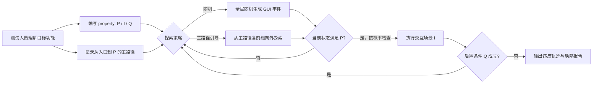

# Kea：用“前置条件—交互—后置条件”检查 Android 非崩溃功能缺陷

## 一页读懂

| 问题 | Kea 的回答 |
|---|---|
| 旧方法哪里不够 | 自动 GUI 探索擅长生成事件，却缺少业务 oracle；Genie、Odin 等自动预言只覆盖特定规律且误报较多，人工脚本又通常只验证少量 happy path。 |
| 本文新增什么 | 设计 Python 风格的 Property Description Language，把功能预期写成前置条件、交互场景和后置条件；再用随机探索或围绕人工主路径的引导探索，在不同应用状态中反复检查 property。 |
| 输入与输出 | 输入是 Android 应用、人工编写的 property，以及引导模式所需的主路径；输出是违反 property 的 GUI 事件轨迹和缺陷报告。 |
| 怎样验证 | 从 8 个真实应用的全部可复现历史功能缺陷中整理 124 条 property；在 97 个输入条件属于工具范围的缺陷上评价触发能力，并将 116 条仍适用的 property 用于最新版本。 |
| 证据能说明什么 | PDL 能表达这 124 个已知缺陷所违反的预期；引导探索在范围内触发 92/97，另发现 25 个新缺陷且全部获确认。结果证明人工 property 与自动探索结合有效，但 property 和主路径仍需人工提供。 |

## 一段话介绍

Kea 将传统 property-based testing 引入 Android GUI：测试人员不再只写一条固定脚本，而是写一项对所有相关界面状态都应成立的业务性质。每项 property 由前置条件 `P`、执行功能的交互场景 `I` 和期望结果 `Q` 组成；只要自动探索到满足 `P` 的状态，系统就执行 `I` 并检查 `Q`。随机策略在全局状态空间中寻找这些状态，引导策略则从一条人工 happy path 的各个前缀向外随机分叉，再尝试接回主路径。作者从 8 个应用的 124 个历史非崩溃功能缺陷中编写 property；排除需要特定文本、系统设置、人工知识或精确时序的 27 个后，引导探索触发 92/97 个范围内缺陷，平均比纯随机策略快近四倍。将仍适用的 property 用于最新版应用又发现 25 个新缺陷，全部获确认。Kea 的贡献在于提供可执行、可复用的结构化 oracle 与相匹配的探索方式；它不使用 LLM，也不自动推导 property。

## 关键术语与阅读前提

- **Property-based testing（PBT，基于性质的测试）**：先声明程序对一类输入或状态都应满足的性质，再自动生成大量输入反复检查。传统 QuickCheck 为函数生成数据；Kea 为移动应用生成 GUI 事件轨迹。
- **Property（性质）**：一项应用功能应始终满足的行为约束。Kea 表示为 `φ = <P, I, Q>`。
- **Precondition `P`（前置条件）**：说明何时可以执行目标功能，例如当前笔记含有至少一个标签。它决定 property 在哪些 GUI 状态中可检查。
- **Interaction scenario `I`（交互场景）**：执行目标功能的事件和计算，例如打开标签列表、随机选择一个已勾选标签、取消勾选并确认。
- **Postcondition `Q`（后置条件）**：操作后必须成立的断言，例如被删除标签不再出现，其他正文保持不变。
- **PDL（Property Description Language）**：Kea 的 Python 风格领域语言。它支持查找控件、读取属性、点击/长按/输入/滚动/旋转，以及 Python 的变量、循环、条件和函数调用。
- **GUI state（GUI 状态）**：由运行时控件树抽象的当前页面状态。Kea 的 `P` 与 `Q` 都是对 GUI 状态的谓词。
- **Main path（主路径）**：从应用入口到满足 `P` 的典型或 happy path。测试人员在编写 property 时通常已经走过这条路径，Kea 将其作为探索引导。
- **Alternative path（替代路径）**：从主路径某个前缀分叉，经额外事件改变内部状态后，再到达可检查 property 的状态。许多不易触发的缺陷只在替代路径上出现。
- **Property violation（性质违反）**：某状态满足 `P`，执行 `I` 后的状态不满足 `Q`。在 Kea 中，这构成非崩溃功能缺陷候选。
- **Automated oracle（自动预言）**：工具自行推断适用于大量应用的异常规律。Kea 的 oracle 由人写 property，因此误报较少，但人工成本和覆盖范围取决于 property 质量。

## 动机

依据：Sections 1–2，PDF 第 1–3 页。

随机、模型或强化学习可以进入大量页面，却只能可靠监控 crash；“删除标签后正文是否保持不变”这类业务正确性没有通用系统信号。人工测试知道预期，但通常只运行固定的 happy path，难以覆盖不同历史状态、事件组合和边界条件。

Genie 用兄弟视图独立性构造蜕变 oracle，Odin 用偏离常见行为的轨迹作为异常信号。这些规则无需人工 property，却只能覆盖符合其假设的缺陷，并在论文引用的实验中出现 59% 和 68% 的高误报率。PBFDroid 的人工 property 又主要限于数据增删改查。

Kea 的选择是保留人工业务知识，同时把一条固定用例扩展为许多自动生成的上下文：测试人员只描述一次功能在什么条件下怎样执行、结果应怎样，探索器负责寻找不同满足条件的状态。

## 贡献

作者列出四个层次的贡献：

1. 在概念层提出面向 Android 功能正确性的通用 property-based testing 方法。
2. 设计 PDL，以及随机探索和主路径引导探索两种 input generator。
3. 在 DroidBot 上实现工具 Kea，并公开实现、property 和实验材料。
4. 用 124 个历史功能缺陷评价 PDL 的表达能力和探索能力，并在最新版本中发现 25 个新缺陷。

核心贡献类型是 **method**；PDL 是方法中的测试规约语言。124 个 property 由历史缺陷构建，可作为 artifact，但论文没有把它定义为独立 benchmark。

## 方法

### 1. PDL：把业务预期拆成 `P-I-Q`

形式上，`φ = <P, I, Q>`。如果状态 `s` 满足 `P`，执行 `I` 到达 `s'`，则 `s'` 必须满足 `Q`；应用要满足 property，就要求所有可达相关状态都符合该关系。

PDL 是 Python 的超集：

- `findWidget(...)` 按 ID、类型、文字等属性在当前控件树中查找元素；
- `@precondition(...)` 组合控件存在性和属性比较；
- `click()`、`long_click()`、`set_text()`、`scroll().to()`、`rotate_screen()` 等执行动作；
- `assert` 可以放在交互过程任意位置，因此不仅能检查最终页面；
- 循环、条件、变量和函数调用允许从运行状态中选择数据并计算预期值。

这种语言比“某元素出现”更细。例如删除笔记标签的 property 先保存完整正文，随机选取一个当前已勾选标签并取消，再断言该标签消失且删除标签后的正文与预期字符串完全一致。PBFDroid 若只检查目标标签消失，会漏掉删除一个标签却破坏另一个标签的错误。

### 2. 随机探索：广泛寻找满足前置条件的状态

每轮先清理数据并重启应用，然后最多生成 `MAX_EVENT_NUMBER` 个随机事件。每到一个状态便检查 `P`：

- 若不满足，继续随机操作；
- 若满足，以 50% 概率执行 `I` 并检查 `Q`，否则继续探索更深状态。

只以 50% 概率立即检查，是为了避免每次刚到最简单的 happy-path 状态就停止。例如笔记一有标签时继续探索，可能先返回列表、重新打开笔记、加入第二个标签，再执行删除，从而暴露依赖历史状态的错误。

### 3. 主路径引导探索：围绕已知功能入口生成替代上下文

测试人员编写 property 时会从应用入口走到满足 `P` 的页面，这条事件序列被保存为主路径。引导策略从主路径末端开始，依次缩短前缀：

1. 重放某个主路径前缀到达中间状态；
2. 从该状态运行最多 20 个随机事件，并在满足 `P` 时按概率检查 property；
3. 随机分叉可能改变内部数据后，尝试寻找当前页面仍可执行的最新主路径事件，重放剩余后缀回到满足 `P` 的状态；
4. 从路径末端逐步退到入口附近，之后清理数据再开始下一轮。

该策略既利用主路径快速接近目标功能，又在路径各阶段插入替代操作。它不是只重复 happy path；实验中 17 个同时被两种策略找到的缺陷仍需要在主路径附近探索，另有 27 个仅引导策略找到。

### 4. 同时检查多个 property

一个应用有多条 property 时，可在同一探索中检查任意子集。当前状态若同时满足多个前置条件，系统随机选一条执行。不同 property 的交互场景还能充当局部应用模型：例如“添加标签”的 `I` 可以创建“删除标签”property 所需的前置状态。

这能减少总运行时间并进入更深状态，但也会分散单条 property 的检查机会。论文中新缺陷实验中，单 property 引导模式找到 23 个，多 property 引导模式找到 22 个；后者更省机器时间，并发现了前者遗漏的两个缺陷。

### 5. 实现边界

Kea 基于 DroidBot，使用 UIAutomator2 解析控件树和操作页面，使用 Hypothesis 生成随机文本。当前支持点击、长按、输入、滑动、滚动、旋转、返回和 Home 等事件；`P` 和 `Q` 主要检查 UIAutomator2 可解析的控件属性。

它不读取应用源码，也不使用截图或 LLM。测试人员负责提供 property；引导策略还需要一条主路径。

## 实验

### 数据构建

- 选择 OmniNotes、Markor、SimpleTask、AmazeFileManager、ActivityDiary、AntennaPod、AnkiDroid 和 Transistor 共 8 个开源应用。
- 检查已关闭且标记为 bug 的 issue，排除重复、功能请求、崩溃、纯视觉、性能/能耗和无法复现问题，得到 124 个历史非崩溃功能缺陷。
- 两名作者独立从 bug 报告中抽象 property，要求去掉已知触发轨迹中的具体字符等 bug 特定信息；交叉核对后由另两名作者讨论达成一致。
- 每条 property 用原始触发轨迹做 sanity check，确认它确实能暴露对应缺陷。

这套构造能检验 PDL 是否可表达已知错误所违反的规则，但不能证明测试人员在不知道缺陷时一定会主动写出相同 property。

### RQ1：PDL 能表达哪些 property

124 个历史缺陷对应的 property 均能在 PDL 中写出。平均复杂度为：前置条件 4.9 个“子句+逻辑运算符”，交互场景 3.1 个事件和 9.9 行代码，后置条件 1.6 个“子句+逻辑运算符”。作者的经验是人工编写一条 property 约需 3–5 分钟。

“124/124 可表达”说明语言对这批已知 property 足够，不等于 Kea 自动发现了 124 个 oracle，也不等于任意 Android 业务规则都能仅靠运行时控件树表达。

### RQ2：能否重新触发历史缺陷

27/124 个历史缺陷被排除在探索能力评价之外：20 个需要领域特定文本，5 个需要特定系统设置，1 个需要密码知识，1 个依赖精确时序。剩余 97 个每种策略给 6 小时，并重复 3 次。

| 策略 | 找到的历史缺陷 |
|---|---:|
| 随机，单测试最多 20 事件 | 54/97（55.7%） |
| 随机，最多 40 事件 | 63/97（64.9%） |
| 随机，最多 60 事件 | 59/97（60.8%） |
| 随机，最多 80 事件 | 63/97（64.9%） |
| 随机，最多 100 事件 | 66/97（68.0%） |
| **主路径引导** | **92/97（94.8%）** |

对两种最佳模式都找到的 65 个缺陷，引导策略平均 684 秒，随机 100 事件策略平均 3,171 秒，前者约快 4.6 倍。四个缺陷两种策略都找不到，原因是需要长而特定的环境构造，例如打开相机拍照、创建笔记、附加图片、备份再恢复。

论文摘要和正文结论有时简写为“92 个历史缺陷”，应保留分母：这是 **92/97 个在探索范围内的缺陷**，而不是 92/124。

### RQ3：在最新版应用中发现新缺陷

124 条 property 中有 8 条对应功能已不存在，剩余 116 条经必要更新后用于最新版本。每条 property 在随机和引导模式下各给 24 小时；另以相同总预算测试每个应用的全部 property。

四种模式找到的不同新缺陷数分别为：单 property 随机 17、单 property 引导 23、多 property 随机 22、多 property 引导 22；合并后为 25 个不同缺陷。全部由开发者确认，21 个已修复。缺陷包括标签删除破坏其他文字、搜索过滤失效、屏幕旋转后标题消失、文件后缀与类型不一致等。

一部分缺陷在主路径直接出现，属于回归；更多需要替代路径。结果说明已有业务 property 可以跨版本继续发现新状态组合下的错误。

### RQ4：与其他非崩溃测试方法比较

对 97 个范围内历史缺陷，Genie、Odin 和 PBFDroid 合计只有 34 个落在其 oracle 能力范围，实际找到 13 个。对 Kea 的 25 个新缺陷，三者合计只有 7 个在范围内，实际找到 1 个。

这项比较同时受 oracle 能力范围和路径生成能力影响。Kea 的 property 是针对应用功能人工编写的，而 Genie/Odin 追求无需人工规约的通用自动 oracle；数字不能解释为在相同人工投入下的纯算法胜负。

## 局限

### 作者明确讨论的局限与有效性威胁

- property 必须人工指定，作者估计每条需 3–5 分钟；Kea 不替代 Genie/Odin 的全自动 oracle，而是可与它们互补。
- 只评价 8 个应用，不能代表完整 Android 生态。
- 124 条 property 从历史缺陷中提取，其质量与多样性会影响结果；作者用无筛选收集、多人交叉检查和原始轨迹 sanity check 缓解。
- 27 个需要特定输入、系统设置、人工知识或时序的历史缺陷不在探索评价范围。

### 我们根据实验设计观察到的问题

1. **已知缺陷参与了 oracle 构造**：RQ1 和 RQ2 更接近“给定由该缺陷抽象出的正确 property，探索器能否再次触发”，不能评价未知条件下 property 发现率。
2. **主路径仍是人工知识**：引导策略的优势依赖到达目标功能的最短路径，论文没有计算记录和维护这些路径的成本。
3. **测试预算很大**：历史缺陷每项每策略 6 小时，新版 property 每条每策略 24 小时；发现率不能直接代表日常 CI 中的短时效果。
4. **新缺陷继承历史 property 范围**：25 个新缺陷证明 property 可复用，但不会覆盖没有历史对应规则的新功能。
5. **界面树限制观察范围**：当前断言依赖 UIAutomator2 可解析属性，对自绘控件、画布、动画、截图级渲染和后台不可见状态支持有限。
6. **误报数据未单独报告**：精确人工 property 理论上减少误报，论文主要统计已确认新缺陷，没有给出所有 property violation 报告数与人工过滤量。

## 和我们课题的关系

### 与 UX testing 的关系

Kea 当前没有截图视觉分析，不能直接识别文字截断、遮挡、重叠或溢出。但它的 `P-I-Q` 结构非常适合描述 UX-Agent 的主动验证逻辑：

- `P`：发现疑似被截断或被遮挡的目标控件，并确认页面处于可验证状态；
- `I`：按指定方向滑动、滚动或切换状态，再恢复页面；
- `Q`：目标内容应变得完整可见，或控件几何关系应恢复到允许范围。

要真正采用该思路，需要扩展 PDL，使 `P/Q` 能访问截图、边界框、遮挡比例和滑动前后可见区域；现有只读控件属性的实现不足以表达 UX-Agent 的视觉 oracle。Kea 也提醒我们，人工规则并非缺点本身：少量明确规则可以换来比开放式 LLM 判定更可追溯的测试证据。

### 与 GUI testing 的关系

Kea 是非崩溃功能 oracle 路线的重要基础工作。它清楚分离了“预期是什么”和“怎样找到触发状态”：property 提供独立于被测执行结果的业务预期，随机或主路径引导探索负责生成输入。相比 LDMDroid 由 LLM 将 CRUDS 通用规则对齐到运行状态，Kea 的 property 更具体、更可执行，适用范围也由人工编写内容决定。

它还展示了主路径的双重作用：主路径既是功能可达性的先验，也只是探索中心；真正有价值的缺陷常出现在从路径前缀分叉后再回到 property 检查点的替代状态。因此固定端到端脚本与随机乱点之间存在一条实用中间路线。

## 与 PropGen 的前后关系

Kea 解决的是：**给定人工 property 和主路径，怎样广泛验证它。** 它的主要瓶颈是 property 编写与维护仍靠人。

PropGen（ASE 2026）解决的是：**怎样从 GUI 状态提出功能假设、执行收集证据，并自动合成和修正 Kea 风格的 property。** 两篇应连续阅读：Kea 提供执行框架、语言和证据基线，PropGen 自动化其最费人工的规约阶段。

## 原文摘要关键句（节选）

> “synergistically combine ... human knowledge ... and ... automated GUI testing”
> — Section 1，正式论文 PDF 第 2 页。

这句话概括方法取舍：Kea没有假设 oracle 可以完全自动获得，而是让人工提供可复用的预期，让机器负责扩大状态与路径覆盖。

## 所读版本与核对范围

- 全文来源：ASE 2024 正式论文 PDF，共 12 页。
- 书目信息：39th IEEE/ACM International Conference on Automated Software Engineering，DOI `10.1145/3691620.3694986`。
- 本地文件名 `propertybased-issta2026.pdf` 与论文真实信息不符；公共记录统一使用 **Kea / ASE 2024**，不沿用错误文件名。
- 已逐页读取 Abstract、Sections 1–8、Algorithms 1–2、Tables 1–6、Figures 1–6 和参考文献；property 代码、两种探索算法和主结果表经过页面渲染核对。
- 未运行 Kea，也未重新构造 124 条 property 或复现缺陷；`status` 为 `extracted`，不表示合作者已核对。

## 书目与分类（记录用）

展开标题、作者、版本和标签

- title: General and Practical Property-based Testing for Android Apps
- authors: Yiheng Xiong; Ting Su; Jue Wang; Jingling Sun; Geguang Pu; Zhendong Su
- year: 2024
- era: traditional
- venue: ASE 2024 Research Papers
- venue_type: conference
- url: https://doi.org/10.1145/3691620.3694986
- pdf_url: https://doi.org/10.1145/3691620.3694986
- version: ASE 2024 formal proceedings, 12 pages
- code_url: https://github.com/ecnusse/Kea
- institution: East China Normal University; Nanjing University; University of Electronic Science and Technology of China; ETH Zurich
- aka: Kea
- door: gui
- question: generate, oracle, evaluate
- contribution_type: method
- platform: android
- method: property-based-testing, random-exploration, path-guided-exploration
- oracle_type: specification, assertion, human
- bug_type: functional
- benchmark: 8 Android apps; 124 historical functional bugs/properties; 97 bugs in exploration scope
- baselines: Genie; Odin; PBFDroid
- headline_result: guided exploration found 92/97 in-scope historical bugs; 25 new bugs confirmed, 21 fixed
- one_liner: 人工以 P-I-Q property 描述业务预期，随机或主路径引导探索自动寻找不同前置状态并执行交互检查后置条件。
- use_in_survey: 结构化非崩溃 oracle 与 property-based GUI testing 主线；作为 PropGen 自动 property 合成的直接基础。
- concepts: property-based testing; property description language; precondition; interaction scenario; postcondition; main path; alternative path
- priority: must
- read_depth: full
- owner: Codex
- status: extracted

