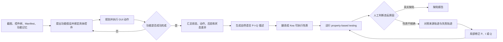

# PropGen：从运行证据自动生成并修正移动 GUI 测试性质

## 一页读懂

| 问题 | PropGen 的回答 |
|---|---|
| 旧方法哪里不够 | Kea 能用 `P-I-Q` 性质检查非崩溃功能缺陷，但性质和主路径需要人工编写；仅让 LLM 根据应用简介生成性质，又会虚构功能和控件。 |
| 本文新增什么 | 先在真实 GUI 中提出并执行功能假设，把成功轨迹整理为行为证据；再由多模态大模型从证据生成自然语言性质和 Kea 可执行代码；对人工判定为误报的性质，根据失败轨迹作局部修正。 |
| 输入与输出 | 输入是 Android 应用及其运行时截图、控件树和 Manifest 信息；输出是自然语言性质与可由 Kea 执行的 `P-I-Q` 性质。 |
| 怎样验证 | 在 12 个开源 Android 应用上，与 DroidAgent、只读应用简介的直接 LLM 生成方式，以及 Genie、Odin、PBFDroid、VisionDroid 比较；人工标注功能、执行和性质是否有效。 |
| 证据能说明什么 | 1,282 个功能假设中 94.4% 有效，76.2% 被正确执行；985 个性质描述中 92.6% 有效；118/127 个不精确性质修正成功；最终发现 25 个此前未知功能缺陷。它证明运行证据能显著约束性质生成，但人工仍要区分真缺陷与误报，且性质可能继承被测程序的既有错误。 |

## 一段话介绍

PropGen 试图自动完成 Kea 最依赖人工的环节：发现应用功能并为其编写可执行的业务 oracle。系统先把当前截图中的可交互控件编号，并结合 UIAutomator2 控件树、Activity 名称和已探索功能记忆，让多模态大模型提出“某个具体控件可能完成什么功能”；随后围绕该假设规划和执行操作，把每一步的前态、动作、后态、界面变化和执行结果压缩成行为证据。只有成功轨迹才进入性质合成：模型先写出不依赖某次具体轨迹的 `P-I-Q` 自然语言描述，再翻译成 Kea 代码。若性质在测试中报告违反，经人工确认属于性质不精确而非真实缺陷，系统对照原始成功轨迹与失败轨迹，只修改前置条件、交互或后置条件中的问题部分。12 个应用的实验显示，运行证据使 985 个生成性质中的 912 个有效，而只根据应用简介直接生成的 240 个性质没有一个有效；修正模块解决 118/127 个不精确性质，并由最终性质发现 25 个新功能缺陷。该方法把自由探索转成可复用的结构化 oracle，但尚未消除人工审核，也无法保证从被测实现观察到的行为就是需求规定的正确行为。

## 关键术语与阅读前提

- **Property（性质）**：对一类 GUI 状态都应成立的功能约束。PropGen沿用 Kea 的 `φ=<P,I,Q>` 表示。
- **Precondition `P`（前置条件）**：说明性质何时适用，例如当前页面存在可添加附件的笔记。
- **Interaction `I`（交互）**：需要执行的操作序列，例如打开附件菜单、拍照并确认。
- **Postcondition `Q`（后置条件）**：操作完成后应成立的可观察结果，例如笔记中出现附件缩略图或附件图标。
- **Functionality hypothesis（功能假设）**：模型根据当前 GUI 推断的“功能描述—触发控件”二元组。它是待执行验证的候选，不等同于已确认功能。
- **Semantic context（语义上下文）**：供模型理解当前状态的信息，包括带编号截图、控件树、应用和 Activity 名称，以及跨状态功能记忆。
- **Widget signature（控件签名）**：由控件类别、resource ID、文字和描述组成的标识。系统用它判断当前页面是否带来尚未分析的新控件，减少重复模型调用。
- **Behavioral evidence（行为证据）**：成功执行功能时形成的结构化轨迹；每一步包含前态、事件、后态、状态差异和结果。它承担性质生成的事实依据。
- **Groundedness（可落地性）**：性质引用的控件和动作是否都能在源轨迹中观察到。它主要防止模型虚构不存在的元素。
- **Faithfulness（忠实性）**：`P-I-Q` 是否准确表达源轨迹所展示的功能意图，而非仅在语法上可执行。
- **Spurious violation（虚假违反）**：可执行性质报告失败，但失败来自性质写得过窄或错误，而非应用缺陷。论文将这种情况称为 imprecise property。
- **Feedback-driven refinement（反馈驱动修正）**：对照性质的来源轨迹与触发误报的轨迹，定位 `P`、`I` 或 `Q` 中的问题并作最小修改。

## 研究问题与动机

自动 GUI 探索能够产生大量动作，却通常只能稳定地以 crash 作为失败信号。Kea 用人工 `P-I-Q` 性质引入业务预期，再围绕主路径寻找更多状态，能够发现非崩溃功能缺陷；其限制是测试人员仍要先理解功能、编写性质并提供主路径。

直接让 LLM 根据应用名称或商店简介编写性质不能解决这一问题。移动应用通常没有足够完整、可执行的规格，简介也不会列出页面控件和详细交互。模型容易生成看似合理但应用中不存在的功能、元素或动作。PropGen 的核心假设是：**先让模型在真实应用中成功执行功能，再从可观察轨迹中归纳性质，比凭常识直接猜测性质可靠。**

## 贡献

作者将贡献概括为三部分：

1. 提出从运行时行为证据自动生成移动应用性质的方法，把功能探索、自然语言性质合成和可执行代码生成连成一条流程。
2. 提出利用测试失败证据修正不精确性质的方法，并尽量只修改 `P-I-Q` 中导致误报的组成部分。
3. 在 12 个真实应用上评价功能发现、性质有效性、性质修正和缺陷发现能力，并与 LLM Agent、直接生成和四类功能测试工具比较。

核心贡献类型是 **method**。12 个应用、生成性质和缺陷材料属于评价 artifact，论文没有提出新的独立 benchmark。

## 方法

### 1. 假设引导的功能探索

系统通过 UIAutomator2 获取控件树，通过 ADB 获取截图并执行事件，同时从 Manifest 提取应用名和 Activity。截图只给叶子级可交互控件编号，使模型输出必须指向当前真实存在的控件。模型为页面提出若干 `<功能描述, 触发控件>` 假设，例如“点击相机入口可为笔记添加照片”。

为控制重复调用，PropGen 用“Activity + 叶子控件签名集合”描述 UI 上下文；只有出现尚未分析的签名时才重新请求模型。静态分析得到的文字白名单用于过滤时间、计数等动态文本，避免同一页面因为内容变化被不断视为新状态。所有已推断功能保存在全局池中，并按以下因素选择下一个目标：

1. 是否属于被测应用本身，而非系统或第三方页面；
2. 与已探索功能相比是否有新的语义；
3. 从当前状态执行成功的可能性。

针对选定功能，模型根据带编号截图生成点击、长按、输入、滑动或返回事件。每次执行后，系统把前后页面、目标和历史交给模型，判断该步是成功、失败还是已完成。若当前区域的功能假设都已尝试，系统用随机探索离开局部区域，再在新上下文中继续推断。

### 2. 把成功轨迹整理为行为证据

PropGen 不把整段原始对话直接用于生成性质，而是逐步汇总：

- 操作前处于什么页面和状态；
- 执行了哪个事件；
- 操作后进入什么状态；
- 哪些控件、文字或页面发生变化；
- 该步对目标功能是成功、失败还是完成。

这种证据既保留“怎样触发”，也保留“触发后看到了什么”，并减少长轨迹中的无关信息。只有被判定为成功完成的轨迹才用于性质合成。

### 3. 先写描述，再生成可执行性质

系统分两步生成 oracle：

1. 从行为证据抽象自然语言 `P-I-Q`。`P` 必须由可观察 GUI 状态判断；`Q` 应是操作后的直接、可见结果；描述应去除只属于某次轨迹的脆弱细节。
2. 根据 Kea API 和控件属性，把描述翻译成可执行代码。

两步生成使研究者可以先审核测试意图，再检查实现细节；它也避免模型一开始就在代码语法、控件定位和业务抽象之间同时决策。

### 4. 用失败轨迹修正误报

生成性质在 Kea 中运行。出现违反后仍需人工判断：若是应用行为真的违背预期，则记录为缺陷；若是合法行为被性质误判，则把它标为“不精确性质”并启动修正。

修正模型同时读取原始性质、生成该性质的成功轨迹和触发误报的失败轨迹。它先恢复原始测试意图，再判断错误属于：

- `P` 太宽，需要限制适用页面或状态；
- `I` 的操作不正确；
- `Q` 太窄，需要接受功能上等价的结果。

随后只修改对应部分。自动代理检查修正后性质是否仍在来源轨迹成立、且不再报告已知误报轨迹；人工标注者再确认其可落地、忠实且保留原意。

论文中的笔记应用展示了这一过程。初始性质假定拍照后一定返回标题为 “Notes” 的页面，并出现固定缩略图；但从 Archive 页面发起操作会合法地返回 Archive，紧凑布局还可能显示附件图标。修正后的 `Q` 用共同存在的菜单控件识别返回页面，并接受缩略图或附件图标。该性质随后发现真实缺陷：先打开录音功能再拍照，会导致照片没有附加到笔记。

### 5. 实现边界

原型基于 DroidBot、Python/JavaScript、UIAutomator2 与 ADB，性质由 Kea 执行。实验使用 GPT-5.2 快照 `gpt-5.2-2025-12-11`，temperature 和 top-p 均为 1.0。方法同时读取截图和控件树，属于运行时黑盒 GUI 测试；它不依赖应用源码来推断业务语义，静态信息主要用于 Manifest 与动态文字过滤。

## 实验

### 对象、时间和人工标注

- 12 个开源 Android 应用：OmniNotes、Markor、RetroMusic、Amaze、MyExpenses、AntennaPod、AnkiDroid、OuterTune、NewPipe、MaterialFiles、Orgzly 和 uhabits。
- Android 11 Pixel 模拟器；Ubuntu 22.04；AMD EPYC 服务器。
- 每个应用先用 3 小时收集行为证据并生成性质，再用 Kea 测试 6 小时。
- 两名具有 4 年以上 Android 经验、且不是论文作者的研究生独立标注功能有效性、执行正确性和性质有效性；Cohen's κ 分别为 0.91、0.82 和 0.81。

### RQ1：功能探索与性质生成是否有效

| 指标 | PropGen | 比较对象 |
|---|---:|---:|
| 推断功能数 | 1,282 | DroidAgent 575 |
| 有效功能 | 1,210 / 1,282（94.4%） | DroidAgent 491 / 575（85.4%） |
| 正确执行 | 977 / 1,282（76.2%） | DroidAgent 187 / 575（32.5%） |
| 生成性质描述 | 985 | 直接 LLM 240 |
| 有效性质描述 | 912 / 985（92.6%） | 直接 LLM 0 / 240（0%） |

直接 LLM 基线使用相同模型，只读取官方应用简介，并为每个应用生成 20 条性质。其 240 条性质全部无效，主要原因是引用不存在的功能或控件，无法执行。该结果支持“运行时行为证据是性质生成的必要约束”，但这个基线输入较弱，不能代表所有带需求文档、设计稿或人工示例的规格生成方法。

功能探索和性质合成阶段每次模型调用平均消耗 6,198 token、0.0145 美元；每个应用平均共 6,364K token、14.86 美元。DroidAgent 为 5,109K token、13.01 美元。主要失败包括功能假设本身无效、在步数预算内未完成、过早判断完成，以及在 `P/I/Q` 中虚构控件。

### RQ2：不精确性质能否修正

生成的可执行性质中，有 127 条在测试时产生虚假违反并被人工判为不精确；其中 118 条修正成功，成功率为 92.9%。成功修正涉及：

- 前置条件 `P`：53 条；
- 交互 `I`：1 条；
- 后置条件 `Q`：64 条。

剩余 9 条中，5 条把误报原因定位到错误组成部分，4 条修正后偏离原测试意图。每条性质修正平均消耗 8,768 token、0.02 美元。论文没有清楚给出全部可执行性质数量这一分母，因此不能把 `127` 解读为所有生成性质的误报率。

### RQ3：能否发现新功能缺陷

最终性质在 12 个应用的最新版本中发现 25 个此前未知的功能缺陷：功能无效果 12 个、状态不一致 6 个、错误行为 4 个、导航失败 3 个。论文报告每个计入缺陷都经过人工复现并确认真实且此前未报告；截至论文记录，5 个已由开发者修复，其余仍在等待回复。这里不能写成“25 个均获开发者确认”。

### RQ4：与既有功能测试工具有什么关系

在 PropGen 的 25 个缺陷中，只有 7 个落入 Genie、Odin、PBFDroid 所声明的 oracle 范围；四个比较工具实际合计重新发现 3 个。相同 12 个应用上，四个工具合计发现 13 个新缺陷，PropGen 发现 25 个；两组重叠 3 个，因此 PropGen 有 22 个独有缺陷，既有工具也有 10 个 PropGen 未发现的缺陷。

这说明它们互补，而非 PropGen 全面替代专门 oracle。Genie、Odin 和 PBFDroid 的规则针对特定错误类型；VisionDroid 逐条判断可能的交互路径；PropGen 则为每项功能生成一条可重复检查的性质。论文为 PropGen 分配 3 小时性质生成加 6 小时测试，为 Genie、Odin、VisionDroid 分配 9 小时，为 PBFDroid 在人工性质构造后分配 6 小时。

## 局限与证据边界

### 作者讨论的局限

- 人工标注具有主观性；论文用两名独立标注者和较高 κ 值缓解。
- 仅评价 12 个开源应用，不能代表完整移动应用生态。
- 应用可能出现在模型训练数据中；作者指出 25 个缺陷此前未公开，且 12 个构建中有 6 个晚于模型知识截止时间。
- 既有错误可能污染性质。作者认为只使用成功轨迹、抽象行为以及人工复核能够降低风险，但不能完全排除。
- 每项功能只生成一条性质；同一功能还可能需要多条性质覆盖不同预期。

### 我们根据方法和实验观察到的问题

1. **Oracle 独立性仍不完整**：性质主要从被测应用自己的成功行为归纳。如果错误行为稳定出现并被模型视为正常，系统可能把实现错误写成预期。需求、设计稿、跨实现差分或显式领域规则仍有价值。
2. **并非端到端全自动**：人需要把性质违反分成真实缺陷和误报，并确认修正后的性质保留原意。92.9% 是在已人工筛出的不精确性质上计算的修正成功率。
3. **观察范围偏向即时可见结果**：`Q` 主要检查操作后马上可见的 GUI 状态；后台状态、延迟效果、跨会话持久化、精确时序和视觉几何异常没有得到充分覆盖。
4. **执行成功仍有明显缺口**：1,282 个有效性候选中只有 76.2% 被正确执行，约四分之一功能没有形成可靠轨迹。
5. **测试成本较高**：每应用性质生成约 14.86 美元，并使用 3 小时生成加 6 小时测试；该配置尚不能直接代表日常 CI 的短时回归成本。
6. **比较不能简化成统一排名**：既有工具使用不同 oracle，能够发现 PropGen 漏掉的 10 个缺陷；理论范围和实际路径触发也被论文分开统计。

## 和我们课题的关系

### 与 UX testing 的关系

PropGen 当前生成的性质主要描述功能操作后的即时、可见结果，并未专门建模文字截断、遮挡、重叠和溢出。它对 UX-Agent 最有价值的是一条可借鉴的证据构造路线：先从当前页面提出具体 UX 检查假设，再主动滑动或切换状态，保存操作前后截图、控件树和变化摘要，最后把检查写成可重复执行的 `P-I-Q` 性质。例如：`P` 为“目标文本疑似被截断且页面可滑动”，`I` 为“向指定方向滑动并在必要时恢复页面”，`Q` 为“目标文本变得完整可见，且没有产生新的遮挡或越界”。

要落地这一思路，性质语言还需要截图、边界框、遮挡比例、父容器裁剪和滑动前后可见区域等几何谓词。更关键的是，UX 性质不能只从当前应用的既有渲染学习；若原页面本来就布局错误，系统可能把错误外观归纳为正常行为。UX-Agent 应继续用明确的视觉/布局规则和主动验证提供独立判据，再借用 PropGen 的探索、证据摘要与性质修正流程。

### 与 GUI testing 的关系

PropGen直接研究 GUI testing 中最难自动化的 oracle 生成：它不只让模型在线判断某次截图“像不像错误”，而是把真实探索轨迹转换成持久、可执行、可回归的结构化性质。这样，探索阶段负责收集功能证据，Kea 负责在更多状态和路径中反复验证同一预期，失败轨迹又反过来修正过窄的 oracle。

它也展示了 LLM GUI Agent 与 GUI testing 的分界。功能假设、动作规划和页面理解与通用 Agent 很相似；测试贡献来自后续的预期抽象、断言生成、误报修正、人工真值和缺陷评价。由于预期仍主要来源于被测实现，PropGen应被归为**运行证据驱动的规格挖掘与测试预言生成**，而不是具有外部需求保证的需求一致性验证。

## 与 Kea 的前后关系

Kea 的输入是人工编写的 `P-I-Q` 性质和主路径，贡献是性质语言、执行器以及围绕主路径生成替代状态的探索方式。PropGen 把这些性质的来源向前自动化：主动发现功能、收集成功轨迹、生成自然语言与可执行性质，并用误报轨迹修正性质；最终仍由 Kea 执行 property-based testing。

因此两篇论文应作为一条连续路线阅读：

1. **Kea** 回答“已有明确业务性质后，怎样在更多 GUI 状态中检查它”；
2. **PropGen** 回答“没有现成性质时，怎样从运行行为提出、实现并修正它”；
3. 二者共同留下的问题是“怎样引入独立于被测实现的需求或设计证据，避免把既有错误学成正确规格”。

## 原文关键句（节选）

> “The LLM alone is thus insufficient without runtime behavioral evidence.”
> — Section 5.2，正式论文 PDF 第 9 页。

这句话概括了论文最重要的实验结论：模型本身不是可靠规格来源，必须把生成结果约束在真实、可执行的运行证据上。

## 所读版本与核对范围

- 全文来源：ASE 2026 正式论文 PDF，共 13 页。
- 书目信息：41st IEEE/ACM International Conference on Automated Software Engineering，DOI `10.1145/3832783.3837536`。
- 已逐页读取 Abstract、Sections 1–8、Figures 1–4、Tables 1–5 和附录/参考信息；总体流程、例子和 Tables 2–5 经过页面渲染核对。
- 未运行 PropGen、Kea 或 artifact，也未复现 25 个缺陷；`status` 为 `extracted`，不表示合作者已核对。

## 书目与分类（记录用）

展开标题、作者、版本和标签

- title: PropGen: Automated Property Generation for Property-Based Testing of Mobile Apps
- authors: Yiheng Xiong; Shiwen Song; Bo Ma; Ting Su; Xiaofei Xie
- year: 2026
- era: llm
- venue: ASE 2026 Research Papers
- venue_type: conference
- url: https://doi.org/10.1145/3832783.3837536
- pdf_url: https://doi.org/10.1145/3832783.3837536
- version: ASE 2026 formal proceedings, 13 pages
- artifact_url: https://doi.org/10.5281/zenodo.21770804
- institution: East China Normal University; Singapore Management University
- aka: PropGen
- door: gui
- question: generate, oracle, evaluate
- contribution_type: method
- platform: android
- method: multimodal-llm, dynamic-analysis, property-synthesis, feedback-refinement
- oracle_type: specification, assertion, human
- bug_type: functional
- benchmark: 12 Android apps
- baselines: DroidAgent; naive LLM generation; Genie; Odin; PBFDroid; VisionDroid
- headline_result: 912/985 valid property descriptions; 118/127 imprecise properties successfully refined; 25 new functional bugs
- open_source: yes
- priority: must
- status: extracted
- read_depth: full

