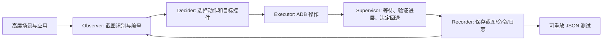

# ScenGen：把高层业务场景转成可重放的移动 GUI 测试

## 一页读懂

| 问题 | 论文的回答 |
|---|---|
| 为什么研究 | 随机或覆盖导向探索可以进入许多页面，却不一定走完“搜索商品→选商品→加入购物车”这样的连续业务流程。 |
| 输入与输出 | 输入一个自然语言场景和 Android 应用；输出带操作意图、控件位置、截图及 ADB 命令的 JSON 测试轨迹，可在不再调用 LLM 的情况下重放。 |
| 主要方法 | Observer 从截图检测控件；Decider 选择场景相关动作并定位控件；Executor 执行；Supervisor 等待页面稳定、检查动作进展与终点；Recorder 保存轨迹和运行日志。 |
| 主要结果 | 92 个应用、10 类场景形成 99 项任务；完整覆盖场景 86/99（86.87%），正常完成且完整覆盖 84/99（84.85%）；运行日志发现 106 个场景相关 crash。 |
| 读表警惕 | Supervisor 检查的是**是否沿场景前进**，不是独立的业务正确性断言。表 4、表 5 的部分百分比与原始计数不符，后文逐项核对。 |

## 一段话介绍

ScenGen 让测试人员只给出“发送邮件”“将商品加入购物车”等高层目标，由系统在当前手机界面上逐步生成、执行并记录测试。它先以传统计算机视觉和 OCR 找到截图中的文字与控件，再让多模态模型理解控件作用；决策分为“下一步应做什么”和“这个动作对应哪个具体控件”两次推理，控件漏检时可推测邻近位置，点到标签时可把坐标移到真正的输入框。每次操作后，Supervisor 检查页面是否加载完、动作是否带来预期进展、场景是否完成；失败时重新定位或修改计划。实验显示它在 99 个应用—场景任务中有 84 个正常完成并完整覆盖场景，且通过日志发现 106 个 crash。其研究价值是把 GUI Agent 的动作序列保存为可检查、可重放的测试资产，同时用场景约束减少无关探索。它没有生成业务断言，无法仅靠 Supervisor 证明购物车数据或页面视觉布局正确。

## 术语与指标

- **Testing scenario（测试场景）**：完整的用户业务目标，例子是“搜索商品并加入购物车”。它比单个点击更高层，却不包含每一步的详细脚本。
- **Scenario coverage（场景覆盖）**：生成动作是否走完给定目标；不是代码覆盖率或缺陷覆盖率。
- **C / S**：论文把 99 次任务分为正常且完整 `c1`、异常终止但完整 `c2`、正常结束但不完整 `c3`、异常且不完整 `c4`。`C=(c1+c2)/99`，`S=c1/99`。
- **Widget localization（控件定位）**：把“点击搜索框”等语义目标映射为可执行屏幕坐标。本文从截图检测候选框，再让模型挑选。
- **Supervisor（监督模块）**：检查加载、动作后的页面变化及场景结束，必要时触发重试或回退。它维护执行进度，不提供独立于被测程序的功能 oracle。
- **Oracle（测试预言）**：判断实际结果是否正确的依据。本文针对缺陷主要使用 crash/未处理异常日志；场景完成判断不能替代业务断言。
- **Replayable script（可重放脚本）**：JSON 记录意图、动作、控件属性、截图和实际 ADB 命令。脚本按设备分辨率记录坐标；跨版本稳定性另需验证。

## 动机和贡献

传统 GUI fuzzer 经常把访问更多状态或代码路径作为目标，但业务错误可能只在一串有依赖的操作之后发生。一个简单例子是登录：要先填账号和密码、同意条款，才能点击提交；随意触碰控件无法验证完整流程。另有隐藏菜单、自绘控件和动态页面，使仅看布局树或固定模型的方法难以使用。

作者提出的贡献是：①把高层测试场景作为探索单位，设计五模块协作流程；②结合截图控件检测、语义推理、漏检控件预测和位置修正；③构建 10 类场景、92 个应用的评价集，并比较场景完成、crash、控件定位、决策与成本。主要贡献类型是**方法**，另公开工具和场景材料；它并未提出独立的业务预言生成方法。

## 方法：一轮测试具体发生什么

### 1. 共享记忆

长期记忆保存设备、应用及场景说明；工作记忆保存目标、已执行动作及中间结果；短期记忆保存当前/上一张截图和控件识别结果。系统用感知哈希与结构相似度合并只差时间、动画等细节的状态，减少重复探索。这个合并对一般功能探索有利，但在研究细微 UX 缺陷时可能抹掉关键视觉差异。

### 2. Observer：从真实画面获得可操作候选

Observer 采用类似 UIED 的边缘、轮廓和组件分组检测控件，用 OCR 提取文字；再合并相邻文字、图标与标签，删除状态栏、重复或尺寸异常的候选。它把编号和边界框覆在截图上，让模型从“直接猜像素坐标”转成“选第几号控件”。对于 Canvas 或混合 H5 页面，截图感知能够看到布局树缺失的元素。检测阈值仍可能把两个相邻元素合并，或把一个控件拆开。

### 3. Decider：先决定动作，再找精确位置

决策输入是场景、动作历史、当前截图和候选控件。第一步输出动作类型、意图、目标描述、输入文本或滑动方向；第二步用带框截图把目标描述对应到控件 ID。若目标漏检，模型可根据邻近控件推测“虚拟控件”位置；若识别到的是“收件人”标签，则把输入位置移到旁边真正的文本框。失败反馈分三类：位置找错、前置步骤漏掉、动作逻辑偏离场景，分别在对应推理上下文中修改。

### 4. Supervisor 与 Recorder：保证执行可追溯

Supervisor 先识别加载态并等待，再用前后截图判断操作是否产生符合场景的变化，最后判断场景是否完成。若页面进入错误状态可返回或回到最近有效状态；对短暂弹窗，可在观察窗口内连续截图。它判断的是**动作执行与场景进度**，论文第 18 页明确说明“不生成传统断言式 oracle”。

Recorder 保存每步意图、动作、控件文字/边界框、输入、操作前后截图和实际 ADB 命令，最后形成 JSON 脚本；运行日志同时用于发现 crash 和未处理异常。脚本可独立重放，但论文没有系统测试跨设备、跨版本或动态内容情况下的重放稳定性。

## 实验：每个数字代表什么

研究者选择邮件、音乐、笔记、拍照、翻译、购物、登录、计算、天气、闹钟 10 类常见场景。92 个英语界面 Android 应用中有 7 个参与两种场景，共 99 项应用—场景任务。用 GPT-4V `gpt-4-vision-preview`、temperature 0；项目包括开源与商业应用。三名有五年以上经验的评价者对定位和决策独立判定，只有三人一致才算正确。论文称重复 10 次并汇总，但主表仍以 99 项任务为分母；如何从重复试验折算单个任务结论不够清楚。

### RQ1：场景是否完整执行

ScenGen 的 `c1/c2/c3/c4=84/2/7/6`，因此场景覆盖 `86/99=86.87%`、正常且完整 `84/99=84.85%`。同表中 GPTDroid 为 74.75%/68.69%，ScenTest 为 77.78%/69.70%，ASOT 为 84.85%/73.74%，还列出 Mobile-Agent-v3、AppAgent、AutoDroid。论文在基线设置文字中只明确介绍前三者，后面三项出现在结果表但配置细节不充分。

失败分析提到提前终止 6 次、完成判断不准 3 次、控件定位 3 次、应用特殊设计 2 次、非常规流程 1 次。论文把这些描述为 15 个失败案例，而 `c2+c3+c4=15`，与总数一致；但一些成因类别可能交叉，不能视为独立机制的严格消融。

### RQ2：报告的缺陷是什么

ScenGen 在 99 项任务中报告 106 个场景相关缺陷；ScenTest 71、ASOT 89、GPTDroid 63。Monkey、Stoat、PIRLTest 的全应用缺陷数分别为 159、228、317，但目标场景内分别为 29、43、51。作者通过操作时间对应的运行日志筛选，人工复核后称这些基本是 **crash/未处理异常**；106 不能解释成视觉缺陷或业务逻辑 oracle 的结果。论文称其中 83.02% 已获开发者验证或修复，但未给出逐项状态表。传统基线每任务运行 2 小时，场景方法运行到自行结束，因此不同工具预算并不相同；“所有基线缺陷均被 ScenGen 找到”的断言缺少逐缺陷列表支持。

### RQ3/RQ4：中间模块的准确率

控件定位表给出 312 次尝试、首次正确 258、修正后正确 305。按计数计算分别为 **82.69%** 和 **97.76%**；表格却写 80.79% 和 97.96%，正文还出现 97.76%。因此可靠的是计数与复算结果，不能无条件引用表中的百分比。逻辑决策表为 408 次、首次 392、最终 396，对应 **96.08%** 和 **97.06%**；紧随表后的正文却写 96.82% 和 97.59%。该论文存在明显数字校对问题。

定位正确性以操作后达到期望 GUI 转移为依据，因此“选中了正确坐标”和“应用实现产生正确业务结果”没有完全分离。决策正确性来自三位评价者一致同意，也不等于应用最终没有缺陷。

### RQ5：成本

表中每场景平均 48,779 token、约 0.32 美元，时间平均 4.71 分钟；ScenTest 1.72 分钟、GPTDroid 7.48 分钟、ASOT 10.38 分钟。ScenGen 的 token 主要消耗在界面状态与完成情况的视觉验证，而非下一步动作选择。成本数字依赖当时的 GPT-4V 价格；模型 API 已有时间敏感性，后续应用不能直接套用。

## 局限与我们应怎样理解

1. **场景完整不等于业务正确**：Supervisor 可能在“已输入翻译文本、尚未按翻译”时提前停止，也可能把登录页面变化误判成登录成功。若要评价功能缺陷，还要有独立需求、断言或跨版本对照。
2. **缺陷终点偏向 crash**：106 个缺陷来自日志与异常终止，不覆盖 UX-Agent 关心的截断、遮挡、重叠、溢出，论文也没有非崩溃缺陷 Precision/Recall。
3. **数据口径存在矛盾**：定位和决策表的百分比与计数冲突；写作与复现时应保留原始分子分母。
4. **视觉感知的优劣依场景而变**：不读 UI 树可触达自绘界面，但 OCR 和轮廓会漏掉隐形触控区域，邻近控件的合并阈值可能错误。
5. **反馈可能掩盖真实 bug**：当应用的点击结果不符合目标，系统可能把它当成点错而重试，最终完成任务，却没有把最初异常作为缺陷保存和人工判定。
6. **脚本重放范围未量化**：保存 ADB 坐标有利于相同设备复跑，但页面改版、分辨率变化和动态内容会使坐标失效。
7. **实验比较不完全对等**：传统工具固定 2 小时，场景工具自动结束；同表附加 GUI Agent 的设置也不够清楚。

## 和我们课题的关系

### 与 UX testing 的关系

ScenGen 的截图候选框、OCR、页面稳定等待、动作失败修正与可重放记录可用于 UX-Agent 进入目标页面并可靠执行主动 slide。它的 Observer 可以为自绘或布局树缺失页面提供候选控件，而 Supervisor 的连续截图窗口能防止短暂遮挡或加载中状态被忽略。

但现有实现不测控件几何关系，也不把“滑动后文字是否完整可见”“目标是否真正被遮挡”写成断言。我们的 UX-Agent 需要在场景轨迹上增加边界框、裁剪容器、遮挡比例和滑动前后可见性证据，并避免把同一页面的细微视觉差异合并成同一个状态。对一个点击“无效”的判断也应先保留缺陷候选，再决定是否自我修正。

### 与 GUI testing 的关系

ScenGen 属于**场景约束的测试生成与执行**：人提供业务目标，模型负责生成动作序列，系统保存可重放脚本；crash 日志充当缺陷 oracle。它与 GraphDroid 的全局功能探索不同，与 ProphetAgent 将详细文本步骤匹配已有转移图也不同。它最清楚地展示了 GUI Agent 和 GUI testing 的交汇：感知、规划、执行、纠错相同；测试系统额外需要可检查的轨迹和明确的失败信号。将“完成目标”当成“测试通过”仍会遗漏功能和显示错误。

## 原文版本与记录字段

- title: Scenario-Guided LLM-based Mobile App GUI Testing
- authors: Shengcheng Yu; Yuchen Ling; Chunrong Fang; Quan Zhou; Yi Zhao; Chunyang Chen; Shaomin Zhu; Zhenyu Chen
- venue: ACM TOSEM 2026；ASE 2026 Journal First 展示，**不是 ASE 主会 Research Paper**
- DOI: https://doi.org/10.1145/3816025
- 本次实际阅读：arXiv `2506.05079v4`，40 页，PDF 的 ACM 书目信息仍为占位符；正式 DOI 和 Journal First 状态由会议页面与作者发表列表核对。
- code: https://github.com/iGUITest/ScenGen
- era: llm
- door: gui
- question: generate, execute, evaluate
- contribution_type: method, artifact
- platform: android
- method: multimodal-llm, computer-vision, OCR, multi-agent, scenario-guided-exploration
- oracle_type: crash-log, human; Supervisor 只做场景进度检查
- bug_type: crash
- benchmark: 92 apps, 10 scenarios, 99 app-scenario tasks
- baselines: GPTDroid; ScenTest; ASOT; Monkey; Stoat; PIRLTest; Mobile-Agent-v3; AppAgent; AutoDroid（不同 RQ 使用不同集合）
- headline_result: 84/99 正常完整；86/99 完整覆盖；106 个场景内 crash 报告
- priority: should
- status: extracted
- read_depth: full

已逐页阅读本地 40 页 PDF 的方法、实验、讨论和参考内容，并核对架构图与关键结果表；未运行工具或复现缺陷。
