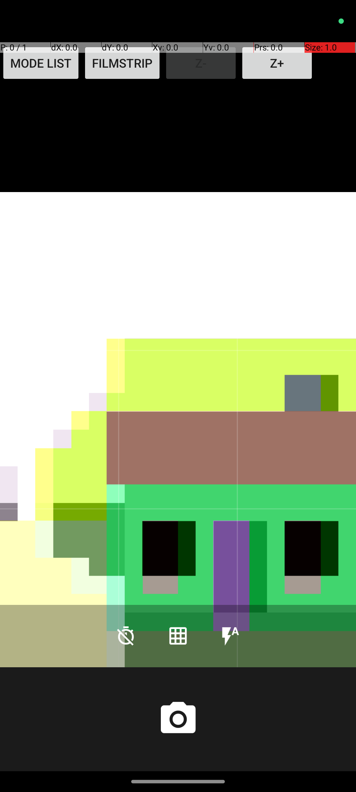
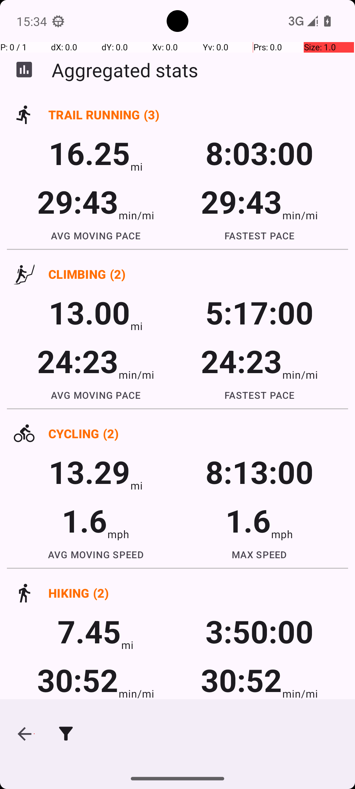

# OS-Genesis：从真实交互生成任务，已经跑完小规模数据链，尚未验证训练收益

更新：2026-11-02。本文合并本项目的复现方式、过程、结果、失败诊断和 AB 分析，作为唯一项目说明。原始实验记录保留用于追溯，不要求读者先读那些分散报告。

[论文学习 note](https://github.com/ZYY0321/Testing-Survey/blob/main/notes/sun2025osgenesis.md) · [正式论文](https://aclanthology.org/2025.acl-long.277/) · [官方代码](https://github.com/OS-Copilot/OS-Genesis) · [本机按任务阅览](http://127.0.0.1:8770/osgenesis) · [八项目总目录](catalog.md)

## 1. 这篇论文到底解决什么，我们完成到了哪里

OS-Genesis 研究 GUI Agent 的训练数据来源。传统做法是先写“收藏一份菜谱”之类目标，再让 Agent 去做；目标可能不符合应用当前支持的能力。它把顺序反过来：先实际操作，记录操作前画面、动作、操作后画面，再让模型据此编出低层指令与高层目标；之后从初始化环境重新执行高层目标，给整条轨迹评分，用评分调节监督训练的采样概率。这里的“反推”是从观察形成候选意图，并非从一次点击直接证明一个完整任务一定可行。

我们已完成 **3 类初始化任务、每类 10 次随机交互 → 22 个变化三元组 → 22 个高层目标 → 22 条非空重新执行轨迹、127 个原生步骤 → 22 个原奖励评分**。这条链能够真实产出数据；它没有进行监督微调，没有重新评测训练后的模型，也没有产品缺陷真值。因此，当前可以说“数据生成小规模适配链路跑通”，不能说“原论文全部复现”或“22 个目标全部成功”。

本轮统一使用 Qwen3.8-Max，替代原论文 GPT-4o。反推入口未完整公开，我们按正式论文 Prompt 14 写了独立薄格式交接组件，未公开的 few-shot 示例明确为空；随机探索、M3A 执行器与奖励模型使用原实现。这些差异意味着本轮是协议对照下的适配 pilot，不能直接和作者成绩作模型优劣比较。

## 2. 原论文的完整协议与本轮对照

|环节|论文原本如何验证|我们实际如何做|差异意味着什么|
|---|---|---|---|
|任务来源|在可交互环境中记录变化三元组，再反推高低层任务|原 shuffle 选择前 3 类任务，每类 10 步，变化才保存|规模小且不代表所有应用、所有状态|
|轨迹采集|强模型根据合成目标重新执行|22 个冻结目标，每任务原 15 步上限，执行阶段 10800 秒预算|目标未因失败改写，不补探索前缀|
|质量评分|模型按完成与连贯性打 1–5 分，并按分数比例采样|全部 22 条经原 RM 评分，保留原格式失败及重试|评分有结果，不等于独立成功标签|
|训练|OS-Genesis 与 Task-Driven 各 1000 条，Self-Instruct 1500 条；开源视觉模型全参数监督训练|未训练|不能报告训练收益|
|在线评测|AndroidWorld 实际 112 任务、WebArena 241 模板测试等|未跑训练后榜单|本轮不是 AndroidWorld 完整成功率复现|
|应用正确性|论文评价任务操作/训练质量|没有注入缺陷、没有软件预期真值|不能算 UX 召回、缺陷覆盖或独立 bug 数|

论文 Table 1 中，同一 Qwen2-VL-7B 骨干的 AndroidWorld 成功率为 Self-Instruct 9.82%、OS-Genesis 17.41%，相差 7.59 个百分点；GPT-4o/M3A 为 23.70%。这是训练后用户任务完成率。我们的 22/22 有轨迹和 RM 5 分占比均没有同样含义，不能填入该表作为“我们的成功率”。数字与协议见[正式 PDF，§4、Table 1、附录 A](https://aclanthology.org/2025.acl-long.277.pdf)及学习 note；正式版与作者其他版本的数值不混用。

## 3. 复现过程：环境适配与研究方法分开

第一步建立 AndroidWorld 环境。Windows 原生与 WSL 的 ADB、gRPC、无障碍树回程存在接口障碍，早期拿到部分树不等于原 controller 已可用；随后建立本项目独立 Android 模拟器及局部传输桥，验证真实 get_state、初始化、动作与重置。资源保护曾在系统提交内存不足时停止自有设备；这属于环境调试，不计作模型失败或论文运行成绩。

第二步运行原随机探索，生成 Markor 8、OpenTracks 5、Camera 9 个变化三元组，共 22 个。输入框文字生成仍调用了一次模型，不能把这一阶段绝对称为零模型探索。保留了原截图、控件树、动作和初始化参数。

第三步从这些三元组反推任务。23 次尝试中 22 个 HTTP 200 形成 22 个目标；一次 DNS 失败只恢复同一请求，先前已成功的四项未重复生成。目标按来源与 step_index 固定，进入执行前冻结，防止按结果选容易目标。

第四步重新执行。M3A 对每个冻结目标使用原 15 步限制；没有为了成功而重放探索前缀、补随机 seed、延长步数或修改答案。原 registry class 负责初始化，但其旧任务判定器不自动适用于新反推目标。执行器未序列化完整终态 success，因此不能用日志含 completed 一词替代目标成功评价。

第五步评分与审计。原 RM 使用目标、完整低层总结历史、末最多三步的动作前截图。不是重新看完整视频；不足三步就使用已有步。原正则只接受 Reason/Score 格式，一条粗体 Score 回答被拒绝并按原逻辑重试，保留了该回答；未放宽解析来抬高结果。固定 20 项样本在执行前冻结，由 AI 实际查看图片与动作进行诊断，人类评审数仍为 0。

所有这些操作均已结束，目前不自动扩充数据、恢复模拟器或开始训练。源码原件与运行适配分开，原失败和原评分不覆盖。

## 4. 核心结果与调用开销

|结果|数值|正确理解|
|---|---:|---|
|变化三元组|22：Markor 8 / OpenTracks 5 / Camera 9|局部变化记录，不是 22 个功能或缺陷|
|反推目标|22|有来源的候选意图，不是 22 个可行性证明|
|非空轨迹|22 / 22|程序产出完整，不代表目标全部完成|
|原生步骤|127，平均每目标约 5.77 步|不是平均响应时间，也未去重为独立语义动作|
|RM 评分|5 分 14 条，3 分 4 条，2 分 4 条|质量意见；14/22=63.64% 仅是 5 分比例|
|执行前冻结审阅|20 条，人类 0|AI 诊断，不是双人人工真值|
|M3A 原图审计|742 张 host PNG 均可解码|原图与模型收到的 JPEG 载荷分别留存|

|实际阶段|请求尝试|HTTP 200|已知 total_tokens|
|---|---:|---:|---:|
|随机交互文字生成|1|1|4290|
|任务反推|23|22|131015|
|M3A 重新执行|238|233|2501463|
|RM 评分|23|23|190225|
|本 pilot 合计|285|279|2826993|

M3A 另外五次尝试为 4 次欠费 HTTP 400 和 1 次 TLS 技术失败；RM 多一次为原格式重试。旧执行阶段另有 prepared 但无 HTTP 返回的历史请求，单列未知，不重复混进本 pilot，也不声称费用为零。实际金额无账单无法推定。

127 步对应的 233 个正常模型回答已按完整 prompt、回答及实际图像字节唯一联接。另 21 个槽位依原程序本来不调用模型，不能补成“丢失回答”。476 个准备的 JPEG 载荷副本不是 476 个任务，也不代表异常请求都已被服务端收到。

## 5. 正反案例：能看见什么，与能证明什么

### 正例：相机网格是有画面依据的局部变化

执行序号 14 的目标是开启网格，末画面能看见网格线，控件树也描述 Grid lines on。这支持“当前网格状态已开启”。它是可借鉴的局部检查方式：让被检查对象与可见后果绑定，而非只相信按钮点击返回成功。它仍不证明所有相机设置正常，也不证明下一次启动会保持设置。

### 反例一：任务从真实数据产生，重置后目标对象却变了

执行序号 9 需要查看周二 Bike Touring 的指标。反推时该对象来自原探索现场；重新初始化 OpenTracks 会清库并随机生成 20 条干扰 activity，冻结参数没有随机 seed。执行现场周二变为 Trail Jog，搜索目标为空。源码、参数与截图共同支持初态漂移，不能把这个例子简化为“模型连已有记录都找不到”。这里 OpenTracks 的 activity 指运动记录，和 Android Activity 页面组件不是一回事。

明确结论是：**局部任务有真实来源，仍不足以保证重置后的任务可执行。** A 线需要把对象数据、状态和恢复条件随意图一起保存，否则比较探索器会混入不可达目标。不能据此声称所有任务漂移或原论文普遍无效。

### 反例二：高分不等于到达了正确对象

执行序号 12 要看当前单条轨迹 Stats，实际到了 Aggregated stats 分类汇总，RM 仍给 5 分。两个页面都“像统计页”，但对象和作用域不同。序号 6 中模型自报 infeasible，RM 也给 5 分；序号 3 仅打开分享面板同样给 5 分，未选择外部接收应用，未证明送达。

这三个例子支持“本轮 Qwen 适配链路的自报完成/高分缺少独立目标核验”，不是原 GPT-4o 的错误率估计。不能把 RM 误评分说成应用 UX 缺陷。

### 反例三：视觉变化与持久化不相同

序号 4 真的选择字号 3，但编辑器为空，无法验证字体效果；模型引用屏幕指针调试条的 Size 也不是字号证据。序号 11 的 KMZ 导入明确显示 Errors 1，回到已有轨迹页面不能证明新导入成功。序号 18/21 进入照片查看器有据，但旧照片相似，画面不足以证明新文件唯一性和长期保存。

这些现象提示，测试至少需要区分“动作发出、界面变化、目标对象正确、持久化正确”。原实验没有为补证追加设备动作，因此对最后两项保留未知。

## 6. 发生过哪些问题，怎样处理，哪些没修

|问题|证据归属|实际处理|保留边界|
|---|---|---|---|
|Windows/WSL 控制通道、无障碍回程|环境兼容|建立独立桥与设备端口，验证真实输入输出|不改原探索策略|
|系统提交内存不足|宿主资源|局部资源保护和串行调度，释放自有设备|不计为模型错误，不改系统分页|
|反推 DNS 失败|网络|只恢复同一失败请求|成功项不重生成|
|4 次 Arrearage|服务账户|暂停原进程保现场，用户充值后继续原动作|原 400 留存，不延长成功预算求高分|
|TLS 连接停滞|单连接传输|精确核 PID/FD/inode/连接后关闭该连接，由原异常逻辑恢复|投递与费用未知，不伪造回答|
|RM 格式失败|原解析协议|保留失败回答，使用原重试|不宽松解析|
|初态漂移与错误完成判断|方法适用性/本轮模型输出|只做离线诊断|不补 seed、不改目标、不改原分数|

## 7. 对 UX 探索率，当前能得出的明确判断

**本轮没有可报告的 UX 探索覆盖率，也不能给出 Activity 覆盖率。** 原链路没有对所有可达 Activity、功能、页面状态或 UX 风险条件建立独立总表。22 个变化三元组只是产出量，127 步是执行量；两者都不是“覆盖了多少 UX 问题”的分子。相机重复网格和前次设置延续还说明，任务数可能高于独立条件数。

原论文也以训练后任务成功和数据多样性证明价值，未定义本课题的 UX 真值全集。针对本轮进行额外分析时，可明确说已包含文字输入、分享面板、设置对话框、统计切换、相机选项等状态证据；但不能据此计算对所有弹层、长文本、键盘遮挡、嵌套滚动条件的召回。

若未来用于 A/B，建议先建立固定“页面 × 条件 × 操作 × 目标对象”的机会清单，再报：触达条件数/适用条件总数、完成有效干预数/触达条件数、独立确认缺陷数，以及首次触达耗时。清单是后续评测设计建议，本轮没有实施。发现不同页面可作探索指标，正确发现缺陷必须另有独立判定。

## 8. 对 A：探索和测试用例生成的可用价值

最能直接使用的是“真实局部变化 → 候选测试意图”的数据结构。它提供无需人工先写完整任务的种子来源，能作为我们的意图生成对照。与 GraphDroid 的在线预算分配不同，它偏重离线数据构造；不必为了借鉴它而同时承担训练小模型。

本轮坏例支持三个具体研究问题：一是意图绑定的对象和恢复条件会丢失；二是页面名称相近时执行器可能进入错误作用域；三是近重复设置被当成不同任务。因此可研究带状态前置条件、对象身份和独立去重的测试生成，而不是泛泛宣称“增加记忆”。要证明改善，应在同一初态和预算下比较可执行目标比例、对象正确率、条件覆盖、重复比例与有效测试数。

测试还需要“应当怎样”的依据。从当前错误实现学出规则，可能只是把既有错误复制进断言。任务来源与 oracle（检查正确与否的规则）来源需分开记录：需求、可信正常版本、跨状态不变量、模型猜测分别标注。当前报告没有证明该新方法有效或具有领域首创性。

可用于论文动机的有据表述是：“在我们的 22 目标适配 pilot 中，观察驱动任务仍出现初始化对象漂移、相似页面作用域混淆与高评分未获目标证据支持的案例，说明轨迹生成完整性与可验证测试有效性需要分别评价。”不写成“原论文成功率低”或全领域定论。

## 9. 对 B：可靠 UX 检测的可用价值

它能提供候选页面及局部操作轨迹，不能直接承担截断、遮挡、合法隐藏的判定。RM 用整条任务语义与尾部图像评分，不绑定某个疑似截断区域，也不检查滑动是否作用在正确容器。字号例子尤其说明：结构或动作文字正确，画面证据仍可能不足。

B 可借它的输入输出追踪方式，保留候选区域、验证动作、前后图和目标对象身份。若滑动后没出现文字，应先检查手势是否生效、容器是否正确、页面是否稳定，再决定是合法隐藏、确定异常或证据不足。当前坏例支撑的是验证器设计需求，不能充当真实 UX 缺陷正例。

## 10. 怎样参考我们项目的目标，而不改变这篇论文的评价任务

我们自己的 UX 项目目标包括低/高级指令页面到达 95%/80%、到达后的 UX 判断 95%，以及动作平均 3 秒、最大 5 秒和三层界面端到端 10 秒。这些是我们的设计约束，**不是 OS-Genesis 的论文验收标准**；本轮是否复现成功应依据前面列出的数据生成协议、实际产物与适配差异判断。

对指令输入的借鉴，是使用它反推的高层目标及对应低层动作来构造候选任务，但须先绑定相同初态与正确目标对象。不能把原论文 AndroidControl 的高/低层离线动作指标当成我们导航页面的准确率。对 UX 判断的借鉴，是保存完整操作与图像证据，并用本轮错误统计页、高分未有送达证据等案例检查我们的验证器是否会把“看起来合理”误认为“已得到证据”。它的 RM 分数本来服务训练采样，并不承担 UX 检出任务。

对实时性能的借鉴，是区分离线任务生成和在线检测：候选意图可以预先生成，不能把完整反推、执行、RM 流程直接放进每次 10 秒的检测窗口。原始调用时间可以用于估算组件成本，但本轮未采集我们定义的单步动作响应计时，不能据步数或 token 推定实时性。网络和资源异常可凭证据单列，不能任意扣除等待时间来制造达标数字。

这些启发属于将复现经验用于我们的系统设计；不改变本项目作为训练数据生成论文的评价目标。

## 11. 复查原始数据的入口

本机项目根为 `D:/Projects/实验室/2026-10-31_论文复现环境/03_OS-Genesis`，本轮目录为 `runs/20261102_095448_ccfd3a`。在[专用查看页](http://127.0.0.1:8770/osgenesis)按22个目标看反推、逐步模型输入输出、原图和RM；不要从文件数量推断任务数。

- [原综合实验记录](http://127.0.0.1:8770/file?path=03_OS-Genesis/runs/20261102_095448_ccfd3a/experiment-report.zh.md)
- [固定20项逐例证据与图片](http://127.0.0.1:8770/file?path=03_OS-Genesis/runs/20261102_095448_ccfd3a/ai-review20/%E5%AE%A1%E9%98%85%E8%AF%B4%E6%98%8E.md)
- [完整逐步模型输入输出索引](http://127.0.0.1:8770/file?path=03_OS-Genesis/runs/20261102_095448_ccfd3a/execution-full1/evidence-view/latest/osgenesis-stage-index-augmented.json)
- [初态漂移审计](http://127.0.0.1:8770/file?path=03_OS-Genesis/runs/20261102_095448_ccfd3a/initial-state-drift-audit.json)
- [分阶段调用账本](http://127.0.0.1:8770/file?path=03_OS-Genesis/runs/20261102_095448_ccfd3a/phase-attempt-ledger.json)

远程实验仓库入口与搬运状态由总目录统一维护；尚未上传的内容不标成远程已可读。原始记录承担证据角色，本篇承担阅读角色，未来同项目的说明继续更新本篇。

数据读取说明：文中示例图随报告保存，可在GitHub直接阅读；`127.0.0.1:8770`链接指向本机只读查看器，远程阅读者需按[总目录](catalog.md)的数据仓库说明下载对应项目并启动查看器。本地文件链接用于源码与准备记录溯源，不声称是在线资源。

## 12. 本次实际看图的 UX 五类专项复查

本节是2026-11-02整理期间新做的像素复查，不是将旧AI审阅文字重新计为看图。固定使用原执行前冻结20项，按每条轨迹第一步与最后一个已序列化步骤的`screen_before`生成左右对照，并实际通过`view_image`查看20组、40个原图位置；另单独看序号1（0起）的最终观察空编辑器图，共41个不同路径、41种字节图。又将统计页原图放大核对。对照图每个原图宽600px，保留原图、原哈希与路径；细微像素级缺陷仍可能漏检。这是20条轨迹的关键状态复查，不是127步骤逐帧全量复查。最后一个`screen_before`可能在最终动作之前，不能伪称每对都是一次动作的精确前后；例如daily_todo在末序列化图中仍有选中文本，另一个真实最终观察图才为空。

专项账本保存在工作区`Testing-Survey/tmp/ux-special-review-20261102/review-ledger.json`，逐条给出源run、0起任务序号、两张原图绝对路径与SHA256、实际观察、五类判定及限制。它与原模型评分、原标签分离；人类审阅0，新增模型/设备动作0。

| UI-Lens五类 | 本次20条关键状态的具体结果 | 代表现场与正确解释 | 原系统是否检测此类 |
|---|---|---|---|
| 文字溢出 | 未见清楚可定位异常，20条均无明显证据 | 长文件名换行与编辑器正文仍在可见区域；不能由文件名长就报溢出 | 未设置此类oracle |
| 内容未显示 | 未形成可确认候选，20条均无明显证据 | 任务1最终空编辑器有删除动作背景；任务8/9/12的Bike Touring搜索无结果有正常空态文案，不能当内容渲染失败 | 未设置此类oracle |
| 内容裁剪 | 4条有缩放/视口边缘条件，其余16条无明显异常证据；0确认 | 任务11汇总统计底端接近导航边缘；14相机放大本来裁取取景内容；17/20画廊右缘露下一张，不能当容器硬裁切 | 未设置此类oracle |
| 容器重叠 | 3条有正常分享/文本编辑浮层，其余17条无明显异常证据；0确认 | 任务1、2、6的选中文本菜单/分享面板会覆盖底层，它们是正常层级关系，不等于错误叠字 | 未设置此类oracle |
| 异常省略 | 1条有正常长副标题省略，其他19条无明显证据；0确认 | 任务2分享目标Tasks下`Create new t...`是受限宽度的长说明，不是短按钮异常省略 | 未设置此类oracle |

这里的4/3/1是按20条样本“是否有对应条件”计数，可跨类别重叠，不是问题数、覆盖率或检测准确率。20条未出现明确某类问题不代表剩余运行图或应用无此类问题。原系统没有以五类UX问题作为输出，即使某帧存在异常，也不能将事后AI观察计为工具自动检出。

本次实际看图后，最有把握的用途是**正常对照与测试条件数据**：键盘打开、文本选择菜单、分享面板、长统计列表、相机缩放、横向画廊都已到达；它们能测试我们的检测器是否误把合法显示变化当缺陷。但任务合理性、目标对象漂移、RM错评属于功能/任务证据问题，不能拿它们填充UI-Lens五类缺陷正例。当前样本未提供可确认五类异常的正例，不应为了“找到bad case”强贴标签。

### 原待跑清单的问题，在本批中得到了什么答案

仓库R5希望看随机交互反推什么任务、是否合理、轨迹是否保留截图与树，并挑20产出看用途。这些是分析问题，不改变原论文的数据生成/训练协议。

| 原计划希望回答 | 本批直接答案 | 尚未得到的证据 |
|---|---|---|
| 真实交互能否反推出任务 | 22变化三元组形成22冻结目标，22条非空M3A轨迹与127步骤，任务来源可追溯 | 不能由22条有输出推断22条可行或成功 |
| 任务是否合理、能否重做 | 既有输入/设置等合理局部目标，也实际看到Bike Touring查询空态；恢复后对象可能漂移，需连同初始化数据检查 | 无独立全量任务合理性标签，不能给合理率；本次端点复查不替代全部中间动作 |
| 是否有截图和控件树 | 原始PNG、SOM、实际JPEG输入与树分别保留，逐调用索引已关联 | 记录存在不等于目标正确、像素异常为真或持久化成功 |
| 20个产出有何用途 | 此次重新看完固定20项关键图，能明确列出键盘/编辑菜单/分享/统计/相机等UX相关条件 | 不是20个人工真值、不是全应用功能分母，也不是五类缺陷覆盖率 |
| 是否适合我们的A/B | A可用作有来源的意图种子与恢复条件反例；B可用正常叠层/缩放等难负例和候选证据结构 | 未训练、没有同任务公平基线、没有五类独立缺陷正例和自动检测成绩 |

## 13. 11月3日会议后的深入回答：局部变化怎样变成有用任务，为什么会重放失败

**最值得借用的是“从已发生的局部变化找测试意图”；需要补齐的是任务对象、可恢复初态和独立检查条件。** 会议00:46–00:52希望解释随机动作具体怎样选、任务质量如何、为什么它比随便保存轨迹更有用。本节重新查了原随机采集、反推交接和RM代码，也重看Bike Touring搜索前后及Aggregated stats原图，原22目标/127步/14个5分等统计不变。

### 13.1 把三阶段说清楚，并更正会议中的两个临时说法

1. **随机交互有明确规则。** `upstream/collection/random_walk_aw.py`先过滤键盘/系统UI包，保留enabled、visible、边界与屏幕相交且不在无效池的元素。每个候选元素在抽样列表重复10份，额外向下滚、向上滚、返回各1份，再随机选；因此元素越多，随机选中某个额外滚动的概率也会改变。可编辑元素优先生成输入文本，可长按的元素按click/long-press=9:1选。本批每类初始化走10步，输入文字生成确有1次模型调用。会议“全部纯规则、系统遍历每个元素”应修正为“规则构造候选后加权随机采样，文字输入会调模型”。
2. **是否保存变化，先看结构标识集合。** 原`has_screen_changed`比较前后元素标识集合，排除systemui；标识包含resource_id、text、bounds、选择/焦点等属性。发生变化才保存前后PNG和三元组；无变化时会把选中元素记入无效池。这里判断的是所采属性的变化，并未先算两张PNG的像素差。于是“只改颜色/图片而树属性不变”可能没有进入任务种子；“控件文字变了”又可能产生新种子。这是可从原代码明确指出的选材机制，发生比例还需后续配对测量。
3. **反推与执行是重新开始的两件事。** 本地按Prompt14给模型前后图和动作，点击另有真实框图，输出Sub-Instruction、Analysis、High-Level-Instruction；未公开few-shot明确为空。然后M3A在初始化环境中按高层目标重新规划，形成完整轨迹。三元组能证明“当时存在一次变化”，目标可能另加“保存、指定日期、多个条目”等要求，必须检查这些要求是否有来源及能否恢复。
4. **本轮各阶段实际用Qwen3.8-Max。** 会议口述“调用GPT-4o再打分”说的是原论文配置，不能当本机实跑模型。RM输出是任务质量意见，代码用目标、低层历史及最后最多3步的动作前图，取Reason/Score；论文用评分调节监督训练采样，不是本轮已经做了奖励训练或微调。评价它的数据有无训练价值，原论文通过训练后任务成绩及消融回答；本批先回答小链路质量与重放问题。

### 13.2 两个真实坏例，以及应该怎样修

**坏例一：Bike Touring目标来自现场，恢复后该对象不在原位置。** 新查看的执行初态截图里，Tuesday是Trail Jog；搜索Bike Touring后出现正常空态。原`initial-state-drift-audit.json`把来源目标、冻结参数与初始化源码连在一起：任务初始化清库、生成相关记录与20条随机干扰记录，所存参数没有seed，也没保存每个干扰对象。这样可以解释“目标来自上次探索、这次却找不到”。修复应保存目标对象的数据身份和重建计划，恢复后先检查对象是否存在；不可恢复时记录为前置恢复失败，再决定重新生成任务。仅把自然语言写得更长，或单独存一个随机seed，都不足以保证跨版本/外部状态完全恢复。

**坏例二：到了统计页，但不是同一个统计对象。** goal-12原目标写current track；实际画面顶部是Aggregated stats，列TRAIL RUNNING (3)、CLIMBING (2)等。原执行回答明确将分类汇总当完成，RM仍为5。这里可具体修为“先绑定当前轨迹身份，再验证该轨迹详情的Stats字段”；评分中同时检查对象/作用域和任务完成。与第一例不同，这一例是目标作用域及评价依据出了偏差，不能用统一一句“模型导航能力差”概括。

原工具的工程改善可先做恢复清单、对象存在检查、输出格式校验与逐步证据关联。我们的研究假设进一步是：**从三元组反推任务时同时生成并核验对象条件、可恢复条件和检查依据，能在固定预算内提高有效测试产出。** 自然语言目标、实际对象、恢复动作和预期关系四项一起评价，优于只数有多少条轨迹。该主张需要配对实验，不能将修好一次重置当成全部收益。

### 13.3 对四方向怎样用，先做什么验证

|方向|从本次坏例得到的机制与具体改法|最小配对实验、指标与失败判据|
|---|---|---|
|SE1：视觉检测|轨迹可提供“到了提醒/统计/编辑哪个对象”的现场，给截断检测保存内容和容器身份；开合另保存展开前后首屏内容，滑动找回单列。把“对象不在/到错页”与“显示不全”分开，可减少错误归责。|冻结12个带对象的定向任务，含正常、对象恢复失败、真显示异常各4个。相同初态比较仅任务文字与任务+对象/恢复检查，检测器固定；报正确现场到达、前置失败识别、显示判断P/R和总成本，不能只对已到达项算系统成功。|
|SE2 UX探索（低优先级）|反推是候选目标来源，并不保证更多功能覆盖。按有效新功能/条件去重，优先补真实未到条件，先量化重放开销，暂不假设UX风险在某些页富集。|使用冻结22源目标，双方从相同重置初态开始，比较只目标、目标+恢复条件，模型/动作/检查预算一致；分别报可恢复、不可恢复、正确对象到达、有效新条件及唯一确认问题/小时。22仅是下一轮配对输入计划，原历史22轨迹保持原样。|
|G功能状态图|把“活动列表→某条活动→该条统计”和“活动列表→分类汇总”建成不同功能/对象关系；内容换名仍可属于同一列表功能，不能仅靠文本相似或页面标题作身份。|从旧轨迹先标20组功能/对象关系，含同功能换对象、相似统计页不同作用域；比较布局表示与功能+对象表示。报功能错合并/错拆分、对象错绑和目标重放成功率；用独立标签判断，节点更多不自动加分。|
|AX树图可靠性|原种子筛选依赖结构变化，可能错过像素变化而树不变的状态。反过来树变也可能只是文本数据变化。增加结构变化/像素变化两条记录通道，再判断哪些变化有测试意义。|构造或独立标注20对同步前后状态，分“树变图变、树变图不变、树不变图变、都不变”各5对；固定反推模型，比较原结构门控与双通道采样。报种子漏收、无价值种子、独立任务合理性和有效到达；若只多收动画而没有更多有效条件，就不采用。|

上表均为新一轮可执行方案，未启动新设备、模型调用或训练。对会议“质量怎么样”的当前结论可以明确讲：**本批任务有真实局部来源，也有合理输入/设置目标；已经定位到对象漂移、相似作用域误达和高分接受错误现场三种损失。接下来优先解决任务能否带着正确对象重放，而不是继续堆任务数量。** 这使它既能服务功能页面采集，也能给视觉检测提供可靠现场，不必先承担训练新GUI模型。
