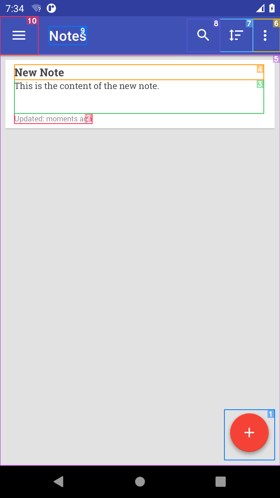
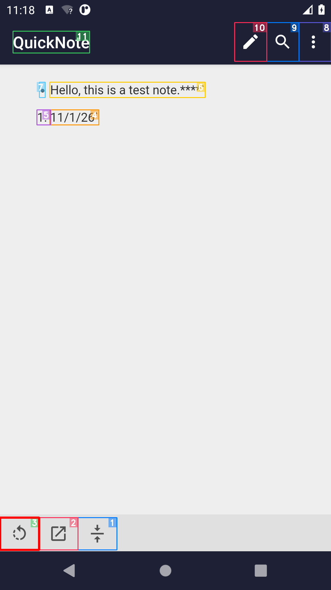
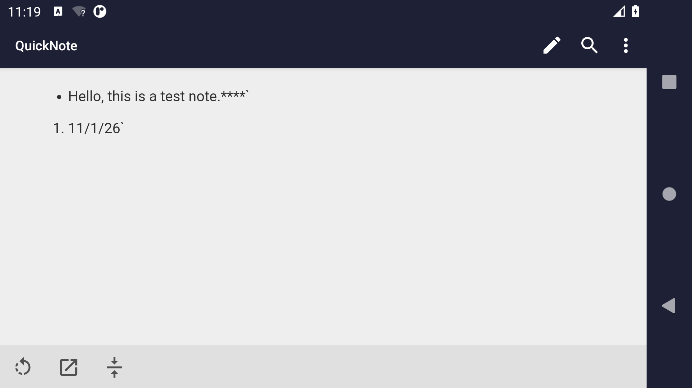
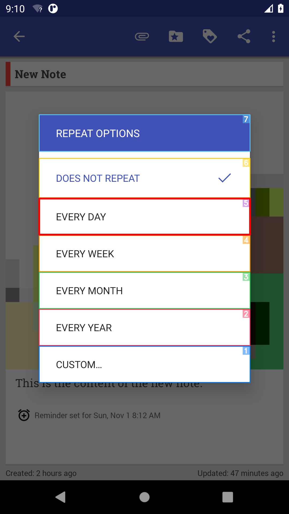
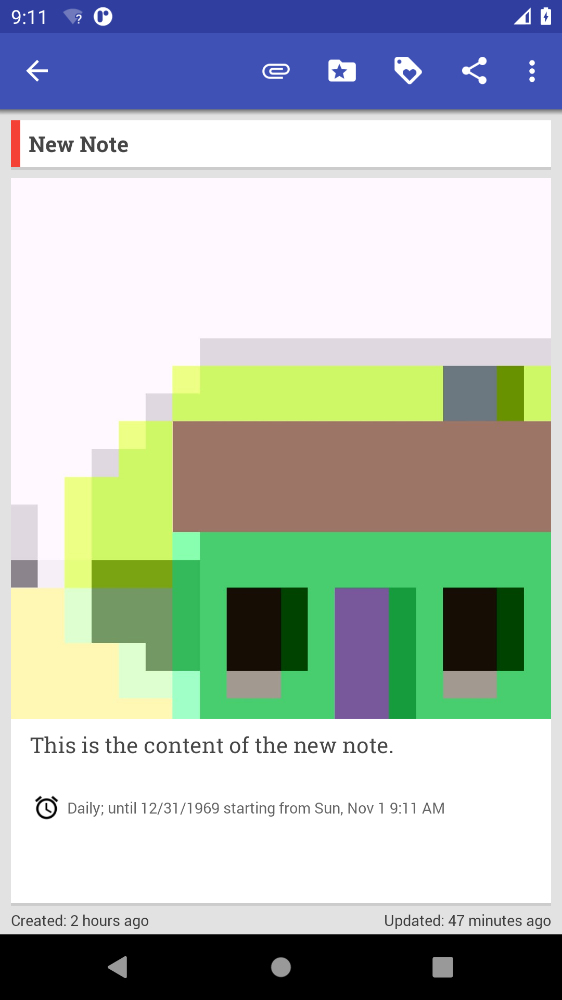
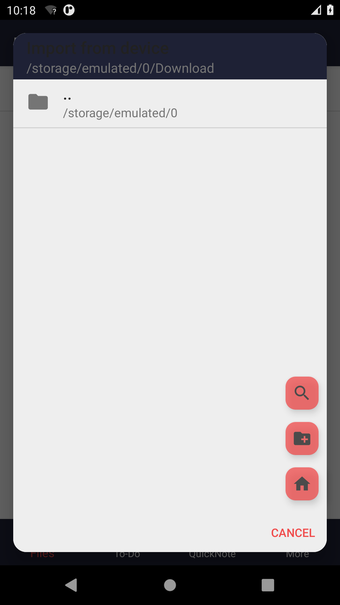

# PropGen：从成功轨迹生成测试性质，执行后暴露了什么问题

更新：2026-11-03。本文是本项目唯一的综合复现报告，汇总探索、性质生成、Kea执行、异常调查、AI审阅及A/B研究分析。原始运行报告、代码和审阅表作为证据保留，不再要求读者依次拼接才能了解结论。

## 1. 先看结论与入口

**我们已在OmniNotes和Markor完成原方法的探索与性质生成，得到31和38条性质；OmniNotes完成累计6小时有效Kea测试，Markor运行约9.8分钟因生成前置条件遇到空值而退出。尚未完成论文的双人人工有效性评价、反馈精化和真实新缺陷确认，因此不能宣称复现了论文92.6%的性质有效率或25个新缺陷。**

对UX testing的最明确结论是：PropGen能自动提供“到哪操作、怎样操作、检查什么”的候选，但本批检查主要是控件存在、弹窗关闭和文本包含，不能可靠代表截断、遮挡、排版或功能正确性。实际坏例已经定位到源轨迹和代码：返回桌面后被框架重新拉起的现象被归给BACK；Rotate被归纳成刷新；移动文件的后置只检查对话框消失。这些是测试生成链的缺点证据，不能反过来算成被测App缺陷。

- [论文学习note](../notes/xiong2026propgen.md)：解释论文原理及正式版各表。
- [官方论文页面](https://conf.researchr.org/details/ase-2026/ase-2026-research-track/240/PropGen-Automated-Property-Generation-for-Property-Based-Testing-of-Mobile-Apps)、[正式DOI](https://doi.org/10.1145/3832783.3837536)、[作者工件](https://doi.org/10.5281/zenodo.21770804)。本次补查官方摘要确认完整方法包含探索、合成、精化三部分；预印本题名不同，百分比以正式版及实际算式为准。
- [本地逐次记录网站](http://127.0.0.1:8770)：选07_PropGen与相应run，可查看完整请求、回答、输入图片和执行证据。
- [OmniNotes生成原件](http://127.0.0.1:8770/file?path=07_PropGen/runs/20261101_152423_44daef/experiment-report.zh.md)、[Markor生成及恢复原件](http://127.0.0.1:8770/file?path=07_PropGen/runs/20261101_175742_cc322c/experiment-report.zh.md)。
- [OmniNotes最终逻辑测试报告](http://127.0.0.1:8770/file?path=07_PropGen/runs/KEA_OMNI_CONT_STANDBY_20261102-095329_ccb9/logical-kea-report.zh.md)、[Markor提前失败证据](http://127.0.0.1:8770/file?path=07_PropGen/runs/KEA_MARKOR_INITIAL_PREP_20261101-230616_034c/experiment-report.zh.md)。D盘runs入口经junction指向E盘LabRepro，对应同一份活跃数据，不能重复计为两份实验。

## 2. 论文究竟希望解决什么

普通探索器能点击很多按钮，但“不崩溃”不意味着功能正确。例如拍照后照片没附到笔记里，App仍能继续用。测试需要一个预期结果，即oracle（判错依据）。Kea允许写“在条件P成立时执行交互I，随后应满足Q”的性质；PropGen把这些性质的来源自动化。

论文的流程是：模型根据截图、控件树、Activity名称和历史提出功能假设；真实执行并记录前态、动作、后态；把被模型认为成功的轨迹总结成行为证据；先生成自然语言性质，再翻译为Kea代码；在更多随机状态中执行性质；对人工判定为误报的性质，结合成功来源与失败轨迹局部修正P、I或Q，检查是否仍保留原意。

这里有三种“成功”必须分开：探索模型说功能已完成；生成代码能通过Python语法与loader；性质在特定状态执行通过。三者都不自动证明真实需求正确，也不等于产品没有缺陷。从运行行为归纳预期，可能把原有错误也学为正常。

正式论文在12个Android应用上，每App先3小时收集行为证据并生成性质，再以Kea测试6小时；模型为GPT-5.2快照，设备为Android11 Pixel模拟器，主机为Ubuntu。两位非作者、有至少4年Android经验的研究生独立标注功能、执行和性质，三项κ为0.91/0.82/0.81。完整复现还应覆盖精化、独立缺陷复现及比较基线。我们的最新任务要求先跑OmniNotes/Markor、看20个产出；模型后来统一替换为Qwen3.8-Max，此项遵循实际运行授权，而非机械沿用旧任务清单中的其他模型名。

## 3. 本次做了什么、与论文相差在哪里

| 环节 | 原论文 | 本次已完成 | 对结论的影响 |
|---|---|---|---|
| 对象 | 12App | 作者OmniNotes6.3.1、Markor2.15.2 APK | 两个App子集，不能外推整个生态 |
| 模型 | GPT-5.2指定快照 | qwen3.8-max，enable_thinking=false | 是替换模型复现，错误率不能归给原论文模型 |
| 生成预算 | 每App3h | 每App总上限10800s，探索9000s，其余合成/收尾 | 具体分配为本地选择，论文没指定这精确比例 |
| 执行预算 | 每App6h | Omni有效21612.8s；Markor588.3s提前失败 | Markor不是完整6h结果；Omni分段而非原生连续 |
| 人工评价 | 两人独立全量标注 | 69生成项AI辅助审阅，原人工表空 | 不报论文式valid率或κ |
| 精化 | 误报分诊→P/I/Q修正→回放验收 | 原断言保留，未完成精化闭环 | 当前是初始性质质量与执行结果 |
| 缺陷与基线 | 25新功能bug，和多工具比较 | 无独立确认App bug，无配对基线 | 不计算缺陷提升、P/R/F1 |

运行副本处理Windows路径、工具定位、timeout单位，以及提示里swipe参数与执行接口枚举的兼容问题；保留上游原件、差异和输入输出，没有为了提高成绩改模型答案、断言或选择策略。截图/HTTP旁录自身有开销，墙钟不等于纯模型推理时间。

## 4. 探索、生成和实际调用结果

| 指标 | OmniNotes | Markor |
|---|---:|---:|
| 生成run | 20261101_152423_44daef | 20261101_175742_cc322c |
| 原探索模型判COMPLETED/FAILED | 31 / 7 | 38 / 8 |
| 生成性质 / 非空代码 | 31 / 31 | 38 / 38（恢复后） |
| 生成墙钟 | 9083.0s | 原进程9069.0s，另原deadline内恢复约25.7s |
| 独立实际模型调用 | 430 | 原探索442+恢复76=518 |
| 返回总token | 2,093,573 | 2,556,946 |
| 实际图片输入调用 | 368，实发字节齐 | 探索442次图片输入保全，恢复文本阶段无图 |
| 代码结构核验 | 单段语法通过、无重名 | 单段语法通过，flat有3组重名；独立类loader发现38条 |

生成统计直接来自[Omni完整调用核验](http://127.0.0.1:8770/file?path=07_PropGen/runs/20261101_152423_44daef/final-call-evidence-audit.json)和[Markor生成/恢复去重账本](http://127.0.0.1:8770/file?path=07_PropGen/runs/20261101_175742_cc322c/generation-and-recovery-ledger.json)；后者输入2,336,480/输出220,466/总2,556,946 token，518个唯一responseID、重复0。两App共948个实际调用，返回总用量4,650,519 token。Chat的prompt/completion与Responses的input/output只是字段别名，未重复相加。这是服务usage，非人民币账单。终态31/38是模型原判定，候选池动态增加且没有完整功能真值，所以31/(31+7)、38/(38+8)都不是全App功能覆盖率或导航准确率。

Markor探索结束时，两个stop/disconnect路径删除临时图发生竞态，原程序exit1，尚未合成。我们没有重跑探索，而是在原3小时deadline内调用作者已有gen_properties_only，使用已存成功轨迹合成38条性质与代码，76次新调用单列；原失败状态未抹掉。flat文件中的test_search_flow、test_overflow_menu_options、test_cancel_dialog各出现两次，直接放进一个Python类会覆盖。实际Kea装载采用每条独立TestCase命名空间，函数名、装饰器、函数体AST逐条不变。这个包装证明38条可装载，不证明原flat无问题或38条都执行过。

## 5. Kea结果：数量很大，真实覆盖却有限

Kea是在许多随机GUI状态下检查性质的执行器。这一阶段没有调用大模型；大模型的成本在前面的探索与生成阶段。

| App/段 | 有效测试秒 | 完成的性质尝试 | pass | assertion fail | error |
|---|---:|---:|---:|---:|---:|
| Omni原bb7e段 | 12669.7 | 808 | 166 | 327 | 315 |
| Omni149min续段 | 1563.1 | 147 | 53 | 68 | 26 |
| Omni最后123min段 | 7380 | 495 | 104 | 265 | 126 |
| **Omni合计** | **21612.8** | **1450** | **323** | **660** | **467** |
| Markor提前失败 | 588.3 | 26 | 4 | 0 | 22 |

Omni1451条开始记录中1450条结束、1条pending。1450是重复执行次数，31条装载性质中只有18条被实际触发，另外13条不能当通过。**18/31=58.06%可以命名为“本轮生成性质的已触发比例”**，分母是本轮生成集合；它不是完整功能覆盖，更不是UX缺陷覆盖。Markor38条仅5条实际触发，即13.16%，也仅描述提前失败窗口。

660次assert fail是断言违反记录，467次error是执行或判定异常；二者不能相加说发现1127个bug。异常文字清单中ui_object_not_found217、HTTP500252、python_exception_text1127等标签可以重叠，不能再相加。我们没有把失败多解释为能力强，也未为获得pass而修断言。

Omni原段发生连接重置/device-not-found而exit4，后续原timer包含主机待机。Kernel-Power与独立观察器验证了待机区间，因此149分钟段仅约1563.1秒计入有效测试，再补123分钟。CLI整数分钟向上取整使总预算多12.8秒。保留应用数据、近似恢复页面，未恢复Python/Fastbot内部随机状态，不能称原生无中断checkpoint。旧qemu约40.5GiB private提交量通过只关闭自有AVD后冷启释放；未改系统pagefile，不能仅凭资源升高断言通信故障唯一来自内存。

Markor最初因all-files特殊许可未恢复停在权限页；12:36:30仅恢复该App的MANAGE_EXTERNAL_STORAGE许可，不clear数据、不改性质。其后几条性质可pass，但原生成权限性质还期待不存在的legacy Allow，环境问题和错误生成性质并存。

最终0026性质前置执行`'- ' in editor.get_text()`，真实RPC HTTP200却返回result:null，Python对None做membership抛TypeError，Kea升级为KeaRuntimeError并exit4。这是**性质求值异常直接中止整个探索流程**的具体bad case。作者锁版uiautomator2 3.7.0与本机3.7.1的get_text AST一致，但服务jar字节不同，未实证全部版本空文本语义；因此既不武断归因“小版本不兼容”，也不擅自把None改空串后冒称原方法成功。

## 6. 正反案例：不是所有“能生成”的性质都能判错

下标均为原审阅表的0起编号。下列是对已有AI审阅的汇总，未追加设备动作或把AI改成人工真值。

| 真实案例 | 本批证据 | 能支持什么 | 暴露的缺点 |
|---|---|---|---|
| Omni /1 创建笔记 | screen19列表出现输入的New Note与正文，动作11–18为创建/输入/返回 | 存在一个从创建到列表可见的持久化检查候选 | 生成代码使用随机ASCII扩展了源输入，尚未证明重复值、特殊字符与滚动条件都可重放 |
| Omni /2 打开抽屉 | screen21显示Omni Notes及Settings | 简单导航和菜单出现的烟测有依据 | 不检Settings可用性、布局、遮挡 |
| Omni /3 排序 | 只有一条笔记，Updated变为Created | 排序模式标签已变 | 不证明多笔记顺序正确；错误排序也可能pass |
| Omni /9 BACK返回App | 源轨迹有框架Intent恢复 | “后面App重新出现”确实发生 | 把外部恢复归给BACK，学到了错误因果关系 |
| Omni /28 删除图片 | 自然语言要附件图像消失，代码检查menu_attachment工具栏消失 | NL与代码可以逐层核对 | 正常保留附件入口也会假失败，失败不是App bug |
| Markor /4 溢出菜单 | screen32出现Import from device与Settings | 菜单展示候选有源证据 | 不检导入和设置实际执行 |
| Markor /30 Rotate | screen165竖屏→166横屏，控件description=Rotate | 真实触及旋转这种UX相关条件 | 模型误归redo/refresh，后置只检查标题/箭头存在，未验证旋转保真 |
| Markor /34 移动文件 | 源操作后对话框关闭 | 操作流程可观察 | 断言仅按钮消失，不检源文件移除、目的文件内容；取消也可能满足 |
| Markor /25 代码标记 | 正文出现反引号 | 当前输入有变化 | 后置只查整篇含反引号，原已存在时操作失效也可能通过 |

[Omni全部31项审阅及原样代码](http://127.0.0.1:8770/file?path=07_PropGen/runs/20261101_152423_44daef/ai-review-all/%E5%AE%A1%E9%98%85%E8%AF%B4%E6%98%8E.md)与[Markor全部38项](http://127.0.0.1:8770/file?path=07_PropGen/runs/20261101_175742_cc322c/ai-review-all/%E5%AE%A1%E9%98%85%E8%AF%B4%E6%98%8E.md)逐项列源动作、原图、请求ID/span和证据hash。固定20原件保留，补查后累计关键图36/40张，不称全轨迹所有帧逐像素检查。人类0，不算κ，不把支持/有争议标签换算原论文92.6%。

下面展示来源轨迹的一个正例：创建后列表中能看到笔记。图片仅说明本次观察，不等于随机输入或全部初态都正确。

旋转案例的前后图给出另一类材料：画面已旋转，但原生成性质误称为redo/refresh。它证明观察变化与解释正确需要分别检查。

## 7. 与论文数值怎样比较才有效

| 论文正式指标 | 原论文结果 | 本次可对应结果 | 是否可以算差距 |
|---|---:|---|---|
| 功能假设有效性 | 1210/1282=94.4% | 只有模型COMPLETED/FAILED，缺独立有效性标注 | 不可；COMPLETED不是人工有效 |
| 正确执行 | 977/1282=76.2% | 有正反源轨迹和AI诊断，无同协议全量标签 | 不可；不能直接用31/38作分子 |
| 生成性质有效性 | 912/985=92.6% | 69条生成，语法/装载核验与AI诊断 | 不可；不同分母和标签来源 |
| 不精确性质精化 | 118/127≈92.9% | 未完成精化及源/失败双回放 | 不可；不是“精化成功0%” |
| 新功能缺陷 | 25，研究者复现；当时5已修复 | 0个独立确认目标App产品缺陷 | 可报告确认状态，不能推断召回0% |
| 运行范围 | 12App×生成3h+测试6h | 2App生成；1App完整有效测试+1早停 | 仅部分协议完成 |

论文25个缺陷分为无效果12、状态不一致6、错误行为4、导航失败3，并非25个视觉布局缺陷。官方摘要支持核心总计；详细数值采用[已核对正式版note](../notes/xiong2026propgen.md)的表2–5。在线预印本正文曾把118/127写成93.7%，算术为92.91%，这里不沿用错误百分比。跨模型、两App子集和缺人工条件下，将本批结果与论文全量数字排成强弱榜没有依据。

## 8. 对UX testing的探索能力与覆盖率判断

**结论：有状态和操作材料，有少量UX相关条件，但没有测得UX探索率或UX缺陷发现率。** “没有测得”表示缺定义/真值，不表示工具完全无法发现体验问题。

我们能数已生成69项、Omni已触发18/31、Markor5/38，并定位菜单、日期弹窗、输入文字、键盘、图片viewer、旋转等真实状态。这说明探索不只停在主页面。可它没有系统改变字体、内容长度、屏幕形态与密集列表，也没有定义全部应到达的风险条件，不能把“含键盘性质数/69”命名成UX覆盖。

Activity是Android的组件而非一个用户可感知页面；同一Activity内能有多个弹窗与编辑状态。即使后来取得Activity覆盖，也只能说明粗粒度组件到达，不代表旋转后内容保留或截断可恢复。当前未独立建立代码/Activity全集，不补造覆盖百分比。

若为A研究复用，可预先定义一个可控App的条件集合，例如“正文为空/短/超长×键盘关闭/打开×普通/旋转后”，用真实到达且证据完整的条件数除预定义总数；对不能到达的任务保留失败。这个是**建议实验方案，当前未执行**。覆盖提升之后还须单独测缺陷触发与正确报告，不能从代码覆盖跨越到UX准确率。

## 9. 对A、B两条论文方向的具体作用

A指生成有测试价值的探索轨迹与用例，B指提高UX截断等检测的可靠性。故障构造/正常对照作为两条方向的评测材料，不自动另立一篇benchmark。

A可以把PropGen作为“成功运行证据→测试性质”的直接基线。我们已有的具体研究问题是：**源轨迹包含框架恢复、误识别动作或弱结果时，怎样避免将它抽象成错误的通用预期；性质存在后，怎样避免大量预算只反复触发少数性质。** 最小实验应固定App、模型、时间与种子方案，分别比较原始方法与“标记系统恢复/动作实际效果核验/未触发性质调度”的模块，报告性质有效性、可重放率、已触发比例、条件覆盖及确认缺陷数。不能把额外人工修正与模型效果混为一项。

B可复用P-I-Q的表达方式，却必须替换弱后置。例如截图中菜单遮住底层内容是正常状态；应先绑定候选内容与容器，在可恢复操作后核对是否完整可获得，再分缺陷、合法隐藏、证据不足。Markor的Rotate与键盘候选可作为场景入口，但现有性质没有检测渲染、遮挡或内容保持，不可说已建立UX oracle。

可写进论文动机的有据表述是：“在统一替换模型的两App部分复现中，观察到错误功能归因、自然语言到代码对象错配、弱后置以及前置异常终止测试；Omni6小时虽执行1450次，31条性质只有18条触发。”这提供问题实例和局部统计。不能写“PropGen总体性质不可靠”“原GPT-5.2也同样失败”或“领域没有方法处理这些问题”。改进新颖性还须和规格挖掘、因果归因、变形测试和Kea调度相关工作比较。

## 10. 对我们项目目标的参考价值与不可直接借用的指标

这些数字是我们自己项目的工程目标，不是要求PropGen满足的标准。下面只说明现有复现能为我们准备什么证据，不对原论文作“验收通过/不通过”评价。

| 我们的目标 | 本批已有哪些材料 | 独立评价所需定义与材料 |
|---|---|---|
| 低级指令到达≥95%，高级≥80% | 生成目标和动作轨迹 | 缺同一任务配对的高/低指令与独立目标页真值；分别以全部任务为分母统计真实到达，超时/执行器错误保留类别 |
| 到达后UX问题判断≥95% | 性质断言、失败日志、图片 | 缺独立UX正负真值与检测输出；需明确accuracy、precision、recall，不能把只报“是bug”的命中率当全部准确率 |
| 单步均≤3s、最大≤5s | HTTP耗时、动作及截图记录 | 阶段含并发与旁录；未形成每GUI动作从决策到稳定后态的完整计时，不能用总时长/调用数代替 |
| 三层界面端到端≤10s，排除网络资源原因 | 完整运行时间、部分异常证据 | 未设计三层定向检测任务；需预先定义起终时刻和网络资源排除规则，同时报告原始与排除后分布 |

尤其Kea阶段0次模型调用不意味着每步延迟0秒，6小时预算也不是一个三层任务的端到端耗时。上述阈值是我们的工程目标，不是PropGen原论文承诺。

## 11. 数据质量、可复查边界与后续使用

Omni最后段4627张PNG有1张原坏尾帧，设备源已清理，一次有界副本检查无有效原件；坏字节/hash保留，不能用它作图证。最终段还保留2240个截图引用、引用路径缺失0；这是“路径存在”的审计，与1张像素解码坏帧并存，不能混为图片全有效。[最终执行统计与媒体审计](http://127.0.0.1:8770/file?path=07_PropGen/runs/KEA_OMNI_CONT_STANDBY_20261102-095329_ccb9/final-native-artifact-audit.json)给出原native executed/fail/error、逻辑预算、已触发18条及未触发13条完整名单；[1450次结束的逐次CSV](http://127.0.0.1:8770/file?path=07_PropGen/runs/KEA_OMNI_CONT_STANDBY_20261102-095329_ccb9/failure-inventory/executions.csv)可复算分段表。Kea原报告会在部分PNG上画点击标记，因此报告图不全是未经标注的设备原图；模型生成阶段的实发输入图单独保全。Markor现存160张native PNG及160独立raw副本都可解码，但native图像索引只覆盖20个bracket/52事件，完整semantic/console索引有26次尝试。后段媒体不可追回，不能把26条文本索引伪装成完整图证。

Markor导出失败另外定位为Windows295字符目标路径，父目录存在；同解释器297字符普通写入失败、扩展路径成功。原同步器吞错误后仍清设备输出，导致缺图。未来局部windows_export_compat的7项离线检查通过，但未接当时launcher、未验证完整report链，不能称历史图片已恢复。该问题与0026前置异常、原生成语义错误是不同层次。

最终所有实验均已结束，不自动重跑或补足Markor6小时。当前最适合的用途是保留坏例，制定独立标签与正常/故障对照，再在相同预算下评价改进。图和代码应成对引用，实验失败、记录缺口与不确定归因随案例一起呈现。

数据读取说明：文中示例图随报告保存，可在GitHub直接阅读；`127.0.0.1:8770`链接指向本机只读查看器，远程阅读者需按[总目录](catalog.md)的数据仓库说明下载对应项目并启动查看器。本地文件链接用于源码与准备记录溯源，不声称是在线资源。

## 本次新增的实图专项复查：探索实际触达了哪些状态

本次整理不只读取旧统计或旧审阅结论。先固定取样：每App将生成性质按原序排列，选择下标 `floor(j×N/10)`（j=0…9），各10项；每项实际打开该功能轨迹第一张和最后一张现存图，共20项、40张不同路径的原存档图。本次由主Agent使用图片查看工具直接检查像素，并核对原动作索引；没有重跑设备、额外调用付费模型或改标签。此样本来自生成探索阶段，不能代表六小时Kea所有执行帧。图中的彩色框、序号是工具控件定位标注，不能算应用重叠，也不把带标注图说成未加工原像素。

|App/原性质下标（0起）|实际打开的screen编号|实看观察与判断|
|---|---|---|
|OmniNotes / 0|4/10|引导Welcome到Notes空态，确实触达首次启动教学与空列表；插图和说明可见，未见五类明确缺陷。|
|OmniNotes / 3|43/45|单笔记列表前后仍只有一条New Note，Updated变Created；可确认排序入口及画面，不能凭单条证明排序关系正确。|
|OmniNotes / 6|58/60|笔记Add reminder变为Reminder set for Sun, Nov 1 8:12 AM，真实提醒文字变化；设置持久化及通知触发未验证。|
|OmniNotes / 9|54/55|前端点是Android桌面，后端点Notes；不能把端点恢复归因于BACK单一动作，需要原框架Intent事件判别。|
|OmniNotes / 12|113/117|图片笔记进入信息弹窗，Chars36/Words10/Images1可见；图文与弹层触达有据，大图预览的裁切不等于产品截断。|
|OmniNotes / 15|207/209|同一笔记上方的时钟弹窗切为日期弹窗且选15；支持嵌套选择器场景，不证明已点击OK或持久化。|
|OmniNotes / 18|144/145|空白Sketch画布，橡皮图标从灰到黑、画笔变灰；只证明工具选中态，不证明擦除了任何笔画。|
|OmniNotes / 21|184/185|Enable checklist菜单变为两图片+清单行；内容变长，提醒行在视口下缘部分露出，缺少同容器滚动证据，不确认为内容裁切缺陷。前帧提醒显示until 12/31/1969；2026年由前序日期选择器确认。后续连续动作核查支持日期摘要矛盾，见下节。|
|OmniNotes / 24|186/187|清单空框变勾选、正文变灰划线；有可见状态反馈。底部提醒仍在视口下缘，不据单帧断言缺失。|
|OmniNotes / 27|214/216|选20的日期弹窗到Reminder set for Fri, Nov20 9:35AM；日期文字有据，通知业务效果未知。|
|Markor / 0|4/10|教学页到存储权限必需弹窗，说明权限前置实际阻挡；不是只凭节点存在就进入文件主界面。|
|Markor / 3|27/30|Documents空列表前后仍空，仅有父目录行；单空列表无法验证按日期排序能力。|
|Markor / 7|278/280|搜索弹窗带键盘，之后Select空结果弹窗；确实触达输入和反馈，但无目标搜索词及数据总表时不能证明召回。|
|Markor / 11|48/50|Import from device弹窗从Audiobooks到Download，目录导航有据；两帧标题黑字落在深色背景，低对比候选，非五类之一，不能因导航成功忽略可读性。|
|Markor / 15|59/72|同导入弹窗带键盘输入Download，后出现NewFolder目录；标题低对比延续。支持输入/创建场景，没核文件系统持久性。|
|Markor / 19|114/115|空QuickNote到Hello this is a test note.并弹键盘；正文和工具栏仍可见，工具栏右端H图标部分露出，尚缺水平滚动/恢复证据，属边缘裁切现象。|
|Markor / 22|123/125|点击粗体后正文出现****标记；这是Markdown编辑源文本，不应把未显示为粗体字形本身当渲染bug，需区分编辑/预览。|
|Markor / 26|134/135|原先第二行破折号变为1.有序列表标记；格式状态变化可见，不能拿该生成阶段正常结果覆盖随后Kea前置null失败。|
|Markor / 30|163/166|起始端点桌面，终点横屏QuickNote预览含项目与有序列表；横屏状态确实达到，但不同端点/模式不能证明旋转前后文本完整持久保持。|
|Markor / 34|202/206|选中QuickNote.md并打开Move菜单，后Documents空列表；离开源位置有据，缺目标文件夹端点，不能单凭空列表证明移动成功。|

这20项中，**明确确认的UI-Lens五类产品缺陷为0，不能因此声称这些App没有问题或工具的UX召回为0%**。我们没有全部缺陷真值，样本也只看功能端点。实图能明确证明探索触达了首次引导、空/非空列表、图片长内容、弹层、日期时间选择器、勾选状态、绘图选中态、搜索与键盘、文件导航、编辑/预览以及横屏等条件；原性质主要检查功能文本或控件存在，并没有针对五类显示问题建立独立视觉oracle。

|UI-Lens问题类别|本样本出现的具体观察|可以作的结论|
|---|---|---|
|文字溢出|未见文字明确跨出容器并覆盖相邻内容的充分证据|不能凭布局框交叠判应用文字溢出|
|内容未显示|空列表、搜索空结果、图文场景均出现|缺内容总表与正确目标，空白不是缺失真值|
|内容裁切|Omni185/187的提醒行在视口底部，Markor114/115工具栏右端部分图标露出|探索触达裁切相关条件；是否可滚动恢复未验证，不确认异常截断|
|容器重叠|菜单/日期弹窗遮住底层内容|正常模态叠层，不等同错误容器重叠|
|异常省略号|未找到足以确认异常省略的样本|不将路径变短、视口裁切或标注遮挡当作异常省略|

还有两类值得讨论、但不硬塞进五类的观察。第一，Omni184提醒文字显示“until 12/31/1969”，前序日期选择器确认所选起始日期在2026年；摘要本身没有写出起始年份。后续新增前序动作与实际APK核查已将它加强为本轮已观察到的日期摘要矛盾，详见下节，实际通知调度错误仍未证实。第二，Markor48/50/59/72的“Import from device”标题黑色文字落在深色背景，肉眼可见可读性弱；文件导航仍可成功，因此功能成功并不消除视觉问题候选。该现象属于对比度/可读性，超出本次UI-Lens五类标签，不能为了匹配分类改标签。

对A最有价值的是：单笔记/空列表无法证明排序；空画布无法证明橡皮功能；源目录空不能单独证明移动成功。生成性质必须具备能区分正确和错误的前置数据。对B最有价值的是：工具确实能进入图文、输入、弹层与横屏状态，但原功能检查不自动检测视口边缘裁切或低对比。可从同一轨迹分别评价探索条件触达和视觉判错，而不是把性质通过数当作UX效果。

此处的0个确认缺陷是本样本、当前证据强度下的人工之外AI诊断结论，非独立人工标注结果。逐项图片路径、hash与观察账本保存在本地整理审计，随实验数据仓库归档；历史固定20审阅和69性质全量审阅仍保持原件，不被这次20项替换。

## 对提醒日期矛盾的进一步追查：探索到了有价值的状态，生成检查却接受了错误摘要

这是一项在前述固定端点复查之后追加的定向诊断，不把它混入固定20项统计。另一个Agent实际查看154、155、156、157、158、159、163、184共8张不同原图，结合原动作与10条原回答重新追踪。本次没有重放设备，也没有新增模型调用。

|顺序|原现场及动作|直接证据|
|---|---|---|
|155|打开已有提醒，原动作为`tap(3)`|进入日期/时间设置|
|156|打开重复选项，`tap(16)`|原状态为DOES NOT REPEAT|
|157|选EVERY DAY，`tap(5)`|普通“每天”选项，不是输入自定义截止日期|
|158|点击OK，`tap(1)`|日期选择器显示NOV 1, 2026|
|159|返回笔记|首次连续看到`Daily; until 12/31/1969 starting from Sun, Nov 1 9:11 AM`|
|163/184|后续现场仍有该日期摘要|同一现象延续，不当成多个独立问题|

**现在能够确认的事实是：前序日期选择器确认2026年起始日期，普通选择“每天重复”后，返回笔记编辑页后的截止摘要却显示1969年；这段连续动作没有输入过去的截止日期。** 这比只看184单帧更有解释力。它仍不证明数据库里存了1969，也不证明通知真的在1969停止；实际调度、跨设备发生率和独立开发者确认均未知，不宣称发现了一个新bug或已验证独立根因。

原模型没有完全漏看这段文字：事件159的`judge_feature_status`回答明确复述1969，却仍返回COMPLETED，精确原调用ID为`f9f70d9bcae14d8e9f1da4d34885658c`。这反映它在判断“是否修改了重复设置”，没有承担日期关系正确性检查。原生成性质下标20只检查`textContains("Daily")`存在；矛盾摘要照样满足这个条件。这里没有声称该性质后来在Kea成功执行，更不能拿生成阶段的判断代替Kea成绩。

对原因已有**强静态推断**：受测6.3.1 APK的真实字节码会在默认重复规则中构造极远未来的截止常数32519731800000毫秒；其内嵌格式化器使用旧`android.text.format.Time.toMillis(false)`后未检查失败返回值。对应Android 11公开实现对超出32位秒范围的日期返回-1，随后格式化与1969显示吻合。实际APK的辅助方法、格式化器字节码及[官方6.3.1源码](https://github.com/federicoiosue/Omni-Notes/tree/6.3.1)、[AOSP Android11 Time实现](https://android.googlesource.com/platform/frameworks/base/+/refs/tags/android-11.0.0_r1/core/java/android/text/format/Time.java)、[ZoneInfo实现](https://android.googlesource.com/platform/libcore/+/refs/tags/android-11.0.0_r1/luni/src/main/java/libcore/util/ZoneInfo.java)分别保存了核查依据；未提取或执行模拟器运行库，也未采集数据库UNTIL字段，因此不把静态推断写成已运行验证的完整因果链。

对A，这是“探索有效”和“生成测试有效”应分别计量的具体例子：探索确实走到重复提醒这一组合状态，但性质没有检查截止≥开始或无截止语义，只检查频率关键词。对B，它提供的不是溢出或裁切，而是界面摘要的语义一致性问题：任务完成判定不能替代体验正确性。若我们的研究只处理UI-Lens五类，应将该例放在范围外讨论或扩展实验，不能增加五类检出数。

可以在论文中谨慎使用的结论是：本轮适配探索触发了可见的跨字段矛盾，而原完成判断和关键词性质仍接受了该画面，提示测试生成需要让前置状态和关系断言共同约束结果。一个定向案例不能估计整个方法的漏报率；对比实验仍需要同状态、同预算和独立预期。完整核查账本及APK/源代码hash见新数据仓库`audit/omni-reminder-candidate-investigation.json`，原图和回答仍在原run。

## 对Markor导入标题的进一步追查：功能可达与可读性检查之间的缺口

追加诊断实际查看了6次图、5种图片内容，包括48/50/59/72存档图、无控件框原PNG以及原模型调用输入。screen50与无标注原PNG字节一致；实际模型输入也能看到该标题，因此低对比不能只归因于工具彩框。标题平坦色区域为`#212121`，工具栏背景为`#1E2135`，按sRGB相对亮度计算对比约 **1.015∶1**；这是该图两种颜色的测量，不是整屏可访问性认证或我们项目的检测成绩。

受测版本为2.15.2/versionCode161。实际APK资源与[同版文件浏览器配置](https://github.com/gsantner/markor/blob/f5237bafc3900d40a91c73d75978aac5cdd6b3e9/app/src/main/java/net/gsantner/markor/frontend/filebrowser/MarkorFileBrowserFactory.java)、[Dialog标题设色](https://github.com/gsantner/markor/blob/f5237bafc3900d40a91c73d75978aac5cdd6b3e9/app/src/main/java/net/gsantner/opoc/frontend/filebrowser/GsFileBrowserDialog.java)、[颜色资源](https://github.com/gsantner/markor/blob/f5237bafc3900d40a91c73d75978aac5cdd6b3e9/app/src/main/res/values/colors.xml)共同支持：浅色正文所用的深文字资源，被显式用作深色工具栏标题。不能仅因工具栏深色就称系统处于暗色主题，也没有必要在缺乏证据时归因系统兼容。

原模型判断的是进入Download、搜索、创建目录等功能推进；38条生成性质中5条导入相关性质检查存在、路径、搜索或目录，没有标题对比断言。未报告该可读性现象不等于测得UX漏报率，因为原任务并非检测低对比。另一个容易误判的细节是：72之前NewFolder未显示时仍存在Download文本过滤，不能直接据此判创建失败。

这仍保留为有像素和资源证据的低对比候选，未进行切换主题对照、独立人类评审或开发者确认；不计UI-Lens五类阳性、唯一确认产品bug或新的总体指标。对A的启发是保留导入弹窗和主题条件；对B的启发是把“成功操作”与“界面内容清楚可读”分别定义。完整原图、原模型、5份源码/资源的版本与hash在数据仓库`audit/markor-contrast-candidate-investigation.json`。
