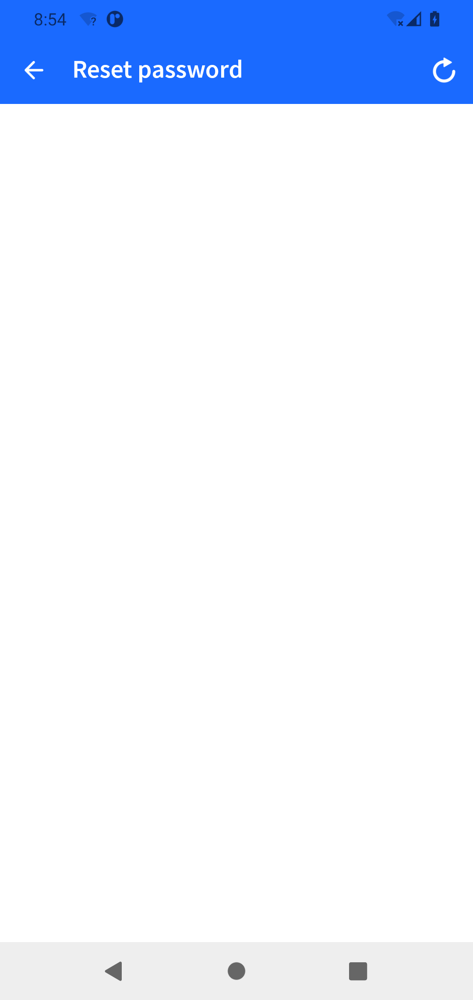

# LLMDroid：方法覆盖探索的复现，以及它离UX测试还有多远

更新：2026-11-02。本篇合并Fing、Wikipedia与TimePlanner的原始/部分运行、覆盖口径、导航失败、UX候选审阅、A/B用途和对我们项目目标的借鉴，是本项目唯一综合报告。原报告和JSON作为可追溯证据保存。

## 1. 结论与学习入口

**已完成：TimePlanner三次完整60分钟探索；Fing三次尝试中一次完整、两次因原无路径异常早停。Wikipedia两次部分运行分别用于环境排除和外部公共写入边界停止，没有完整一小时成绩。** 替换模型统一为Qwen3.8-Max，使用作者原插桩APK和原Droidbot探索策略；没有做14App全量、其他底层探索器、模型对照或消融。

TimePlanner最高去重方法覆盖为2946/23280=12.6546%；Fing唯一完整轮为14278/62491=22.8481%。分母均来自作者配置，尚未独立枚举。两个数不能直接比较App测试难度，也不能说明找到多少UX问题。

最有价值的探索bad case包括：原UTG（界面转移图）删掉根节点唯一出边后，无路径异常使程序提前结束；教学浮层在前台时，底栏目标虽产生事件但没有实际切换；长按出现编辑菜单而stateID不变。这些是导航鲁棒性、动作效果与状态抽象的具体证据。Fing已到达注册/重置密码白屏和破图现场，但只是离线AI发现的候选，LLMDroid本身没有自动UX判错模块。

- [论文note](https://github.com/ZYY0321/Testing-Survey/blob/main/notes/wang2025llmdroid.md)：原理、表3/4、Activity与方法覆盖的区别。
- [正式DOI](https://doi.org/10.1145/3715763)、[作者托管PDF](https://tmliu06.github.io/pdfs/llmdroid-fse2025.pdf)、[官方代码与材料](https://github.com/security-pride/LLMDroid)、[官方适配说明](https://github.com/security-pride/LLMDroid/blob/main/documents/Adapting_LLMDroid_to_Other_Tools.md)。本次独立搜索核查官方工具确实以实时覆盖反馈触发LLM，不将其描述为逐步视觉Agent。
- [本地LLMDroid网站](http://127.0.0.1:8770/llmdroid?run=20261102-161743)：保留旧5run与TimePlanner新3run，展示文字I/O、动作前后原图、覆盖、簇与报告。
- [Fing/Wiki队列原件](http://127.0.0.1:8770/file?path=08_LLMDroid/runs/R3_QUEUE_20261101-164000/experiment-report.zh.md)、[TimePlanner完整原件](http://127.0.0.1:8770/file?path=08_LLMDroid/runs/R3_TIMEPLANNER_20261102-140915/experiment-report.zh.md)。

## 2. 论文要解决什么，怎样工作

纯随机或启发式探索动作便宜，却容易一直走重复页面；每一步都问大模型又慢又贵。LLMDroid把二者结合：先让原探索器运行，监视APK插桩产生的方法执行日志；当最近一段覆盖增长都低时，让模型从已经见过的页面与未操作功能中选一个目标；在历史图上重放路径到该页，再由模型最多执行五步功能操作，然后交还原探索器。

这里“方法”是代码函数/方法，不是测试方法论。方法覆盖=本次执行到的不同方法身份数/应用方法总数。Activity是Android页面组件，但同一Activity可以容纳列表、菜单、键盘、弹窗、编辑器多个状态，因此Activity覆盖只是较粗的到达指标。

为了少调用模型，工具把文字化控件树相似的页面聚簇。默认Dice相似阈值0.6，页面控件的类型、resource-id、动作、宽高参与比较；根页先总结，非根页的独特功能可在后台补充。摘要按能打开新页面或核心功能的重要性排序，不是按UX风险排序。选目标时看前10个重要页、每页最多5个未测试功能；“未测试”主要指相应控件未操作，不是该功能通过了独立断言。

原模型输入是HTML样式的**文字控件结构**。即使我们保存了大量PNG，不能说这些调用让Qwen看到了画面。无文字图标、自绘内容和弹层与树不一致，因而都是适用边界。方法覆盖反馈可以告诉系统“增长停了”，却没有把具体未覆盖代码条件交给模型推理。

原导航先重启App，在历史转移图上找最短路并核对页面；路径失败可换近期路径、降低匹配阈值，多轮目标失败后回原探索器。这依赖旧路径在当下可重放，也不保证启动节点总可达。模型说功能完成只是探索调度信号，不是业务或UX测试通过。

## 3. 原论文协议与本次执行边界

原论文用14个能成功插桩运行的应用，Google Pixel4实体机/Android11，各工具每App60分钟、间隔3秒、重复3次，**取最高覆盖**分析。比较Droidbot、Humanoid、Fastbot和Monkey；模型配置含GPT-4o、4o-mini、3.5。需登录的应用先人工注册登录。作者明确不做缺陷检测评价，因为插桩可能制造崩溃，难与原App错误区分。我们不能替这篇论文补造bug分数。

| 维度 | 本次实际 | 与严格数值复现的差异 |
|---|---|---|
| App | 作者原配Fing/Wikipedia/TimePlanner APK | 子集，Wiki协议未完成 |
| 策略 | LLMDroid-Droidbot，原dfs_greedy、interval3、timeout3600 | 没跑Fastbot/Humanoid分支与配对原工具 |
| 模型 | qwen3.8-max，enable_thinking=false | 替换模型，不是原GPT结果 |
| 设备 | 独立Pixel4 API30 Android11模拟器5562，TimePlanner用HOST GPU | Android对齐，实体机/主机速度不同 |
| 数据 | 原生events/states/UTG、完整文字HTTP I/O、coverage/semantic及截图 | 旁录含开销与明确少量缺额 |
| 评价 | 原覆盖重算、固定候选AI复核、离线UX筛查 | 无UX独立真值、无双人人工，不能用AI意见作论文检出率 |

本地适配主要是ASCII路径、UTF8、临时私密配置路径、响应/语义/截图记录以及设备连通。原源码、工作副本与hash保留；没有改导航、阈值、失败恢复或模型回答以补满时长。原counter从1开始，比唯一METHOD集合多1，因此并列报告原计数与独立去重，不静默改作者算法。

## 4. 先前Fing与Wikipedia：实际尝试而非所有都完成

| App/轮 | run | 墙钟秒 | HTTP | 唯一METHOD / 原counter / 作者分母 | 预算结论 |
|---|---|---:|---:|---|---|
| Fing1 | 20261101-161752 | 3611.44 | 34 | 14278 / 14279 / 62491 | 完整60min |
| Fing2 | 20261101-171835 | 1406.19 | 11 | 12213 / 12214 / 62491 | 原NetworkXNoPath早停 |
| Fing3 | 20261101-174211 | 1842.40 | 14 | 12901 / 12902 / 62491 | 同类早停 |
| Wiki环境尝试 | 20261101-181458 | 275.82 | 5 | 4933 / 4934 / 79210 | 模拟器未接现有代理，环境排除 |
| Wiki公共写入边界 | 20261101-182142 | 778.21 | 12 | 10993 / 10994 / 79210 | 公共编辑器处停止 |

Fing完整轮原counter覆盖22.84969%，去重22.84809%；只一个满预算结果，不能说完成三次取最高协议。将三次部分观测放一起的原counter描述均值21.01369%不能替代完整预算结果。没有通过第四轮取得好成绩。另161536/161649两次初始化0调用失败是本地私密配置路径遗漏，单独留存而不计方法轮。

### 4.1 可复现的探索器失败链

两次Fing早停均在框架回到State0后，删除失效启动动作对应的State0→State1边，恰为根节点唯一出边。随后UTG.generate_paths从first_state直接调用NetworkX最短路径，无路径异常被InputPolicy捕获并break；进程甚至返回0。所以manifest的completed不能等同跑满一小时。

相关utg.py和input_policy.py与冻结作者源码逐字节相同；networkx本机3.6.1按无路径契约抛异常。作者未锁版本，未做旧版实测，不能说所有版本都实证重现。异常前最后导出的图仍可达，是因为导出早于运行时删边；按日志重建后不可达，与旧导出并存，未冒称重建图就是内存dump。

**研究结论很明确：基于已走过路径的离线导航依赖可重放启动边，失败处理本身可能让本轮探索提前结束，损失后续预算。** 这支持异常/失效边恢复的动机；尚无修复对照，不能报告恢复能增加多少覆盖。

### 4.2 Wiki环境修复与停止原因

首次Wiki有真实METHOD增长，但Explore离线。主机现有代理可访问官方API而模拟器未配置；仅把5562的Android代理设为10.0.2.2:7897后，真实页面出现Featured article与图片。主机、其他设备不变，fresh安装后开始正式新尝试。这是环境修复，不是算法提升。

第二次探索进入英文Wikipedia User:Kuru公共用户页源码编辑器，存在Next。停止研究进程并force-stop该App，没有继续发布。保留58条完整native事件未见Next/Publish/Submit或文字输入，但有1个早期不完整JSON，缺全网络写请求审计，不能绝对断言远端无变化。作者已检查材料没有提供测试Wiki或隔离部署；“Offline Navigation”指历史图导航，不是站点离线隔离。用户后来明确暂缓，当前不自动恢复。

## 5. TimePlanner：三轮完整，配置字段与生效窗口不能混淆

选用作者TimePlanner3.22.0_6，package=com.albul.timeplanner，APK SHA256为`ce1cf73980b2f8e5093963168f5f5a93515a15bab3c485253adc3b3f1852fbf0`。静态无INTERNET权限，断网预检能进Logging与本地教程入口；仅证明本地预检路径，不说明全部功能都验证。正式每轮fresh卸载安装，清除预检状态。三轮均由原timer自然结束，没有人工代操作或第四轮。

| 轮/run | 墙钟秒 | 可解析事件/文件 | HTTP | 唯一METHOD/原counter | 去重方法比例 | 有效PNG |
|---|---:|---:|---:|---|---:|---:|
| 1 / 20261102-141624 | 3622.520 | 259/260 | 18 | 2833 / 2834 | 12.1692% | 941 |
| 2 / 20261102-151704 | 3615.250 | 261/261 | 19 | 2945 / 2946 | 12.6503% | 945 |
| 3 / 20261102-161743 | 3611.654 | 272/272 | 20 | 2946 / 2947 | 12.6546% | 985 |

按论文三次取最高的统计形式，TimePlanner最高原counter为12.6589%，最高去重12.6546%；三轮均值分别12.4957%/12.4914%，只是补充波动描述。分母23280来自作者配置而未独立核定。三轮重叠的方法不可相加，PNG含裁图与副本也不是独立页面数。

**Window配置100，实际窗口80。** 作者policy/utg_based_policy.py固定AndroLogCVMonitor(wsize=80)，未读取配置Window；三轮semantic记录__WINDOW_SIZE=80。保留原生80，没有按配置改代码或重跑。每轮安装探索前原monitor清logcat，断网预检1551条METHOD不混入正式覆盖。

每轮原生GUIDE自然触发一次，原导航自报1/1。HTTP到semantic可精确关联，后续原动作主要按时间/顺序关联，缺唯一GUIDE因果ID；不能把接下来所有覆盖增长归给一次建议，也不能把3次自报1/1当95%导航达标。

## 6. 实际模型记录与完整性

Fing/Wiki旧5run共有76次独立HTTP，均200/stop；返回input131966/output8936/total140902 token。TimePlanner57次均200/stop，input92067/output8316/total100383。合计133次实际HTTP、241285 token，包含环境排除与提前停止成本。用量是服务返回，不是账单；HTTP成功不说明语义正确。所有调用为文字输入，截图是执行现场及离线分析材料。

旧五轮的调用/用量分账如下，包含排除尝试；每行来源是[原队列实际调用账本](http://127.0.0.1:8770/file?path=08_LLMDroid/runs/R3_QUEUE_20261101-164000/actual-api-usage-ledger.json)。PNG这一列采用旧队列最初归档审计的目录范围，与后续扩展筛查范围分开。

| run | HTTP | 输入token | 输出token | 总token | 原归档PNG文件数 |
|---|---:|---:|---:|---:|---:|
| Fing161752 | 34 | 60176 | 3604 | 63780 | 720 |
| Fing171835 | 11 | 17071 | 1115 | 18186 | 309 |
| Fing174211 | 14 | 22321 | 1520 | 23841 | 360 |
| Wiki181458 | 5 | 6405 | 540 | 6945 | 61 |
| Wiki182142 | 12 | 25993 | 2157 | 28150 | 178 |

TimePlanner57次实际调用按(run,callstep)保留，在[三轮用量账本](http://127.0.0.1:8770/file?path=08_LLMDroid/runs/R3_TIMEPLANNER_20261102-140915/usage-ledger-all-three.json)逐条列出；[聚合JSON](http://127.0.0.1:8770/file?path=08_LLMDroid/runs/R3_TIMEPLANNER_20261102-140915/aggregate.json)给各轮终态和用量。动作精确图片完整性按轮为519/520、522/522、544/544（可用引用/全部引用）；PNG有效数941/945/985包括控件裁图与副本，不能由这些文件数计算独立语义任务量。三轮均完整预算，旧五轮中只有Fing161752完整，所有早停和排除保留在统计中。

TimePlanner793个事件文件中792可解析，首轮event_2026-11-02_151639.json原0字节；原timer同期后态保存失败，另缺1个精确after图引用。1586个前后图引用中1585存在；2871现存PNG完整解码通过。不能因为已有很多副本就补造缺失的精确后态。三轮stateJSON76/78/84，原簇13/14/14；这些是不同算法单位，不混作真实功能页面数。

旧队列原截图归档审计有1628PNG，后续缺陷筛查纳入2155PNG按字节去重602张，二者是目录范围/时间不同的统计，不相加也不互相替代。首轮中途新增保全，有此前覆盖和末尾cleanup缺口；其137秒归档累计I/O不是模型或单动作延迟。临时凭证配置结束后删除，网站不放开work-source/private-configs。实验专属模拟器及观察程序已收尾，本地查看器保留。

## 7. 与论文效果的对比：为什么不能拿一个22.85%说超过论文

[论文note](https://github.com/ZYY0321/Testing-Survey/blob/main/notes/wang2025llmdroid.md)逐列核对正式表3/4，原数据包含14App汇总、三次取最高、不同运行月份。下面是同类指标的定位，不组成统一排名。

| 论文范围/配置 | 方法覆盖 | Activity覆盖 | 本次对应状态 |
|---|---:|---:|---|
| RQ1 Droidbot原→增强 | 9.21%→11.69% | 15.90%→22.46% | 本次只跑增强分支，未做配对原Droidbot |
| RQ1 Humanoid原→增强 | 11.05%→13.40% | 19.16%→23.66% | 未运行 |
| RQ1 Fastbot原→增强 | 11.36%→14.80% | 24.40%→30.05% | 未运行该分支 |
| RQ2 LLMDroid-Fastbot+4o | 14.33% | 28.28% | 不同模型/底层/集合，不直接对比 |
| 本次Fing唯一完整轮，Droidbot+Qwen | 22.8481%去重 | 无独立总分母 | 只一个App一轮完整 |
| 本次TimePlanner三轮最高，Droidbot+Qwen | 12.6546%去重 | 无独立总分母 | 单App完成三轮，分母来自作者配置 |

论文RQ1三种探索器平均相对提高方法覆盖26.16%、Activity29.31%；这是增强前后相对增益，不是最终覆盖率。我们没有原探索器基线，不能说本次增益为正、比论文更高或模型替换带来提升。TimePlanner与Fing百分比的差异还受方法总量、运行服务、APK复杂度影响。

论文整体47.84%引导被按其事后覆盖增长标准判有效；不等于47.84%导航正确或缺陷检测正确。无效引导中12.11%导航未达，18.14%到新页但覆盖不足，69.75%未进新页；其分母是无效引导，不是所有任务。原RQ2 4o每App小时约102次调用、调用总耗时399.40s，但阻塞约107s，说明异步时间可重叠；两个时间都不能转成我们的单步≤3s结论。RQ1与RQ2月份不同，其14.80%和0.494美元不能拼成同次结果。

## 8. 真实正反样本：动作发生不等于页面或功能已覆盖

TimePlanner在判断前按原内容hash序冻结每轮7/7/6，共20条(run,candidate_id)，对应16个唯一内容hash、4条跨轮重复。实际审阅40张原图，人类0、新模型API0。AI认为8条图像支持可见效果、7条未支持目标、5条意图未知或语义不确定。该样本不是独立任务真值，**8/20不应被命名为40%的导航或UX成功率**。

| 案例 | 实际看到什么 | 对探索与UX判断的意义 |
|---|---|---|
| 首轮00229fc41f8a点2026 | 月份网格→年份列表且2026高亮 | 正例：同一日期功能内存在不同子状态；不能只按Activity计一个页面 |
| 首轮0188ab24ffb9点scrim | 悬浮Category/Note菜单收起，回Categories空列表 | 正例/难负例：正常遮罩覆盖底层不是截断缺陷，关闭后内容可恢复 |
| 首轮0174f70f885e点Statistics | 前后均New category教学层，Hello World未改，底栏不在前台 | 明确未见目标跳转；执行事件/函数tested不能证明统计页已覆盖 |
| 首轮05701c722497点touch_outside | 2025年11月→2025年2月，弹窗仍在 | 画面变了，但未证明“点外部关闭”；大bounds中心可能命中子控件 |
| 第2轮073f9017db07长按Hello World | 新出现Paste/Select all菜单，原stateID相同 | 状态抽象漏分实例：相同ID不保证可见状态相同 |
| 第2轮0602c1a138fd点颜色入口 | 前后均教学层，未见颜色面板 | 控件目标与前台叠层应绑定；不能单凭控件在树里就认定可操作 |

[固定20完整索引](http://127.0.0.1:8770/file?path=08_LLMDroid/runs/R3_TIMEPLANNER_20261102-140915/ai-review/README.md)、[首轮细表](http://127.0.0.1:8770/file?path=08_LLMDroid/runs/R3_TIMEPLANNER_20261102-140915/ai-review/review-repeat-1.zh.md)、[第2轮细表](http://127.0.0.1:8770/file?path=08_LLMDroid/runs/R3_TIMEPLANNER_20261102-140915/ai-review/review-repeat-2.zh.md)给完整ID、图路径/hash、动作与判断。未凭这些图唯一锁定缓存、异步或隐藏底层根因，也不把正常教学过程当产品bug。

## 9. 已经走到哪些UX异常现场

对旧5run的离线筛查读324份状态、583有效动作及5份logcat，保留7份不完整动作JSON。2155PNG归并602张字节不同图片，实际查看17张联系表并放大8张代表原图；不是602张每像素精查。结论是**到达了可见异常候选，尚无已确认目标App产品缺陷**。

| 候选/排除项 | 真实证据 | 当前允许的结论 |
|---|---|---|
| Fing重置密码空白 | 第1/3轮Reset password正文白，仅返回/刷新 | 内容未呈现；无网络响应和充分等待真值，不能断言永久故障 |
| Fing注册空白 | 第3轮相隔6s两张Sign up正文白，第1轮也出现 | 可观察的流程阻断候选，根因可能服务/网络/WebView/时机，未知 |
| Fing概览卡片破图 | 同区域有正常蓝图标和灰斜线占位帧 | 显示资源异常候选，不等于测速功能失效 |
| Fing0国家/0天无中断条目 | 约98s空列表 | 真实数据是否应非空未知，0结果也可能合法 |
| Wiki离线与短白屏 | 联网修复后出现正文；短白屏后有内容 | 环境或正常加载反例，不能当App长期内容缺失 |
| Wiki User:Kuru右列裁切 | 右列部分在视口外 | 未试横向恢复，未证明内容无法获得；不能确认截断bug |
| Gmail/Chrome渲染进程SIGABRT | logcat包名及SkiaOpenGLPipeline GL errors明确 | 外部进程/图形栈异常，不能计Fing崩溃 |

具体原图： [Fing重置密码](assets/08-007aec80db48.png)、[Fing注册空白](assets/08-8f1c5b39b65c.png)、[Fing卡片异常候选](assets/08-fda186eca79e.png)。[完整筛查与动作/日志入口](http://127.0.0.1:8770/file?path=08_LLMDroid/runs/R3_QUEUE_20261101-164000/defect-coverage-audit/report.zh.md)保留所有候选、环境排除、正常过渡和不确定项，0确认不是0候选，也不是检出率0%。

下面保留两张有具体上下文的原图。第一张是重置密码页正文未呈现的候选，第二张是注册页空白；它们说明探索已到达这些现场，不能单凭图片确定根因或将其列为确认bug。

## 10. 覆盖指标的明确回答：哪些可算，哪些不能

**这篇探索工作确实有方法覆盖与Activity覆盖指标；本次有方法去重覆盖和已见Activity绝对数，但没有独立Activity分母，也没有UX真值集合，所以不能计算UX探索率或UX缺陷召回。**

旧状态JSON按foreground_activity精确去重并只保留目标包前缀：Fing三轮13/5/6个，Wiki环境/边界尝试4/9个。状态文件数分别143/69/76/10/26。它们是留存状态里的“已见数”，被过滤未保存的状态可能遗漏；不同轮不能相加成全App覆盖百分比。TimePlanner有原簇13/14/14，但簇依据树结构，不当作独立Activity或功能数。

面向UX建议把三个层次分开：①触达不同功能页；②到达“输入填充、键盘打开、长内容、菜单/弹层、滚动位置、屏幕形态”等条件；③触发并正确确认问题。当前材料能给①②的部分证据及③的待核候选。因为未知全部应到达的风险条件，不能人为把现有602截图当全集分母，再声称覆盖100%。

如果后续有mock App或已知spec，先冻结功能×风险条件集合，独立核对截图和动作效果，再算已覆盖条件/全部可行条件。被测App根本不支持的条件标不适用；重复hash按不同研究目标选择去重，不能只挑成功图。这个方案尚未执行，目的是给学姐所要的“明确覆盖结论”建立可复用的分母。

## 11. A/B方向的启发、可写结论和比较用途

A是测试用例生成与有价值探索。LLMDroid可作“轻量探索+按覆盖停滞调LLM”的基线，但当前没有对照证明其比原Droidbot好。现有坏例支持三类待验证改进：失效启动边/路径恢复，避免整个预算早停；前台弹层与候选控件绑定，减少“动作发生但目标未到”；状态抽象保留影响交互的浮层与编辑菜单，避免ID相同漏掉新条件。应逐项消融并报告有效到达、新功能/条件、重复率、异常中止率、实际等待时间，不能只报告多生成几个stateID。

B是可靠UX判定。Fing说明探索轨迹确能把检测器带到白屏/破图候选，但原方法只读文字，没有独立检查视觉缺陷。可将原轨迹作为候选来源，后接截图/结构/受控交互证据；Wiki短白屏和TimePlanner正常scrim关闭则提供难负例。网络/资源故障应明确记录，不能简单从图像看到空白就把责任归给App，也不能一律把空白排除，因为错误反馈不足本身可能仍是UX问题，需独立规范。

可用于论文的表述是：“在替换模型的部分复现中，原路径删边后的无路径异常使Fing两次试验提前结束；在预先冻结的TimePlanner样本中，存在教学层下底栏动作未到目标、菜单变化但stateID不变的实例。方法覆盖与这些目标/条件的有效到达并非同一指标。”这是有源证据的动机，不是全领域新颖性证明，也不支持“LLMDroid总是无法导航”或某个总体UX错误率。

## 12. 对我们项目目标的参考价值与不可直接借用的指标

以下阈值来自我们自己的UX项目目标，LLMDroid原论文没有承诺这些数字，也不应以这份表判原方法“验收不合格”。它的作用是明确哪些探索记录可借，哪些评价仍应由我们独立完成。

| 我们的目标 | 当前复现提供的证据 | 不可直接借用的指标与需要补的定义 |
|---|---|---|
| 低级指令≥95%、高级≥80%正确到达 | 原导航自报、事件/后态和失败链 | 原任务不是开发者配对高低指令集合，缺独立目标页标签和全部任务分母；3次GUIDE自报成功不等于95% |
| 到达后发现UX问题≥95% | 离线候选与反例、AI审阅 | LLMDroid没有UX检测输出与独立正负真值；覆盖不是检测accuracy，候选也不是TP |
| 动作均≤3s，最大≤5s | interval3、完整HTTP和部分动作时间 | 配置间隔3s不是响应上界；模型决策、执行、稳定等待、旁录需分离，并发总耗时不可除以动作数代替 |
| 三层界面端到端≤10s，排除网络资源 | 运行墙钟、环境异常原记录 | 没有冻结三层目标/输出任务；需明确定义问题输入→最终报告计时及预注册排除，不能事后删慢样本 |

不能因为TimePlanner离线可用就认为所有慢步骤已排除网络/资源影响；同样，论文后台总结减少阻塞也不能直接证明本次单步5s上界。更合理的后续比较是同任务、同正常初态，分开报告导航成功率、到达后条件检测、端到端全任务成功率与时延分布，同时保留超时和环境排除数量。

## 13. 当前可交付与未做工作

网站与原件提供完整文字模型I/O、精确动作图、原UTG/簇、去重曲线及原counter；TimePlanner记录少量坏尾项有明确定位，旧5run缺口也保留。不自动恢复Wiki，不为漂亮覆盖重跑Fing，也未把正常教学层绕过去后重测。原始失败是当前结论的一部分。

后续若用于A基线，需要独立原Droidbot对照和完整重复预算，不能将当前部分尝试当配对试验；若用于B，需要另建UX真值、目标内容可达性/正常隐藏判据及受控网络对照；若要对接工程验收，还需高低指令任务、三层深度定义和统一时钟。当前数据可以支持选择这些问题的动机，不能替代尚未完成的评价。

数据读取说明：文中示例图随报告保存，可在GitHub直接阅读；`127.0.0.1:8770`链接指向本机只读查看器，远程阅读者需按[总目录](catalog.md)的数据仓库说明下载对应项目并启动查看器。本地文件链接用于源码与准备记录溯源，不声称是在线资源。

## 14. 本次实际看图的 UX 五类专项复查

为避免只依赖历史审阅文字，本次重新实际打开原TimePlanner固定20条的精确动作前后图：20组、40个图位置、40个路径、39种字节图；分别来自原7/7/6冻结集合，未按本次判断换样本。又从旧Fing四类风险条目按原列表顺序取2/3/3/2组，逐组看“候选帧+同目录之前最近一张字节不同的留存帧”：10组、20个路径、18种字节图。Fing这10组是时间邻近比较，不是精确动作因果，部分前帧来自Gmail或启动过渡，不能据此认定前一操作导致后图异常。

实际通过`view_image`看了30张左右对照图，每张包含两幅宽600px的原图，另放大核对TimePlanner教程/编辑菜单，以及Fing正常蓝logo、破图和注册白页等5张原图。两App合计60个源图位置、60路径、57种字节图。原图不修改，源路径、hash、逐项五类判定在`Testing-Survey/tmp/ux-special-review-20261102/review-ledger.json`。这是抽样像素复查，不是所有2871张TimePlanner或602种旧队列截图的逐像素穷查；新增模型/设备动作0、人类0。

| UI-Lens五类 | TimePlanner固定20组实看结论 | Fing风险10组实看结论 | 能否算原工具检出 |
|---|---|---|---|
| 文字溢出 | 20组未见明显文字跨越可见容器边界 | 10组未见明显证据 | 不能；原工具不做此类视觉判错 |
| 内容未显示 | 20组没有可确认候选；No categories created/Nothing planned有正常空态解释 | 7组疑似：密码恢复白正文2、注册白正文3、测速卡片破图2；正常蓝logo1组，0国家/0天列表2组无应非空真值 | 属于事后AI候选，不是自动检出；7组不是7个独立bug |
| 内容裁剪 | 2组背景Tag or title在右缘截开；未做恢复，属视口条件，其余18组无明显证据 | 3组概览下方Go Premium卡片部分露出/处于固定底栏边缘，未验证滚动恢复；其余7组无明显证据 | 不能；屏边露出不能直接贴硬裁切缺陷 |
| 容器重叠 | 20组均包含日期弹窗、教程、菜单或Welcome层，属于正常叠层条件；未见可确证错误叠字 | 10组未见明显错误重叠证据 | 不能；正常遮罩不是五类缺陷真值 |
| 异常省略 | 20组未见清楚异常省略证据 | 10组未见清楚异常省略证据 | 不能；没有输出此类标签 |

这些是选定样本中的条件/候选数量，不是缺陷发生率、UX探索率或precision/recall。Fing风险样本本来按异常类型选取，不能将7/10外推总体异常比例；TimePlanner重复hash仍保留，更不能将20条说成20独立场景。所有类均未获得独立确认产品缺陷；这不意味着真实缺陷数为0。

**内容未显示的正向候选证据。** `165205`概览测速卡片实际有清楚蓝色图标，`170911`和`171003`相同卡片位置变为灰色破图符号，其他文字/速度仍可见，支持图像资源显示异常候选。Reset password和Sign up标题页也确实已到达，正文白且只有返回/刷新；第三轮注册`174658→174704`仍白。没有网络响应、原服务正常版本或充分稳定等待证据，因此不能确定永久内容丢失、服务根因或归责App代码。这些材料可供B检测候选使用，不能当已有完整独立真值。

[正常蓝图标原图](http://127.0.0.1:8770/file?path=08_LLMDroid/runs/20261101-161752/artifacts/screens-history/screen_2026-11-01_165205.png) · [破图原图](http://127.0.0.1:8770/file?path=08_LLMDroid/runs/20261101-161752/artifacts/screens-history/screen_2026-11-01_170911.png) · [注册白页原图](http://127.0.0.1:8770/file?path=08_LLMDroid/runs/20261101-174211/artifacts/screens-history/screen_2026-11-01_174658.png)。

**容易误判的正常对照。** TimePlanner教程用暗层覆盖Root等背景，白色说明文字前景可读；长按Hello World后Paste/Select all菜单完整出现，菜单遮住上部标题不等于容器错误重叠。日期月份/年份切换是正常子状态；点击底栏但教程还在，说明目标未到达，而非证明Statistics页有布局缺陷。Fing的0国家/0天断网列表虽空，但有明确0结果文案，没有“本应有内容”的独立证据，不能和注册白页归为同强度缺失正例。

### 原待跑清单的问题，在本批中得到了什么答案

R3原本希望在自带插桩APK跑2–3个App，查看覆盖是否接近论文、卡住时何时调大模型、调后走到哪里，并看20个产出。用户后续模型和范围授权优先，不能为完成AI清单而篡改策略或补成功轮。

| 原计划问题 | 本批直接答案 | 未得到的证据/不可外推处 |
|---|---|---|
| 原工具能否跑满并产出覆盖 | TimePlanner三轮完整60min；Fing一轮完整、两轮原NoPath早停；Wiki只部分尝试 | 不是全14App或所有分支，失败轮不能过滤后称三重复完整 |
| 覆盖与论文接近吗 | Fing满轮去重22.8481%，TimePlanner三轮最高12.6546%，作者方法分母未独立枚举 | 原论文是跨App/原模型/原底层汇总，无配对baseline，不能直接排强弱或算覆盖提升 |
| 何时调LLM | 原代码实际滑动窗口80监控停滞，TimePlanner每轮自然触发一次GUIDE；全57HTTP含摘要等，不是57次引导 | 配置Window100未被消费，不能说实际窗口100；需分清后台总结与GUIDE |
| 调用后去了哪里、引导是否有效 | 原导航自报1/1及精确前后图可追踪；本次实看到日期选择、菜单关闭、教程下未跳转和编辑菜单出现 | 后续覆盖增长没有唯一GUIDE因果ID；到同Activity、动作发出和到正确功能页不同，不可给95% |
| 20个产出与UX有何关系 | 固定20组已重新看40图位，正常叠层/日期/编辑菜单条件有证据；另Fing10风险组看20图位，得到7组未确认内容缺失候选 | 人类0，候选非真值；五类未确证不代表工具从未经过该类缺陷，不能算UX覆盖率 |
| A/B下一步怎么用 | A重点测目标真实到达、失效边恢复和状态抽象；B把白页/破图候选与正常空态/遮罩成对保存 | 仍需独立真值与同预算对照，不把事后检测归给原文字探索模型 |
