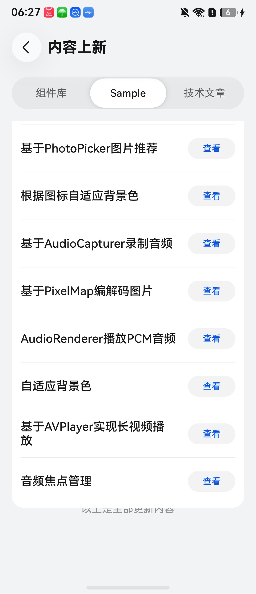
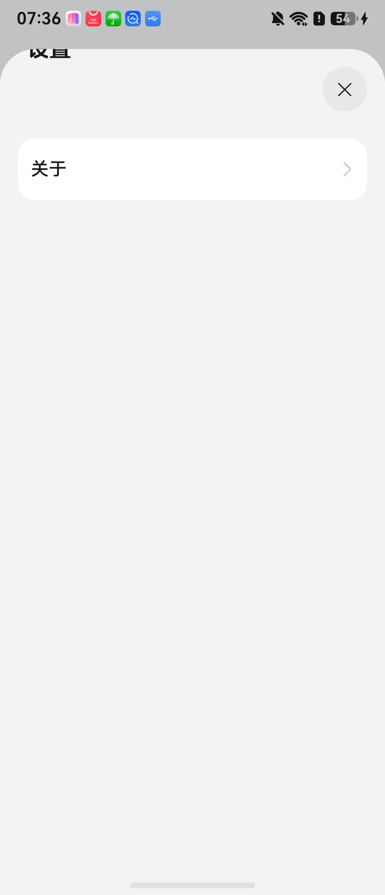
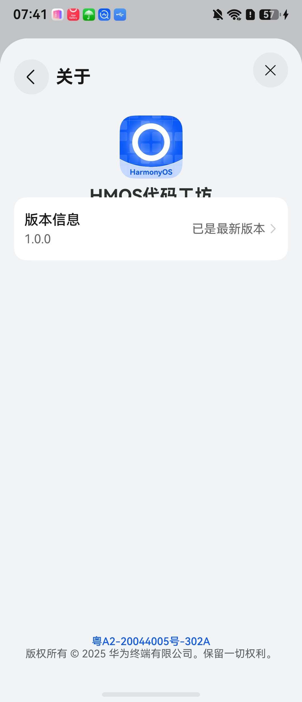
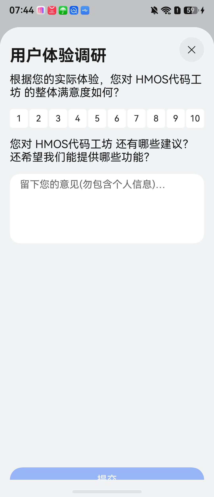

# 从零理解UI显示缺陷、布局树与数据构造：基础课和完整案例

> 仓库阅读说明
> 本次发布两份报告正文。链接中的 `D:/`、`E:/` 指向研究电脑上的实验、源码或截图原件，GitHub网页无法直接打开这些文件或显示这些本地图片。仓库已有的引用材料已改为相对链接。
> 阅读顺序建议先看[总体研究汇报](总体研究汇报_20261109.md)，再查[完整基础课与案例](完整研究报告.md)。后续讨论修正及半字专项实验以总体研究汇报为准。

更新于2026年11月7日。本文把你当作第一次接触GUI testing的读者。你不需要先读懂XML，不需要会写鸿蒙App，也不需要先知道机器学习。我们从手机上的一行字开始，逐步走到真实文件、实验与论文。

这份报告讨论的是**怎么制作可信的“界面截图＋对应布局树＋缺陷答案”数据**。已经做过的实验、历史材料、论文方法和后续建议分别说明；所有例子都有具体来源。完整文件入口在各案例旁边，附录还有23次采集的全量索引。代码框中的“完整节点”保留该节点全部属性；它是整棵树中的一个部分，整屏文件通过相邻链接打开。


**课程目录**

- [第一课：我们到底在测试什么](#lesson-1)
- [第二课：一张页面截图是怎么产生的](#lesson-2)
- [第三课：XML、JSON、布局树与Inspector](#lesson-3)
- [第四课：把真实节点的每类字段读懂](#lesson-4)
- [第五课：数据合成究竟有哪几条路线](#lesson-5)
- [第六课：这次实验怎样做，如何读完整文件](#lesson-6)
- [第七课：从真实运行的正常页开始，逐例读到缺陷与恢复](#lesson-7)
- [第八课：自然应用里看着有问题的画面，怎样一步步排除](#lesson-8)
- [第九课：学姐历史材料、手写样例与商业应用逐例拆解](#lesson-9)
- [第十课：把论文放进同一条数据流程里](#lesson-10)
- [第十一课：回到我们的项目，究竟要制造什么数据](#lesson-11)
- [第十二课：接下来怎样把研究做成一套可用的数据](#lesson-12)
- [阅读与原始材料入口](#lesson-13)

建议先读前五课，再完整跟读正常正文、限行截断、父裁切和可滑正文四个案例；其余案例可以按需查阅。

<a id="lesson-1"></a>

## 第一课：我们到底在测试什么

本课内容：

- [1.1 从一次普通操作开始](#lesson-1-part-1)
- [1.2 一套测试通常包含三个不同工作](#lesson-1-part-2)
- [1.3 什么算UI显示缺陷](#lesson-1-part-3)
- [1.4 正例、负例、真值是什么](#lesson-1-part-4)


<a id="lesson-1-part-1"></a>

### 1.1 从一次普通操作开始

你打开一个购物App，搜索耳机，点击某个商品，再看价格和售后说明。这里同时发生几件事：应用收到点击；程序取到商品数据；页面把图片、价格和文字摆好；系统把它们画到屏幕上；你再根据画面继续操作。

测试就是有目的地检查这条过程。假设点击“加入购物车”后购物车没有商品，这是功能结果的问题；假设商品确实加入了，但按钮上的文字被切掉一半，这是显示的问题；假设应用直接退出，则属于崩溃问题。它们可能一起发生，但测试所需的证据不同。

GUI是Graphical User Interface，即图形用户界面。按钮、图片、输入框、菜单、列表共同组成GUI。UI通常简称用户界面；在本文里，GUI和UI都指屏幕上供人查看和操作的界面。UX是User Experience，即用户体验，范围还包括是否易理解、是否方便、是否让人困惑。本轮将范围收在视觉显示异常，重点研究截断及其正常例外。


<a id="lesson-1-part-2"></a>

### 1.2 一套测试通常包含三个不同工作

|工作|通俗说法|实际例子|
|---|---|---|
|到达页面|先把目标地方打开|首页→我的→设置→关于|
|施加条件或动作|让可能出问题的情况发生|放大字号、展开折叠屏、输入长文字、滚动列表|
|判断结果|回答现在这样算不算错|标题少了半个字且没有正常入口读全，应记录问题|

“探索器”主要负责前两项中的页面访问：它自动点按钮、滑动、按返回，尝试看到更多界面。DroidBot、HapTest等工作常包含这类能力。“检测器”主要负责第三项，可能用规则，也可能用模型。论文里的oracle常译为判定器：它负责告诉测试程序观察到的结果是否符合要求，而不是神奇地天然知道所有正确答案。

因此，探索到了100个页面、发现100张截图、报告100个疑点，是三个不同统计。每张图都需要判断正常还是异常，疑点还可能因为可滚动、动画或截图时机而被排除。


<a id="lesson-1-part-3"></a>

### 1.3 什么算UI显示缺陷

本次阅读过的论文讨论过文字重叠、图片缺失、组件遮挡、文字或图标截断、模糊、错误占位内容等。不同论文定义并不完全相同，所以这里不把它们强行当成同一套标签。

我们当前最关心的截断，可以从三个问题入手：本来要让用户得到什么内容？此刻画面显示了多少？通过该页面正常提供的操作，用户能否拿到剩余内容？例如“预约服务：请于周五下午三点……”中，预约时间是重要信息；如果只剩“请于周”且没有正常恢复方式，就与一个能横滑读完整句子的控件不同。

手机屏幕有限，正常页面也经常只显示部分内容。消息列表在底部露出半条，向上滑一下就能读全；标题显示省略号，点详情能读完整；输入金额时面板盖住下方分类，关闭面板又能选择。我们实际采到了这些例子，后面逐个展示。这样理解之后，就能看出为什么“看到切边就报bug”会误报。


<a id="lesson-1-part-4"></a>

### 1.4 正例、负例、真值是什么

本文将“确实存在目标显示缺陷”叫正例，把“对目标判定而言正常”叫负例。“难负例”是外观很像缺陷、实际有合理解释的正常样本，例如可滑出的半行文字。这些名字只表示数据标签，不表示样本好坏。

真值（ground truth，GT）是评价时采用的参考答案。它可能来自人工审查、可控源码与操作证据，或历史标注。标注文件并非永远正确：本轮C04就出现标注框在空白处。因此每个标签最好说明依据。模型说“有问题”属于预测；人工看图与源码、操作证据支持的标签，才能作为评价它的参考。

误报是把正常当缺陷，漏报是把缺陷当正常。我们的数据如果本身图树错位或标签错误，检测器即使按文件正确执行，也可能被错误评价。此次工作先核数据是否可信，还没有开展模型训练或新算法准确率实验。


<a id="lesson-2"></a>

## 第二课：一张页面截图是怎么产生的

本课内容：

- [2.1 源码、数据、布局、绘制四个阶段](#lesson-2-part-1)
- [2.2 组件与容器](#lesson-2-part-2)
- [2.3 组件框与字形框](#lesson-2-part-3)
- [2.4 截断、裁切、遮挡、限行、正常省略的差别](#lesson-2-part-4)


<a id="lesson-2-part-1"></a>

### 2.1 源码、数据、布局、绘制四个阶段

开发者先写页面代码，表示“这里放一个文字组件，字号24，宽度200”。App运行后，把当前文字内容填进去。系统再计算每个组件实际放在哪、占多大。最后，渲染系统把文字的笔画、背景、图标画成屏幕上的像素。

```text
页面源码 + 当前业务数据 + 系统/设备条件
                ↓
创建运行时组件（Text、Row、Scroll……）
                ↓
排版：计算组件位置、宽高、父子关系
                ↓
绘制：画字形、背景、图标，并应用裁切/遮挡等效果
                ↓
用户看到的屏幕画面 → 截图文件
```

这几个阶段彼此有关，却不是同一份东西。源代码里写的是200vp，设备导出的矩形可能宽625像素；文字内容是完整句子，画面上可能只显示前8个字；组件有一个矩形，矩形里也可能有大片空白，并不是处处都有笔画。


<a id="lesson-2-part-2"></a>

### 2.2 组件与容器

组件是构成界面的一个单元。`Text`负责文字，`Image`负责图片，`Button`负责按钮。容器是组织其他组件的单元：`Row`把子组件按行摆放，`Column`按列摆放，`Scroll`给内容提供滚动区域。容器也可能有尺寸、背景和裁切规则。

“父组件”就是外面包着它的组件，“子组件”就是里面被包着的组件。例如外层卡片包含标题，卡片是父，标题是子。父里面又包含父，这样层层嵌套，就形成一棵树。祖先指从当前组件一路往外包的所有层；查裁切时有时要往上找几层，不能只盯着文字本身。


<a id="lesson-2-part-3"></a>

### 2.3 组件框与字形框

把一个文字组件想成一张透明卡片，字画在卡片上。透明卡片的矩形是组件框；具体字的黑色笔画占据的区域是字形范围。文字基线、行高、内边距会使二者边缘不同。

所以“组件底部在y=1000”没有直接说明最后一笔在哪里。几何规则能发现组件越过父边界，但若要判断半个汉字是否被切掉，还需要看像素或有实际文字排版信息。树的矩形很有用，含义也需要读准。


<a id="lesson-2-part-4"></a>

### 2.4 截断、裁切、遮挡、限行、正常省略的差别

|情况|一个具体画面|可能的产生过程|要核实什么|
|---|---|---|---|
|父容器裁切|右边半个字没了|大Text放进小Row，Row开启clip|父的边界、子原框、可见框、是否可滚|
|文字内部限行|句子在“请于周”处结束|Text只准一行，宽度不够且不显示省略号|完整text、实际画面、宽度和行数设置|
|遮挡|字本身位置没变，被白色卡片盖住|另一个组件画在它上面|层叠关系、前景组件、是否临时弹层|
|正常省略|“预约服务：请于…”|开发者设置Ellipsis并提供详情入口|点开后是否真的得到完整内容|
|正常滚动露边|一半内容在滚动窗口外|内容宽于可视窗口|是否存在可操作的Scroll以及滑后内容|

这里的“可能”是为了说明机制。判断某张真实图属于哪一种，必须回到那张图的树、源码或操作，而不是看一个单词就决定。我们的轻量App恰好把这些条件分开，便于你逐个学习。


<a id="lesson-3"></a>

## 第三课：XML、JSON、布局树与Inspector

本课内容：

- [3.1 树是内容，XML和JSON是包装方式](#lesson-3-part-1)
- [3.2 dumpLayout到底在做什么](#lesson-3-part-2)
- [3.3 整棵树为什么比页面正文大得多](#lesson-3-part-3)
- [3.4 Inspector和独立视图图像](#lesson-3-part-4)


<a id="lesson-3-part-1"></a>

### 3.1 树是内容，XML和JSON是包装方式

一个表格可以存为Excel，也可以存为CSV；同一类组件关系也可以写成XML或JSON。文件名叫XML，并不自动说明它是页面源代码或设备运行时树。

Android项目中的`res/layout/*.xml`通常是开发者写的布局资源。运行测试时另导出的UIAutomator XML则是当时界面的观测。它们虽然扩展名相同，来源和用途完全不同。当前鸿蒙ArkTS页面通常在`.ets`源码里定义；本项目历史树有XML文件，本轮`uitest dumpLayout`得到的是JSON。要先问“谁生成它、什么时候生成、包含哪些字段”。

下面两段只是教学表示，用两种语法表达相同关系：

```xml
<node type="Row" id="card">
  <node type="Text" id="title" text="预约服务" />
</node>
```

```json
{
  "attributes": {"type": "Row", "id": "card"},
  "children": [{
    "attributes": {"type": "Text", "id": "title", "text": "预约服务"},
    "children": []
  }]
}
```

XML用开始／结束标签表达包裹。JSON用`{}`表示一个对象，`[]`表示列表；`attributes`放当前节点的属性，`children`放子节点。`children: []`意味着此份导出记录没有子节点。引号里的`"false"`是字符串，程序读取时要把它解释成布尔值false，不能用“非空字符串就是true”的简化判断。

先练习手动走一遍上面的JSON：最外面的`{}`是一份对象；它的`attributes`里说自己是Row，id是card；它的`children`是一份列表，目前只有一个元素；这个元素又是一个对象，自己的属性说它是Text，内容是“预约服务”。所以你可以把它在纸上画成“Row卡片下面连着Text标题”。树这个词指的正是这些连接关系。

后文出现`$.children[0].attributes.text`这样的路径时，`$`表示从整份文件最外层开始；点号表示进入某个字段；`children[0]`表示取子节点列表的第一个元素，因为程序通常从0开始编号；最后的`attributes.text`表示读这个节点的文本属性。这条路径描述怎样找到值，不是手机上要显示的一句话。实际导出可能最外层就是窗口列表，那么路径会从`$[0]`开始，意思是取第一个窗口对象。

不要把JSON里的逗号、大括号和引号当作无用装饰。逗号分隔同级项目，大括号包住对象，方括号包住列表；少一个符号，读取程序可能无法解析整份文件。你阅读时不需要手写这些文件，先用缩进辨认“谁在谁里面”就够了。


<a id="lesson-3-part-2"></a>

### 3.2 dumpLayout到底在做什么

`dump`在这里可理解成“把当前状态导出到文件”，`layout`是布局。执行命令后，测试工具向系统查询当前可导出的组件层级，并写入文件。它不会读取你的截图再猜一棵树，也不会自动修正页面。

本项目[hdc.ts第219行](D:/Projects/UX-testing/UX-Agent/HarmonyArena-fdu_agent/.opencode/lib/hdc.ts:219)执行`uitest dumpLayout -p`并读回JSON文本；变量名`dumpXml`是代码命名，不决定文件实际语法。[布局读取器](D:/Projects/UX-testing/UX-Agent/HarmonyArena-fdu_agent/src/text-trunc-verifier/layout.ts)首先执行JSON.parse，再读节点。历史XML文件进入算法前，需要使用已有适配入口或明确转换，不能直接把XML原文送给这个JSON读取函数。

`hdc`是电脑与鸿蒙设备沟通的工具；`-t 127.0.0.1:5555`指定本次模拟器；`shell`是在设备里执行命令；`file recv`把设备上的文件拿回电脑。下面是真实采集步骤的结构：

```text
电脑发命令给模拟器
  → 模拟器把树写到 /data/local/tmp/…json
  → 电脑把这个文件收回来
  → 模拟器保存截图，电脑收回
  → 再导一次树并收回
```


<a id="lesson-3-part-3"></a>

### 3.3 整棵树为什么比页面正文大得多

一张截图还可能包含状态栏、导航条、系统窗口。全屏dump里也可能包含多个窗口，所以根节点下面不一定只有你的App。文本“11:50”可能是系统时间；一个`Button`可能属于系统导航而非业务页面。读文件要先找App对应的根及目标id，不能搜索到第一个Text就开始判断。

此外，运行时框架可能插入开发者没有在源码里显式写出的包装节点。源码的一层组件，不保证与dump里的一层节点一一对应。我们先根据稳定id与文本定位，再看实际父子链。


<a id="lesson-3-part-4"></a>

### 3.4 Inspector和独立视图图像

Inspector是开发环境里的界面检查工具。它让开发者选择一个组件、查看层级和属性。它可能通过与调试应用协作取得更多信息；本轮没有运行Inspector采集，因此不把它的可能能力混进本轮证据。

独立视图图像是把某个视图或子树单独绘制出来得到的像素。例如文字被上层白卡片挡住，整屏截图裁下那一块会得到白色；如果另外取得该文字视图自身的绘制图，可能看到文字本身。dVermin利用这类额外材料做比较。它要求的输入应从作者实现逐项核对，不能将“截图按bounds裁图”替换成“独立视图绘制”。

我们当前数据条件很明确：系统截图＋项目使用的dumpLayout。先研究这些字段足够回答哪些问题，再考虑是否真的需要扩大采集接口。


<a id="lesson-4"></a>

## 第四课：把真实节点的每类字段读懂

本课内容：

- [4.1 坐标怎么算](#lesson-4-part-1)
- [4.2 为什么得沿着祖先往上读](#lesson-4-part-2)


下面按本轮实际dump中的字段解释。空字符串表示当前文件没有提供具体值；它和明确的false或0不同。字段名字只是入口，具体含义必须结合平台和实测，尤其不要把标识号当成跨重启永远稳定的业务id。

|字段|你可以怎样读|本研究中怎样用|
|---|---|---|
|type|组件类型，如Text、Row、Scroll|确定文字节点和容器类型|
|text|导出的文本内容|与截图可见文字比较，内容可能仍是完整句|
|originalText|此导出记录中的原文本属性|本轮目标中与text相同，保留原值|
|id、key|组件标识|受控页通过.id(...)赋值，可用来稳定定位|
|bounds|当前导出的组件边界|与截图像素坐标对齐，核可见几何|
|origBounds|导出的原组件边界|与bounds比较观察祖先裁切；不是全文天然宽度|
|clip|该节点的裁切属性|要查目标与祖先；子节点false仍可能被父节点裁|
|scrollable|是否被报告为可滚动|指导动作选择，再看操作是否实际生效|
|visible|导出工具报告的可见状态|true的Text也可能只显示一部分|
|clickable、longClickable|点击／长按能力标记|查是否有交互入口，不能只凭文字猜可点|
|enabled|是否启用|禁用控件和可操作控件要分开|
|checkable、checked|是否可勾选、是否已勾选|这是选项状态，和文字裁切不是同一个问题|
|selected、focused|选择／焦点状态|可能随交互改变，用于理解页面状态|
|accessibilityId|框架导出的辅助访问节点标识|本次记录内定位辅助，不当作永久业务主键|
|hashcode|当前导出中的节点相关标识字符串|记录和追踪时保留，不把字符串当安全哈希|
|hierarchy|导出层级路径信息|帮助找节点所在位置，页面结构变化后可能变化|
|hostWindowId、displayId|所属窗口／显示屏|排除找错窗口或屏幕|
|bundleName、abilityName、pagePath|部分节点上的App、界面入口与页面信息|先确认采到的是目标App而不是桌面|
|backgroundColor、backgroundImage|背景颜色／图像属性|辅助理解遮盖和背景；空源不意味着整个节点没有像素|
|opacity|透明度属性|1通常表示完全不透明的设置值；仍要考虑父级和实际绘制|
|blur|模糊属性|仅解释文件实际值，不推断文件没写就绝无模糊|
|zIndex|层叠顺序相关属性|遮挡分析的线索；单个数值不能替代完整渲染顺序|
|hitTestBehavior|点击命中处理方式|画面位置与动作作用是否一致时可能相关|
|description、hint|描述／提示信息|补充控件语义，可能为空|
|children|子节点列表|从当前容器继续往里找|


<a id="lesson-4-part-1"></a>

### 4.1 坐标怎么算

截图左上角是(0,0)。向右x增大，向下y增大。`[800,947][1425,1035]`表示左800、上947、右1425、下1035。宽度是1425−800=625像素，高度是1035−947=88像素。

本次截图2224×2496。源码里的宽200vp变成625px，比例约3.125；这是本次设备条件下实际观测的换算。切换设备或密度后要重新核，不能在所有鸿蒙设备上固定乘这个数。聊天里图片可能被缩小显示，计算必须以原图像素为准。

判断右侧少了多少，可以在坐标系统一致且框定义适合的情况下算`origRight−right`。本轮父裁切子节点原右边2831，当前右边1425，差1406px。这描述组件范围被限制的部分，不表示“少了1406px的字形”，也不告诉我们是否可通过滚动取回。


<a id="lesson-4-part-2"></a>

### 4.2 为什么得沿着祖先往上读

文字节点`clip=false`只说明这个节点自己的相关属性没有开启。外层Row若`clip=true`，仍会把子内容限制在自己的矩形内。类似一张长纸放进小窗口，纸本身没有剪掉，但窗口挡住了右半边。我们会在案例里给出从根到文字的真实路径，不让你只看到一个脱离上下文的矩形。


<a id="lesson-5"></a>

## 第五课：数据合成究竟有哪几条路线

本课内容：

- [5.1 只改像素](#lesson-5-part-1)
- [5.2 用树指导改图](#lesson-5-part-2)
- [5.3 同时离线修改图与树](#lesson-5-part-3)
- [5.4 改App源码，再让系统产生图与树](#lesson-5-part-4)
- [5.5 改设置，让现有App暴露问题](#lesson-5-part-5)


<a id="lesson-5-part-1"></a>

### 5.1 只改像素

拿到正常截图，用绘图软件涂掉一部分字、盖一个色块、粘贴一段重叠文字，就得到异常图片。它适合测试只看截图的模型。若同时附着旧树，应明确这是输入正常树而不是新画面的运行时观测。

但不是所有像素修改都应该改变text：真实遮挡时text本来就可以保持完整。所以合理的问题是“这个故障机制在运行时会改变哪些属性”，而不是机械地要求每次改图都删掉树中的文字。


<a id="lesson-5-part-2"></a>

### 5.2 用树指导改图

生成器先读正常树，知道文字在哪里、图片在哪里，然后在相应矩形编辑图像。这样比随机涂一块更容易落在真实组件上。Owl Eyes和Nighthawk属于重要参考。这里树参与了数据制作，但输出仍可能只有图和缺陷框。缺陷框文件里记录`xmin/ymin/xmax/ymax`，用途是监督“问题在哪里”；它没有整屏父子关系。后面会专门比较这两种看起来都叫XML的文件。


<a id="lesson-5-part-3"></a>

### 5.3 同时离线修改图与树

GvT已有实际公开例子：标题像素向右下移，XML对应节点的bounds也跟着移。它没有启动修改过的App。这条路线的难点是要保持有关字段共同一致：移动子节点后父节点是否仍包含它、点击范围应怎样变、裁切后的后代怎样处理、被挡住的内容是否还能存在于树中。


<a id="lesson-5-part-4"></a>

### 5.4 改App源码，再让系统产生图与树

源码里把父容器变小、开启clip、改变文字行数，然后编译、安装、运行，由系统真正排版绘制，再采图和树。学姐D2/D3和本轮轻量App走这条路线。优点是很多坐标和祖先裁切关系由真实框架处理；难点是应用构建、页面到达、注入有效性和采集同步。

“人工”在这里指缺陷原因是研究者主动加入的；“真实运行时”指最终图片和树来自真的App运行。这两个性质可以同时成立。自然缺陷则是未经我们专门注入、原App已出现的问题。三者要分开记录，才能比较人工数据像不像实际问题。


<a id="lesson-5-part-5"></a>

### 5.5 改设置，让现有App暴露问题

不改App源码，只放大系统字号或改变屏幕条件，原来固定高度的文字区可能装不下新字号。AccessiText、dVermin可提供这种受控对照的思路。正常重排也会使树变化，因此“树不同”还需要与显示问题判定相结合。


<a id="lesson-6"></a>

## 第六课：这次实验怎样做，如何读完整文件

本课内容：

- [6.1 一个案例目录中的文件](#lesson-6-part-1)
- [6.2 全部页面源码](#lesson-6-part-2)


先解释实验环境中的名字。DevEco Studio是开发鸿蒙应用的软件，可以编辑、构建、调试应用，并管理模拟设备；模拟器是在电脑上运行的虚拟手机环境。SDK是开发工具和平台接口的集合；API版本标记应用可以依赖哪一代平台接口。编译或构建，是把开发者写的源码处理成可安装的软件包。HAP是鸿蒙应用的模块安装包格式，本轮用它安装轻量实验App。安装把包放进设备，启动才会运行其中的程序并显示页面，所以“编译成功”“安装成功”“成功打开目标页面”要分别确认。

我们使用本机DevEco环境、Mate X5展开态模拟器，系统实际返回OpenHarmony-6.1.0.115，API23，2224×2496像素。没有调用模型。原代码工坊因启动接口兼容问题退出，随后构建独立小App；另外安装OhBill和开源仿微信观察自然页面。

23次采集每次保存两个完整树和一张设备原始JPEG。`snapshot.png`只是把该JPEG解码保存为PNG便于查看，没有增加缺失细节。开始的启动瞬态、桌面以及14号不同步帧排除后，20次用于状态证据。它们不是20个独立bug；受控缺陷机制为两类，自然应用确证显示缺陷为0。


<a id="lesson-6-part-1"></a>

### 6.1 一个案例目录中的文件

|文件|完整内容是什么|阅读顺序|
|---|---|---|
|snapshot.native.jpeg|设备直接保存的原始截图|需要核原件时查看|
|snapshot.png|同一画面的PNG查看版|先看整屏，再定位目标|
|tree-before.json|截图前的完整设备树|主讲文件，正文摘取目标节点|
|tree-after.json|截图后的完整设备树|检查采集期间结构是否变化|
|capture.json|目标设备、图像尺寸、采集时间、文件哈希等|确认文件属于同一采集记录|

长JSON原来可能只有一行，不适合初学者直接读。为此，本版额外生成“完整文件参考”：把相同JSON按缩进排版，保留所有节点和属性，并附原件入口。排版副本经解析相等核对；它不是补造的新树。正文的局部节点帮助理解，完整文件让你随时往上往下追。

每个案例都按同样顺序读：先看截图→明确本来要显示什么→打开完整文件→按id找目标→看完整目标属性和祖先→算坐标→看操作前后→给出结论。第一次慢慢读正常页和父裁切页，后面的例子就会容易很多。


<a id="lesson-6-part-2"></a>

### 6.2 全部页面源码

下面保留本轮轻量App的整个`Index.ets`，没有用省略号跳过分支。`scenario`记录选中的模式；`expanded`记录详情是否展开；按钮修改这些状态后，框架重新显示相应分支。顶部“正常”等按钮是实验控制台，用于切换条件；我们讨论一个模式的恢复能力时，不把切换到另一个实验模式当作该业务内容的正常恢复入口。

[整个页面源码原件](<D:/Projects/实验室/2026-11-06_UI显示缺陷与布局树研究/运行时实验/paired-app/entry/src/main/ets/pages/Index.ets>)

```typescript
@Entry
@Component
struct Index {
 @State scenario: number = 0;
 @State expanded: boolean = false;
 private message: string = '预约服务：请于周五下午三点携带完整材料到服务中心办理。';
 build() {
  Column({ space: 16 }) {
   Text('布局树与画面配对实验').fontSize(26).fontWeight(FontWeight.Bold)
   Text('同一文本，切换布局条件；正文没有其他隐藏入口。').fontSize(16)
   Row({space: 8}) {
    Button('正常').onClick(() => { this.scenario = 0; this.expanded = false; }).id('choose-normal')
    Button('限行截断').onClick(() => { this.scenario = 1; }).id('choose-line')
    Button('省略详情').onClick(() => { this.scenario = 2; this.expanded = false; }).id('choose-ellipsis')
   }
   Row({space: 8}) {
    Button('父级裁剪').onClick(() => { this.scenario = 3; }).id('choose-parent')
    Button('正常横滑').onClick(() => { this.scenario = 4; }).id('choose-scroll')
   }
   Text('正文区域').fontSize(18)
   if (this.scenario === 0) {
    Text(this.message).width('100%').fontSize(24).id('body-normal')
   } else if (this.scenario === 1) {
    Text(this.message).width(200).fontSize(24).maxLines(1)
     .textOverflow({overflow: TextOverflow.Clip}).id('body-line-clip')
   } else if (this.scenario === 2) {
    if (this.expanded) { Text(this.message).width('100%').fontSize(24).id('body-details') }
    else { Text(this.message).width(200).fontSize(24).maxLines(1)
     .textOverflow({overflow: TextOverflow.Ellipsis}).id('body-ellipsis') }
    Button(this.expanded ? '收起' : '查看完整内容').onClick(() => { this.expanded = !this.expanded; }).id('toggle-details')
   } else if (this.scenario === 3) {
    Row() { Text(this.message).width(650).fontSize(24).maxLines(1).id('body-parent-child') }
     .width(200).height(48).clip(true).id('body-clipped-parent')
   } else {
    Scroll() { Text(this.message).width(650).fontSize(24).maxLines(1).id('body-scroll-child') }
     .scrollable(ScrollDirection.Horizontal).width(200).height(48).id('body-scroll-parent')
   }
  }.width('100%').height('100%').padding(24).backgroundColor('#FFFFFF')
 }
}

```

源码读法：`Text(this.message)`创建文字；点号后是配置；`width(200)`给宽度；`maxLines(1)`只准一行；`TextOverflow.Clip`使用截断方式；`Ellipsis`显示省略号；`onClick`后的函数就是点击行为；`Row(){...}`和`Scroll(){...}`中的大括号包着它们的子组件。

可以把完整源码分成下面几块读，第一次不需要记住语法：

|源码位置或写法|发生了什么|与实验有什么关系|
|---|---|---|
|`@Entry`、`@Component`和`struct Index`|声明这个页面组件及入口|框架知道要从这里构造页面|
|`@State scenario: number = 0`|保存当前模式，初值为0；模式改变时更新画面|0正常，1限行，2省略详情，3父裁切，其他分支为横滑|
|`@State expanded: boolean = false`|保存详情是否展开，初始为否|同一模式可以比较展开前后|
|`private message: string = ...`|保存要显示的完整字符串|所有条件下使用相同内容，避免换文造成混淆|
|`build()`|描述当前状态下应显示哪些组件|这里的结构被框架用于创建和更新页面|
|`Column({ space: 16 })`|把里面的元素竖着摆，元素间设置间距|标题、模式按钮、正文按顺序排列|
|两个带Button的Row|每行放一组按钮|这是实验人员切换条件的控制台|
|`() => { this.scenario = 1; }`|一个点击后执行的小函数，把模式改成1|点击“限行截断”后进入对应分支|
|`if`、`else if`、`else`|按条件选择其中一个分支|一次显示当前模式的正文，而不是把五个版本叠在一起|
|`width('100%')`|使用父容器提供的可用宽度|正常版本尽量利用页面空间|
|`width(200)`和`width(650)`|给固定布局宽度，本例单位为vp|制造窄窗口与长内容的尺寸差异|
|`.id('body-parent-child')`|给组件设置可查找的标识|后面的树里可以准确定位这段文字|
|`.clip(true)`|让该容器裁去边界外的内容|父裁切条件的关键设置|
|`ScrollDirection.Horizontal`|指定水平滚动|为相同长内容提供正常恢复方式|
|`expanded ? '收起' : '查看完整内容'`|条件为真显示前一个字符串，否则显示后一个|按钮标题告诉用户当前可执行的动作|
|`this.expanded = !this.expanded`|把真假状态反过来|点击一次展开，再点一次收起|
|`.padding(24)`|在页面内容边缘留空白|解释目标为何没有紧贴屏幕边缘|
|`.backgroundColor('#FFFFFF')`|把背景设为白色|十六进制颜色中这个值表示白色|

例如选择“父级裁剪”后，`scenario`变成3，框架选中`scenario === 3`分支：先创建宽650vp的Text，再把它放进宽200vp的Row，并给Row开启裁切。运行时系统计算它们的像素坐标，之后dumpLayout记录这些对象和属性。这样就把“源码里设置什么”“树里出现什么”“截图为什么少了一截”连成了一条完整过程。

注意所有模式都用同一个完整字符串。我们没有把文字改短来假装截断。真正改变的是容器、宽度、行数和恢复入口，这让后面的数据对照有明确原因。


<a id="lesson-7"></a>

## 第七课：从真实运行的正常页开始，逐例读到缺陷与恢复

本课内容：

- [案例1：正常全文，先学会读一棵树](#lesson-7-part-1)
- [案例2：真的少了内容，两个框却完全相同](#lesson-7-part-2)
- [案例3：文字本身很宽，外层窗口很窄](#lesson-7-part-3)
- [案例4：像素完全一样，却可以正常横滑](#lesson-7-part-4)
- [案例5：两棵树都稳定，图片却可能还是旧帧](#lesson-7-part-5)
- [案例6：取得与滚动位置相符的新画面](#lesson-7-part-6)
- [案例7：最后一句真的能滑出来](#lesson-7-part-7)
- [案例8：省略号为什么是正常难负例](#lesson-7-part-8)
- [案例9：用展开后的结果支持上一例判定](#lesson-7-part-9)
- [案例10：限行正文执行同方向滑动后](#lesson-7-part-10)
- [案例11：不可滚动Row执行同方向滑动后](#lesson-7-part-11)
- [案例12：两棵子树完整并排理解——Row和Scroll](#lesson-7-part-12)


下列完整节点均由原文件自动抽出，保留所有属性；祖先表是导读，不替代完整树。每例的“全文件易读版”包含截图前后的两棵完整树。


<a id="lesson-7-part-1"></a>

### 案例1：正常全文，先学会读一棵树

先读画面中的正文，而不是上面的模式按钮。完整句子从“预约服务”一直到“办理。”都能看到。源码没有限制行数，文字使用页面可用宽度。这个版本提供比较基准：我们知道同一个字符串在足够空间下应是什么样。


完整参考：[全文件易读版](D:/Projects/实验室/2026-11-06_UI显示缺陷与布局树研究/完整文件参考/10-normal/完整内容.md)；[原始整屏树](D:/Projects/实验室/2026-11-06_UI显示缺陷与布局树研究/运行时实验/10-normal/tree-before.json)；[截图后整屏树](D:/Projects/实验室/2026-11-06_UI显示缺陷与布局树研究/运行时实验/10-normal/tree-after.json)；[设备原截图](D:/Projects/实验室/2026-11-06_UI显示缺陷与布局树研究/运行时实验/10-normal/snapshot.native.jpeg)；[采集元信息](D:/Projects/实验室/2026-11-06_UI显示缺陷与布局树研究/运行时实验/10-normal/capture.json)。

先在树里搜索`body-normal`。本次完整JSON路径为`$.children[0].children[0].children[5]`。路径从`$`根开始；`children[0]`指子节点列表中的第1个元素，因为索引从0计数。

**从最外层到目标父节点：**

|层|类型|id|bounds|origBounds|clip|scrollable|
|---|---|---|---|---|---|---|
|0|||[0,0][2224,2496]||||
|1|root||[0,122][2224,2496]|[0,0][2224,2496]|false|false|
|2|Column||[0,122][2224,2409]|[0,121][2224,2409]|false|false|

表中空白是原属性空值，不自动补成false。当前目标自身的全部属性与children如下：


```json
{
  "attributes": {
    "accessibilityId": "21",
    "backgroundColor": "#00000000",
    "backgroundImage": "empty source",
    "blur": "",
    "bounds": "[75,916][2149,1004]",
    "checkable": "false",
    "checked": "false",
    "clickable": "false",
    "clip": "false",
    "description": "",
    "displayId": "0",
    "enabled": "true",
    "focused": "false",
    "hashcode": "33:21",
    "hierarchy": "ROOT33,0,5",
    "hint": "",
    "hitTestBehavior": "HitTestMode.Default",
    "hostWindowId": "33",
    "id": "body-normal",
    "key": "body-normal",
    "longClickable": "false",
    "opacity": "1.000000",
    "origBounds": "[75,916][2149,1004]",
    "originalText": "预约服务：请于周五下午三点携带完整材料到服务中心办理。",
    "scrollable": "false",
    "selected": "false",
    "text": "预约服务：请于周五下午三点携带完整材料到服务中心办理。",
    "type": "Text",
    "visible": "true",
    "zIndex": "0"
  },
  "children": []
}
```

目标框宽2149−75=2074px，高1004−916=88px。bounds和origBounds相同，与这张正常图相符。这里的推理方向是“看到了完整内容并且几何一致”，而不是仅凭两个框相同就判正常。下一例将直接反驳后一种捷径。

**再核对三件事：** 画面里的目标是否就是这个节点；造成限制的是自己还是某个祖先；有没有实际操作后的内容恢复证据。单独抄下一个bounds还没有把这三个问题回答完。


<a id="lesson-7-part-2"></a>

### 案例2：真的少了内容，两个框却完全相同

正文只显示前段“预约服务：请于周”，后面的星期、时间、材料和办理地点不在画面里，也没有省略号或详情按钮。源码的width(200)、maxLines(1)、TextOverflow.Clip共同产生这个状态；文字字符串本身没有被改短。


完整参考：[全文件易读版](D:/Projects/实验室/2026-11-06_UI显示缺陷与布局树研究/完整文件参考/11-line-clip/完整内容.md)；[原始整屏树](D:/Projects/实验室/2026-11-06_UI显示缺陷与布局树研究/运行时实验/11-line-clip/tree-before.json)；[截图后整屏树](D:/Projects/实验室/2026-11-06_UI显示缺陷与布局树研究/运行时实验/11-line-clip/tree-after.json)；[设备原截图](D:/Projects/实验室/2026-11-06_UI显示缺陷与布局树研究/运行时实验/11-line-clip/snapshot.native.jpeg)；[采集元信息](D:/Projects/实验室/2026-11-06_UI显示缺陷与布局树研究/运行时实验/11-line-clip/capture.json)。

先在树里搜索`body-line-clip`。本次完整JSON路径为`$.children[0].children[0].children[5]`。路径从`$`根开始；`children[0]`指子节点列表中的第1个元素，因为索引从0计数。

**从最外层到目标父节点：**

|层|类型|id|bounds|origBounds|clip|scrollable|
|---|---|---|---|---|---|---|
|0|||[0,0][2224,2496]||||
|1|root||[0,122][2224,2496]|[0,0][2224,2496]|false|false|
|2|Column||[0,122][2224,2409]|[0,121][2224,2409]|false|false|

表中空白是原属性空值，不自动补成false。当前目标自身的全部属性与children如下：


```json
{
  "attributes": {
    "accessibilityId": "22",
    "backgroundColor": "#00000000",
    "backgroundImage": "empty source",
    "blur": "",
    "bounds": "[800,916][1425,1004]",
    "checkable": "false",
    "checked": "false",
    "clickable": "false",
    "clip": "false",
    "description": "",
    "displayId": "0",
    "enabled": "true",
    "focused": "false",
    "hashcode": "33:22",
    "hierarchy": "ROOT33,0,5",
    "hint": "",
    "hitTestBehavior": "HitTestMode.Default",
    "hostWindowId": "33",
    "id": "body-line-clip",
    "key": "body-line-clip",
    "longClickable": "false",
    "opacity": "1.000000",
    "origBounds": "[800,916][1425,1004]",
    "originalText": "预约服务：请于周五下午三点携带完整材料到服务中心办理。",
    "scrollable": "false",
    "selected": "false",
    "text": "预约服务：请于周五下午三点携带完整材料到服务中心办理。",
    "type": "Text",
    "visible": "true",
    "zIndex": "0"
  },
  "children": []
}
```

目标宽1425−800=625px，与正常版本2074px差很多。系统给这个Text分配的就是625px宽度，因此origBounds也只有625px。它没有把完整句子的自然长度自动写进origBounds。text与originalText仍然存全句；clip=false也没有阻止Text内部的限行溢出处理。40号实际横滑后内容未恢复。判断依据是源码中没有该模式的恢复入口、画面内容丢失和动作对照共同支持。

**再核对三件事：** 画面里的目标是否就是这个节点；造成限制的是自己还是某个祖先；有没有实际操作后的内容恢复证据。单独抄下一个bounds还没有把这三个问题回答完。


<a id="lesson-7-part-3"></a>

### 案例3：文字本身很宽，外层窗口很窄

这里源码让Text宽650vp，外面Row只宽200vp并clip(true)。把它想象成长纸放在窄窗口后：字仍然画在长纸上，窗口外的部分不展示。截图中右边出现硬切边。


完整参考：[全文件易读版](D:/Projects/实验室/2026-11-06_UI显示缺陷与布局树研究/完整文件参考/12-parent-clip/完整内容.md)；[原始整屏树](D:/Projects/实验室/2026-11-06_UI显示缺陷与布局树研究/运行时实验/12-parent-clip/tree-before.json)；[截图后整屏树](D:/Projects/实验室/2026-11-06_UI显示缺陷与布局树研究/运行时实验/12-parent-clip/tree-after.json)；[设备原截图](D:/Projects/实验室/2026-11-06_UI显示缺陷与布局树研究/运行时实验/12-parent-clip/snapshot.native.jpeg)；[采集元信息](D:/Projects/实验室/2026-11-06_UI显示缺陷与布局树研究/运行时实验/12-parent-clip/capture.json)。

先在树里搜索`body-parent-child`。本次完整JSON路径为`$.children[0].children[0].children[5].children[0]`。路径从`$`根开始；`children[0]`指子节点列表中的第1个元素，因为索引从0计数。

**从最外层到目标父节点：**

|层|类型|id|bounds|origBounds|clip|scrollable|
|---|---|---|---|---|---|---|
|0|||[0,0][2224,2496]||||
|1|root||[0,122][2224,2496]|[0,0][2224,2496]|false|false|
|2|Column||[0,122][2224,2409]|[0,121][2224,2409]|false|false|
|3|Row|body-clipped-parent|[800,916][1425,1066]|[800,916][1425,1066]|true|false|

表中空白是原属性空值，不自动补成false。当前目标自身的全部属性与children如下：


```json
{
  "attributes": {
    "accessibilityId": "24",
    "backgroundColor": "#00000000",
    "backgroundImage": "empty source",
    "blur": "",
    "bounds": "[800,947][1425,1035]",
    "checkable": "false",
    "checked": "false",
    "clickable": "false",
    "clip": "false",
    "description": "",
    "displayId": "0",
    "enabled": "true",
    "focused": "false",
    "hashcode": "33:24",
    "hierarchy": "ROOT33,0,5,0",
    "hint": "",
    "hitTestBehavior": "HitTestMode.Default",
    "hostWindowId": "33",
    "id": "body-parent-child",
    "key": "body-parent-child",
    "longClickable": "false",
    "opacity": "1.000000",
    "origBounds": "[800,947][2831,1035]",
    "originalText": "预约服务：请于周五下午三点携带完整材料到服务中心办理。",
    "scrollable": "false",
    "selected": "false",
    "text": "预约服务：请于周五下午三点携带完整材料到服务中心办理。",
    "type": "Text",
    "visible": "true",
    "zIndex": "0"
  },
  "children": []
}
```

Text原宽2831−800=2031px，当前宽1425−800=625px，右侧范围少1406px。父Row的横向范围也正好从800到1425。Text自己的clip=false，父Row的clip=true；因此要沿祖先找到裁切来源。41号对同一正文区域执行横滑后仍未恢复，且源码外层是Row，没有Scroll。

**再核对三件事：** 画面里的目标是否就是这个节点；造成限制的是自己还是某个祖先；有没有实际操作后的内容恢复证据。单独抄下一个bounds还没有把这三个问题回答完。


<a id="lesson-7-part-4"></a>

### 案例4：像素完全一样，却可以正常横滑

先把本图与上一例对照。原JPEG的SHA256相同，表示两个文件字节完全相同。你从这两张初始图的像素里看不出一个有滚动容器、另一个没有。它们的子Text矩形也相同。


完整参考：[全文件易读版](D:/Projects/实验室/2026-11-06_UI显示缺陷与布局树研究/完整文件参考/13-scroll-before/完整内容.md)；[原始整屏树](D:/Projects/实验室/2026-11-06_UI显示缺陷与布局树研究/运行时实验/13-scroll-before/tree-before.json)；[截图后整屏树](D:/Projects/实验室/2026-11-06_UI显示缺陷与布局树研究/运行时实验/13-scroll-before/tree-after.json)；[设备原截图](D:/Projects/实验室/2026-11-06_UI显示缺陷与布局树研究/运行时实验/13-scroll-before/snapshot.native.jpeg)；[采集元信息](D:/Projects/实验室/2026-11-06_UI显示缺陷与布局树研究/运行时实验/13-scroll-before/capture.json)。

先在树里搜索`body-scroll-child`。本次完整JSON路径为`$.children[0].children[0].children[5].children[0]`。路径从`$`根开始；`children[0]`指子节点列表中的第1个元素，因为索引从0计数。

**从最外层到目标父节点：**

|层|类型|id|bounds|origBounds|clip|scrollable|
|---|---|---|---|---|---|---|
|0|||[0,0][2224,2496]||||
|1|root||[0,122][2224,2496]|[0,0][2224,2496]|false|false|
|2|Column||[0,122][2224,2409]|[0,121][2224,2409]|false|false|
|3|Scroll|body-scroll-parent|[800,916][1425,1066]|[800,916][1425,1066]|true|true|

表中空白是原属性空值，不自动补成false。当前目标自身的全部属性与children如下：


```json
{
  "attributes": {
    "accessibilityId": "26",
    "backgroundColor": "#00000000",
    "backgroundImage": "empty source",
    "blur": "",
    "bounds": "[800,947][1425,1035]",
    "checkable": "false",
    "checked": "false",
    "clickable": "false",
    "clip": "false",
    "description": "",
    "displayId": "0",
    "enabled": "true",
    "focused": "false",
    "hashcode": "33:26",
    "hierarchy": "ROOT33,0,5,0",
    "hint": "",
    "hitTestBehavior": "HitTestMode.Default",
    "hostWindowId": "33",
    "id": "body-scroll-child",
    "key": "body-scroll-child",
    "longClickable": "false",
    "opacity": "1.000000",
    "origBounds": "[800,947][2831,1035]",
    "originalText": "预约服务：请于周五下午三点携带完整材料到服务中心办理。",
    "scrollable": "false",
    "selected": "false",
    "text": "预约服务：请于周五下午三点携带完整材料到服务中心办理。",
    "type": "Text",
    "visible": "true",
    "zIndex": "0"
  },
  "children": []
}
```

差异在祖先：本例是Scroll，scrollable=true；上一例是Row，scrollable=false。这给测试程序一个具体动作方向。执行动作后42号展示中段、18号展示结尾，说明内容可以在不同滚动位置读到。不能要求一张窄窗口图同时容纳全文，应该检验正常操作能否访问内容。

**再核对三件事：** 画面里的目标是否就是这个节点；造成限制的是自己还是某个祖先；有没有实际操作后的内容恢复证据。单独抄下一个bounds还没有把这三个问题回答完。


<a id="lesson-7-part-5"></a>

### 案例5：两棵树都稳定，图片却可能还是旧帧

这一帧必须学习，因为数据构造也会出错。采集顺序仍是树→图→树，前后两树相同；但原JPEG与13号初始图完全相同，树的origBounds已经改变。它不是我们要往正例集中加入的新App缺陷，而是图树配对质量疑点。


完整参考：[全文件易读版](D:/Projects/实验室/2026-11-06_UI显示缺陷与布局树研究/完整文件参考/14-scroll-middle/完整内容.md)；[原始整屏树](D:/Projects/实验室/2026-11-06_UI显示缺陷与布局树研究/运行时实验/14-scroll-middle/tree-before.json)；[截图后整屏树](D:/Projects/实验室/2026-11-06_UI显示缺陷与布局树研究/运行时实验/14-scroll-middle/tree-after.json)；[设备原截图](D:/Projects/实验室/2026-11-06_UI显示缺陷与布局树研究/运行时实验/14-scroll-middle/snapshot.native.jpeg)；[采集元信息](D:/Projects/实验室/2026-11-06_UI显示缺陷与布局树研究/运行时实验/14-scroll-middle/capture.json)。

先在树里搜索`body-scroll-child`。本次完整JSON路径为`$.children[0].children[0].children[5].children[0]`。路径从`$`根开始；`children[0]`指子节点列表中的第1个元素，因为索引从0计数。

**从最外层到目标父节点：**

|层|类型|id|bounds|origBounds|clip|scrollable|
|---|---|---|---|---|---|---|
|0|||[0,0][2224,2496]||||
|1|root||[0,122][2224,2496]|[0,0][2224,2496]|false|false|
|2|Column||[0,122][2224,2409]|[0,121][2224,2409]|false|false|
|3|Scroll|body-scroll-parent|[800,916][1425,1066]|[800,916][1425,1066]|true|true|

表中空白是原属性空值，不自动补成false。当前目标自身的全部属性与children如下：


```json
{
  "attributes": {
    "accessibilityId": "26",
    "backgroundColor": "#00000000",
    "backgroundImage": "empty source",
    "blur": "",
    "bounds": "[800,947][1425,1035]",
    "checkable": "false",
    "checked": "false",
    "clickable": "false",
    "clip": "false",
    "description": "",
    "displayId": "0",
    "enabled": "true",
    "focused": "false",
    "hashcode": "33:26",
    "hierarchy": "ROOT33,0,5,0",
    "hint": "",
    "hitTestBehavior": "HitTestMode.Default",
    "hostWindowId": "33",
    "id": "body-scroll-child",
    "key": "body-scroll-child",
    "longClickable": "false",
    "opacity": "1.000000",
    "origBounds": "[295,947][2326,1035]",
    "originalText": "预约服务：请于周五下午三点携带完整材料到服务中心办理。",
    "scrollable": "false",
    "selected": "false",
    "text": "预约服务：请于周五下午三点携带完整材料到服务中心办理。",
    "type": "Text",
    "visible": "true",
    "zIndex": "0"
  },
  "children": []
}
```

13号原框左端800，14号变成295，表示记录中目标左移505px；右端从2831变成2326，同样左移505px。若把14号图片误当作对应的新画面，就会产生“树移动了但图没移动”的错误训练对。原始记录保留并排除；42号等待后的新采集另存，不能覆盖14号来隐藏问题。具体底层原因未定位，本轮只确认文件层面的不一致证据。

**再核对三件事：** 画面里的目标是否就是这个节点；造成限制的是自己还是某个祖先；有没有实际操作后的内容恢复证据。单独抄下一个bounds还没有把这三个问题回答完。


<a id="lesson-7-part-6"></a>

### 案例6：取得与滚动位置相符的新画面

本图能看到句子的中间部分，区别于初始“预约服务”开头。它是等待稳定后单独采集的新记录，原图与14号不同。


完整参考：[全文件易读版](D:/Projects/实验室/2026-11-06_UI显示缺陷与布局树研究/完整文件参考/42-scroll-middle-stable/完整内容.md)；[原始整屏树](D:/Projects/实验室/2026-11-06_UI显示缺陷与布局树研究/运行时实验/42-scroll-middle-stable/tree-before.json)；[截图后整屏树](D:/Projects/实验室/2026-11-06_UI显示缺陷与布局树研究/运行时实验/42-scroll-middle-stable/tree-after.json)；[设备原截图](D:/Projects/实验室/2026-11-06_UI显示缺陷与布局树研究/运行时实验/42-scroll-middle-stable/snapshot.native.jpeg)；[采集元信息](D:/Projects/实验室/2026-11-06_UI显示缺陷与布局树研究/运行时实验/42-scroll-middle-stable/capture.json)。

先在树里搜索`body-scroll-child`。本次完整JSON路径为`$.children[0].children[0].children[5].children[0]`。路径从`$`根开始；`children[0]`指子节点列表中的第1个元素，因为索引从0计数。

**从最外层到目标父节点：**

|层|类型|id|bounds|origBounds|clip|scrollable|
|---|---|---|---|---|---|---|
|0|||[0,0][2224,2496]||||
|1|root||[0,122][2224,2496]|[0,0][2224,2496]|false|false|
|2|Column||[0,122][2224,2409]|[0,121][2224,2409]|false|false|
|3|Scroll|body-scroll-parent|[800,916][1425,1066]|[800,916][1425,1066]|true|true|

表中空白是原属性空值，不自动补成false。当前目标自身的全部属性与children如下：


```json
{
  "attributes": {
    "accessibilityId": "38",
    "backgroundColor": "#00000000",
    "backgroundImage": "empty source",
    "blur": "",
    "bounds": "[800,947][1425,1035]",
    "checkable": "false",
    "checked": "false",
    "clickable": "false",
    "clip": "false",
    "description": "",
    "displayId": "0",
    "enabled": "true",
    "focused": "false",
    "hashcode": "33:38",
    "hierarchy": "ROOT33,0,5,0",
    "hint": "",
    "hitTestBehavior": "HitTestMode.Default",
    "hostWindowId": "33",
    "id": "body-scroll-child",
    "key": "body-scroll-child",
    "longClickable": "false",
    "opacity": "1.000000",
    "origBounds": "[230,947][2261,1035]",
    "originalText": "预约服务：请于周五下午三点携带完整材料到服务中心办理。",
    "scrollable": "false",
    "selected": "false",
    "text": "预约服务：请于周五下午三点携带完整材料到服务中心办理。",
    "type": "Text",
    "visible": "true",
    "zIndex": "0"
  },
  "children": []
}
```

这里origBounds左端230，较初始800左移570px；与14号的位置不完全相同，因此42号并不是14号那一瞬间的时间机器。它证明我们取得了一个图树相符的中段状态，并与18号结尾一起补齐内容可访问的证据。

**再核对三件事：** 画面里的目标是否就是这个节点；造成限制的是自己还是某个祖先；有没有实际操作后的内容恢复证据。单独抄下一个bounds还没有把这三个问题回答完。


<a id="lesson-7-part-7"></a>

### 案例7：最后一句真的能滑出来

现在看正文的右端，结尾“到服务中心办理。”已经出现。左边有些文字被窗口挡住，是当前滚动位置的正常结果。


完整参考：[全文件易读版](D:/Projects/实验室/2026-11-06_UI显示缺陷与布局树研究/完整文件参考/18-scroll-tail-confirmed/完整内容.md)；[原始整屏树](D:/Projects/实验室/2026-11-06_UI显示缺陷与布局树研究/运行时实验/18-scroll-tail-confirmed/tree-before.json)；[截图后整屏树](D:/Projects/实验室/2026-11-06_UI显示缺陷与布局树研究/运行时实验/18-scroll-tail-confirmed/tree-after.json)；[设备原截图](D:/Projects/实验室/2026-11-06_UI显示缺陷与布局树研究/运行时实验/18-scroll-tail-confirmed/snapshot.native.jpeg)；[采集元信息](D:/Projects/实验室/2026-11-06_UI显示缺陷与布局树研究/运行时实验/18-scroll-tail-confirmed/capture.json)。

先在树里搜索`body-scroll-child`。本次完整JSON路径为`$.children[0].children[0].children[5].children[0]`。路径从`$`根开始；`children[0]`指子节点列表中的第1个元素，因为索引从0计数。

**从最外层到目标父节点：**

|层|类型|id|bounds|origBounds|clip|scrollable|
|---|---|---|---|---|---|---|
|0|||[0,0][2224,2496]||||
|1|root||[0,122][2224,2496]|[0,0][2224,2496]|false|false|
|2|Column||[0,122][2224,2409]|[0,121][2224,2409]|false|false|
|3|Scroll|body-scroll-parent|[800,916][1425,1066]|[800,916][1425,1066]|true|true|

表中空白是原属性空值，不自动补成false。当前目标自身的全部属性与children如下：


```json
{
  "attributes": {
    "accessibilityId": "33",
    "backgroundColor": "#00000000",
    "backgroundImage": "empty source",
    "blur": "",
    "bounds": "[800,947][1425,1035]",
    "checkable": "false",
    "checked": "false",
    "clickable": "false",
    "clip": "false",
    "description": "",
    "displayId": "0",
    "enabled": "true",
    "focused": "false",
    "hashcode": "33:33",
    "hierarchy": "ROOT33,0,5,0",
    "hint": "",
    "hitTestBehavior": "HitTestMode.Default",
    "hostWindowId": "33",
    "id": "body-scroll-child",
    "key": "body-scroll-child",
    "longClickable": "false",
    "opacity": "1.000000",
    "origBounds": "[-606,947][1425,1035]",
    "originalText": "预约服务：请于周五下午三点携带完整材料到服务中心办理。",
    "scrollable": "false",
    "selected": "false",
    "text": "预约服务：请于周五下午三点携带完整材料到服务中心办理。",
    "type": "Text",
    "visible": "true",
    "zIndex": "0"
  },
  "children": []
}
```

判断恢复不需要要求所有字在同一帧同时出现，而是看沿着正常滚动路径能否读到前、中、后段。我们保留13号开始、42号中段、18号尾段。15号目录虽叫scroll-end，但实际只到中后段，文件名不替代读图结论。

**再核对三件事：** 画面里的目标是否就是这个节点；造成限制的是自己还是某个祖先；有没有实际操作后的内容恢复证据。单独抄下一个bounds还没有把这三个问题回答完。


<a id="lesson-7-part-8"></a>

### 案例8：省略号为什么是正常难负例

画面写“预约服务：请于…”并有“查看完整内容”按钮。省略号是一个有意的呈现方式；本例是否正常，需要继续检查这个入口确实能显示完整内容。


完整参考：[全文件易读版](D:/Projects/实验室/2026-11-06_UI显示缺陷与布局树研究/完整文件参考/16-ellipsis-before/完整内容.md)；[原始整屏树](D:/Projects/实验室/2026-11-06_UI显示缺陷与布局树研究/运行时实验/16-ellipsis-before/tree-before.json)；[截图后整屏树](D:/Projects/实验室/2026-11-06_UI显示缺陷与布局树研究/运行时实验/16-ellipsis-before/tree-after.json)；[设备原截图](D:/Projects/实验室/2026-11-06_UI显示缺陷与布局树研究/运行时实验/16-ellipsis-before/snapshot.native.jpeg)；[采集元信息](D:/Projects/实验室/2026-11-06_UI显示缺陷与布局树研究/运行时实验/16-ellipsis-before/capture.json)。

先在树里搜索`body-ellipsis`。本次完整JSON路径为`$.children[0].children[0].children[5]`。路径从`$`根开始；`children[0]`指子节点列表中的第1个元素，因为索引从0计数。

**从最外层到目标父节点：**

|层|类型|id|bounds|origBounds|clip|scrollable|
|---|---|---|---|---|---|---|
|0|||[0,0][2224,2496]||||
|1|root||[0,122][2224,2496]|[0,0][2224,2496]|false|false|
|2|Column||[0,122][2224,2409]|[0,121][2224,2409]|false|false|

表中空白是原属性空值，不自动补成false。当前目标自身的全部属性与children如下：


```json
{
  "attributes": {
    "accessibilityId": "28",
    "backgroundColor": "#00000000",
    "backgroundImage": "empty source",
    "blur": "",
    "bounds": "[800,916][1425,1004]",
    "checkable": "false",
    "checked": "false",
    "clickable": "false",
    "clip": "false",
    "description": "",
    "displayId": "0",
    "enabled": "true",
    "focused": "false",
    "hashcode": "33:28",
    "hierarchy": "ROOT33,0,5",
    "hint": "",
    "hitTestBehavior": "HitTestMode.Default",
    "hostWindowId": "33",
    "id": "body-ellipsis",
    "key": "body-ellipsis",
    "longClickable": "false",
    "opacity": "1.000000",
    "origBounds": "[800,916][1425,1004]",
    "originalText": "预约服务：请于周五下午三点携带完整材料到服务中心办理。",
    "scrollable": "false",
    "selected": "false",
    "text": "预约服务：请于周五下午三点携带完整材料到服务中心办理。",
    "type": "Text",
    "visible": "true",
    "zIndex": "0"
  },
  "children": []
}
```

源码设置Ellipsis，按钮切换expanded状态。text字段仍是完整句子，因为内容没有被删掉。这种数据若只按“图中少字”标缺陷，会把合理折叠信息误标。它与限行Clip的差别不仅是几个点，还包括具体恢复入口和其实际结果。

**再核对三件事：** 画面里的目标是否就是这个节点；造成限制的是自己还是某个祖先；有没有实际操作后的内容恢复证据。单独抄下一个bounds还没有把这三个问题回答完。


<a id="lesson-7-part-9"></a>

### 案例9：用展开后的结果支持上一例判定

点击“查看完整内容”后，全句出现，按钮变成“收起”。这里有真实的操作后截图和树，不是从expected_slide之类预填答案字段复制结论。


完整参考：[全文件易读版](D:/Projects/实验室/2026-11-06_UI显示缺陷与布局树研究/完整文件参考/17-ellipsis-expanded/完整内容.md)；[原始整屏树](D:/Projects/实验室/2026-11-06_UI显示缺陷与布局树研究/运行时实验/17-ellipsis-expanded/tree-before.json)；[截图后整屏树](D:/Projects/实验室/2026-11-06_UI显示缺陷与布局树研究/运行时实验/17-ellipsis-expanded/tree-after.json)；[设备原截图](D:/Projects/实验室/2026-11-06_UI显示缺陷与布局树研究/运行时实验/17-ellipsis-expanded/snapshot.native.jpeg)；[采集元信息](D:/Projects/实验室/2026-11-06_UI显示缺陷与布局树研究/运行时实验/17-ellipsis-expanded/capture.json)。

先在树里搜索`body-details`。本次完整JSON路径为`$.children[0].children[0].children[5]`。路径从`$`根开始；`children[0]`指子节点列表中的第1个元素，因为索引从0计数。

**从最外层到目标父节点：**

|层|类型|id|bounds|origBounds|clip|scrollable|
|---|---|---|---|---|---|---|
|0|||[0,0][2224,2496]||||
|1|root||[0,122][2224,2496]|[0,0][2224,2496]|false|false|
|2|Column||[0,122][2224,2409]|[0,121][2224,2409]|false|false|

表中空白是原属性空值，不自动补成false。当前目标自身的全部属性与children如下：


```json
{
  "attributes": {
    "accessibilityId": "31",
    "backgroundColor": "#00000000",
    "backgroundImage": "empty source",
    "blur": "",
    "bounds": "[75,916][2149,1004]",
    "checkable": "false",
    "checked": "false",
    "clickable": "false",
    "clip": "false",
    "description": "",
    "displayId": "0",
    "enabled": "true",
    "focused": "false",
    "hashcode": "33:31",
    "hierarchy": "ROOT33,0,5",
    "hint": "",
    "hitTestBehavior": "HitTestMode.Default",
    "hostWindowId": "33",
    "id": "body-details",
    "key": "body-details",
    "longClickable": "false",
    "opacity": "1.000000",
    "origBounds": "[75,916][2149,1004]",
    "originalText": "预约服务：请于周五下午三点携带完整材料到服务中心办理。",
    "scrollable": "false",
    "selected": "false",
    "text": "预约服务：请于周五下午三点携带完整材料到服务中心办理。",
    "type": "Text",
    "visible": "true",
    "zIndex": "0"
  },
  "children": []
}
```

与16号相比，正文区域扩大且完整句子可读。源码在展开状态使用另一个Text分支，id从body-ellipsis变为body-details，所以追踪语义上同一句话时，要同时看源码与text，不能把不同id简单理解成丢失原对象。

**再核对三件事：** 画面里的目标是否就是这个节点；造成限制的是自己还是某个祖先；有没有实际操作后的内容恢复证据。单独抄下一个bounds还没有把这三个问题回答完。


<a id="lesson-7-part-10"></a>

### 案例10：限行正文执行同方向滑动后

对限行场景的正文区域发出与横滑场景同方向的操作，截图仍然只显示前段。完整命令保存在commands.jsonl。


完整参考：[全文件易读版](D:/Projects/实验室/2026-11-06_UI显示缺陷与布局树研究/完整文件参考/40-line-after-swipe/完整内容.md)；[原始整屏树](D:/Projects/实验室/2026-11-06_UI显示缺陷与布局树研究/运行时实验/40-line-after-swipe/tree-before.json)；[截图后整屏树](D:/Projects/实验室/2026-11-06_UI显示缺陷与布局树研究/运行时实验/40-line-after-swipe/tree-after.json)；[设备原截图](D:/Projects/实验室/2026-11-06_UI显示缺陷与布局树研究/运行时实验/40-line-after-swipe/snapshot.native.jpeg)；[采集元信息](D:/Projects/实验室/2026-11-06_UI显示缺陷与布局树研究/运行时实验/40-line-after-swipe/capture.json)。

先在树里搜索`body-line-clip`。本次完整JSON路径为`$.children[0].children[0].children[5]`。路径从`$`根开始；`children[0]`指子节点列表中的第1个元素，因为索引从0计数。

**从最外层到目标父节点：**

|层|类型|id|bounds|origBounds|clip|scrollable|
|---|---|---|---|---|---|---|
|0|||[0,0][2224,2496]||||
|1|root||[0,122][2224,2496]|[0,0][2224,2496]|false|false|
|2|Column||[0,122][2224,2409]|[0,121][2224,2409]|false|false|

表中空白是原属性空值，不自动补成false。当前目标自身的全部属性与children如下：


```json
{
  "attributes": {
    "accessibilityId": "34",
    "backgroundColor": "#00000000",
    "backgroundImage": "empty source",
    "blur": "",
    "bounds": "[800,916][1425,1004]",
    "checkable": "false",
    "checked": "false",
    "clickable": "false",
    "clip": "false",
    "description": "",
    "displayId": "0",
    "enabled": "true",
    "focused": "false",
    "hashcode": "33:34",
    "hierarchy": "ROOT33,0,5",
    "hint": "",
    "hitTestBehavior": "HitTestMode.Default",
    "hostWindowId": "33",
    "id": "body-line-clip",
    "key": "body-line-clip",
    "longClickable": "false",
    "opacity": "1.000000",
    "origBounds": "[800,916][1425,1004]",
    "originalText": "预约服务：请于周五下午三点携带完整材料到服务中心办理。",
    "scrollable": "false",
    "selected": "false",
    "text": "预约服务：请于周五下午三点携带完整材料到服务中心办理。",
    "type": "Text",
    "visible": "true",
    "zIndex": "0"
  },
  "children": []
}
```

本例不是用一次无效滑动证明所有App永远无法恢复。我们已有完整源码，知道这个分支的正文没有滚动、详情或展开入口。动作结果与源码提供的条件一致，构成受控实验中的反例。

**再核对三件事：** 画面里的目标是否就是这个节点；造成限制的是自己还是某个祖先；有没有实际操作后的内容恢复证据。单独抄下一个bounds还没有把这三个问题回答完。


<a id="lesson-7-part-11"></a>

### 案例11：不可滚动Row执行同方向滑动后

父裁切模式下做相同横滑，右侧内容没有像Scroll模式那样移入。画面仍保留原来的切边。


完整参考：[全文件易读版](D:/Projects/实验室/2026-11-06_UI显示缺陷与布局树研究/完整文件参考/41-parent-after-swipe/完整内容.md)；[原始整屏树](D:/Projects/实验室/2026-11-06_UI显示缺陷与布局树研究/运行时实验/41-parent-after-swipe/tree-before.json)；[截图后整屏树](D:/Projects/实验室/2026-11-06_UI显示缺陷与布局树研究/运行时实验/41-parent-after-swipe/tree-after.json)；[设备原截图](D:/Projects/实验室/2026-11-06_UI显示缺陷与布局树研究/运行时实验/41-parent-after-swipe/snapshot.native.jpeg)；[采集元信息](D:/Projects/实验室/2026-11-06_UI显示缺陷与布局树研究/运行时实验/41-parent-after-swipe/capture.json)。

先在树里搜索`body-parent-child`。本次完整JSON路径为`$.children[0].children[0].children[5].children[0]`。路径从`$`根开始；`children[0]`指子节点列表中的第1个元素，因为索引从0计数。

**从最外层到目标父节点：**

|层|类型|id|bounds|origBounds|clip|scrollable|
|---|---|---|---|---|---|---|
|0|||[0,0][2224,2496]||||
|1|root||[0,122][2224,2496]|[0,0][2224,2496]|false|false|
|2|Column||[0,122][2224,2409]|[0,121][2224,2409]|false|false|
|3|Row|body-clipped-parent|[800,916][1425,1066]|[800,916][1425,1066]|true|false|

表中空白是原属性空值，不自动补成false。当前目标自身的全部属性与children如下：


```json
{
  "attributes": {
    "accessibilityId": "36",
    "backgroundColor": "#00000000",
    "backgroundImage": "empty source",
    "blur": "",
    "bounds": "[800,947][1425,1035]",
    "checkable": "false",
    "checked": "false",
    "clickable": "false",
    "clip": "false",
    "description": "",
    "displayId": "0",
    "enabled": "true",
    "focused": "false",
    "hashcode": "33:36",
    "hierarchy": "ROOT33,0,5,0",
    "hint": "",
    "hitTestBehavior": "HitTestMode.Default",
    "hostWindowId": "33",
    "id": "body-parent-child",
    "key": "body-parent-child",
    "longClickable": "false",
    "opacity": "1.000000",
    "origBounds": "[800,947][2831,1035]",
    "originalText": "预约服务：请于周五下午三点携带完整材料到服务中心办理。",
    "scrollable": "false",
    "selected": "false",
    "text": "预约服务：请于周五下午三点携带完整材料到服务中心办理。",
    "type": "Text",
    "visible": "true",
    "zIndex": "0"
  },
  "children": []
}
```

比较12、13、18、41四个状态，你可以把机制串起来：12与13初图相同；13通过滚动到18；12通过同向动作到41却未恢复。源码和树提供了为什么会不同的结构依据。

**再核对三件事：** 画面里的目标是否就是这个节点；造成限制的是自己还是某个祖先；有没有实际操作后的内容恢复证据。单独抄下一个bounds还没有把这三个问题回答完。


<a id="lesson-7-part-12"></a>

### 案例12：两棵子树完整并排理解——Row和Scroll

下面分别给出父裁切的Row子树与正常横滑的Scroll子树，包含父节点全部属性和全部后代。它们不是手写的说明性JSON，是从两份实际dump提取的完整子树。

**12-parent-clip，完整父子子树：**


```json
{
  "attributes": {
    "accessibilityId": "23",
    "backgroundColor": "#00000000",
    "backgroundImage": "empty source",
    "blur": "",
    "bounds": "[800,916][1425,1066]",
    "checkable": "false",
    "checked": "false",
    "clickable": "false",
    "clip": "true",
    "description": "",
    "displayId": "0",
    "enabled": "true",
    "focused": "false",
    "hashcode": "33:23",
    "hierarchy": "ROOT33,0,5",
    "hint": "",
    "hitTestBehavior": "HitTestMode.Default",
    "hostWindowId": "33",
    "id": "body-clipped-parent",
    "key": "body-clipped-parent",
    "longClickable": "false",
    "opacity": "1.000000",
    "origBounds": "[800,916][1425,1066]",
    "originalText": "",
    "scrollable": "false",
    "selected": "false",
    "text": "",
    "type": "Row",
    "visible": "true",
    "zIndex": "0"
  },
  "children": [
    {
      "attributes": {
        "accessibilityId": "24",
        "backgroundColor": "#00000000",
        "backgroundImage": "empty source",
        "blur": "",
        "bounds": "[800,947][1425,1035]",
        "checkable": "false",
        "checked": "false",
        "clickable": "false",
        "clip": "false",
        "description": "",
        "displayId": "0",
        "enabled": "true",
        "focused": "false",
        "hashcode": "33:24",
        "hierarchy": "ROOT33,0,5,0",
        "hint": "",
        "hitTestBehavior": "HitTestMode.Default",
        "hostWindowId": "33",
        "id": "body-parent-child",
        "key": "body-parent-child",
        "longClickable": "false",
        "opacity": "1.000000",
        "origBounds": "[800,947][2831,1035]",
        "originalText": "预约服务：请于周五下午三点携带完整材料到服务中心办理。",
        "scrollable": "false",
        "selected": "false",
        "text": "预约服务：请于周五下午三点携带完整材料到服务中心办理。",
        "type": "Text",
        "visible": "true",
        "zIndex": "0"
      },
      "children": []
    }
  ]
}
```

**13-scroll-before，完整父子子树：**


```json
{
  "attributes": {
    "accessibilityId": "25",
    "backgroundColor": "#00000000",
    "backgroundImage": "empty source",
    "blur": "",
    "bounds": "[800,916][1425,1066]",
    "checkable": "false",
    "checked": "false",
    "clickable": "false",
    "clip": "true",
    "description": "",
    "displayId": "0",
    "enabled": "true",
    "focused": "false",
    "hashcode": "33:25",
    "hierarchy": "ROOT33,0,5",
    "hint": "",
    "hitTestBehavior": "HitTestMode.Default",
    "hostWindowId": "33",
    "id": "body-scroll-parent",
    "key": "body-scroll-parent",
    "longClickable": "false",
    "opacity": "1.000000",
    "origBounds": "[800,916][1425,1066]",
    "originalText": "",
    "scrollable": "true",
    "selected": "false",
    "text": "",
    "type": "Scroll",
    "visible": "true",
    "zIndex": "0"
  },
  "children": [
    {
      "attributes": {
        "accessibilityId": "26",
        "backgroundColor": "#00000000",
        "backgroundImage": "empty source",
        "blur": "",
        "bounds": "[800,947][1425,1035]",
        "checkable": "false",
        "checked": "false",
        "clickable": "false",
        "clip": "false",
        "description": "",
        "displayId": "0",
        "enabled": "true",
        "focused": "false",
        "hashcode": "33:26",
        "hierarchy": "ROOT33,0,5,0",
        "hint": "",
        "hitTestBehavior": "HitTestMode.Default",
        "hostWindowId": "33",
        "id": "body-scroll-child",
        "key": "body-scroll-child",
        "longClickable": "false",
        "opacity": "1.000000",
        "origBounds": "[800,947][2831,1035]",
        "originalText": "预约服务：请于周五下午三点携带完整材料到服务中心办理。",
        "scrollable": "false",
        "selected": "false",
        "text": "预约服务：请于周五下午三点携带完整材料到服务中心办理。",
        "type": "Text",
        "visible": "true",
        "zIndex": "0"
      },
      "children": []
    }
  ]
}
```

阅读时把注意力从子Text移到父节点：组件类型、scrollable以及children中的完整Text。两棵树里的框裁切关系可以相同，是否有恢复动作则不同。这是“相同视觉现象，需要不同结构解释”的实际例子。


<a id="lesson-8"></a>

## 第八课：自然应用里看着有问题的画面，怎样一步步排除

本课内容：

- [8.1 OhBill主页](#lesson-8-part-1)
- [8.2 OhBill分类页](#lesson-8-part-2)
- [8.3 金额面板出现，下排图标被挡](#lesson-8-part-3)
- [8.4 一次向上滚动没有解决问题](#lesson-8-part-4)
- [8.5 关闭面板后分类恢复](#lesson-8-part-5)
- [8.6 开源仿微信主页](#lesson-8-part-6)
- [8.7 聊天底部最后一条消息露边](#lesson-8-part-7)
- [8.8 消息滚动后完整出现](#lesson-8-part-8)
- [8.9 发现页的补充正常页面观察](#lesson-8-part-9)
- [全部23次记录的去向](#lesson-8-part-10)


受控App告诉我们机制，接下来用普通开源App观察相似画面。这里的仿微信是开源演示项目，消息来自示例数据；本轮没有发送消息。OhBill没有保存账单。以下每个状态的全文件参考都保留完整树，不只保留我们感兴趣的节点。


<a id="lesson-8-part-1"></a>

### 8.1 OhBill主页

先确认App能正常运行，主页提供进入记账的入口。本帧用于建立正常界面参考，不因后续某个弹层遮挡就给整个App贴缺陷标签。


完整参考：[整屏图、两棵完整树、节点索引与元信息](D:/Projects/实验室/2026-11-06_UI显示缺陷与布局树研究/完整文件参考/20-ohbill-home/完整内容.md)；[原始树](D:/Projects/实验室/2026-11-06_UI显示缺陷与布局树研究/运行时实验/20-ohbill-home/tree-before.json)。


<a id="lesson-8-part-2"></a>

### 8.2 OhBill分类页

观察分类图标如何组织，记住下方“礼物”“捐赠”的位置。它是后续判断“内容是本来没有，还是暂时被盖住”的参照。


完整参考：[整屏图、两棵完整树、节点索引与元信息](D:/Projects/实验室/2026-11-06_UI显示缺陷与布局树研究/完整文件参考/21-ohbill-add/完整内容.md)；[原始树](D:/Projects/实验室/2026-11-06_UI显示缺陷与布局树研究/运行时实验/21-ohbill-add/tree-before.json)。


<a id="lesson-8-part-3"></a>

### 8.3 金额面板出现，下排图标被挡

面板占据下半屏，部分分类图标看起来被切掉。此时有两种解释：应用布局真的不让用户选择这些分类；或者编辑面板可以正常关闭。要继续操作验证，不能只凭这张图定案。


完整参考：[整屏图、两棵完整树、节点索引与元信息](D:/Projects/实验室/2026-11-06_UI显示缺陷与布局树研究/完整文件参考/22-ohbill-entry-form/完整内容.md)；[原始树](D:/Projects/实验室/2026-11-06_UI显示缺陷与布局树研究/运行时实验/22-ohbill-entry-form/tree-before.json)。


<a id="lesson-8-part-4"></a>

### 8.4 一次向上滚动没有解决问题

此次滚动后下排仍被挡住。这个结果说明这一动作没有让内容完整出现。它没有排除点击外围关闭面板等其他正常方式，所以不能立刻把它标成不可恢复。


完整参考：[整屏图、两棵完整树、节点索引与元信息](D:/Projects/实验室/2026-11-06_UI显示缺陷与布局树研究/完整文件参考/23-ohbill-categories-after-scroll/完整内容.md)；[原始树](D:/Projects/实验室/2026-11-06_UI显示缺陷与布局树研究/运行时实验/23-ohbill-categories-after-scroll/tree-before.json)。


<a id="lesson-8-part-5"></a>

### 8.5 关闭面板后分类恢复

点击既有的收起区域后，礼物与捐赠图标完整显示，页面已有正常路径可访问它们。于是22号疑点被消解。我们得到了一组有操作证据的正常难负例，而不是发现一个自然App缺陷。


完整参考：[整屏图、两棵完整树、节点索引与元信息](D:/Projects/实验室/2026-11-06_UI显示缺陷与布局树研究/完整文件参考/24-ohbill-panel-dismissed/完整内容.md)；[原始树](D:/Projects/实验室/2026-11-06_UI显示缺陷与布局树研究/运行时实验/24-ohbill-panel-dismissed/tree-before.json)。


<a id="lesson-8-part-6"></a>

### 8.6 开源仿微信主页

首页文字、头像、底栏形成自然页面结构。用它看树，可以理解真实应用比测试页包含更多Image、Button和容器，稳定业务id也未必都齐全。


完整参考：[整屏图、两棵完整树、节点索引与元信息](D:/Projects/实验室/2026-11-06_UI显示缺陷与布局树研究/完整文件参考/30-wechat-home/完整内容.md)；[原始树](D:/Projects/实验室/2026-11-06_UI显示缺陷与布局树研究/运行时实验/30-wechat-home/tree-before.json)。


<a id="lesson-8-part-7"></a>

### 8.7 聊天底部最后一条消息露边

底部输入栏附近只露出消息一部分，外观很像父裁切。需要看消息列表是否能滚动，以及滚动后目标消息是否露全。


完整参考：[整屏图、两棵完整树、节点索引与元信息](D:/Projects/实验室/2026-11-06_UI显示缺陷与布局树研究/完整文件参考/31-wechat-chat/完整内容.md)；[原始树](D:/Projects/实验室/2026-11-06_UI显示缺陷与布局树研究/运行时实验/31-wechat-chat/tree-before.json)。


<a id="lesson-8-part-8"></a>

### 8.8 消息滚动后完整出现

最后一条绿色消息完整出现，说明刚才只是滚动列表的边缘状态。不要因为顶部现在又有别的消息露边而不断报告新bug：滚动窗口始终只能展示长列表的一部分。


完整参考：[整屏图、两棵完整树、节点索引与元信息](D:/Projects/实验室/2026-11-06_UI显示缺陷与布局树研究/完整文件参考/33-wechat-chat-after-scroll/完整内容.md)；[原始树](D:/Projects/实验室/2026-11-06_UI显示缺陷与布局树研究/运行时实验/33-wechat-chat-after-scroll/tree-before.json)。


<a id="lesson-8-part-9"></a>

### 8.9 发现页的补充正常页面观察

这是另一种列表布局，作为已采到的页面资料保留。它没有被计作确证自然缺陷，也不用于替代其他页面的动作验证。


完整参考：[整屏图、两棵完整树、节点索引与元信息](D:/Projects/实验室/2026-11-06_UI显示缺陷与布局树研究/完整文件参考/32-wechat-discover/完整内容.md)；[原始树](D:/Projects/实验室/2026-11-06_UI显示缺陷与布局树研究/运行时实验/32-wechat-discover/tree-before.json)。


<a id="lesson-8-part-10"></a>

### 全部23次记录的去向

这个表覆盖所有采集，包括没有用于结论的记录。请保留00、01和14：失败和异常记录能帮助理解质量控制，不应删掉后让人误以为每次采集都成功。

|采集|原判定记录|整屏与全部文件|
|---|---|---|
|00-start|启动瞬态，前后树不一致|[完整内容](D:/Projects/实验室/2026-11-06_UI显示缺陷与布局树研究/完整文件参考/00-start/完整内容.md)|
|01-home|桌面，非目标App|[完整内容](D:/Projects/实验室/2026-11-06_UI显示缺陷与布局树研究/完整文件参考/01-home/完整内容.md)|
|10-normal|全文可见|[完整内容](D:/Projects/实验室/2026-11-06_UI显示缺陷与布局树研究/完整文件参考/10-normal/完整内容.md)|
|11-line-clip|限行Clip截断|[完整内容](D:/Projects/实验室/2026-11-06_UI显示缺陷与布局树研究/完整文件参考/11-line-clip/完整内容.md)|
|12-parent-clip|父Row裁剪|[完整内容](D:/Projects/实验室/2026-11-06_UI显示缺陷与布局树研究/完整文件参考/12-parent-clip/完整内容.md)|
|13-scroll-before|正常横滑起始露边|[完整内容](D:/Projects/实验室/2026-11-06_UI显示缺陷与布局树研究/完整文件参考/13-scroll-before/完整内容.md)|
|14-scroll-middle|图树不匹配疑点，原图与13相同但树位置已变|[完整内容](D:/Projects/实验室/2026-11-06_UI显示缺陷与布局树研究/完整文件参考/14-scroll-middle/完整内容.md)|
|15-scroll-end|只到中后段，并未到尾端|[完整内容](D:/Projects/实验室/2026-11-06_UI显示缺陷与布局树研究/完整文件参考/15-scroll-end/完整内容.md)|
|16-ellipsis-before|有明确详情入口的省略|[完整内容](D:/Projects/实验室/2026-11-06_UI显示缺陷与布局树研究/完整文件参考/16-ellipsis-before/完整内容.md)|
|17-ellipsis-expanded|详情展开全文|[完整内容](D:/Projects/实验室/2026-11-06_UI显示缺陷与布局树研究/完整文件参考/17-ellipsis-expanded/完整内容.md)|
|18-scroll-tail-confirmed|横滑尾部|[完整内容](D:/Projects/实验室/2026-11-06_UI显示缺陷与布局树研究/完整文件参考/18-scroll-tail-confirmed/完整内容.md)|
|20-ohbill-home|主页未见显示缺陷|[完整内容](D:/Projects/实验室/2026-11-06_UI显示缺陷与布局树研究/完整文件参考/20-ohbill-home/完整内容.md)|
|21-ohbill-add|完整分类|[完整内容](D:/Projects/实验室/2026-11-06_UI显示缺陷与布局树研究/完整文件参考/21-ohbill-add/完整内容.md)|
|22-ohbill-entry-form|金额面板覆盖底排|[完整内容](D:/Projects/实验室/2026-11-06_UI显示缺陷与布局树研究/完整文件参考/22-ohbill-entry-form/完整内容.md)|
|23-ohbill-categories-after-scroll|纵滑未恢复，后经关闭面板恢复|[完整内容](D:/Projects/实验室/2026-11-06_UI显示缺陷与布局树研究/完整文件参考/23-ohbill-categories-after-scroll/完整内容.md)|
|24-ohbill-panel-dismissed|关闭面板恢复底排|[完整内容](D:/Projects/实验室/2026-11-06_UI显示缺陷与布局树研究/完整文件参考/24-ohbill-panel-dismissed/完整内容.md)|
|30-wechat-home|会话列表|[完整内容](D:/Projects/实验室/2026-11-06_UI显示缺陷与布局树研究/完整文件参考/30-wechat-home/完整内容.md)|
|31-wechat-chat|聊天列表底部露边|[完整内容](D:/Projects/实验室/2026-11-06_UI显示缺陷与布局树研究/完整文件参考/31-wechat-chat/完整内容.md)|
|32-wechat-discover|发现页|[完整内容](D:/Projects/实验室/2026-11-06_UI显示缺陷与布局树研究/完整文件参考/32-wechat-discover/完整内容.md)|
|33-wechat-chat-after-scroll|末条气泡滚动恢复|[完整内容](D:/Projects/实验室/2026-11-06_UI显示缺陷与布局树研究/完整文件参考/33-wechat-chat-after-scroll/完整内容.md)|
|40-line-after-swipe|限行横滑后未恢复|[完整内容](D:/Projects/实验室/2026-11-06_UI显示缺陷与布局树研究/完整文件参考/40-line-after-swipe/完整内容.md)|
|41-parent-after-swipe|父裁剪横滑后未恢复|[完整内容](D:/Projects/实验室/2026-11-06_UI显示缺陷与布局树研究/完整文件参考/41-parent-after-swipe/完整内容.md)|
|42-scroll-middle-stable|横滑中段新帧|[完整内容](D:/Projects/实验室/2026-11-06_UI显示缺陷与布局树研究/完整文件参考/42-scroll-middle-stable/完整内容.md)|


<a id="lesson-9"></a>

## 第九课：学姐历史材料、手写样例与商业应用逐例拆解

本课内容：

- [先学会读一个框](#lesson-9-part-1)
- [1. g01 — 代码工坊：内容上新底部文字上移后被裁](#lesson-9-part-2)
- [2. g02 — 代码工坊：设置页标题被上边界裁切](#lesson-9-part-3)
- [3. g03 — 代码工坊：关于页版本卡片上移，遮挡关系待核](#lesson-9-part-4)
- [4. g04 — 代码工坊：提交按钮下半部越过局部底边](#lesson-9-part-5)
- [5. g05 — 代码工坊：分类条左右露字，首先检查横向滚动](#lesson-9-part-6)
- [6. g06 — 代码工坊：文章滚动后的顶部标题被裁](#lesson-9-part-7)
- [7. C01 — Pillow商品卡右裁：图和树共享clip框，但原宽手写](#lesson-9-part-8)
- [8. C04 — Pillow详情卡：文字、树和GT三处错位](#lesson-9-part-9)
- [9. 淘宝局部数字：局部裁切与顶栏覆盖并存](#lesson-9-part-10)
- [10. 腾讯视频导航：文字候选对应Button且两框相等](#lesson-9-part-11)
- [11. 唯品会分类条：用作可滚露边对照](#lesson-9-part-12)
- [读完这些例子后如何组织比较](#lesson-9-part-13)


本文件服务于[项目合成审计](<D:/Projects/实验室/2026-11-06_UI显示缺陷与布局树研究/项目合成审计.md>)的逐例阅读。材料均是团队/学姐历史保存的数据，本轮只读核查，没有重新采集、运行设备、调用模型或修改任何原图/原树。这里把“从源码改出来的真机页面”“Pillow画出来且手写树的页面”“商业App历史页面”分别展开。截图显示什么、GT标了什么、树记录什么、源码改变什么是四条证据，需要指向同一个对象。


<a id="lesson-9-part-1"></a>

### 先学会读一个框

`[x1,y1][x2,y2]`用左上和右下两个点表示矩形。x向右增加，y向下增加；宽=x2−x1，高=y2−y1。本文把bounds称为导出有效矩形，把origBounds称为导出原矩形，沿用文件实际字段。它们是组件矩形，不是每个汉字的黑色像素外框。`clip=false`只说明该节点自己的标志，祖先clip=true仍可能裁掉它；scrollable是能否滚动的结构线索，是否恢复目标文字还要看实际操作。

每例下方的目标节点JSON完整保留原文件的全部属性键和值，包括空字符串。祖先表从直接父节点一直列到根；表中未重复全部元字段，但原XML/dump提供完整内容。多个同文节点会分别列出，避免把背景页面与前景弹层混淆。XML多为超长第2行，点击原文件后按text、accessibilityId或坐标查找比按行找更方便。

#### 把“父子节点”想成页面里的盒子套盒子

页面最外层是一个大盒子，里面是标题栏、内容区等盒子；内容区再装卡片，卡片再装文字。树把这种包含关系写成父子关系：直接装着文字的盒子是父节点，再外一层是祖父节点。下面的祖先表就是从文字所在盒子逐层向外走。看到Row表示横向组织子组件，Column表示纵向组织，Stack表示同一位置可叠放，Scroll/List通常是某种内容视口；具体是否开启裁切与滚动要看该节点字段。

例如父盒子可见y范围为100到150，子文字原范围y90到130，父盒子开启clip时，文字顶上90到100的10px会消失，留下100到130。树若记录origBounds=[20,90][80,130]、bounds=[20,100][80,130]，读者就能算出上部少10px。换成兄弟卡片盖在文字上面，则可能两组bounds仍相同，所以还要看覆盖层。下面每例都会把这两种情况分开。

#### 原属性逐项怎样读

原节点属性很多，先按用途读一遍，再看每例中的真实值：

|属性|它在这份文件里告诉你什么|怎样用于本例阅读|
|---|---|---|
|type|组件类型，如Text、Button、Row|先确认文字是否由Text承载；有些按钮直接带文字|
|text / originalText|节点文本及导出的原文本|按文字找节点，然后用坐标排除同名背景节点|
|bounds / origBounds|有效组件矩形与原组件矩形|逐边比较，找到几何收缩方向|
|clip|该节点自己的裁切开关|目标false时，沿父链继续找true|
|scrollable|该节点导出的可滚标记|定位哪个容器能滚，后续还需实际动作验证|
|children（JSON）或嵌套node（XML）|装在该组件里面的子节点|据此建立父子链，不能按文件相邻文字猜父子|
|id / key|应用或框架提供的标识|非空时辅助跨帧找同一对象；空值原样保留|
|accessibilityId / hashcode|运行中导出的节点身份|帮助在当前树中精确找到这一个节点|
|hierarchy|层级定位串|协助复查节点所属分支|
|hostWindowId / displayId|所属窗口与显示设备|有弹层、多窗口时帮助区分前景和背景|
|visible / opacity|可见标志、透明度|opacity=0是透明；visible=true仍需看是否被别的东西盖住|
|zIndex|叠放次序字段|结合兄弟节点与实际图检查覆盖，不能单凭默认0推断完整绘制顺序|
|clickable / longClickable / enabled|能点、能长按、是否启用|帮助判断目标可操作性，不是文字是否完整的直接判据|
|checkable / checked / selected|选择和勾选状态|描述控件状态，阅读时保留原值|
|focused|焦点状态|解释输入和操作对象，不用于裁切坐标计算|
|description / hint|辅助描述与提示|有些无Text的控件靠description提供文字语义|
|backgroundColor / backgroundImage|背景颜色、图片信息|覆盖分析时可检查遮挡物背景|
|blur|模糊信息|当前几何计算未使用，原字段仍完整列出|
|hitTestBehavior|触摸命中行为|解释操作落在哪个对象，视觉裁切与触摸命中是不同环节|

字段缺失与字段空字符串也要区别：Python手写dump根本没有accessibilityId等键；真机XML有这些键但id可能为空。这就是为什么下面展示完整原属性，而不是替样本补一套看起来整齐的字段。


<a id="lesson-9-part-2"></a>

### 1. g01 — 代码工坊：内容上新底部文字上移后被裁

**本例从数字到画面的演算。** 先找到text为“以上是全部更新内容”的Text，它的原y范围2119到2170，高51px。现在bounds的y范围2141到2170，高29px。51−29=22，且变化只发生在上边，所以文字顶部少22px。再往外一层，Row顶部恰好2141并开启clip；这个相同的2141把“哪层边界”连接起来。即便List可以上下滚，Text与Row之间的相对位置如果一直不变，滚动整张卡片也可能保留同样的局部裁切；应实际滑后再看同一text和同一Row。

#### 文件在哪里

原截图：`D:/Projects/实验室/Testing-Survey/方向与实验/材料/代码工坊截断构造参考/样例/g01/bifold_xml_truncated_sample_g01_s1.jpg`




- [完整XML布局树](../材料/代码工坊截断构造参考/样例/g01/bifold_xml_truncated_sample_g01_s1.xml)
- [完整Labelme GT文件](../材料/代码工坊截断构造参考/样例/g01/bifold_xml_truncated_sample_g01_s1.json)
- [源码差异补丁：NewContentItem.ets](D:/Projects/实验室/Testing-Survey/方向与实验/材料/代码工坊截断构造参考/截断注入.patch:403)
- [材料说明与版本来源](../材料/代码工坊截断构造参考/README.md)

完整App工程未放在此材料包；源码参考是上述patch及其标明的上游基点，不把patch当完整工程。

#### 第一步：先看画面与版本

截图中Sample卡片底部有灰色“以上是全部更新内容”，文字上半部被白色卡片边界切去，只剩较矮的一段。注意目标在页面内部的局部提示行，不是直接选系统屏幕最底部。

采集元信息：

```json
{
  "source": "HarmonyOS uitest dumpLayout",
  "target": "22M0223928009654",
  "capturedAt": "2026-09-28T18:29:20.784+08:00"
}
```


#### 第二步：读源码改变了什么

补丁在Text上添加translate({y:-55})，父Row添加clip(true)。文字先按布局算出位置，渲染时再上移；父容器决定哪些像素留下。XML里位移参数本身没有作为translate字段导出，结果通过有效矩形与原矩形差异留下。


#### 第三步：定位目标并逐项读树

本例按text筛得1个节点；全部列出如下。


##### 目标节点：以上是全部更新内容 / 5273

```json
{
  "accessibilityId": "5273",
  "backgroundColor": "#00000000",
  "backgroundImage": "empty source",
  "blur": "",
  "bounds": "[343,2141][737,2170]",
  "checkable": "false",
  "checked": "false",
  "clickable": "false",
  "clip": "false",
  "description": "",
  "displayId": "0",
  "enabled": "true",
  "focused": "false",
  "hashcode": "533:5273",
  "hierarchy": "ROOT533,0,1,1,1,0,0,1,0,0,0,0,1,0,0",
  "hint": "",
  "hitTestBehavior": "HitTestMode.Default",
  "hostWindowId": "533",
  "id": "",
  "key": "",
  "longClickable": "false",
  "opacity": "1.000000",
  "origBounds": "[343,2119][737,2170]",
  "originalText": "以上是全部更新内容",
  "scrollable": "false",
  "selected": "false",
  "text": "以上是全部更新内容",
  "type": "Text",
  "visible": "true",
  "zIndex": "0"
}
```

先算原矩形：宽394=737−(343)，高51=2170−(2119)。再算有效矩形：宽394=737−(343)，高29=2170−(2141)。

逐边比较：左边向内收0px，上边向内收22px，右边向内收0px，下边向内收0px。这里按“原边界到有效边界”的差计算；负数意味着有效边向外扩，不解释为被裁。当前有效面积11426px²，原矩形面积20094px²；面积差反映矩形变化，不直接当作丢失的字形像素数。

祖先链从近到远如下。每一行都来自实际节点，没有用猜测的布局类型填充。

|距离|type|bounds|origBounds|clip|scrollable|
|---|---|---|---|---|---|
|1|Row|[50,2141][1030,2504]|[50,2141][1030,2504]|true|false|
|2|ListItemGroup|[50,2141][1030,2504]|[50,2141][1030,2504]|false|false|
|3|List|[50,511][1030,2504]|[50,511][1030,2504]|true|true|
|4|Column|[50,461][1030,2504]|[50,461][1030,2504]|false|false|
|5|TabContent|[50,461][1030,2504]|[50,461][1030,2504]|true|false|
|6|Swiper|[50,461][1030,2504]|[50,461][1030,2504]|true|false|
|7|Tabs|[50,461][1030,2504]|[50,461][1030,2504]|false|false|
|8|Column|[0,113][1080,2504]|[0,0][1080,2504]|false|false|
|9|Stack|[0,113][1080,2504]|[0,0][1080,2504]|false|false|
|10|NavDestinationContent|[0,113][1080,2504]|[0,0][1080,2504]|false|false|
|11|NavDestination|[0,113][1080,2504]|[0,0][1080,2504]|false|false|
|12|NavigationContent|[0,113][1080,2504]|[0,0][1080,2504]|false|false|
|13|Navigation|[0,113][1080,2504]|[0,0][1080,2504]|false|false|
|14|root|[0,113][1080,2504]|[0,0][1080,2504]|false|false|
|15||[0,0][1080,2504]||||
|16|（无type）|||||

读表时先找与目标被裁边数值相同的祖先边界，再看该祖先clip与scrollable。矩形边界吻合是几何线索；兄弟节点覆盖、Web内部绘制和动画时序还需要其他字段或画面对照。


#### 第四步：对照GT与图片

GT标注框约[344.52,2138.42,735.48,2163.46]，覆盖残余文字附近；它不是XML组件框的逐像素复制。材料README把边称为“下边”，而XML显示原始顶部2119被收至2141，实际去掉的是顶部22px。应分清“画面上剩下哪一半”和“缺少哪条边”。

GT页级flags与全部shape（省略可能很大的imageData，完整原件可点击上面的GT链接）：

```json
{
  "flags": {
    "正常图": false
  },
  "shapes": [
    {
      "label": "截断-文字",
      "points": [
        [
          344.52,
          2138.416
        ],
        [
          735.48,
          2163.456
        ]
      ],
      "group_id": null,
      "description": "",
      "shape_type": "rectangle",
      "flags": {
        "top": false,
        "bottom": true,
        "left": false,
        "right": false
      },
      "mask": null
    }
  ],
  "imagePath": "bifold_xml_truncated_sample_g01_s1.jpg",
  "imageWidth": 1080,
  "imageHeight": 2504
}
```


#### 第五步：本例说明什么、下一步核哪一点

这例的目标Text自身clip=false；真正承担裁切的直接父Row是clip=true。只检查目标节点clip会漏掉这种关系。更外层List又scrollable=true，说明局部裁切与整页可滚可以同时存在，不能看到任何一个scrollable祖先就立刻说文字能恢复。

本次没有注入前同页面的正常版树，因而可以逐项验证当前图/树的对应关系，无法计算同一节点从正常版到缺陷版的真实增量。源码布局单位、设备缩放、字体度量也未凭空补齐。若重新制作此例，应保存开关状态、构建版本、运行状态、正常/缺陷截图及两份同步树，逐对比较。


<a id="lesson-9-part-3"></a>

### 2. g02 — 代码工坊：设置页标题被上边界裁切

**先解决同名对象，再算。** 这一棵树有两个“设置”：背景入口y1242到1301，弹层标题y137到174。截图缺字在顶部，所以主目标是后者。标题原高174−99=75px，有效高174−137=37px，上部75−37=38px未留在有效范围。TitleBar顶部137正好对应这一边界。直接父Row顶部162且clip=false，不能把“最近父矩形”直接当裁切框；要找真正开启clip并与有效边吻合的更高祖先。

#### 文件在哪里

原截图：`D:/Projects/实验室/Testing-Survey/方向与实验/材料/代码工坊截断构造参考/样例/g02/bifold_xml_truncated_sample_g02_s1.jpg`




- [完整XML布局树](../材料/代码工坊截断构造参考/样例/g02/bifold_xml_truncated_sample_g02_s1.xml)
- [完整Labelme GT文件](../材料/代码工坊截断构造参考/样例/g02/bifold_xml_truncated_sample_g02_s1.json)
- [源码差异补丁：SettingView.ets](D:/Projects/实验室/Testing-Survey/方向与实验/材料/代码工坊截断构造参考/截断注入.patch:463)
- [材料说明与版本来源](../材料/代码工坊截断构造参考/README.md)

完整App工程未放在此材料包；源码参考是上述patch及其标明的上游基点，不把patch当完整工程。

#### 第一步：先看画面与版本

截图是设置弹层，左上“设置”顶端被切去，右侧关闭按钮完整。主目标是弹层标题；树里背景“我的”页面还有另一个“设置”入口，要用坐标区分同文节点。

采集元信息：

```json
{
  "source": "HarmonyOS uitest dumpLayout",
  "target": "22M0223928009654",
  "capturedAt": "2026-09-28T19:36:38.459+08:00"
}
```


#### 第二步：读源码改变了什么

补丁增加标题builder：Row高56，Text高24、lineHeight24，translate y=-36，替换Navigation.title。尺寸单位是ArkUI布局单位，导出树与截图使用像素；本例不把-36直接当成36个屏幕像素。


#### 第三步：定位目标并逐项读树

本例按text筛得2个节点；全部列出如下。


##### 目标节点：设置 / 5031

```json
{
  "accessibilityId": "5031",
  "backgroundColor": "#00000000",
  "backgroundImage": "empty source",
  "blur": "",
  "bounds": "[212,1242][312,1301]",
  "checkable": "false",
  "checked": "false",
  "clickable": "false",
  "clip": "false",
  "description": "",
  "displayId": "0",
  "enabled": "true",
  "focused": "false",
  "hashcode": "533:5031",
  "hierarchy": "ROOT533,0,1,0,1,0,0,0,0,1,0,1,0,0,3,0,1,0,1,0,0",
  "hint": "",
  "hitTestBehavior": "HitTestMode.Default",
  "hostWindowId": "533",
  "id": "",
  "key": "",
  "longClickable": "false",
  "opacity": "1.000000",
  "origBounds": "[212,1242][312,1301]",
  "originalText": "设置",
  "scrollable": "false",
  "selected": "false",
  "text": "设置",
  "type": "Text",
  "visible": "true",
  "zIndex": "0"
}
```

先算原矩形：宽100=312−(212)，高59=1301−(1242)。再算有效矩形：宽100=312−(212)，高59=1301−(1242)。

逐边比较：左边向内收0px，上边向内收0px，右边向内收0px，下边向内收0px。这里按“原边界到有效边界”的差计算；负数意味着有效边向外扩，不解释为被裁。当前有效面积5900px²，原矩形面积5900px²；面积差反映矩形变化，不直接当作丢失的字形像素数。

祖先链从近到远如下。每一行都来自实际节点，没有用猜测的布局类型填充。

|距离|type|bounds|origBounds|clip|scrollable|
|---|---|---|---|---|---|
|1|Row|[212,1242][312,1301]|[212,1242][312,1301]|false|false|
|2|Column|[212,1217][930,1326]|[212,1217][930,1326]|false|false|
|3|Row|[62,1197][1018,1347]|[62,1197][1018,1347]|false|false|
|4|HdsListItem|[62,1197][1018,1347]|[62,1197][1018,1347]|false|false|
|5|Column|[62,1197][1018,1347]|[62,1197][1018,1347]|false|false|
|6|Flex|[50,1185][1030,1359]|[50,1185][1030,1359]|false|false|
|7|Column|[0,287][1080,1359]|[0,287][1080,1359]|false|false|
|8|Scroll|[0,113][1080,2504]|[0,0][1080,2504]|true|false|
|9|NavDestinationContent|[0,113][1080,2504]|[0,0][1080,2504]|false|false|
|10|NavDestination|[0,113][1080,2504]|[0,0][1080,2504]|false|false|
|11|NavigationContent|[0,113][1080,2504]|[0,0][1080,2504]|false|false|
|12|Navigation|[0,113][1080,2504]|[0,0][1080,2504]|false|false|
|13|TabContent|[0,113][1080,2504]|[0,0][1080,2504]|true|false|
|14|Swiper|[0,113][1080,2504]|[0,0][1080,2504]|true|false|
|15|Tabs|[0,113][1080,2504]|[0,0][1080,2504]|false|false|
|16|NavDestinationContent|[0,113][1080,2504]|[0,0][1080,2504]|false|false|
|17|NavDestination|[0,113][1080,2504]|[0,0][1080,2504]|false|false|
|18|NavigationContent|[0,113][1080,2504]|[0,0][1080,2504]|false|false|
|19|Navigation|[0,113][1080,2504]|[0,0][1080,2504]|false|false|
|20|root|[0,113][1080,2504]|[0,0][1080,2504]|false|false|
|21||[0,0][1080,2504]||||
|22|（无type）|||||

读表时先找与目标被裁边数值相同的祖先边界，再看该祖先clip与scrollable。矩形边界吻合是几何线索；兄弟节点覆盖、Web内部绘制和动画时序还需要其他字段或画面对照。


##### 目标节点：设置 / 5694

```json
{
  "accessibilityId": "5694",
  "backgroundColor": "#00000000",
  "backgroundImage": "empty source",
  "blur": "",
  "bounds": "[75,137][200,174]",
  "checkable": "false",
  "checked": "false",
  "clickable": "false",
  "clip": "false",
  "description": "",
  "displayId": "0",
  "enabled": "true",
  "focused": "false",
  "hashcode": "533:5694",
  "hierarchy": "ROOT533,1,0,2,0,0,0,1,0",
  "hint": "",
  "hitTestBehavior": "HitTestMode.Default",
  "hostWindowId": "533",
  "id": "",
  "key": "",
  "longClickable": "false",
  "opacity": "1.000000",
  "origBounds": "[75,99][200,174]",
  "originalText": "设置",
  "scrollable": "false",
  "selected": "false",
  "text": "设置",
  "type": "Text",
  "visible": "true",
  "zIndex": "0"
}
```

先算原矩形：宽125=200−(75)，高75=174−(99)。再算有效矩形：宽125=200−(75)，高37=174−(137)。

逐边比较：左边向内收0px，上边向内收38px，右边向内收0px，下边向内收0px。这里按“原边界到有效边界”的差计算；负数意味着有效边向外扩，不解释为被裁。当前有效面积4625px²，原矩形面积9375px²；面积差反映矩形变化，不直接当作丢失的字形像素数。

祖先链从近到远如下。每一行都来自实际节点，没有用猜测的布局类型填充。

|距离|type|bounds|origBounds|clip|scrollable|
|---|---|---|---|---|---|
|1|Row|[0,162][1080,337]|[0,162][1080,337]|false|false|
|2|TitleBar|[0,137][1080,337]|[0,137][1080,337]|true|false|
|3|NavBar|[0,137][1080,2504]|[0,137][1080,2504]|true|false|
|4|Navigation|[0,137][1080,2504]|[0,137][1080,2504]|false|false|
|5|Scroll|[0,137][1080,2504]|[0,137][1080,2504]|true|false|
|6|SheetPage|[0,137][1080,2504]|[0,137][1080,2641]|false|false|
|7|SheetWrapper|[0,113][1080,2504]|[0,0][1080,2504]|true|false|
|8|root|[0,113][1080,2504]|[0,0][1080,2504]|false|false|
|9||[0,0][1080,2504]||||
|10|（无type）|||||

读表时先找与目标被裁边数值相同的祖先边界，再看该祖先clip与scrollable。矩形边界吻合是几何线索；兄弟节点覆盖、Web内部绘制和动画时序还需要其他字段或画面对照。


#### 第四步：对照GT与图片

GT约[83.16,135.22,197.64,165.26]覆盖标题残字；目标Text的bounds从x75开始，标注只框住字形。GT与组件框左右不完全重合符合两者定义。背景入口bounds[212,1242][312,1301]是另一对象，本节会同时列出匹配项并明确主要看顶部者。

GT页级flags与全部shape（省略可能很大的imageData，完整原件可点击上面的GT链接）：

```json
{
  "flags": {
    "正常图": false
  },
  "shapes": [
    {
      "label": "截断-文字",
      "points": [
        [
          83.16,
          135.216
        ],
        [
          197.64,
          165.264
        ]
      ],
      "group_id": null,
      "description": "",
      "shape_type": "rectangle",
      "flags": {
        "top": true,
        "bottom": false,
        "left": false,
        "right": false
      },
      "mask": null
    }
  ],
  "imagePath": "bifold_xml_truncated_sample_g02_s1.jpg",
  "imageWidth": 1080,
  "imageHeight": 2504
}
```


#### 第五步：本例说明什么、下一步核哪一点

目标Text自身clip=false，直接父Row也false；再上层TitleBar、NavBar为clip=true。因此裁切来自祖先链。有效顶部137与弹层TitleBar顶部137吻合。

本次没有注入前同页面的正常版树，因而可以逐项验证当前图/树的对应关系，无法计算同一节点从正常版到缺陷版的真实增量。源码布局单位、设备缩放、字体度量也未凭空补齐。若重新制作此例，应保存开关状态、构建版本、运行状态、正常/缺陷截图及两份同步树，逐对比较。


<a id="lesson-9-part-4"></a>

### 3. g03 — 代码工坊：关于页版本卡片上移，遮挡关系待核

**这次“差值为零”怎样理解。** 原高735−662=73px，有效高也73px，每条边差都是0。它告诉我们导出树没有缩小该标题矩形；画面上若有版本卡片盖住下半部，那些被覆盖的像素并未通过这个字段反映。下一步应比较标题与版本卡片矩形是否相交、卡片是否绘制在上层、背景是否不透明。先检查这条机制，比为了得到正例而强行把标题origBounds改大更符合原材料。

#### 文件在哪里

原截图：`D:/Projects/实验室/Testing-Survey/方向与实验/材料/代码工坊截断构造参考/样例/g03/bifold_xml_truncated_sample_g03_s1.jpg`




- [完整XML布局树](../材料/代码工坊截断构造参考/样例/g03/bifold_xml_truncated_sample_g03_s1.xml)
- [完整Labelme GT文件](../材料/代码工坊截断构造参考/样例/g03/bifold_xml_truncated_sample_g03_s1.json)
- [源码差异补丁：AboutView.ets](D:/Projects/实验室/Testing-Survey/方向与实验/材料/代码工坊截断构造参考/截断注入.patch:423)
- [材料说明与版本来源](../材料/代码工坊截断构造参考/README.md)

完整App工程未放在此材料包；源码参考是上述patch及其标明的上游基点，不把patch当完整工程。

#### 第一步：先看画面与版本

截图里HarmonyOS图标下方的“HMOS代码工坊”靠近版本信息卡片，上缘卡片看起来盖住字样下部。Labelme shapes为空，没有人工缺陷框。不能把空GT写成一个已标注裁切正例。

采集元信息：

```json
{
  "source": "HarmonyOS uitest dumpLayout",
  "target": "22M0223928009654",
  "capturedAt": "2026-09-28T19:42:26.854+08:00"
}
```


#### 第二步：读源码改变了什么

有效改动作用于AboutItemCard：translate y=-42。改动的是版本卡片，标题Text没有被直接改小。机制首先应检查兄弟组件重叠，而不是只看Text是否超出父容器。


#### 第三步：定位目标并逐项读树

本例按text筛得1个节点；全部列出如下。


##### 目标节点：HMOS代码工坊 / 5733

```json
{
  "accessibilityId": "5733",
  "backgroundColor": "#00000000",
  "backgroundImage": "empty source",
  "blur": "",
  "bounds": "[320,662][760,735]",
  "checkable": "false",
  "checked": "false",
  "clickable": "false",
  "clip": "false",
  "description": "",
  "displayId": "0",
  "enabled": "true",
  "focused": "false",
  "hashcode": "533:5733",
  "hierarchy": "ROOT533,1,0,2,0,1,0,1,0,0,1",
  "hint": "",
  "hitTestBehavior": "HitTestMode.Default",
  "hostWindowId": "533",
  "id": "",
  "key": "",
  "longClickable": "false",
  "opacity": "1.000000",
  "origBounds": "[320,662][760,735]",
  "originalText": "HMOS代码工坊",
  "scrollable": "false",
  "selected": "false",
  "text": "HMOS代码工坊",
  "type": "Text",
  "visible": "true",
  "zIndex": "0"
}
```

先算原矩形：宽440=760−(320)，高73=735−(662)。再算有效矩形：宽440=760−(320)，高73=735−(662)。

逐边比较：左边向内收0px，上边向内收0px，右边向内收0px，下边向内收0px。这里按“原边界到有效边界”的差计算；负数意味着有效边向外扩，不解释为被裁。当前有效面积32120px²，原矩形面积32120px²；面积差反映矩形变化，不直接当作丢失的字形像素数。

祖先链从近到远如下。每一行都来自实际节点，没有用猜测的布局类型填充。

|距离|type|bounds|origBounds|clip|scrollable|
|---|---|---|---|---|---|
|1|Column|[0,412][1080,1060]|[0,412][1080,1060]|false|false|
|2|Column|[0,362][1080,2504]|[0,362][1080,2504]|false|false|
|3|NavDestinationContent|[0,362][1080,2504]|[0,362][1080,2504]|false|false|
|4|NavDestination|[0,137][1080,2504]|[0,137][1080,2504]|false|false|
|5|NavigationContent|[0,137][1080,2504]|[0,137][1080,2504]|false|false|
|6|Navigation|[0,137][1080,2504]|[0,137][1080,2504]|false|false|
|7|Scroll|[0,137][1080,2504]|[0,137][1080,2504]|true|false|
|8|SheetPage|[0,137][1080,2504]|[0,137][1080,2641]|false|false|
|9|SheetWrapper|[0,113][1080,2504]|[0,0][1080,2504]|true|false|
|10|root|[0,113][1080,2504]|[0,0][1080,2504]|false|false|
|11||[0,0][1080,2504]||||
|12|（无type）|||||

读表时先找与目标被裁边数值相同的祖先边界，再看该祖先clip与scrollable。矩形边界吻合是几何线索；兄弟节点覆盖、Web内部绘制和动画时序还需要其他字段或画面对照。


#### 第四步：对照GT与图片

此组提供了一个对照：修改源码后画面变化是真实的，布局树也来自运行时，但树的bounds差无法单独表示所有遮挡。历史另一次Mate X5日志说标题完整，属于另次运行；本节以这张2026-09-28截图为对象，不用另一日志覆盖它。

GT页级flags与全部shape（省略可能很大的imageData，完整原件可点击上面的GT链接）：

```json
{
  "flags": {
    "正常图": false
  },
  "shapes": [],
  "imagePath": "bifold_xml_truncated_sample_g03_s1.jpg",
  "imageWidth": 1080,
  "imageHeight": 2504
}
```


#### 第五步：本例说明什么、下一步核哪一点

标题bounds与origBounds完全相同，宽440、高73。标题的直接父Column及更高层当前均未显示局部clip。有效矩形相等说明这份树没有把标题的视觉覆盖折算成较小矩形。要继续分析可读取卡片兄弟节点的几何与zIndex、背景不透明度。

本次没有注入前同页面的正常版树，因而可以逐项验证当前图/树的对应关系，无法计算同一节点从正常版到缺陷版的真实增量。源码布局单位、设备缩放、字体度量也未凭空补齐。若重新制作此例，应保存开关状态、构建版本、运行状态、正常/缺陷截图及两份同步树，逐对比较。


<a id="lesson-9-part-5"></a>

### 4. g04 — 代码工坊：提交按钮下半部越过局部底边

**组件框与文字框分开读。** Button原高2479−2354=125px，现高2417−2354=63px，下部少62px，约为原高度49.6%。Button有效底2417与NavBarContent底2417相同。GT组件框把整条蓝色按钮圈住，GT文字框只圈“提交”两个字；它们指向同一个Button的不同视觉部分。因为Button里没有单独Text子节点，框到字后还要允许绑定承载文字的Button。

#### 文件在哪里

原截图：`D:/Projects/实验室/Testing-Survey/方向与实验/材料/代码工坊截断构造参考/样例/g04/bifold_xml_truncated_sample_g04_s1.jpg`




- [完整XML布局树](../材料/代码工坊截断构造参考/样例/g04/bifold_xml_truncated_sample_g04_s1.xml)
- [完整Labelme GT文件](../材料/代码工坊截断构造参考/样例/g04/bifold_xml_truncated_sample_g04_s1.json)
- [源码差异补丁：QuestionnaireView.ets](D:/Projects/实验室/Testing-Survey/方向与实验/材料/代码工坊截断构造参考/截断注入.patch:443)
- [材料说明与版本来源](../材料/代码工坊截断构造参考/README.md)

完整App工程未放在此材料包；源码参考是上述patch及其标明的上游基点，不把patch当完整工程。

#### 第一步：先看画面与版本

用户体验调研页底部蓝色提交按钮只露上半部，文字也被底边截去。GT有两个框：一个标组件，一个标文字。树中提交文本直接放在Button属性里，不另有同位置Text子节点。

采集元信息：

```json
{
  "source": "HarmonyOS uitest dumpLayout",
  "target": "22M0223928009654",
  "capturedAt": "2026-09-28T19:44:32.186+08:00"
}
```


#### 第二步：读源码改变了什么

README明确截图在translate({y:20})与clip(true)被注释之前采集；当前patch这两行均带//，不会执行。因此恢复当前patch不应预期自动得到这张历史图，须恢复对应开关并记录版本。


#### 第三步：定位目标并逐项读树

本例按text筛得1个节点；全部列出如下。


##### 目标节点：提交 / 5797

```json
{
  "accessibilityId": "5797",
  "backgroundColor": "#FF0A59F7",
  "backgroundImage": "empty source",
  "blur": "",
  "bounds": "[50,2354][1030,2417]",
  "checkable": "false",
  "checked": "false",
  "clickable": "false",
  "clip": "false",
  "description": "",
  "displayId": "0",
  "enabled": "false",
  "focused": "false",
  "hashcode": "533:5797",
  "hierarchy": "ROOT533,1,0,2,0,0,1,0,5",
  "hint": "",
  "hitTestBehavior": "HitTestMode.Default",
  "hostWindowId": "533",
  "id": "",
  "key": "",
  "longClickable": "false",
  "opacity": "1.000000",
  "origBounds": "[50,2354][1030,2479]",
  "originalText": "提交",
  "scrollable": "false",
  "selected": "false",
  "text": "提交",
  "type": "Button",
  "visible": "true",
  "zIndex": "0"
}
```

先算原矩形：宽980=1030−(50)，高125=2479−(2354)。再算有效矩形：宽980=1030−(50)，高63=2417−(2354)。

逐边比较：左边向内收0px，上边向内收0px，右边向内收0px，下边向内收62px。这里按“原边界到有效边界”的差计算；负数意味着有效边向外扩，不解释为被裁。当前有效面积61740px²，原矩形面积122500px²；面积差反映矩形变化，不直接当作丢失的字形像素数。

祖先链从近到远如下。每一行都来自实际节点，没有用猜测的布局类型填充。

|距离|type|bounds|origBounds|clip|scrollable|
|---|---|---|---|---|---|
|1|Column|[0,368][1080,2417]|[0,368][1080,2417]|false|false|
|2|NavBarContent|[0,368][1080,2417]|[0,368][1080,2417]|true|false|
|3|NavBar|[0,137][1080,2417]|[0,137][1080,2417]|true|false|
|4|Navigation|[0,137][1080,2504]|[0,137][1080,2504]|true|false|
|5|Scroll|[0,137][1080,2504]|[0,137][1080,2504]|true|false|
|6|SheetPage|[0,137][1080,2504]|[0,137][1080,2641]|false|false|
|7|SheetWrapper|[0,113][1080,2504]|[0,0][1080,2504]|true|false|
|8|root|[0,113][1080,2504]|[0,0][1080,2504]|false|false|
|9||[0,0][1080,2504]||||
|10|（无type）|||||

读表时先找与目标被裁边数值相同的祖先边界，再看该祖先clip与scrollable。矩形边界吻合是几何线索；兄弟节点覆盖、Web内部绘制和动画时序还需要其他字段或画面对照。


#### 第四步：对照GT与图片

组件GT约[49.68,2351.26,1030.32,2416.36]贴近Button有效框；文字GT约[490.32,2388.82,587.52,2416.36]只覆盖按钮中文字。组件矩形较大、字形框较小，应分别对应组件检测和文字检测。

GT页级flags与全部shape（省略可能很大的imageData，完整原件可点击上面的GT链接）：

```json
{
  "flags": {
    "正常图": false
  },
  "shapes": [
    {
      "label": "截断-组件",
      "points": [
        [
          49.68,
          2351.256
        ],
        [
          1030.32,
          2416.36
        ]
      ],
      "group_id": null,
      "description": "",
      "shape_type": "rectangle",
      "flags": {
        "top": false,
        "bottom": true,
        "left": false,
        "right": false
      },
      "mask": null
    },
    {
      "label": "截断-文字",
      "points": [
        [
          490.32,
          2388.816
        ],
        [
          587.5200000000001,
          2416.36
        ]
      ],
      "group_id": null,
      "description": "",
      "shape_type": "rectangle",
      "flags": {
        "top": false,
        "bottom": true,
        "left": false,
        "right": false
      },
      "mask": null
    }
  ],
  "imagePath": "bifold_xml_truncated_sample_g04_s1.jpg",
  "imageWidth": 1080,
  "imageHeight": 2504
}
```


#### 第五步：本例说明什么、下一步核哪一点

Button本身clip=false，直接父Column也false；NavBarContent和NavBar的下边界均2417且clip=true。Button原bottom2479，沿祖先链裁到2417，位置与画面中的局部底边一致。系统屏幕仍到2504，说明裁切来自应用内部容器。

本次没有注入前同页面的正常版树，因而可以逐项验证当前图/树的对应关系，无法计算同一节点从正常版到缺陷版的真实增量。源码布局单位、设备缩放、字体度量也未凭空补齐。若重新制作此例，应保存开关状态、构建版本、运行状态、正常/缺陷截图及两份同步树，逐对比较。


<a id="lesson-9-part-6"></a>

### 5. g05 — 代码工坊：分类条左右露字，首先检查横向滚动

**同时算左右两边。** 左文字orig从x=-173起，负坐标表示跑到屏幕左侧外面；bounds从0起，少了173px。右文字origRight=1143，而屏宽1080，右侧少1143−1080=63px。两边都被同一个宽1080的Scroll视口截取，这比简单写“模型报了两个错”更能说明机制。Scroll标scrollable=true使恢复操作有明确目标：横滑这一条分类栏，追踪原来那两个标签能否全部出现。

#### 文件在哪里

原截图：`D:/Projects/实验室/Testing-Survey/方向与实验/材料/代码工坊截断构造参考/样例/g05/bifold_xml_truncated_sample_g05_s1.jpg`


- [完整XML布局树](../材料/代码工坊截断构造参考/样例/g05/bifold_xml_truncated_sample_g05_s1.xml)
- [完整Labelme GT文件](../材料/代码工坊截断构造参考/样例/g05/bifold_xml_truncated_sample_g05_s1.json)
- [源码差异补丁：HomeView.ets](D:/Projects/实验室/Testing-Survey/方向与实验/材料/代码工坊截断构造参考/截断注入.patch:1)
- [材料说明与版本来源](../材料/代码工坊截断构造参考/README.md)

完整App工程未放在此材料包；源码参考是上述patch及其标明的上游基点，不把patch当完整工程。

#### 第一步：先看画面与版本

样例页中间横向分类条左侧只剩ArkUI实践的末端，右侧“更多案例”也被屏边切开。其他中间标签完整。截图和GT可以定位当前不可见的部分，但这种横向导航设计经常把相邻项露一点提示可滚动。

采集元信息：

```json
{
  "source": "HarmonyOS uitest dumpLayout",
  "target": "22M0223928009654",
  "capturedAt": "2026-09-28T19:47:47.371+08:00"
}
```


#### 第二步：读源码改变了什么

README把此组映射到HomeView.ets；当前patch中75% RectShape裁切逻辑处在整段注释代码内，活跃改动主要是import与格式。这份patch未保留能直接解释本图的有效注入。


#### 第三步：定位目标并逐项读树

本例按text筛得2个节点；全部列出如下。


##### 目标节点：ArkUI实践 / 554

```json
{
  "accessibilityId": "554",
  "backgroundColor": "#00000000",
  "backgroundImage": "empty source",
  "blur": "",
  "bounds": "[0,1457][30,1508]",
  "checkable": "false",
  "checked": "false",
  "clickable": "false",
  "clip": "false",
  "description": "",
  "displayId": "0",
  "enabled": "true",
  "focused": "false",
  "hashcode": "533:554",
  "hierarchy": "ROOT533,0,1,0,1,0,0,0,0,1,0,1,0,0,1,0,0,2,0",
  "hint": "",
  "hitTestBehavior": "HitTestMode.Default",
  "hostWindowId": "533",
  "id": "",
  "key": "",
  "longClickable": "false",
  "opacity": "1.000000",
  "origBounds": "[-173,1457][30,1508]",
  "originalText": "ArkUI实践",
  "scrollable": "false",
  "selected": "false",
  "text": "ArkUI实践",
  "type": "Text",
  "visible": "true",
  "zIndex": "0"
}
```

先算原矩形：宽203=30−(-173)，高51=1508−(1457)。再算有效矩形：宽30=30−(0)，高51=1508−(1457)。

逐边比较：左边向内收173px，上边向内收0px，右边向内收0px，下边向内收0px。这里按“原边界到有效边界”的差计算；负数意味着有效边向外扩，不解释为被裁。当前有效面积1530px²，原矩形面积10353px²；面积差反映矩形变化，不直接当作丢失的字形像素数。

祖先链从近到远如下。每一行都来自实际节点，没有用猜测的布局类型填充。

|距离|type|bounds|origBounds|clip|scrollable|
|---|---|---|---|---|---|
|1|Row|[0,1432][80,1533]|[-223,1432][80,1533]|false|false|
|2|Row|[0,1382][1080,1564]|[-1098,1382][1080,1564]|false|false|
|3|Scroll|[0,1382][1080,1564]|[0,1382][1080,1564]|true|true|
|4|ListItemGroup|[0,1382][1080,2504]|[0,1382][1080,4068]|false|false|
|5|List|[0,113][1080,2504]|[0,0][1080,2504]|false|true|
|6|Stack|[0,113][1080,2504]|[0,0][1080,2504]|false|false|
|7|NavDestinationContent|[0,113][1080,2504]|[0,0][1080,2504]|false|false|
|8|NavDestination|[0,113][1080,2504]|[0,0][1080,2504]|false|false|
|9|NavigationContent|[0,113][1080,2504]|[0,0][1080,2504]|false|false|
|10|Navigation|[0,113][1080,2504]|[0,0][1080,2504]|false|false|
|11|TabContent|[0,113][1080,2504]|[0,0][1080,2504]|true|false|
|12|Swiper|[0,113][1080,2504]|[0,0][1080,2504]|true|false|
|13|Tabs|[0,113][1080,2504]|[0,0][1080,2504]|false|false|
|14|NavDestinationContent|[0,113][1080,2504]|[0,0][1080,2504]|false|false|
|15|NavDestination|[0,113][1080,2504]|[0,0][1080,2504]|false|false|
|16|NavigationContent|[0,113][1080,2504]|[0,0][1080,2504]|false|false|
|17|Navigation|[0,113][1080,2504]|[0,0][1080,2504]|false|false|
|18|root|[0,113][1080,2504]|[0,0][1080,2504]|false|false|
|19||[0,0][1080,2504]||||
|20|（无type）|||||

读表时先找与目标被裁边数值相同的祖先边界，再看该祖先clip与scrollable。矩形边界吻合是几何线索；兄弟节点覆盖、Web内部绘制和动画时序还需要其他字段或画面对照。


##### 目标节点：更多案例 / 566

```json
{
  "accessibilityId": "566",
  "backgroundColor": "#00000000",
  "backgroundImage": "empty source",
  "blur": "",
  "bounds": "[967,1457][1080,1508]",
  "checkable": "false",
  "checked": "false",
  "clickable": "false",
  "clip": "false",
  "description": "",
  "displayId": "0",
  "enabled": "true",
  "focused": "false",
  "hashcode": "533:566",
  "hierarchy": "ROOT533,0,1,0,1,0,0,0,0,1,0,1,0,0,1,0,0,5,0",
  "hint": "",
  "hitTestBehavior": "HitTestMode.Default",
  "hostWindowId": "533",
  "id": "",
  "key": "",
  "longClickable": "false",
  "opacity": "1.000000",
  "origBounds": "[967,1457][1143,1508]",
  "originalText": "更多案例",
  "scrollable": "false",
  "selected": "false",
  "text": "更多案例",
  "type": "Text",
  "visible": "true",
  "zIndex": "0"
}
```

先算原矩形：宽176=1143−(967)，高51=1508−(1457)。再算有效矩形：宽113=1080−(967)，高51=1508−(1457)。

逐边比较：左边向内收0px，上边向内收0px，右边向内收63px，下边向内收0px。这里按“原边界到有效边界”的差计算；负数意味着有效边向外扩，不解释为被裁。当前有效面积5763px²，原矩形面积8976px²；面积差反映矩形变化，不直接当作丢失的字形像素数。

祖先链从近到远如下。每一行都来自实际节点，没有用猜测的布局类型填充。

|距离|type|bounds|origBounds|clip|scrollable|
|---|---|---|---|---|---|
|1|Row|[917,1432][1080,1533]|[917,1432][1193,1533]|false|false|
|2|Row|[0,1382][1080,1564]|[-1098,1382][1080,1564]|false|false|
|3|Scroll|[0,1382][1080,1564]|[0,1382][1080,1564]|true|true|
|4|ListItemGroup|[0,1382][1080,2504]|[0,1382][1080,4068]|false|false|
|5|List|[0,113][1080,2504]|[0,0][1080,2504]|false|true|
|6|Stack|[0,113][1080,2504]|[0,0][1080,2504]|false|false|
|7|NavDestinationContent|[0,113][1080,2504]|[0,0][1080,2504]|false|false|
|8|NavDestination|[0,113][1080,2504]|[0,0][1080,2504]|false|false|
|9|NavigationContent|[0,113][1080,2504]|[0,0][1080,2504]|false|false|
|10|Navigation|[0,113][1080,2504]|[0,0][1080,2504]|false|false|
|11|TabContent|[0,113][1080,2504]|[0,0][1080,2504]|true|false|
|12|Swiper|[0,113][1080,2504]|[0,0][1080,2504]|true|false|
|13|Tabs|[0,113][1080,2504]|[0,0][1080,2504]|false|false|
|14|NavDestinationContent|[0,113][1080,2504]|[0,0][1080,2504]|false|false|
|15|NavDestination|[0,113][1080,2504]|[0,0][1080,2504]|false|false|
|16|NavigationContent|[0,113][1080,2504]|[0,0][1080,2504]|false|false|
|17|Navigation|[0,113][1080,2504]|[0,0][1080,2504]|false|false|
|18|root|[0,113][1080,2504]|[0,0][1080,2504]|false|false|
|19||[0,0][1080,2504]||||
|20|（无type）|||||

读表时先找与目标被裁边数值相同的祖先边界，再看该祖先clip与scrollable。矩形边界吻合是几何线索；兄弟节点覆盖、Web内部绘制和动画时序还需要其他字段或画面对照。


#### 第四步：对照GT与图片

GT确实有左右两个文字框；它记录当前截图字形残缺。要把它定为UX错误，仍需确认能否横滑恢复、切换分类能否到达完整标签。现存文件没有对应操作前后链，本节把它保留为可恢复性待核候选。

GT页级flags与全部shape（省略可能很大的imageData，完整原件可点击上面的GT链接）：

```json
{
  "flags": {
    "正常图": false
  },
  "shapes": [
    {
      "label": "截断-文字",
      "points": [
        [
          0.0,
          1457.328
        ],
        [
          29.16,
          1504.904
        ]
      ],
      "group_id": null,
      "description": "",
      "shape_type": "rectangle",
      "flags": {
        "top": false,
        "bottom": false,
        "left": true,
        "right": false
      },
      "mask": null
    },
    {
      "label": "截断-文字",
      "points": [
        [
          967.6800000000001,
          1457.328
        ],
        [
          1080.0,
          1504.904
        ]
      ],
      "group_id": null,
      "description": "",
      "shape_type": "rectangle",
      "flags": {
        "top": false,
        "bottom": false,
        "left": false,
        "right": true
      },
      "mask": null
    }
  ],
  "imagePath": "bifold_xml_truncated_sample_g05_s1.jpg",
  "imageWidth": 1080,
  "imageHeight": 2504
}
```


#### 第五步：本例说明什么、下一步核哪一点

关键祖先Scroll的bounds[0,1382][1080,1564]，clip=true且scrollable=true；内层Row orig从x=-1098开始。左右Text的orig分别越过0和1080。相比g01的局部Row裁切，这里更像由横向视口截取宽内容。

本次没有注入前同页面的正常版树，因而可以逐项验证当前图/树的对应关系，无法计算同一节点从正常版到缺陷版的真实增量。源码布局单位、设备缩放、字体度量也未凭空补齐。若重新制作此例，应保存开关状态、构建版本、运行状态、正常/缺陷截图及两份同步树，逐对比较。


<a id="lesson-9-part-7"></a>

### 6. g06 — 代码工坊：文章滚动后的顶部标题被裁

**先分清工具栏与Web正文。** 顶部工具栏Text原高200−150=50px，有效高200−175=25px，恰好少一半。直接父Row顶部175并clip=true，几何关系很直接。Web正文位于另一分支，正文标题完整也不能替代工具栏标题的判断；两处字串相近，位置和类型才让我们知道当前检查哪个对象。缺少连续帧时，保留“标题栏稳定后是否仍缺字”这一具体待核点。

#### 文件在哪里

原截图：`D:/Projects/实验室/Testing-Survey/方向与实验/材料/代码工坊截断构造参考/样例/g06/bifold_xml_truncated_sample_g06_s1.jpg`


- [完整XML布局树](../材料/代码工坊截断构造参考/样例/g06/bifold_xml_truncated_sample_g06_s1.xml)
- [完整Labelme GT文件](../材料/代码工坊截断构造参考/样例/g06/bifold_xml_truncated_sample_g06_s1.json)
- [源码差异补丁：ArticleDetailView.ets / ArticleWebComponent.ets / article.css](D:/Projects/实验室/Testing-Survey/方向与实验/材料/代码工坊截断构造参考/截断注入.patch:383)
- [材料说明与版本来源](../材料/代码工坊截断构造参考/README.md)

完整App工程未放在此材料包；源码参考是上述patch及其标明的上游基点，不把patch当完整工程。

#### 第一步：先看画面与版本

截图顶部标题“多端UX设计”上半部缺失，下方Web正文标题完整。GT只标顶部工具栏标题，不应误选Web正文中的“怎样做「多端的UX设计」”。

采集元信息：

```json
{
  "source": "HarmonyOS uitest dumpLayout",
  "target": "22M0223928009654",
  "capturedAt": "2026-09-28T20:29:02.170+08:00"
}
```


#### 第二步：读源码改变了什么

材料映射到三个文章相关文件，但当前patch这三个diff仅文件末尾换行，未给出有效注入参数。截图与XML证明历史状态存在，当前补丁不足以重建其具体成因。


#### 第三步：定位目标并逐项读树

本例按text筛得1个节点；全部列出如下。


##### 目标节点：多端UX设计 / 5853

```json
{
  "accessibilityId": "5853",
  "backgroundColor": "#00000000",
  "backgroundImage": "empty source",
  "blur": "",
  "bounds": "[225,175][568,200]",
  "checkable": "false",
  "checked": "false",
  "clickable": "false",
  "clip": "false",
  "description": "",
  "displayId": "0",
  "enabled": "true",
  "focused": "false",
  "hashcode": "533:5853",
  "hierarchy": "ROOT533,0,1,1,0,1,4,0,0,0,0",
  "hint": "",
  "hitTestBehavior": "HitTestMode.Default",
  "hostWindowId": "533",
  "id": "",
  "key": "",
  "longClickable": "false",
  "opacity": "1.000000",
  "origBounds": "[225,150][568,200]",
  "originalText": "多端UX设计",
  "scrollable": "false",
  "selected": "false",
  "text": "多端UX设计",
  "type": "Text",
  "visible": "true",
  "zIndex": "0"
}
```

先算原矩形：宽343=568−(225)，高50=200−(150)。再算有效矩形：宽343=568−(225)，高25=200−(175)。

逐边比较：左边向内收0px，上边向内收25px，右边向内收0px，下边向内收0px。这里按“原边界到有效边界”的差计算；负数意味着有效边向外扩，不解释为被裁。当前有效面积8575px²，原矩形面积17150px²；面积差反映矩形变化，不直接当作丢失的字形像素数。

祖先链从近到远如下。每一行都来自实际节点，没有用猜测的布局类型填充。

|距离|type|bounds|origBounds|clip|scrollable|
|---|---|---|---|---|---|
|1|Row|[0,175][1080,225]|[0,175][1080,225]|true|false|
|2|Column|[0,113][1080,287]|[0,112][1080,287]|false|false|
|3|BuilderProxyNode|[0,113][1080,287]|[0,112][1080,287]|false|false|
|4|StackCustomNode|[0,113][1080,287]|[0,112][1080,287]|false|false|
|5|HdsTitleBar|[0,113][1080,287]|[0,112][1080,287]|false|false|
|6|TitleBar|[0,113][1080,287]|[0,0][1080,287]|false|false|
|7|NavDestination|[0,113][1080,2504]|[0,0][1080,2504]|false|false|
|8|NavigationContent|[0,113][1080,2504]|[0,0][1080,2504]|false|false|
|9|Navigation|[0,113][1080,2504]|[0,0][1080,2504]|false|false|
|10|root|[0,113][1080,2504]|[0,0][1080,2504]|false|false|
|11||[0,0][1080,2504]||||
|12|（无type）|||||

读表时先找与目标被裁边数值相同的祖先边界，再看该祖先clip与scrollable。矩形边界吻合是几何线索；兄弟节点覆盖、Web内部绘制和动画时序还需要其他字段或画面对照。


#### 第四步：对照GT与图片

GT约[225.72,172.78,563.76,215.34]，与标题位置相邻；GT底215.34超出Text有效底200，说明人工框有留白，不能把它当精确排版范围。要判定是否稳定错误，需核文章滚动停止、工具栏动画完成后标题是否仍被切，当前没有该过程视频/连续帧。

GT页级flags与全部shape（省略可能很大的imageData，完整原件可点击上面的GT链接）：

```json
{
  "flags": {
    "正常图": false
  },
  "shapes": [
    {
      "label": "截断-文字",
      "points": [
        [
          225.72,
          172.776
        ],
        [
          563.76,
          215.344
        ]
      ],
      "group_id": null,
      "description": "",
      "shape_type": "rectangle",
      "flags": {
        "top": true,
        "bottom": false,
        "left": false,
        "right": false
      },
      "mask": null
    }
  ],
  "imagePath": "bifold_xml_truncated_sample_g06_s1.jpg",
  "imageWidth": 1080,
  "imageHeight": 2504
}
```


#### 第五步：本例说明什么、下一步核哪一点

目标Text直接父Row bounds[0,175][1080,225]且clip=true。Text origTop150，boundsTop175，恰好裁到Row顶部。更上层HdsTitleBar等保留标题栏结构，正文Web是另一个分支。

本次没有注入前同页面的正常版树，因而可以逐项验证当前图/树的对应关系，无法计算同一节点从正常版到缺陷版的真实增量。源码布局单位、设备缩放、字体度量也未凭空补齐。若重新制作此例，应保存开关状态、构建版本、运行状态、正常/缺陷截图及两份同步树，逐对比较。


<a id="lesson-9-part-8"></a>

### 7. C01 — Pillow商品卡右裁：图和树共享clip框，但原宽手写

**跟着代码参数走一遍。** 第一个商品卡x1=28、y1=228，所以title_box左边28+24=52、上边228+448=676，右边卡右526−24=502。画图按此框crop，树也用此框，所以裁边x502一致。orig右端52+920=972表示人为指定完整宽920；真实字体把整句话画多宽，脚本并没有用这个值反推。两个变量复用解释一致的部分，920硬编码解释仍需核实的部分。

#### 文件在哪里

脚本预定原图路径为`D:/Projects/UX-testing/UX-Agent/HarmonyArena-fdu_agent/scripts/showcase/cases/C01/snapshot.png`，当前文件缺失。现存的是带GT红框的完整overlay，下图明确按overlay展示，未重绘补造原图。


- [完整手写dump.json](D:/Projects/UX-testing/UX-Agent/HarmonyArena-fdu_agent/scripts/showcase/cases/C01/dump.json)
- [完整spec及GT](D:/Projects/UX-testing/UX-Agent/HarmonyArena-fdu_agent/scripts/showcase/cases/C01/spec.json)
- [原有运行result.json](D:/Projects/UX-testing/UX-Agent/HarmonyArena-fdu_agent/scripts/showcase/cases/C01/result.json)
- [完整生成源码](D:/Projects/UX-testing/UX-Agent/HarmonyArena-fdu_agent/scripts/showcase/generate_shop_cases.py:237)

没有对应设备采集XML；此dump就是Python直接创建的JSON树。没有注入前正常版App或编译产物，截图本身也没有通过ArkUI渲染。

#### 第一步：先追产生路径

图上第一张商品卡标题在右缘切字，其余标题画省略号。脚本同一个title_box既传给paste_clipped_text，也作为Text bounds，因此主要位置关系一致。origBounds右端972来自硬编码的920宽，没有从完整文字排版测得。

生成器node()设置type、bounds、origBounds、text、id、visible、clip、scrollable，再把children挂上；save_pair()分别保存图、树与spec。图和树共处一个函数，仍需检查各自坐标来自同一变量还是分别硬写。

#### 第二步：目标全部属性与祖先链


##### 目标节点：goods_title_101

```json
{
  "type": "Text",
  "bounds": "[52,676][502,724]",
  "origBounds": "[52,676][972,724]",
  "text": "索尼降噪耳机旗舰版限时直降官方正品",
  "id": "goods_title_101",
  "visible": "true",
  "clip": "true",
  "scrollable": "false"
}
```

先算原矩形：宽920=972−(52)，高48=724−(676)。再算有效矩形：宽450=502−(52)，高48=724−(676)。

逐边比较：左边向内收0px，上边向内收0px，右边向内收470px，下边向内收0px。这里按“原边界到有效边界”的差计算；负数意味着有效边向外扩，不解释为被裁。当前有效面积21600px²，原矩形面积44160px²；面积差反映矩形变化，不直接当作丢失的字形像素数。

祖先链从近到远如下。每一行都来自实际节点，没有用猜测的布局类型填充。

|距离|type|bounds|origBounds|clip|scrollable|
|---|---|---|---|---|---|
|1|Column|[28,228][526,960]|[28,228][526,960]|true|false|
|2|WaterFlow|[0,200][1080,2172]|[0,200][1080,2172]|false|false|
|3|root|[0,0][1080,2340]|[0,0][1080,2340]|false|false|

读表时先找与目标被裁边数值相同的祖先边界，再看该祖先clip与scrollable。矩形边界吻合是几何线索；兄弟节点覆盖、Web内部绘制和动画时序还需要其他字段或画面对照。


#### 第三步：完整spec与GT框的含义

```json
{
  "gt_issues": [
    {
      "bbox_px": [
        454,
        680,
        550,
        762
      ],
      "orig_px": [
        52,
        676,
        972,
        724
      ],
      "slide_direction": "left",
      "visible_px": [
        52,
        680,
        502,
        714
      ],
      "bbox": [
        420,
        291,
        509,
        326
      ],
      "issue_type": "text_truncation"
    }
  ],
  "expected_layout": "true_truncation",
  "expected_slide": "skip",
  "showcase": true,
  "set": "shop-constructed",
  "id": "C01",
  "family": "true",
  "page": "home",
  "fault": "grid_title_clip",
  "title": "首页商品卡标题一字切开",
  "story": "模型应打到被切标题；layout 绑 goods_title_101 判 true，不滑。Clip+固定行高，划列表补不回。",
  "expected_subtype": "text_self_glyph_clip",
  "expected_slide_dir": "left",
  "polarity": "positive",
  "image": "snapshot.png",
  "dump": "dump.json",
  "image_size": [
    1080,
    2340
  ]
}
```


C01先得到可见字形框[52,680,502,714]，再用overflow_query把框改为[454,680,550,762]。新框跨越右裁边x502，便于测试框绑定；它不是整个文本组件或全部字形的紧框。组件bounds高48，字形可见高34，也有不同定义。

这里还同时保存了两种坐标单位：`bbox_px`是图片像素；`bbox`把图片宽高分别换算到0—1000的范围。例如左边454÷1080×1000≈420，上边680÷2340×1000≈291，便得到另一个框的前两个值。看到result中的[420,291,509,326]时，要先还原单位，不能把它当作像素框直接与y676的组件比较。


#### 第四步：历史结果应怎样读

布局验证器verify_one.ts读dump和issue框，调用verifyTextTruncations，不读图像像素。C01现存result中，model的pred_count=0，表示该记录没有模型预测框；oracle_layout则使用参考问题框绑定到goods_title_101，返回true_truncation，子类text_self_glyph_clip，并记录右侧隐藏范围470px。这里两条处理路径要分开：给定参考框时布局规则能走到目标分支，模型自己没有提供这个候选框。C01绘图与手写树的主要几何吻合，但树缺少真实运行元字段，仍应按脚本生成案例理解。

没有after_slide.png的这两个例子也没有设备交互证据。不要把showcase脚本中预期为skip的设定解释成已经实际滑过且无法恢复。


<a id="lesson-9-part-9"></a>

### 8. C04 — Pillow详情卡：文字、树和GT三处错位

**用空白GT检查数据错误。** 图片文字起笔y340，截图能看到一行正文在卡片上方。GT红框从y580起，下方没有对应文字；在树里，Text却从y500起且原高度360。先对比起笔、目标树和标注三个位置，就能发现输入本身对不上。验证器依靠树给出高置信裁切，只说明它相信收到的几何；模型没有在空白框里找出文字，也可能是合理响应。

#### 文件在哪里

脚本预定原图路径为`D:/Projects/UX-testing/UX-Agent/HarmonyArena-fdu_agent/scripts/showcase/cases/C04/snapshot.png`，当前文件缺失。现存的是带GT红框的完整overlay，下图明确按overlay展示，未重绘补造原图。


- [完整手写dump.json](D:/Projects/UX-testing/UX-Agent/HarmonyArena-fdu_agent/scripts/showcase/cases/C04/dump.json)
- [完整spec及GT](D:/Projects/UX-testing/UX-Agent/HarmonyArena-fdu_agent/scripts/showcase/cases/C04/spec.json)
- [原有运行result.json](D:/Projects/UX-testing/UX-Agent/HarmonyArena-fdu_agent/scripts/showcase/cases/C04/result.json)
- [完整生成源码](D:/Projects/UX-testing/UX-Agent/HarmonyArena-fdu_agent/scripts/showcase/generate_shop_cases.py:347)

没有对应设备采集XML；此dump就是Python直接创建的JSON树。没有注入前正常版App或编译产物，截图本身也没有通过ArkUI渲染。

#### 第一步：先追产生路径

图上正文是一行，位于卡片上部；GT红框在卡片底部空白。脚本draw.text从(48,340)起笔，没有换行；clip=[48,330,1032,596]。树却把Text安排到y500–620，origBottom860，形成另一种底部越界。图的右侧裁切、树的底部裁切、GT空白框没有指向同一种现象。

生成器node()设置type、bounds、origBounds、text、id、visible、clip、scrollable，再把children挂上；save_pair()分别保存图、树与spec。图和树共处一个函数，仍需检查各自坐标来自同一变量还是分别硬写。

#### 第二步：目标全部属性与祖先链


##### 目标节点：detail_body

```json
{
  "type": "Text",
  "bounds": "[48,500][1032,620]",
  "origBounds": "[48,500][1032,860]",
  "text": "本商品支持七天无理由退货，运费险已包含。请在签收后核对配件清单，如有缺失请在订单页提交售后申请并保留外包装。",
  "id": "detail_body",
  "visible": "true",
  "clip": "false",
  "scrollable": "false"
}
```

先算原矩形：宽984=1032−(48)，高360=860−(500)。再算有效矩形：宽984=1032−(48)，高120=620−(500)。

逐边比较：左边向内收0px，上边向内收0px，右边向内收0px，下边向内收240px。这里按“原边界到有效边界”的差计算；负数意味着有效边向外扩，不解释为被裁。当前有效面积118080px²，原矩形面积354240px²；面积差反映矩形变化，不直接当作丢失的字形像素数。

祖先链从近到远如下。每一行都来自实际节点，没有用猜测的布局类型填充。

|距离|type|bounds|origBounds|clip|scrollable|
|---|---|---|---|---|---|
|1|Stack|[28,240][1052,620]|[28,240][1052,620]|true|false|
|2|root|[0,0][1080,2340]|[0,0][1080,2340]|false|false|

读表时先找与目标被裁边数值相同的祖先边界，再看该祖先clip与scrollable。矩形边界吻合是几何线索；兄弟节点覆盖、Web内部绘制和动画时序还需要其他字段或画面对照。


#### 第三步：完整spec与GT框的含义

```json
{
  "gt_issues": [
    {
      "bbox_px": [
        480,
        580,
        720,
        660
      ],
      "slide_direction": "up",
      "bbox": [
        444,
        248,
        667,
        282
      ],
      "issue_type": "text_truncation"
    }
  ],
  "expected_layout": "true_truncation",
  "expected_slide": "skip",
  "showcase": false,
  "set": "shop-constructed",
  "id": "C04",
  "family": "true",
  "page": "detail",
  "fault": "card_bottom_clip",
  "title": "详情卡片底切长文",
  "story": "固定高度卡片 clip 末行字形。",
  "expected_subtype": "local_non_scroll_glyph_clip",
  "polarity": "positive",
  "image": "snapshot.png",
  "dump": "dump.json",
  "image_size": [
    1080,
    2340
  ]
}
```


C04 GT=[480,580,720,660]，宽240、高80。draw.text的文字绘制起点是(48,340)，GT顶部580比该起点低240px；绘制起点不是文字基线，具体笔画像素还取决于字体与锚点。图片红框位置实际空白。树Text y500–620与GT有40px纵向交集；现存result确实绑定到detail_body。矩形交集只是绑定线索之一，这一结果没有验证画面中是否真有字。


#### 第四步：历史结果应怎样读

布局验证器verify_one.ts读dump和issue框，调用verifyTextTruncations，不读图像像素。若spec与dump互相配合，程序可能返回预期分支；要验证数据本身，还需图片中目标字形真的位于框内。C04原result的oracle_layout=true_truncation、local_non_scroll_glyph_clip，只说明该手写输入触发了此分支。其model miss受错误GT位置影响，不直接作为模型漏掉真实底切的证据。C01主要几何吻合，但手写树缺少真实运行元字段。

没有after_slide.png的这两个例子也没有设备交互证据。不要把showcase脚本中预期为skip的设定解释成已经实际滑过且无法恢复。


<a id="lesson-9-part-10"></a>

### 9. 淘宝局部数字：局部裁切与顶栏覆盖并存

**照着局部父盒子计算。** 第一处0原底290、有效底283，相差7px；父Stack原底288、有效底283，相差5px。Text、父Stack都被更高层边界283收住，说明多层盒子可以同时留下一组相近的裁切痕迹。截图又有固定顶栏覆盖，顶部可见缺笔要另找覆盖关系；把两件事分别检查，才不会把“树有7px差”错误地当成整个视觉现象的完整解释。

#### 完整文件参考

原图绝对路径：`D:/Projects/UX-testing/UX-Agent/测试集/整理/widefold_xml_normal/taobao/g01/widefold_xml_normal_taobao_g01_s1.jpg`


- [完整XML](D:/Projects/UX-testing/UX-Agent/测试集/整理/widefold_xml_normal/taobao/g01/widefold_xml_normal_taobao_g01_s1.xml)
- [完整Labelme GT](D:/Projects/UX-testing/UX-Agent/测试集/整理/widefold_xml_normal/taobao/g01/widefold_xml_normal_taobao_g01_s1.json)

商业App源码、构建参数、截图前完整操作轨迹、同页面正常基线及恢复后图/树在本次所核材料中没有提供。这里不存在可点的人工注入patch，不能用代码工坊补丁代替商业App成因。

#### 第一步：画面上具体看什么

原图是我的淘宝页，顶部权益区的数字与文字出现局部缺笔。不是挑屏幕底部只露半行的商品卡：目标数值在页面上部内部Stack中。画面另有滚动后固定顶栏的覆盖，顶部像素缺失与树记录的底部5–7px收缩要分别核对。

原XML采集元信息：

```json
{
  "source": "HarmonyOS uitest dumpLayout",
  "target": "6HQ0125A11000475",
  "capturedAt": "2026-09-15T20:36:55.5222276+08:00"
}
```


#### 第二步：具体节点全部属性


##### 目标节点：0 / 8264

```json
{
  "accessibilityId": "8264",
  "backgroundColor": "#00000000",
  "backgroundImage": "empty source",
  "blur": "0.00px",
  "bounds": "[764,208][798,283]",
  "checkable": "false",
  "checked": "false",
  "clickable": "false",
  "clip": "true",
  "description": "",
  "displayId": "0",
  "enabled": "true",
  "focused": "false",
  "hashcode": "238:8264",
  "hierarchy": "ROOT238,0,0,1,0,1,0,0,0,0,0,0,0,0,0,0,0,0,0,0,1,1,0,0,0,0,0,0,0,0,0,0,17,4,11,0,0",
  "hint": "",
  "hitTestBehavior": "HitTestMode.Transparent",
  "hostWindowId": "238",
  "id": "NativeNode_2502",
  "key": "NativeNode_2502",
  "longClickable": "false",
  "opacity": "1.000000",
  "origBounds": "[764,208][798,290]",
  "originalText": "0",
  "scrollable": "false",
  "selected": "false",
  "text": "0",
  "type": "Text",
  "visible": "true",
  "zIndex": "0"
}
```

先算原矩形：宽34=798−(764)，高82=290−(208)。再算有效矩形：宽34=798−(764)，高75=283−(208)。

逐边比较：左边向内收0px，上边向内收0px，右边向内收0px，下边向内收7px。这里按“原边界到有效边界”的差计算；负数意味着有效边向外扩，不解释为被裁。当前有效面积2550px²，原矩形面积2788px²；面积差反映矩形变化，不直接当作丢失的字形像素数。

祖先链从近到远如下。每一行都来自实际节点，没有用猜测的布局类型填充。

|距离|type|bounds|origBounds|clip|scrollable|
|---|---|---|---|---|---|
|1|Stack|[761,208][798,283]|[761,208][798,288]|true|false|
|2|Stack|[758,200][801,283]|[758,200][801,283]|true|false|
|3|Stack|[27,118][1237,327]|[27,118][1237,327]|true|false|
|4|Stack|[27,107][1237,485]|[27,-37][1237,485]|true|false|
|5|Stack|[0,107][1264,525]|[0,-376][1264,525]|true|false|
|6|Stack|[0,107][1264,525]|[0,-376][1264,525]|false|false|
|7|NodeContainer|[0,107][1264,525]|[0,-376][1264,525]|false|false|
|8|Stack|[0,107][1264,525]|[0,-376][1264,525]|false|false|
|9|BuilderProxyNode|[0,107][1264,525]|[0,-376][1264,525]|false|false|
|10|NodeContainer|[0,107][1264,525]|[0,-376][1264,525]|false|false|
|11|Column|[0,107][1264,525]|[0,-376][1264,525]|false|false|
|12|__Common__|[0,107][1264,525]|[0,-376][1264,525]|false|false|
|13|Column|[0,107][1264,1639]|[0,-376][1264,3489]|false|false|
|14|Scroll|[0,107][1264,1639]|[0,0][1264,1639]|true|true|
|15|Stack|[0,107][1264,1639]|[0,0][1264,1639]|false|false|
|16|Refresh|[0,107][1264,1639]|[0,0][1264,1639]|true|true|
|17|Stack|[0,107][1264,1639]|[0,0][1264,1639]|false|false|
|18|Column|[0,107][1264,1639]|[0,0][1264,1639]|false|false|
|19|__Common__|[0,107][1264,1639]|[0,0][1264,1639]|false|false|
|20|BuilderProxyNode|[0,107][1264,1639]|[0,0][1264,1639]|false|false|
|21|NodeContainer|[0,107][1264,1639]|[0,0][1264,1639]|false|false|
|22|TabContent|[0,107][1264,1639]|[0,0][1264,1639]|true|false|
|23|Swiper|[0,107][1264,1848]|[0,0][1264,1848]|true|false|
|24|Tabs|[0,107][1264,1848]|[0,0][1264,1848]|false|false|
|25|Stack|[0,107][1264,1848]|[0,0][1264,1848]|false|false|
|26|Stack|[0,107][1264,1848]|[0,0][1264,1848]|false|false|
|27|BuilderProxyNode|[0,107][1264,1848]|[0,0][1264,1848]|false|false|
|28|NodeContainer|[0,107][1264,1848]|[0,0][1264,1848]|false|false|
|29|Stack|[0,107][1264,1848]|[0,0][1264,1848]|false|false|
|30|Stack|[0,107][1264,1848]|[0,0][1264,1848]|false|false|
|31|NavDestinationContent|[0,107][1264,1848]|[0,0][1264,1848]|false|false|
|32|NavDestination|[0,107][1264,1848]|[0,0][1264,1848]|false|false|
|33|NavigationContent|[0,107][1264,1848]|[0,0][1264,1848]|false|false|
|34|Navigation|[0,107][1264,1848]|[0,0][1264,1848]|false|false|
|35|Stack|[0,107][1264,1848]|[0,0][1264,1848]|false|false|
|36|root|[0,107][1264,1848]|[0,0][1264,1848]|false|false|
|37||[0,0][1264,1848]||||
|38|（无type）|||||

读表时先找与目标被裁边数值相同的祖先边界，再看该祖先clip与scrollable。矩形边界吻合是几何线索；兄弟节点覆盖、Web内部绘制和动画时序还需要其他字段或画面对照。


##### 目标节点：0 / 8270

```json
{
  "accessibilityId": "8270",
  "backgroundColor": "#00000000",
  "backgroundImage": "empty source",
  "blur": "0.00px",
  "bounds": "[950,208][984,283]",
  "checkable": "false",
  "checked": "false",
  "clickable": "false",
  "clip": "true",
  "description": "",
  "displayId": "0",
  "enabled": "true",
  "focused": "false",
  "hashcode": "238:8270",
  "hierarchy": "ROOT238,0,0,1,0,1,0,0,0,0,0,0,0,0,0,0,0,0,0,0,1,1,0,0,0,0,0,0,0,0,0,0,17,4,14,1,0",
  "hint": "",
  "hitTestBehavior": "HitTestMode.Transparent",
  "hostWindowId": "238",
  "id": "NativeNode_2508",
  "key": "NativeNode_2508",
  "longClickable": "false",
  "opacity": "1.000000",
  "origBounds": "[950,208][984,290]",
  "originalText": "0",
  "scrollable": "false",
  "selected": "false",
  "text": "0",
  "type": "Text",
  "visible": "true",
  "zIndex": "0"
}
```

先算原矩形：宽34=984−(950)，高82=290−(208)。再算有效矩形：宽34=984−(950)，高75=283−(208)。

逐边比较：左边向内收0px，上边向内收0px，右边向内收0px，下边向内收7px。这里按“原边界到有效边界”的差计算；负数意味着有效边向外扩，不解释为被裁。当前有效面积2550px²，原矩形面积2788px²；面积差反映矩形变化，不直接当作丢失的字形像素数。

祖先链从近到远如下。每一行都来自实际节点，没有用猜测的布局类型填充。

|距离|type|bounds|origBounds|clip|scrollable|
|---|---|---|---|---|---|
|1|Stack|[947,208][1057,283]|[947,208][1057,288]|true|false|
|2|Stack|[920,200][1060,283]|[920,200][1060,283]|true|false|
|3|Stack|[27,118][1237,327]|[27,118][1237,327]|true|false|
|4|Stack|[27,107][1237,485]|[27,-37][1237,485]|true|false|
|5|Stack|[0,107][1264,525]|[0,-376][1264,525]|true|false|
|6|Stack|[0,107][1264,525]|[0,-376][1264,525]|false|false|
|7|NodeContainer|[0,107][1264,525]|[0,-376][1264,525]|false|false|
|8|Stack|[0,107][1264,525]|[0,-376][1264,525]|false|false|
|9|BuilderProxyNode|[0,107][1264,525]|[0,-376][1264,525]|false|false|
|10|NodeContainer|[0,107][1264,525]|[0,-376][1264,525]|false|false|
|11|Column|[0,107][1264,525]|[0,-376][1264,525]|false|false|
|12|__Common__|[0,107][1264,525]|[0,-376][1264,525]|false|false|
|13|Column|[0,107][1264,1639]|[0,-376][1264,3489]|false|false|
|14|Scroll|[0,107][1264,1639]|[0,0][1264,1639]|true|true|
|15|Stack|[0,107][1264,1639]|[0,0][1264,1639]|false|false|
|16|Refresh|[0,107][1264,1639]|[0,0][1264,1639]|true|true|
|17|Stack|[0,107][1264,1639]|[0,0][1264,1639]|false|false|
|18|Column|[0,107][1264,1639]|[0,0][1264,1639]|false|false|
|19|__Common__|[0,107][1264,1639]|[0,0][1264,1639]|false|false|
|20|BuilderProxyNode|[0,107][1264,1639]|[0,0][1264,1639]|false|false|
|21|NodeContainer|[0,107][1264,1639]|[0,0][1264,1639]|false|false|
|22|TabContent|[0,107][1264,1639]|[0,0][1264,1639]|true|false|
|23|Swiper|[0,107][1264,1848]|[0,0][1264,1848]|true|false|
|24|Tabs|[0,107][1264,1848]|[0,0][1264,1848]|false|false|
|25|Stack|[0,107][1264,1848]|[0,0][1264,1848]|false|false|
|26|Stack|[0,107][1264,1848]|[0,0][1264,1848]|false|false|
|27|BuilderProxyNode|[0,107][1264,1848]|[0,0][1264,1848]|false|false|
|28|NodeContainer|[0,107][1264,1848]|[0,0][1264,1848]|false|false|
|29|Stack|[0,107][1264,1848]|[0,0][1264,1848]|false|false|
|30|Stack|[0,107][1264,1848]|[0,0][1264,1848]|false|false|
|31|NavDestinationContent|[0,107][1264,1848]|[0,0][1264,1848]|false|false|
|32|NavDestination|[0,107][1264,1848]|[0,0][1264,1848]|false|false|
|33|NavigationContent|[0,107][1264,1848]|[0,0][1264,1848]|false|false|
|34|Navigation|[0,107][1264,1848]|[0,0][1264,1848]|false|false|
|35|Stack|[0,107][1264,1848]|[0,0][1264,1848]|false|false|
|36|root|[0,107][1264,1848]|[0,0][1264,1848]|false|false|
|37||[0,0][1264,1848]||||
|38|（无type）|||||

读表时先找与目标被裁边数值相同的祖先边界，再看该祖先clip与scrollable。矩形边界吻合是几何线索；兄弟节点覆盖、Web内部绘制和动画时序还需要其他字段或画面对照。


##### 目标节点：.00 / 8271

```json
{
  "accessibilityId": "8271",
  "backgroundColor": "#00000000",
  "backgroundImage": "empty source",
  "blur": "0.00px",
  "bounds": "[984,218][1057,283]",
  "checkable": "false",
  "checked": "false",
  "clickable": "false",
  "clip": "true",
  "description": "",
  "displayId": "0",
  "enabled": "true",
  "focused": "false",
  "hashcode": "238:8271",
  "hierarchy": "ROOT238,0,0,1,0,1,0,0,0,0,0,0,0,0,0,0,0,0,0,0,1,1,0,0,0,0,0,0,0,0,0,0,17,4,14,1,1",
  "hint": "",
  "hitTestBehavior": "HitTestMode.Transparent",
  "hostWindowId": "238",
  "id": "NativeNode_2509",
  "key": "NativeNode_2509",
  "longClickable": "false",
  "opacity": "1.000000",
  "origBounds": "[984,218][1057,288]",
  "originalText": ".00",
  "scrollable": "false",
  "selected": "false",
  "text": ".00",
  "type": "Text",
  "visible": "true",
  "zIndex": "0"
}
```

先算原矩形：宽73=1057−(984)，高70=288−(218)。再算有效矩形：宽73=1057−(984)，高65=283−(218)。

逐边比较：左边向内收0px，上边向内收0px，右边向内收0px，下边向内收5px。这里按“原边界到有效边界”的差计算；负数意味着有效边向外扩，不解释为被裁。当前有效面积4745px²，原矩形面积5110px²；面积差反映矩形变化，不直接当作丢失的字形像素数。

祖先链从近到远如下。每一行都来自实际节点，没有用猜测的布局类型填充。

|距离|type|bounds|origBounds|clip|scrollable|
|---|---|---|---|---|---|
|1|Stack|[947,208][1057,283]|[947,208][1057,288]|true|false|
|2|Stack|[920,200][1060,283]|[920,200][1060,283]|true|false|
|3|Stack|[27,118][1237,327]|[27,118][1237,327]|true|false|
|4|Stack|[27,107][1237,485]|[27,-37][1237,485]|true|false|
|5|Stack|[0,107][1264,525]|[0,-376][1264,525]|true|false|
|6|Stack|[0,107][1264,525]|[0,-376][1264,525]|false|false|
|7|NodeContainer|[0,107][1264,525]|[0,-376][1264,525]|false|false|
|8|Stack|[0,107][1264,525]|[0,-376][1264,525]|false|false|
|9|BuilderProxyNode|[0,107][1264,525]|[0,-376][1264,525]|false|false|
|10|NodeContainer|[0,107][1264,525]|[0,-376][1264,525]|false|false|
|11|Column|[0,107][1264,525]|[0,-376][1264,525]|false|false|
|12|__Common__|[0,107][1264,525]|[0,-376][1264,525]|false|false|
|13|Column|[0,107][1264,1639]|[0,-376][1264,3489]|false|false|
|14|Scroll|[0,107][1264,1639]|[0,0][1264,1639]|true|true|
|15|Stack|[0,107][1264,1639]|[0,0][1264,1639]|false|false|
|16|Refresh|[0,107][1264,1639]|[0,0][1264,1639]|true|true|
|17|Stack|[0,107][1264,1639]|[0,0][1264,1639]|false|false|
|18|Column|[0,107][1264,1639]|[0,0][1264,1639]|false|false|
|19|__Common__|[0,107][1264,1639]|[0,0][1264,1639]|false|false|
|20|BuilderProxyNode|[0,107][1264,1639]|[0,0][1264,1639]|false|false|
|21|NodeContainer|[0,107][1264,1639]|[0,0][1264,1639]|false|false|
|22|TabContent|[0,107][1264,1639]|[0,0][1264,1639]|true|false|
|23|Swiper|[0,107][1264,1848]|[0,0][1264,1848]|true|false|
|24|Tabs|[0,107][1264,1848]|[0,0][1264,1848]|false|false|
|25|Stack|[0,107][1264,1848]|[0,0][1264,1848]|false|false|
|26|Stack|[0,107][1264,1848]|[0,0][1264,1848]|false|false|
|27|BuilderProxyNode|[0,107][1264,1848]|[0,0][1264,1848]|false|false|
|28|NodeContainer|[0,107][1264,1848]|[0,0][1264,1848]|false|false|
|29|Stack|[0,107][1264,1848]|[0,0][1264,1848]|false|false|
|30|Stack|[0,107][1264,1848]|[0,0][1264,1848]|false|false|
|31|NavDestinationContent|[0,107][1264,1848]|[0,0][1264,1848]|false|false|
|32|NavDestination|[0,107][1264,1848]|[0,0][1264,1848]|false|false|
|33|NavigationContent|[0,107][1264,1848]|[0,0][1264,1848]|false|false|
|34|Navigation|[0,107][1264,1848]|[0,0][1264,1848]|false|false|
|35|Stack|[0,107][1264,1848]|[0,0][1264,1848]|false|false|
|36|root|[0,107][1264,1848]|[0,0][1264,1848]|false|false|
|37||[0,0][1264,1848]||||
|38|（无type）|||||

读表时先找与目标被裁边数值相同的祖先边界，再看该祖先clip与scrollable。矩形边界吻合是几何线索；兄弟节点覆盖、Web内部绘制和动画时序还需要其他字段或画面对照。


#### 第三步：标注与几何逐项对应

```json
{
  "flags": {
    "正常图": false
  },
  "shapes": [
    {
      "label": "截断-文字",
      "points": [
        [
          1137.0627404934357,
          238.04552399275687
        ],
        [
          1176.5973856948845,
          292.6516806247171
        ]
      ],
      "group_id": null,
      "description": "",
      "shape_type": "rectangle",
      "flags": {
        "top": true,
        "bottom": false,
        "left": false,
        "right": false
      },
      "mask": null
    },
    {
      "label": "截断-文字",
      "points": [
        [
          950.7422193300135,
          238.1710757129923
        ],
        [
          1055.8555341783613,
          278.48732458125846
        ]
      ],
      "group_id": null,
      "description": "",
      "shape_type": "rectangle",
      "flags": {
        "top": true,
        "bottom": false,
        "left": false,
        "right": false
      },
      "mask": null
    },
    {
      "label": "截断-文字",
      "points": [
        [
          764.8407933454051,
          238.13570903123585
        ],
        [
          797.0456937528293,
          277.336139090086
        ]
      ],
      "group_id": null,
      "description": "",
      "shape_type": "rectangle",
      "flags": {
        "top": true,
        "bottom": false,
        "left": false,
        "right": false
      },
      "mask": null
    },
    {
      "label": "截断-文字",
      "points": [
        [
          1213.9870416478043,
          1593.1712171797192
        ],
        [
          1238.2220603214123,
          1629.475116002716
        ]
      ],
      "group_id": null,
      "description": "",
      "shape_type": "rectangle",
      "flags": {
        "top": false,
        "bottom": false,
        "left": false,
        "right": true
      },
      "mask": null
    },
    {
      "label": "截断-组件",
      "points": [
        [
          1172.5586438301282,
          1493.4486177884617
        ],
        [
          1241.6504407051282,
          1642.0488782051284
        ]
      ],
      "group_id": null,
      "description": "",
      "shape_type": "rectangle",
      "flags": {
        "top": false,
        "bottom": false,
        "left": false,
        "right": true
      },
      "mask": null
    }
  ],
  "imagePath": "widefold_xml_normal_taobao_g01_s1.jpg",
  "imageWidth": 1264,
  "imageHeight": 1848
}
```

每个数字Text本身clip=true，局部父Stack也true，且父bottom=283与Text有效bottom完全一致。origBottom分别290、288，给出7/5px范围差；代码工坊g02为上裁38px，两者共享“原范围大于有效范围”的结构形式。实际损失了几条笔画不能只拿7px代替，字体内部留白也在组件范围内。


#### 第四步：它和人工树真正有什么区别

这份XML和代码工坊XML同样有source=HarmonyOS uitest dumpLayout，并保留accessibilityId、bounds、origBounds、clip、scrollable、text/originalText、type、visible、opacity、zIndex、hostWindowId、hierarchy等实际字段。目标节点完整属性已列在前面，可以自行逐键比较。区别首先在运行组件类型、祖先结构、视口与覆盖关系，不是按商业/人工两个标签决定树字段。

这份历史GT来自既有人工标注，当前AI阅读没有改其真值。目录名含xml_normal而flags可能是正常图=false，阅读时按JSON实际内容。要评价可靠的缺陷检出，还需同对象恢复操作、稳定时刻与正常预期；当前只读材料无法补出这一段过程。


<a id="lesson-9-part-11"></a>

### 10. 腾讯视频导航：文字候选对应Button且两框相等

**三个字为何不一定叫Text。** 树把整个分类按钮称为Button，字段text里写“短视频”。其宽2061−1975=86px，高336−277=59px。orig也是同样86×59，两框差为0；图里标签右侧可见内容与相邻菜单仍需要检查绘制/覆盖。小白读这例先记住“文字可以是控件属性”，再沿CustomFrameNode看容器，避免只搜索type=Text而找不到目标。

#### 完整文件参考

原图绝对路径：`D:/Projects/UX-testing/UX-Agent/测试集/整理/bifold_xml_normal/tencentvideo/g01/bifold_xml_normal_tencentvideo_g01_s2.jpg`


- [完整XML](D:/Projects/UX-testing/UX-Agent/测试集/整理/bifold_xml_normal/tencentvideo/g01/bifold_xml_normal_tencentvideo_g01_s2.xml)
- [完整Labelme GT](D:/Projects/UX-testing/UX-Agent/测试集/整理/bifold_xml_normal/tencentvideo/g01/bifold_xml_normal_tencentvideo_g01_s2.json)

商业App源码、构建参数、截图前完整操作轨迹、同页面正常基线及恢复后图/树在本次所核材料中没有提供。这里不存在可点的人工注入patch，不能用代码工坊补丁代替商业App成因。

#### 第一步：画面上具体看什么

顶部导航靠右“短视频”紧贴菜单区，标签末端呈被截的视觉候选，Labelme有文字框。它不是内容流底部的自然露边；但顶栏也可能横向滑动，现存图不能回答操作后完整文字是否恢复。

原XML采集元信息：

```json
{
  "source": "HarmonyOS uitest dumpLayout",
  "target": "22M0223928009654",
  "capturedAt": "2026-09-14T16:54:33.0804034+08:00"
}
```


#### 第二步：具体节点全部属性


##### 目标节点：短视频 / 158329674402607

```json
{
  "accessibilityId": "158329674402607",
  "backgroundColor": "",
  "backgroundImage": "",
  "blur": "",
  "bounds": "[1975,277][2061,336]",
  "checkable": "true",
  "checked": "false",
  "clickable": "false",
  "clip": "false",
  "description": "短视频",
  "displayId": "0",
  "enabled": "true",
  "focused": "false",
  "hashcode": "99:158329674402607",
  "hierarchy": "ROOT99,0,0,1,0,1,0,0,0,0,0,0,1,0,1,0,3,11,0",
  "hint": "",
  "hitTestBehavior": "",
  "hostWindowId": "99",
  "id": "",
  "key": "",
  "longClickable": "false",
  "opacity": "1.000000",
  "origBounds": "[1975,277][2061,336]",
  "originalText": "短视频",
  "scrollable": "false",
  "selected": "false",
  "text": "短视频",
  "type": "Button",
  "visible": "true",
  "zIndex": "0"
}
```

先算原矩形：宽86=2061−(1975)，高59=336−(277)。再算有效矩形：宽86=2061−(1975)，高59=336−(277)。

逐边比较：左边向内收0px，上边向内收0px，右边向内收0px，下边向内收0px。这里按“原边界到有效边界”的差计算；负数意味着有效边向外扩，不解释为被裁。当前有效面积5074px²，原矩形面积5074px²；面积差反映矩形变化，不直接当作丢失的字形像素数。

祖先链从近到远如下。每一行都来自实际节点，没有用猜测的布局类型填充。

|距离|type|bounds|origBounds|clip|scrollable|
|---|---|---|---|---|---|
|1|CustomFrameNode|[1912,232][2125,382]|[1912,232][2125,382]|false|false|
|2|CustomFrameNode|[0,237][2061,375]|[0,237][2061,375]|false|false|
|3|CustomFrameNode|[0,113][2224,2496]|[0,0][2224,2496]|false|false|
|4|Custom|[0,113][2224,2496]|[0,0][2224,2496]|false|false|
|5|Stack|[0,113][2224,2496]|[0,0][2224,2496]|false|false|
|6|NodeContainer|[0,113][2224,2496]|[0,0][2224,2496]|false|false|
|7|Stack|[0,113][2224,2496]|[0,0][2224,2496]|false|false|
|8|Stack|[0,113][2224,2496]|[0,0][2224,2496]|false|false|
|9|__Common__|[0,113][2224,2496]|[0,0][2224,2496]|false|false|
|10|__Common__|[0,113][2224,2496]|[0,0][2224,2496]|false|false|
|11|Stack|[0,113][2224,2496]|[0,0][2224,2496]|false|false|
|12|Column|[0,113][2224,2496]|[0,0][2224,2496]|false|false|
|13|NavDestinationContent|[0,113][2224,2496]|[0,0][2224,2496]|false|false|
|14|NavDestination|[0,113][2224,2496]|[0,0][2224,2496]|false|false|
|15|NavigationContent|[0,113][2224,2496]|[0,0][2224,2496]|false|false|
|16|Navigation|[0,113][2224,2496]|[0,0][2224,2496]|false|false|
|17|Stack|[0,113][2224,2496]|[0,0][2224,2496]|false|false|
|18|root|[0,113][2224,2496]|[0,0][2224,2496]|false|false|
|19||[0,0][2224,2496]||||
|20|（无type）|||||

读表时先找与目标被裁边数值相同的祖先边界，再看该祖先clip与scrollable。矩形边界吻合是几何线索；兄弟节点覆盖、Web内部绘制和动画时序还需要其他字段或画面对照。


#### 第三步：标注与几何逐项对应

```json
{
  "flags": {
    "正常图": false
  },
  "shapes": [
    {
      "label": "截断-文字",
      "points": [
        [
          1971.5167824074074,
          278.50925925925935
        ],
        [
          2063.412037037037,
          332.61805555555566
        ]
      ],
      "group_id": null,
      "description": "",
      "shape_type": "rectangle",
      "flags": {
        "top": false,
        "bottom": false,
        "left": false,
        "right": true
      },
      "mask": null
    }
  ],
  "imagePath": "bifold_xml_normal_tencentvideo_g01_s2.jpg",
  "imageWidth": 2224,
  "imageHeight": 2496
}
```

对应节点是Button，text/originalText/description都是短视频，bounds=origBounds且clip=false。直接父CustomFrameNode右端2125，而更上层CustomFrameNode右端2061，目标又止于2061。树没有给出原矩形越界，因此只依据orig与bounds差的规则会漏过这一类型的候选；节点类型限制为Text也会漏掉Button承载的文字。


#### 第四步：它和人工树真正有什么区别

这份XML和代码工坊XML同样有source=HarmonyOS uitest dumpLayout，并保留accessibilityId、bounds、origBounds、clip、scrollable、text/originalText、type、visible、opacity、zIndex、hostWindowId、hierarchy等实际字段。目标节点完整属性已列在前面，可以自行逐键比较。区别首先在运行组件类型、祖先结构、视口与覆盖关系，不是按商业/人工两个标签决定树字段。

这份历史GT来自既有人工标注，当前AI阅读没有改其真值。目录名含xml_normal而flags可能是正常图=false，阅读时按JSON实际内容。要评价可靠的缺陷检出，还需同对象恢复操作、稳定时刻与正常预期；当前只读材料无法补出这一段过程。


<a id="lesson-9-part-12"></a>

### 11. 唯品会分类条：用作可滚露边对照

**沿父子链找到真正裁切者。** 数码Text原宽1194−1106=88px，有效宽1181−1106=75px，右侧少13px。Text、Stack、Column、ListItem都写clip=false；再向外的List写clip=true、scrollable=true，右边也是1181。这使裁切来源从“文字自己的宽度不够”转为“滚动视口只显示75px”。实际向左滑分类条后是否恢复，是这例与固定错误裁切的关键区分步骤。

#### 完整文件参考

原图绝对路径：`D:/Projects/UX-testing/UX-Agent/测试集/整理/widefold_xml_normal/vipshop/g01/widefold_xml_normal_vipshop_g01_s2.jpg`


- [完整XML](D:/Projects/UX-testing/UX-Agent/测试集/整理/widefold_xml_normal/vipshop/g01/widefold_xml_normal_vipshop_g01_s2.xml)
- [完整Labelme GT](D:/Projects/UX-testing/UX-Agent/测试集/整理/widefold_xml_normal/vipshop/g01/widefold_xml_normal_vipshop_g01_s2.json)

商业App源码、构建参数、截图前完整操作轨迹、同页面正常基线及恢复后图/树在本次所核材料中没有提供。这里不存在可点的人工注入patch，不能用代码工坊补丁代替商业App成因。

#### 第一步：画面上具体看什么

截图为左右分栏，左页分类栏“数码”在右侧菜单前只露部分。它的字形确实被裁出可见视口；这里把它作为结构清晰的露边对照，不当确认UX缺陷正例。

原XML采集元信息：

```json
{
  "source": "HarmonyOS uitest dumpLayout",
  "target": "6HQ0125A11000475",
  "capturedAt": "2026-09-15T16:30:05.0571054+08:00"
}
```


#### 第二步：具体节点全部属性


##### 目标节点：数码 / 3413

```json
{
  "accessibilityId": "3413",
  "backgroundColor": "#00000000",
  "backgroundImage": "empty source",
  "blur": "",
  "bounds": "[1106,380][1181,490]",
  "checkable": "false",
  "checked": "false",
  "clickable": "false",
  "clip": "false",
  "description": "",
  "displayId": "0",
  "enabled": "true",
  "focused": "false",
  "hashcode": "123:3413",
  "hierarchy": "ROOT123,1,0,1,0,0,2,0,3,0,0,0,7,0,0,0,0",
  "hint": "",
  "hitTestBehavior": "HitTestMode.Default",
  "hostWindowId": "123",
  "id": "",
  "key": "",
  "longClickable": "false",
  "opacity": "1.000000",
  "origBounds": "[1106,380][1194,490]",
  "originalText": "数码",
  "scrollable": "false",
  "selected": "false",
  "text": "数码",
  "type": "Text",
  "visible": "true",
  "zIndex": "0"
}
```

先算原矩形：宽88=1194−(1106)，高110=490−(380)。再算有效矩形：宽75=1181−(1106)，高110=490−(380)。

逐边比较：左边向内收0px，上边向内收0px，右边向内收13px，下边向内收0px。这里按“原边界到有效边界”的差计算；负数意味着有效边向外扩，不解释为被裁。当前有效面积8250px²，原矩形面积9680px²；面积差反映矩形变化，不直接当作丢失的字形像素数。

祖先链从近到远如下。每一行都来自实际节点，没有用猜测的布局类型填充。

|距离|type|bounds|origBounds|clip|scrollable|
|---|---|---|---|---|---|
|1|Stack|[1106,380][1181,490]|[1106,380][1194,490]|false|false|
|2|Column|[1106,380][1181,490]|[1106,380][1194,490]|false|false|
|3|Column|[1079,380][1181,490]|[1079,380][1221,490]|false|false|
|4|ListItem|[1079,380][1181,490]|[1079,380][1221,490]|false|false|
|5|List|[0,380][1181,490]|[0,380][1181,490]|true|true|
|6|Stack|[0,380][1181,490]|[0,380][1181,490]|false|false|
|7|Flex|[0,380][1181,490]|[0,380][1181,490]|false|false|
|8|Row|[0,380][1291,490]|[0,380][1291,490]|false|false|
|9|Column|[0,107][1291,490]|[0,0][1291,490]|false|false|
|10|Column|[0,107][1291,1615]|[0,0][1291,1615]|false|false|
|11|Stack|[0,107][1291,1615]|[0,0][1291,1615]|false|false|
|12|__Common__|[0,107][1291,1615]|[0,0][1291,1615]|false|false|
|13|Swiper|[0,107][1291,1615]|[0,0][1291,1615]|true|false|
|14|Column|[0,107][1291,1828]|[0,0][1291,1828]|false|false|
|15|Stack|[0,107][1291,1828]|[0,0][1291,1828]|false|false|
|16|root|[0,107][2584,1828]|[0,0][2584,1828]|false|false|
|17||[0,0][2584,1828]||||
|18|（无type）|||||

读表时先找与目标被裁边数值相同的祖先边界，再看该祖先clip与scrollable。矩形边界吻合是几何线索；兄弟节点覆盖、Web内部绘制和动画时序还需要其他字段或画面对照。


#### 第三步：标注与几何逐项对应

```json
{
  "flags": {
    "正常图": false
  },
  "shapes": [
    {
      "label": "截断-文字",
      "points": [
        [
          1105.08819980695,
          406.898031960532
        ],
        [
          1182.2680582368082,
          454.5707046332047
        ]
      ],
      "group_id": null,
      "description": "",
      "shape_type": "rectangle",
      "flags": {
        "top": false,
        "bottom": false,
        "left": false,
        "right": true
      },
      "mask": null
    }
  ],
  "imagePath": "widefold_xml_normal_vipshop_g01_s2.jpg",
  "imageWidth": 2584,
  "imageHeight": 1828
}
```

Text本身clip=false，origRight1194被收至1181，少13px；一直向上到List，它的clip=true且scrollable=true。这正好演示“子节点无clip也会被祖先视口裁”。人工g05左右标签也有同类Scroll关系。是否是设计预期的露边应检查横滑，不因有13px差就定错。


#### 第四步：它和人工树真正有什么区别

这份XML和代码工坊XML同样有source=HarmonyOS uitest dumpLayout，并保留accessibilityId、bounds、origBounds、clip、scrollable、text/originalText、type、visible、opacity、zIndex、hostWindowId、hierarchy等实际字段。目标节点完整属性已列在前面，可以自行逐键比较。区别首先在运行组件类型、祖先结构、视口与覆盖关系，不是按商业/人工两个标签决定树字段。

这份历史GT来自既有人工标注，当前AI阅读没有改其真值。目录名含xml_normal而flags可能是正常图=false，阅读时按JSON实际内容。要评价可靠的缺陷检出，还需同对象恢复操作、稳定时刻与正常预期；当前只读材料无法补出这一段过程。


<a id="lesson-9-part-13"></a>

### 读完这些例子后如何组织比较

先把每张图中同一个对象绑定到树节点，保留文本、类型、id或accessibilityId及实际祖先链。随后记录裁的是哪条边、减少多少、由哪层容器造成；再把覆盖型、局部裁切型、可滚视口型分开解释。g01/g02/g04/g06能展示原范围与有效范围关系，g03展示范围不变而画面可能被覆盖，g05/唯品会展示滚动视口露边，C04展示手工图树不同步会污染评测。

本文件没有把这些历史例子汇总成真实缺陷检出率，也没有补造正常/缺陷成对数据。研究下一步的具体工件应是同一设备、相同页面与内容、显式注入开关下的正常/缺陷图与同步树，再附恢复步骤和结果。现有完整文件可复查字段与坐标，是设计这项比较的基础。


<a id="lesson-10"></a>

## 第十课：把论文放进同一条数据流程里

本课内容：

- [1. GvT（ICSE 2018）：有实际原件的离线图树联合变异](#lesson-10-part-1)
- [2. Owl Eyes（ASE 2020）：正常树定位目标，输出异常图片](#lesson-10-part-2)
- [3. Nighthawk（在线2022／TSE卷期2023）：输出带框的异常图](#lesson-10-part-3)
- [4. UIS-Hunter（ICSE 2021）：在结构与像素上执行规范条件](#lesson-10-part-4)
- [5. dVermin（ASE 2022）：真实缩放运行，独立视图像素比较](#lesson-10-part-5)
- [6. AccessiText（ESEC/FSE 2022）：普通XML＋截图的真实前后对照](#lesson-10-part-6)
- [7. SUDFinder（TSE 2026）：把抽出的真实布局装入测试页，再运行采集](#lesson-10-part-7)
- [8. UI-Lens（CVPR 2026）：专家构造视觉异常，公开描述没有同步运行树](#lesson-10-part-8)
- [9. 按产物决定怎么使用这些路线](#lesson-10-part-9)


本课继续把前面的读图、读树方法用于论文。材料核对至2026-11-07；不新增模型／设备实验，不下载大包。GvT是实际下载并查看的小样本；其余论文按已读全文、已核代码及现有资源分别说明。下面的教学数值会明确标注，原样本数据给出完整本地路径。


<a id="lesson-10-part-1"></a>

### 1. GvT（ICSE 2018）：有实际原件的离线图树联合变异

#### 1.1 先打开哪四个完整文件

|用途|完整本地文件|
|---|---|
|正常截图|[original.png](D:/Projects/实验室/2026-11-06_UI显示缺陷与布局树研究/公开数据样本/GvT/original.png)|
|正常XML原件|[original.xml](D:/Projects/实验室/2026-11-06_UI显示缺陷与布局树研究/公开数据样本/GvT/original.xml)|
|17号合成截图|[synthetic-17.png](D:/Projects/实验室/2026-11-06_UI显示缺陷与布局树研究/公开数据样本/GvT/synthetic-17.png)|
|17号合成XML原件|[synthetic-17.xml](D:/Projects/实验室/2026-11-06_UI显示缺陷与布局树研究/公开数据样本/GvT/synthetic-17.xml)|


[作者完整复现包](https://gitlab.com/SEMERU-Code-Public/Data/gvt-replication-package)中的来源路径如下。下载后只改本地文件名，未改文件内容。

```text
Study1-Empirical-Study/Original-Screens-and-Mockups/com.apalon.ringtones/original.png
Study1-Empirical-Study/Original-Screens-and-Mockups/com.apalon.ringtones/ui-dump.xml
Study1-Empirical-Study/Synthetically-Altered-Screens/com.apalon.ringtones-original2-17.png
Study1-Empirical-Study/Synthetically-Altered-Screens/com.apalon.ringtones-ui-dump-2-17.xml
```

本轮枚举该合成目录198项：99PNG和99XML，按包名、屏号可配成99对。论文和README写100个合成屏，当前仓库数量与原文差1，不补造缺失文件。只实际检查本组，不把99组目录可见写成99组均核验通过。

#### 1.2 生成器与检测器是两个不同阶段

[论文全文](https://boyangcs.github.io/ICSE18GVT.pdf)§5.1.1–5.1.3，第7–8页，描述生成器：采集正常App实现截图和UIAutomator XML，逆向制作能与其匹配的Sketch设计稿；复制正常实现图树，对随机组件同时编辑像素和XML。得到的是离线合成实现，不需要重编译APK。十个原页面来自八个App，论文将其复制成100屏，注入200项设计违规；每屏1–3项、每组件最多一项，经人工检查。

生成器的规则有位移、尺寸、移除、图片内容、图片／组件颜色及字体／文字颜色。位移限制在同容器内，最大距原点为屏宽四分之一；尺寸增加或减少20%；移除后填周围主色；图片内容扰动40%像素；图片色相偏30°、组件色相偏180°。这些规则服务作者的设计违规分类，树中有没有相应颜色／字体字段要按实际导出属性处理。

GvT中的KNN匹配，可理解为按位置找空间上最近的候选组件，再筛选对应关系；它没有大模型替界面自由判错。GvT检测时拿到的是“正确Sketch稿及其元数据”与“待检查实现截图及XML”，先匹配对应叶组件，再检查几何、图像和颜色，输出HTML问题报告、位置框、组件裁图及可用的源码链接。因此它有正确设计参照。我们拿其变异样本研究图树同步很合适；仅看某张变异图是否有UI-Lens式明显显示bug，还需要重新按UI-Lens规则标注。

#### 1.3 实际移动了哪两个对象，怎么计算

已看原图和合成图：第三项标题Midnight In Glasgow、第五项标题Groovy Background向右下移动；各自下方灰色Rock以及右侧时长没有一起移动。

|对象|正常框|合成框|位移|宽高与面积|
|---|---|---|---|---|
|Midnight In Glasgow|[64,1628][648,1714]|[245,1660][829,1746]|Δx=245−64=181；Δy=1660−1628=32|w=648−64=584，h=1714−1628=86；面积50224px²，变异后相同|
|Groovy Background|[64,2208][620,2294]|[212,2257][768,2343]|Δx=212−64=148；Δy=2257−2208=49|w=620−64=556，h=2294−2208=86；面积47816px²，变异后相同|

两张截图均1440×2560；181/1440约12.57%，148/1440约10.28%，均小于屏宽四分之一360px。XML根内容范围是1440×2368，不能把整个截图高度直接当应用内容根高度。

更具体地看，第三项父容器为[64,1628][1216,1790]，第五项父容器为[64,2208][1216,2368]；新标题框仍位于各自父容器内。第三项Rock框为[64,1714][188,1790]，新标题从x=245开始；第五项Rock框为[64,2294][188,2368]，新标题从x=212开始。因此虽然标题与Rock的y范围重叠，两者x范围没有相交，不存在二维矩形相交。这个已核样本主要展示“错位与不对齐”，不是已经验证的文字被裁掉或互相遮住案例。

#### 1.4 四个真实局部子树：保留全部属性

下面把同一父节点及其两个子节点完整列出，只为阅读加缩进，不省略属性。原树解析使用恢复模式，合成树可以标准解析；这是从现有原件提取的局部，不是新编示意树。被移动的标题都是叶节点，无children；其父LinearLayout还有一个Rock文本叶节点。两个标题共享同一个resource-id，所以对象匹配还需结合文字、列表项位置及祖先，不能只用resource-id。

**正常树：Midnight In Glasgow及父节点。**

```xml
<node bounds="[64,1628][1216,1790]" checkable="false" checked="false" class="android.widget.LinearLayout" clickable="false" content-desc="" enabled="true" focusable="false" focused="false" index="0" long-clickable="false" package="com.apalon.ringtones" password="false" resource-id="" scrollable="false" selected="false" text="">
																<node bounds="[64,1628][648,1714]" checkable="false" checked="false" class="android.widget.TextView" clickable="false" content-desc="" enabled="true" focusable="false" focused="false" index="0" long-clickable="false" package="com.apalon.ringtones" password="false" resource-id="com.apalon.ringtones:id/ringtone_title" scrollable="false" selected="false" text="Midnight In Glasgow"/>
																<node bounds="[64,1714][188,1790]" checkable="false" checked="false" class="android.widget.TextView" clickable="false" content-desc="" enabled="true" focusable="false" focused="false" index="1" long-clickable="false" package="com.apalon.ringtones" password="false" resource-id="com.apalon.ringtones:id/ringtone_catergory" scrollable="false" selected="false" text="Rock"/>
															</node>
```

**正常树：Groovy Background及父节点。**

```xml
<node bounds="[64,2208][1216,2368]" checkable="false" checked="false" class="android.widget.LinearLayout" clickable="false" content-desc="" enabled="true" focusable="false" focused="false" index="0" long-clickable="false" package="com.apalon.ringtones" password="false" resource-id="" scrollable="false" selected="false" text="">
																<node bounds="[64,2208][620,2294]" checkable="false" checked="false" class="android.widget.TextView" clickable="false" content-desc="" enabled="true" focusable="false" focused="false" index="0" long-clickable="false" package="com.apalon.ringtones" password="false" resource-id="com.apalon.ringtones:id/ringtone_title" scrollable="false" selected="false" text="Groovy Background"/>
																<node bounds="[64,2294][188,2368]" checkable="false" checked="false" class="android.widget.TextView" clickable="false" content-desc="" enabled="true" focusable="false" focused="false" index="1" long-clickable="false" package="com.apalon.ringtones" password="false" resource-id="com.apalon.ringtones:id/ringtone_catergory" scrollable="false" selected="false" text="Rock"/>
															</node>
```

**合成树：Midnight In Glasgow及父节点。**

```xml
<node bounds="[64,1628][1216,1790]" checkable="false" checked="false" class="android.widget.LinearLayout" clickable="false" content-desc="" enabled="true" focusable="false" focused="false" index="0" long-clickable="false" package="com.apalon.ringtones" password="false" resource-id="" scrollable="false" selected="false" text="">
  <node bounds="[245,1660][829,1746]" checkable="false" checked="false" class="android.widget.TextView" clickable="false" content-desc="" enabled="true" focusable="false" focused="false" index="0" long-clickable="false" package="com.apalon.ringtones" password="false" resource-id="com.apalon.ringtones:id/ringtone_title" scrollable="false" selected="false" text="Midnight In Glasgow"/>
  <node bounds="[64,1714][188,1790]" checkable="false" checked="false" class="android.widget.TextView" clickable="false" content-desc="" enabled="true" focusable="false" focused="false" index="1" long-clickable="false" package="com.apalon.ringtones" password="false" resource-id="com.apalon.ringtones:id/ringtone_catergory" scrollable="false" selected="false" text="Rock"/>
</node>
```

**合成树：Groovy Background及父节点。**

```xml
<node bounds="[64,2208][1216,2368]" checkable="false" checked="false" class="android.widget.LinearLayout" clickable="false" content-desc="" enabled="true" focusable="false" focused="false" index="0" long-clickable="false" package="com.apalon.ringtones" password="false" resource-id="" scrollable="false" selected="false" text="">
  <node bounds="[212,2257][768,2343]" checkable="false" checked="false" class="android.widget.TextView" clickable="false" content-desc="" enabled="true" focusable="false" focused="false" index="0" long-clickable="false" package="com.apalon.ringtones" password="false" resource-id="com.apalon.ringtones:id/ringtone_title" scrollable="false" selected="false" text="Groovy Background"/>
  <node bounds="[64,2294][188,2368]" checkable="false" checked="false" class="android.widget.TextView" clickable="false" content-desc="" enabled="true" focusable="false" focused="false" index="1" long-clickable="false" package="com.apalon.ringtones" password="false" resource-id="com.apalon.ringtones:id/ringtone_catergory" scrollable="false" selected="false" text="Rock"/>
</node>
```

属性里的text是完整字符串；bounds是该对象矩形；class区分TextView和容器；clickable、scrollable等为交互属性。这个样本中两个标题的text、resource-id、class、可交互属性均未改变，改变的是bounds。树的hierarchy根还新增了window-name空属性，属于序列化元信息变化，不是标题位移。

#### 1.5 原XML为什么要容错，容错会影响什么

标准xml.etree.ElementTree解析original.xml，在第73行第2列报mismatched tag；synthetic-17.xml可以标准解析。原文件保留原样，没有补闭合标签。为了比较节点，本轮使用lxml的XMLParser(recover=True)，两文件恢复／解析后均得到45个node，按遍历序比较节点属性，发现上述两处bounds改变。

**恢复解析可能改变祖先挂接，不能把“45节点属性能对上”写成“整个树拓扑完全相同”。** 两目标的直接父节点、兄弟Rock节点及局部层级在恢复结果中可对应，但两树长XPath的前几层确有不同。要批量评价完整层级一致性，应先单列原始XML损坏情况，再确定修复规则；本轮没有修复或认证原树的全局拓扑。

可复核命令（读取原件，不写回）：

```python
from pathlib import Path
from lxml import etree
base = Path('D:/Projects/实验室/2026-11-06_UI显示缺陷与布局树研究/公开数据样本/GvT')
for name in ['original.xml', 'synthetic-17.xml']:
    tree = etree.parse(str(base / name), etree.XMLParser(recover=True))
    nodes = list(tree.getroot().iter('node'))
    print(name, len(nodes))
    for i in [30, 40]:
        print(i, dict(nodes[i].attrib))
        print('parent', dict(nodes[i].getparent().attrib))
```

#### 1.6 迁移到鸿蒙时能直接借什么

可借的是同一对象ID、变异记录和图树同步更新：移动像素对象时同时改结构坐标；保留原图、原树、目标对象和Δx/Δy，让后续检测有可检查证据。鸿蒙实际树若同时包含bounds与origBounds，就要明确它们分别表示什么，不能只照着Android单一bounds搬数值。若目标故障是祖先clip造成裁切，完整text通常保留，组件原始范围和可见范围可能分裂；这与GvT本组“整个标题平移、宽高不变”是不同变异机制。最稳妥的核对对象是少量鸿蒙真实运行导出，与离线变异逐字段对照。


<a id="lesson-10-part-2"></a>

### 2. Owl Eyes（ASE 2020）：正常树定位目标，输出异常图片

#### 2.1 完整资料与核验状态

- [本地原英文PDF](D:/Projects/实验室/2026-11-06_UX截断论文阅读/2009.01417v2.pdf)。
- [完整中文译稿](D:/Projects/实验室/2026-11-06_UX截断论文阅读/01-核心论文/08-Owl-Eyes/article.zh.md)，重点§4算法1、§5.2数据。
- [已核作者完整DataAug.py](https://github.com/franklinbill/OwlEye/blob/master/DataAug/DataAug.py)；本轮已实际读代码，但没有在本地找到一份可可靠引用的独立DataAug.py文件，因此给作者原文件链接。
- [作者仓库README](https://github.com/franklinbill/OwlEye/blob/master/README.md)。Dataset实际递归目录可见两个LFS RAR，内部清单未解包；DataAug/json和picture目录当前是说明占位txt，不是现成匹配图树。

#### 2.2 数据流拆开看

第一步输入Rico正常截图、对应层级JSON、预备缺图图标、目标异常类别。JSON中的activity.root、children、class、text和bounds让程序知道“哪个区域是文字／图片，它的完整文字是什么”。树在这一步是选对象和定编辑区域的依据。

第二步在正常截图像素上编辑。论文四种方式：用背景色块盖文字的一部分，制造组件遮挡；重复绘制原文并偏移，制造重叠；擦掉图片再贴错误图标；擦掉原文再写NULL。花屏另收少量图。实际公开DataAug.py并非逐行复刻论文：文字字体大小固定40；部分函数按图宽/1440缩放坐标，挑选1080宽截图、指定y范围；默认主入口只调用android_text，其余三类调用被注释。重用源码时要区分论文算法与这个公开实现版本。

第三步输出异常JPG，之后与正常图组成分类训练集。代码函数结尾保存output/%d.jpg；没有把修改后的文字、坐标或完整层级写成JSON。遍历时pop(children)只是展开内存节点的方式，不是生成新树。推理时CNN（卷积神经网络，可理解为从图像局部形状逐层学习模式的分类器）只读截图，判断整图有无显示问题；Grad-CAM是解释模型判断的办法，把“哪些图像区域更支持异常这个类别”显示成热点。热点不是完整UI树，也不是人工逐对象标出的准确边界。

#### 2.3 对鸿蒙的具体启发

鸿蒙dumplayout若能给text与bounds，就可重用“选文字对象→按范围编辑像素”的思路。若只训练视觉分类器，不需要假定有新树。若训练图树联合检测器，则每类变异应分别定义：覆盖文字时原text是否仍保留；新增遮挡是否要有新节点；null是数据内容被改为null，还是仅画面被写入null；这些对应不同运行机制。Owl Eyes提供便宜图像构造，不替我们回答所有结构变化。


<a id="lesson-10-part-3"></a>

### 3. Nighthawk（在线2022／TSE卷期2023）：输出带框的异常图

#### 3.1 完整资料

- [本地英文PDF](D:/Projects/实验室/2026-11-06_UX截断论文阅读/2205.13945v1.pdf)。
- [本地完整中文译稿](D:/Projects/实验室/2026-11-06_UX截断论文阅读/01-核心论文/07-Nighthawk/article.zh.md)，重点§4算法1的33行、§3模型。
- [作者仓库README](https://github.com/20200501/Nighthawk/blob/main/README.md)：本轮读到的是v2.1在线服务说明，工具和数据需联系作者；未取得可供链接的本地生成器完整源码和原始数据包。

#### 3.2 输入、编辑、监督标签与检测输出

输入仍是正常截图scr、树json、类别category和图标icon。算法1第1–12行从树中找到TextView、ImageView、Button、EditText，按类别选组件，读矩形、原文及字号信息。遮挡允许选更多种组件；重叠和NULL选TextView。

第13–19行按组件宽度和随机高度盖背景色块，组件区域作为遮挡监督框。第20–23行按[-0.5w,0.5w]取水平偏移，写相同文字，再取两段文字的重叠区域作为框。第24–27行用错误图标替换图片，图片区域作为框。第28–31行写NULL，以NULL文字区域作为框。最后第32行writexml(x1,y1,x2,y2)，第33行返回genscr和bbox。

这份bbox XML负责告诉目标检测器“这张图里哪块是某类缺陷”；不是包含全部父子节点、原文、可点击和可滚动属性的运行时树。训练采用ResNet50和Faster R-CNN：ResNet50负责把图像变成可供学习的特征；Faster R-CNN是目标检测器，负责寻找目标矩形并判断类别。训练时框标签由生成器产生，模型拿这些正确答案学习；推理时只输入截图，模型自己输出类别、置信度与矩形，比Owl Eyes事后产生热图更接近目标定位。

引言有“修改JSON相关信息”的概括表述，而§4具体算法展示的是读JSON、编辑图像和写bbox。当前原文和可获取工件不足以核实是否还额外保存了完整修改后层级，所以准确结论是“**算法明确输出图＋框，完整新树尚无实物证据**”，而非推断所有作者私有数据都绝无树。

#### 3.3 鸿蒙迁移差异

对象选择和自动框标签易迁移；Android TextView等类型要对应鸿蒙Text／Button／Image及自定义组件。节点框覆盖整个文字容器时，它可能大于真正被截字形区域，标注目标应明确是容器、文字像素还是异常局部。若我们的标签要用可见字形缺失程度，不能直接把整Text框当精确损坏区。应保存原正常树、异常图、目标对象和独立缺陷框；完整新树是否生成属于另一项输出规范。


<a id="lesson-10-part-4"></a>

### 4. UIS-Hunter（ICSE 2021）：在结构与像素上执行规范条件

#### 4.1 可打开的完整材料

- [本地工具论文PDF](D:/Projects/实验室/Testing-Survey/tmp/classic-notes/uis-hunter.pdf)及[完整抽取文本](D:/Projects/实验室/Testing-Survey/tmp/classic-notes/uis-hunter.txt)。该PDF为四页Demonstrations论文，勿把它写成已读12页主论文全部实现。
- [作者四页原文](https://xin-xia.github.io/publication/icse217.pdf)。
- [主论文DOI](https://doi.org/10.1109/ICSE43902.2021.00075)。
- [已核详实note](../../ux-display-reading/02-related-notes/UIS-Hunter.md)。
- [作者数据目录](https://drive.google.com/drive/folders/1iey4qVqgRm6UYwv7LBGlMwqI2Yd0W6cr)本轮读取失败，未取得完整标注包／规则源码。

#### 4.2 先有知识，再对界面提信息

作者整理Material Design中明确的don’t和caution规则及例图，形成组件类型、设计维度、判断条件、严重性与正反例知识。输入界面还要有组件类型、矩形、数量、父子组成和完整文字等元数据。运行框架可给JSON这种结构化文本，原型工具可给SVG这种保存图形对象与位置的矢量文件；裸图片可人工标注，或先视觉识别再修正。

结构回答“哪些项属于这个导航抽屉、共N项”；像素提取补充“识别到了K个图标、各行多高、有多少分隔线”。EAST是文字区域检测算法，只负责找出“哪里有文字”的矩形；Tesseract是OCR程序，把矩形内像素读成字符串；HSV是表示色相、鲜艳程度与明暗的颜色坐标，方便统计主色；Canny是找图像边线的算法，用于发现分隔线等形状。再把这些观测代入相应组件规则，而非所有页面统一只算矩形交集。

原文图2的例子：导航抽屉有N项，图标数K既不是0也不是N时，报告部分项目配图标的违规。教学数字：N=5、K=3，满足；K=0或5则该规则不报告。检查缩小文字时看是否有一行高度小于平均；分隔线规则按图中E>2且E≠N+1。后两项涉及边缘计数、字体容差，四页正文没有公开全部工程参数。

输出是规则、问题组件、红／橙框和正反例报告，不是异常数据生成器。它消费树／元数据，未提供改写整棵树的阶段。若拿到问题screen ID，可以尝试回连Rico原图树；本轮未取得这一实际标签格式，回连属于待做步骤。

#### 4.3 鸿蒙适用性

适合借“组件适用范围→结构预期→像素观测→规则证据”的组织。Material Design规则要逐条确认是否适合鸿蒙，不能把Android菜单外观直接当鸿蒙错误。元数据中的完整文字与OCR可见文字可以帮助查截断，但OCR漏识、正常省略及滚动边缘应单列；原文未把所有标题截断判据写成可复用完整程序，不能凭图1例子填补不存在的算法细节。


<a id="lesson-10-part-5"></a>

### 5. dVermin（ASE 2022）：真实缩放运行，独立视图像素比较

#### 5.1 完整资料、源码和缺少的包

- [本地原英文PDF](D:/Projects/实验室/2026-11-06_UX截断论文阅读/2212.04388v1.pdf)。
- [本地英文完整文本](D:/Projects/实验室/2026-11-06_UX截断论文阅读/01-核心论文/06-dVermin/source.txt)及[中文全文](D:/Projects/实验室/2026-11-06_UX截断论文阅读/01-核心论文/06-dVermin/article.zh.md)。
- 已实际读的作者源码：[README](https://github.com/EasyVector/dVermin-Python/blob/main/README.md)、[node.py](https://github.com/EasyVector/dVermin-Python/blob/main/node.py)、[li_to_xml.py](https://github.com/EasyVector/dVermin-Python/blob/main/li_to_xml.py)、[dVermin.py](https://github.com/EasyVector/dVermin-Python/blob/main/dVermin.py)。未找到本地独立源码副本，直接给完整官方文件链接。
- [Figshare样本](https://figshare.com/s/d60421220e6a3fcd27c9)页面显示175.62MB、data_samples.zip、CC BY 4.0；此前下载尝试202空响应，未解包。不把源码期待的格式冒充已经看到的ZIP内部清单。

#### 5.2 三段输入必须一起理解

先对应用注入可配对的helper ID，分别在不同显示／字体缩放设置下实际运行。采集器从Android运行时取得视图树和各视图图像。原始Layout Inspector的.li文件经工具转换文本，再由li_to_xml.py生成ViewHierarchy.xml。转换保留类、对象id、布局、绘制与文字等属性。

node.py读取的字段包括id、class、attributes_helperID、layout_getHeight／Width、layout_getLocationOnScreen_x／y、四侧padding、drawing_getAlpha、drawing_getTransitionAlpha及drawing_getZ。它为每个对象构造class@id.png和class@id#layer.png路径，后者为可选额外层图。PNG透明通道用来判断该视图实际绘制了哪些像素，而不是拿整个矩形都当有内容。

随后进行视图配对、视图之间不一致、视图内部不一致三段检查。配对结合helper ID和重复列表的内容／结构，确定默认与放大后哪些对象相同；跨视图检查利用真实绘制区域与层次判断遮挡／裁切；内部检查比较文字／图形内容在缩放后的保留情况。输出候选问题和对应视图区域。它改变系统设置来触发真实问题，没有离线画一个故障再手写匹配树。

#### 5.3 为什么“截图裁一块”替代不了它的独立视图图像

如果Text视图被上层卡片盖住，最终截图对应矩形已经画上卡片。裁这块截图得到的是合成后的结果；独立Text图像则来自该视图自己的绘制。只有后者可能保留被其他兄弟挡住的部分和alpha透明区域。因此“只拿一屏截图＋dumplayout”时，dVermin的配对思路和部分几何规则仍有价值，独立视图透明通道算法缺的是具体像素输入，不能靠改文件名补齐。

鸿蒙迁移应先列出现有dump字段与上述字段的对应，再看是否有合法可用的逐组件绘制接口；不同系统的Inspector导出不能只因都叫XML而直接替换。此处没有宣称鸿蒙商业应用已经能采这些额外材料。


<a id="lesson-10-part-6"></a>

### 6. AccessiText（ESEC/FSE 2022）：普通XML＋截图的真实前后对照

#### 6.1 完整资料

- [本地英文PDF](D:/Projects/实验室/2026-11-06_UX截断论文阅读/2022_FSE_AccessiText.pdf)。
- [本地全文译稿](D:/Projects/实验室/2026-11-06_UX截断论文阅读/01-核心论文/05-AccessiText/article.zh.md)，重点§4.1–4.2。
- [作者原文](https://seal.ics.uci.edu/publications/2022_FSE_AccessiText.pdf)。未取得可核公开完整源码和图树配对包，本文不杜撰本地生成器文件。

#### 6.2 同一个脚本运行两次，树在每一步重新导出

输入现有GUI脚本，即一串“找到某个按钮、点击、输入文字、滚动”等操作步骤。默认字号执行一次，大字号执行一次；Appium是按脚本操作界面的测试框架，adb是Android设备命令工具；它们控制设备，每一步抓截图并导出XML，含text、resource-id、class、bounds及交互属性。动作定位依赖resource-id或文字等静态属性，避免只靠绝对屏幕坐标；大字后坐标可能变化。

大字运行额外尝试横向／纵向滚动，收集移出首屏的视图。若目标无法点击，暂时恢复默认字号越过该步骤，再启用大字继续。这里的恢复用来让测试覆盖后续界面，不是自动把此前报告的错误撤销。对于“移出首屏但可滚动找回”的对象，附加观测用于区分真正消失与重新排版。

分析阶段从class筛文字对象，用bounds裁图，OCR得到实际显示文字和高度，再与树的原文及另一设置对照：高度不变查不响应；前后对象缺失查消失；默认不相交、放大后相交查新增重叠；实际字高未按缩放因子增长查裁切；可见文字与XML text相比连第一个完整单词都未保留时查过度省略。

教学例子：默认OCR字高20px、字体缩放1.5，预期30px；放大实际23px，差7px。是否报警要看所设阈值，论文没给统一7px规则。高度增长判据也受OCR、换行和布局变化影响，不应把这组教学数字写成论文测量结果。

#### 6.3 输出及鸿蒙迁移

输出问题、上下文和重叠／裁切程度。前后树都是系统从实际状态新导出的，没有手工改树。截图＋普通层级字段比较贴近我们的基本采集条件，核心迁移工作是找到跨设置同一对象、保证截图与树同状态、定义滚动后可达性，以及让OCR和正常省略有明确处理。它没有LLM，也仍与图树数据和截断验证直接相关。


<a id="lesson-10-part-7"></a>

### 7. SUDFinder（TSE 2026）：把抽出的真实布局装入测试页，再运行采集

#### 7.1 完整资料与未取得内容

- [本地英文全文PDF](D:/Projects/实验室/Testing-Survey/tmp/pdfs/ux-focused/huang2026sudfinder.pdf)。
- [本地英文完整抽取](D:/Projects/实验室/Testing-Survey/tmp/pdfs/work/huang2026sudfinder/full.txt)。
- [已核详实note](../../ux-display-reading/02-related-notes/SUDFinder.md)。
- [正式DOI](https://doi.org/10.1109/TSE.2026.3709984)与[作者发表页](https://huaxunhuang.github.io/)。本轮未核到可链接的完整本地实现／数据包；算法依据全文§IV、图11和算法1–2，不编造源码路径。

#### 7.2 为什么它需要布局源码，怎么得到运行时数据

输入APK与待测设置。解包抽取Android XML布局，将一个布局交给新注入测试Activity的setContentView加载。布局中原来的容器和控件约束仍由Android正常执行；不是先随便拆散所有组件、自由拼一张页面。一个XML可能对应整页、卡片或弹窗片段，布局资源数量不是业务页面总数。

部分TextView在XML没有文字，本来要等业务代码／服务器填充。工具给模型应用名、文件名和XML，要求补充合理文字后返回XML，再构建测试包。这里使用的GPT-4o等模型能根据上下文生成文本，作用类似替缺字的测试表单填内容；它不是从服务器取得真正用户数据。模型在这里生成输入内容；颜色、对齐、距离和交叠关系的最终判错由程序计算，不是LLM看一眼给结论。

运行默认与目标设置，抓布局、可见内容范围和颜色；必要时滚动收集新组件。组件表示含布局矩形、非透明内容矩形与两个主色。对对应组件对比较：原来同色、后来不同色；原来存在对齐、后来完全失去；中心间距变化超过屏宽／高10%；交叠布尔关系前后改变。符合规则就产生候选，人工再回原App真实路径确认。

#### 7.3 和鸿蒙改ArkTS源码再采集的关系

两者都通过实际渲染取得新图树，所以比手绘图＋手写结构更接近系统状态。差别在输入与覆盖：SUDFinder利用APK静态XML直接加载，鸿蒙ArkTS是代码式声明界面，不能假定APK的XML抽取／setContentView流程原封不动适用。对自有鸿蒙源码，可选目标页面加稳定id、变更尺寸／clip／文字等后重建，再从系统导出；对商业鸿蒙HAP是否能重建，涉及包格式、签名和代码支持，本轮没有取得通用实现。

直接加载抽出的布局会省略部分真实业务代码和状态，因此候选还需真实路径确认。对我们而言最可借的是“构造或加载受控布局→真实渲染→同状态采图树→回原状态验证”，而非把模拟测试页当商业应用真实页面全集。


<a id="lesson-10-part-8"></a>

### 8. UI-Lens（CVPR 2026）：专家构造视觉异常，公开描述没有同步运行树

#### 8.1 完整文件

- [本地主论文PDF](D:/Projects/实验室/2026-11-06_UX截断论文阅读/Xiang_UI-Lens_Assessing_General_MLLMs_Potential_to_Automate_UI_Display_Quality_CVPR_2026_paper.pdf)。
- [本地完整补充PDF](D:/Projects/实验室/2026-11-06_UX截断论文阅读/Xiang_UI-Lens_Assessing_General_CVPR_2026_supplemental.pdf)。
- [主文译稿](D:/Projects/实验室/2026-11-06_UX截断论文阅读/01-核心论文/01-UI-Lens/article.zh.md)及[补充译稿](D:/Projects/实验室/2026-11-06_UX截断论文阅读/01-核心论文/01-UI-Lens/supplement.zh.md)。
- [官方补充原文](https://openaccess.thecvf.com/content/CVPR2026/supplemental/Xiang_UI-Lens_Assessing_General_CVPR_2026_supplemental.pdf)，A.6给Figma构造例，B/C给缺陷标签与提示规则。

#### 8.2 从正常搜索框到异常省略图

专家先采商业App正常截图，标注规则中明确哪些显示现象属于异常。真实正例稀缺时，额外人工构造1030张中文异常图。A.6例子是正常搜索框：用与背景同色的形状盖住一部分文字，再放上字体、颜色、大小匹配的省略号，使本应完整显示的内容提前省略。输出是新图片及标签／缺陷位置，编辑对象在Figma画布中；论文没有给“改运行应用并导出新树”的步骤，也没有提供与这张Figma结果相配的dumplayout原件。

模型评价输入截图与某一类规则，输出是否异常、描述与粗方位。数据标注有缺陷框，主要单屏指标却是截图级有无分类；这解释了为何论文示意图有红框，而此前复现输出仍只有上／中／下等位置文字。位置标签与被测模型实际输出格式需要分别看。

#### 8.3 对鸿蒙数据应怎么用

UI-Lens采集含HarmonyOS，可以借复杂商业界面外观、异常定义和正常例外，例如滚动列表正常露边、正常省略、加载空白与真正内容缺失。它没有现成同步树证据，因此不能在这张合成图旁附原正常dump并自称系统导出的一致状态。我们可把它作为视觉评价参照，再用自有鸿蒙运行态样本研究树能补什么信息；两套标签与平台范围应记录清楚。


<a id="lesson-10-part-9"></a>

### 9. 按产物决定怎么使用这些路线

GvT已给离线修改图树的实物；Owl Eyes和Nighthawk给以树为定位工具的图像编辑及监督；UIS-Hunter给结构与像素各负责什么的规则架构；AccessiText给普通转储＋截图的真实设置对照；dVermin给更丰富的逐视图渲染观测；SUDFinder给内部布局受控加载再实际运行；UI-Lens给复杂界面的视觉标签和正常例外。

如果当前问题是“我们到底如何得到可信的鸿蒙异常图树”，最直接可做的比较是：离线联合变异、源码修改后真实采集、未经修改的真实应用异常三组。每例保留完整原件和具体生成机制，解释哪些字段应变、哪些应保持；不要只按文件是否同时存在图片和XML判定质量。该比较是研究建议，这份素材没有新增实验结果。


<a id="lesson-11"></a>

## 第十一课：回到我们的项目，究竟要制造什么数据

本课内容：

- [11.1 我们已有的材料走了几条不同路线](#lesson-11-part-1)
- [11.2 为什么“两个框不同”不能直接充当全部答案](#lesson-11-part-2)
- [11.3 如何理解“真实树与人工树的不同”](#lesson-11-part-3)


读到这里，可以重新理解最初的问题：“截图出错时，XML是否也应该一起出错？”更准确的任务描述是：**要保存缺陷发生时，系统实际产生的画面和相应布局记录。** XML或JSON本身应当是格式正确、可以读取的文件；里面的数值和结构要忠实描述那个有显示问题的界面。

例如，父容器太窄造成文字截断，实际树里可能保存宽文字节点、窄祖先节点和裁切属性。我们希望这些关系被记录下来。把XML标签故意写坏，或随便把节点坐标改小，制造的是文件或标注错误，研究对象随之改变了。反过来，限行截断的真实树可能具有相等的bounds和origBounds，这也是必须保留的真实现象。


<a id="lesson-11-part-1"></a>

### 11.1 我们已有的材料走了几条不同路线

|材料|图怎样来|树怎样来|本次核查所得|
|---|---|---|---|
|代码工坊g01—g06|修改App后，在双折叠真机上采集；依据材料说明|对应运行时导出XML|有可分析的祖先、原框和当前框；各例仍需结合标签、版本和操作条件阅读|
|Pillow类C01/C04|Python在画布上画界面与异常|程序另外组织树文件|图和树需要逐项对齐；C04发现明显的目标和标注对应问题|
|本轮轻量App|运行真实ArkUI页面，由布局参数产生不同显示状态|从同一设备采集完整dumpLayout|可解释正常、限行、父裁切、可滚动和省略详情；还发现一份配对时机疑点|
|本轮OhBill、仿微信|安装公开App并操作|相邻时刻采集完整dumpLayout|取得正常和容易误判的例子，未确认自然显示缺陷|
|历史商业App材料|历史采集图片|部分截图带XML|可读真实字段与祖先链；静态文件缺少部分恢复动作证据|
|GvT公开样本|对原截图中的组件区域作变换|样本同时提供修改后的XML|存在图与层级文件共同变换的先例；所查样本偏设计错位，原XML还有格式问题|

这张表也回答了“学姐给的仓库是什么”。截图里的仓库是华为开源示例 **HMOS代码工坊**，地址为[HarmonyOS_Samples/sample_in_harmonyos](https://gitcode.com/HarmonyOS_Samples/sample_in_harmonyos)。它提供可以编译运行的示例App源码。学姐材料另外保存了修改补丁、六处位置说明、六组截图、XML与标注。要复原那些人工截断，需要把补丁应用到材料指定版本，再构建和采集；直接打开上游源码，看到的通常是示例原本的界面。此处“仓库身份”来自用户截图和本地材料，具体复原问题见前面的历史案例与原审计。

当前保存的补丁与六张历史结果并非完整的一一对应版本：g04的相关两行已被注释，g05的裁切设置在整段注释中，g06对应改动仅为换行。因此按上面的复原流程使用现存补丁，还需先逐处核对有效代码；不能期待一次应用补丁就重现全部六图。前面逐例列出了这些差异。

项目计划里的D2要求从源码注入，D3要求采集图与树。这说明当前目标已经包含让截图与布局证据共同成立。后续重点应放在如何证明配对正确、如何保留各种真实字段表现，以及如何区分缺陷和可恢复的正常显示。


<a id="lesson-11-part-2"></a>

### 11.2 为什么“两个框不同”不能直接充当全部答案

把四个已讲过的例子放在一起：

|例子|当前框与原框|祖先和行为|实际解释|
|10正常正文|相同|全文可见|正常|
|11限行正文|相同|源码限一行并硬截断；40操作未恢复|存在内容丢失|
|12父级裁切|不同|窄Row裁切；41操作未恢复|存在内容丢失|
|13可滑正文|不同|Scroll可横滑；42和18显示后续内容|正常可访问内容|

如果规则只检查两个框是否不同，它会漏掉11，还会把13当作问题。这个结论直接来自这四个受控案例。它给我们一个具体研究方向：树用来提供候选和可执行动作线索，截图用来观察实际可见内容，交互用来验证剩余内容是否可达。

也要注意任务定义。例如，若项目要求“某条重要信息必须在展开后的首屏完整呈现”，那么后续滚动读到这条信息仍未满足首屏要求。若项目要求“正文应当通过合理操作完整可读”，滚动恢复就是有效证据。数据标注前先写明检查的是哪种要求，同一个画面才不会被两个人按不同标准打标签。


<a id="lesson-11-part-3"></a>

### 11.3 如何理解“真实树与人工树的不同”

不要先寻找一个能识别“人工”的神奇字段。先核查它们如何产生。本轮轻量App虽然由我们写出，树仍由真实系统导出；其字段组织可以与公开App同类运行时导出比较。Pillow脚本则需要自己处理绘图、坐标、层级、文本和标签之间的关系，任何一处未同步都会形成数据矛盾。

可以按下面顺序检查一个样本。每一项都有独立意义：

1. **文件可读取。** JSON或XML能解析，图片能打开。这一步解决文件损坏，尚未涉及显示是否正常。
2. **对象能对应。** 树中的文本、id、类型与截图中的目标相符。若目标文字根本不是同一句，应先查错页、错对象或旧文件。
3. **空间能解释。** 坐标落在相应屏幕区域，祖先关系能解释窗口裁切。别把标注框、组件框和字形框混用。
4. **条件能复核。** 记下屏幕尺寸、方向、字号、页面状态及触发方式。同一App换了设置可能产生另一种布局。
5. **操作能解释。** 区分有详情、有滚动、被临时面板覆盖和没有恢复入口。保留操作前后文件。
6. **采集能配对。** 两棵树稳定之外，再查看截图是否对应那次状态。14号记录说明仅比较前后树还会留下疑点。

这六项检查既适用于手工画的数据，也适用于真实设备采集。真实App会动画、异步加载、弹面板，采集程序也可能把邻近状态拼在一起。


<a id="lesson-12"></a>

## 第十二课：接下来怎样把研究做成一套可用的数据

本课内容：

- [12.1 先写清一个样本包括哪些文件](#lesson-12-part-1)
- [12.2 先做成对案例，再扩大数量](#lesson-12-part-2)
- [12.3 自然缺陷怎么补，找不到时如何记录](#lesson-12-part-3)
- [12.4 模型以后在这里做什么](#lesson-12-part-4)
- [12.5 怎样评价结果，避免数字看起来好却解释不了](#lesson-12-part-5)
- [12.6 当前研究已经落到了哪一步](#lesson-12-part-6)


下面是由本轮证据推导出的下一步方案，尚未执行新的批量实验。先读懂每一步要解决什么，再决定规模。


<a id="lesson-12-part-1"></a>

### 12.1 先写清一个样本包括哪些文件

一个可复核样本，至少应能回答：哪个App、哪个版本、哪个页面、什么条件、图片在哪、树在哪、检查哪个对象、答案是什么、为什么这样判断。

本轮每个采集目录已经有图片、前后树和采集元信息；恢复类证据分布在多次采集中。因此，未来做训练集时，还需要在上层把“13初始→42中段→18结尾”组织成一个案例，而不能把三次采集当成三个互不相关的缺陷。

下面给出一个**建议的案例说明模板**。这是便于理解的设计样例，未冒充已经使用的采集格式；路径名和字段可按项目现有约定调整。

```json
{
  "case_id": "example-scroll-recoverable",
  "origin": "controlled_app_runtime",
  "target_requirement": "正文可以通过页面正常操作完整读取",
  "target_text": "预约服务：请于周五下午三点携带完整材料到服务中心办理。",
  "initial_capture": "13-scroll-before",
  "related_captures": ["42-scroll-middle-stable", "18-scroll-tail-confirmed"],
  "target_node_id": "body-scroll-child",
  "label": "normal_recoverable",
  "reason": "初始仅显示部分正文；横向滚动后可读取后续与结尾",
  "excluded_capture": "14-scroll-middle",
  "exclusion_reason": "树中坐标已变化，图片仍与初始帧相同"
}
```

逐项理解：`case_id`给整件事情一个编号；`origin`说明来源是受控App；`target_requirement`先固定判断标准；`target_text`说明检查内容；`initial_capture`指向起点；`related_captures`把操作证据连起来；`target_node_id`帮助找到对象；`label`给出分类；`reason`留下依据；最后两项防止被排除的旧帧又混入训练。

这里的id来自我们的受控App，可以明确赋值。商业App可能没有稳定id，未来要结合文本、类型、祖先和位置做对应，并记录对应失败。不能悄悄换成屏幕上另一段相似文字继续判定。


<a id="lesson-12-part-2"></a>

### 12.2 先做成对案例，再扩大数量

最容易理解的第一组是：同一段文字，正常全文、限行丢失、父容器裁切、可横滑、可展开详情。它们已经在本轮跑通。下一步可以改变字号、文案长度、容器宽度、横竖方向和嵌套祖先深度，但每次先改变一个主要因素，保留正常版本作对照。

为什么先控制一个因素？假设同时改字体、宽度、屏幕方向和文字内容，最终少了一行，你很难说明到底哪个改变造成了问题。先做单因素对照，之后再研究组合条件，能把错误原因和数据标签讲清楚。

扩大时需要更多页面结构与App，而不仅是同一张卡片换一百段文字。否则检测器可能学到“这套白底实验页面经常有错误”，却没有学会判断其他App的截断。真实应用中的正常难例也要保留：滚动列表露边、可展开省略、临时面板、加载动画分别考验不同的误报来源。


<a id="lesson-12-part-3"></a>

### 12.3 自然缺陷怎么补，找不到时如何记录

本轮两个公开App提供了正常和可恢复例子，未确认自然显示缺陷。我们已有受控缺陷的完整配对证据；自然缺陷与受控缺陷之间的分布差异，还需要后续取得自然问题来比较。

继续找自然问题时，应记录App来源、版本、许可证或可用条件、设备状态、到达步骤、触发条件以及恢复尝试。优先尝试已明确可能改变排版的条件，例如长内容、窄窗口、较大字号；观察到异常后回到同一起点复现。一个App仓库不活跃，最多是筛选线索，最终仍要用运行证据确认是否存在显示问题。

对于商业App，先使用项目已经可采集的截图和dumpLayout，研究这两种信息的价值。需要独立组件位图或Inspector内部信息时，再针对具体系统版本、应用权限和工具接口核查。dVermin的方法中哪些依赖这些额外数据，前面的论文课已逐项拆开；不能把缺少的位图当成普通截图裁一块就自动补齐。


<a id="lesson-12-part-4"></a>

### 12.4 模型以后在这里做什么

数据集是题库，检测器是答题者。输入可以只有截图，也可以同时给截图和树；输出可以是“有没有问题”，也可以包括类型、对象框和解释。若还允许操作，系统还要提出并执行恢复动作，然后重新判断。

例如，一个只看图的模型在12和13的初始截图上收到完全相同的像素。如果两者最终标签取决于是否可滚动恢复，它需要额外信息来区分：树、源码提供的条件，或一次实际操作。这个受控对照清楚地展示了为什么研究树有意义。

树的作用也有层次：只给目标节点属性，可能看不到Scroll祖先；把祖先关系保留下来，才知道动作线索在哪。因此未来可以比较“仅图”“图加目标属性”“图加祖先结构”“图树加操作证据”四种输入。使用同一批案例、同一判定标准，才能看出新增信息改善了什么。这里提出的是比较方案，本轮未训练或评测这些模型。


<a id="lesson-12-part-5"></a>

### 12.5 怎样评价结果，避免数字看起来好却解释不了

先分别统计实际缺陷数、正常例数和模型报告数。精确率关心“报告的问题里有多少是真的”，召回率关心“实际问题里找到了多少”。例如真实有10个问题，模型报告8个，其中6个正确，则精确率为6/8=75%，召回率为6/10=60%；其余2个报告是误报，真实问题中有4个漏掉。这只是教学算例，与本轮未运行的模型成绩无关。

若输出还包含矩形框，要单独评价框是否落在正确对象上。整页类型答对，却框住另一行文字，仍需在定位评价里体现。若方法依赖滑动恢复，还要记录操作是否实际作用于目标，以及恢复结果是否读取了同一段内容。

划分训练集和测试集时，要把同一原页面的各种变体放在同一组。例如正常版、裁切版和只是换了几字的版本若分散到训练与测试两边，模型容易凭熟悉的页面取得好成绩。可按基础页面、App或注入模板分组，再说明测试的是哪种泛化：见过App的新页面，还是从未见过的App。


<a id="lesson-12-part-6"></a>

### 12.6 当前研究已经落到了哪一步

目前已完成文献与公开数据路线核查、项目历史合成材料审计、轻量鸿蒙App构建和运行采集，以及两个公开App的有限页面观察。保留23次采集，排除启动瞬态、桌面和一份配对疑点后，20次用于状态证据，其中11次受控App状态、9次公开App状态。受控显示缺陷机制有两类；自然应用确证缺陷为0。历史材料另行分析，不混入这些数量。

已经得到三个直接服务后续设计的结果：真实限行问题可能没有框差；同样的初始像素可以对应不同恢复能力；前后树相同仍可能留下图树不同步的采集问题。对应的文件、源码和操作状态已在案例中展开。

下一阶段最有价值的工作，是围绕这些已出现的问题制定配对校验、样本分组和标签依据，再补充自然缺陷、不同页面结构与不同设备条件。现在还没有新的模型性能结果，也没有足够自然缺陷来计算人工与自然数据的分布相似度。这两项需要新的数据与正式对照实验。


<a id="lesson-13"></a>

## 阅读与原始材料入口

第一次读可以分四段：第一至第五课建立概念；第六至第八课跟着真实App读文件；第九课核查已有材料；第十至第十二课理解论文与后续研究。遇到字段看不懂，回第四课查表；遇到某个坐标不放心，就打开该案例的完整文件，把目标与祖先一起找到。

完整参考包含所有23次采集的两棵树和元信息，代码块没有省略节点。历史材料、公开样本的原文件入口也保留在案例中。下面这些专门报告保留较集中的审计与来源记录，阅读本课程时无需来回切换才能理解主要结论。

- [23次运行采集：完整截图、完整前后树和元信息](<D:/Projects/实验室/2026-11-06_UI显示缺陷与布局树研究/完整文件参考/README.md>)
- [历史与公开样本：完整XML、标注和已引用源码](<D:/Projects/实验室/2026-11-06_UI显示缺陷与布局树研究/完整文件参考/历史与公开样本/README.md>)
- [论文与公开数据来源核查](<D:/Projects/实验室/2026-11-06_UI显示缺陷与布局树研究/相关论文与公开数据.md>)
- [项目已有合成数据审计](<D:/Projects/实验室/2026-11-06_UI显示缺陷与布局树研究/项目合成审计.md>)
- [运行实验、环境与原记录](<D:/Projects/实验室/2026-11-06_UI显示缺陷与布局树研究/运行时实验/运行时实验报告.md>)
