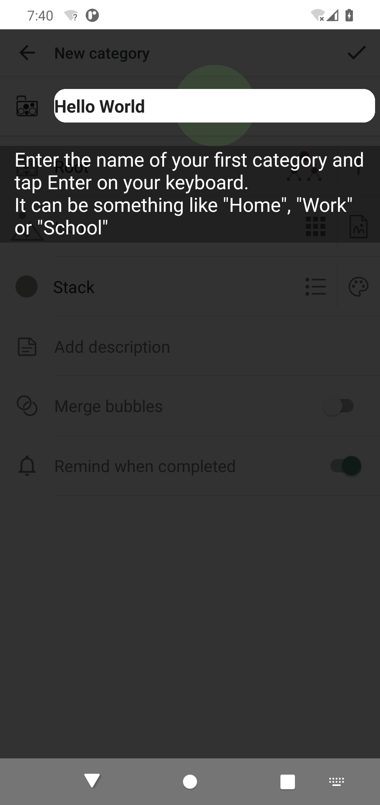
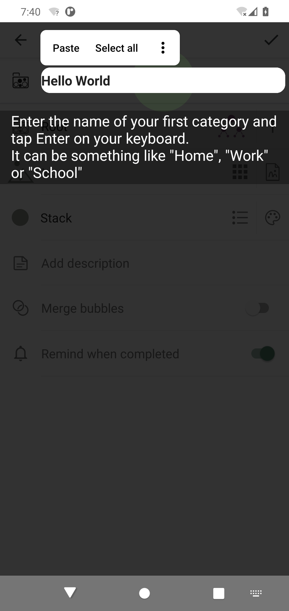
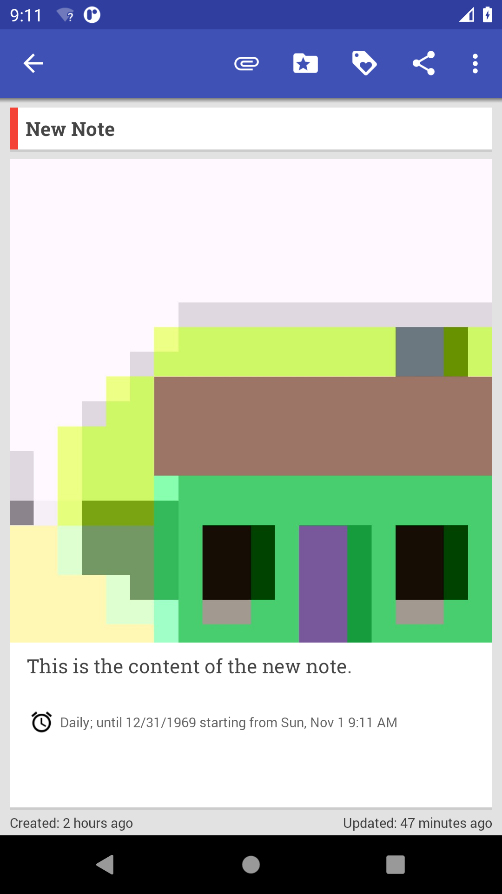

# GUI智能体复现与研究方向：王龄锋补充汇报稿

更新：2026-11-03，会后版。我的职责是补充文献与八项复现的细节、效果、发现和改进建议；学姐负责整体研究框架。正文按她的四方向衔接，使用我方已保存的复现材料。

使用方式：先讲第1节，再按学姐当前讲到的方向选第2节补充；第3节供逐篇追问时查数字，第4–5节用于讨论下一步。八篇原报告的会后补充都在各篇末尾，入口见[总目录](../reproduction/catalog.md)。本稿末尾保留原汇报稿全文，方便追溯。

## 1. 开场与四方向：先说明我这周提供了什么

可以直接这样讲：

> 我这周整理了八项工具，其中七项形成实际运行或评测产物，GraphDroid完成了工件和源码缺口核查。我的补充围绕三件事：它的方法到底怎么工作，本次实际产生了什么，以及从这些产物里能找到哪些值得改进的地方。下面按四个方向补充，重点是检测、探索和功能状态表示之间的联系。

|学姐的框架|我方最相关的材料|我能补充的核心问题|
|---|---|---|
|显示问题检测（SE1：截断、开合）|ReFLAIR、UI-Lens；其他工具留下的真实页面和动作|怎样从“怀疑有问题”得到可信判断；哪些匹配和复核步骤值得借，哪些地方需要改|
|以UX为目标的探索（SE2，现阶段低优先级）|GraphDroid方法、LLMDroid、HapTest、FuncDroid|怎样在预算内找到更多有用现场；规则、模型和混合方案各自解决了什么|
|从轨迹构造功能状态图（G）|LLMDroid状态键、FuncDroid功能图、PropGen性质、OS-Genesis目标重放|哪些页面可以归为同一功能；哪些对象、菜单和数据条件必须保留；这张图怎样帮助到达目标|
|树与画面的可靠性（AX，协作基础）|ReFLAIR的可见性检查、OS-Genesis变化筛选、LLMDroid现场记录|布局树、截图和动作记录分别说明什么；采集与匹配出现偏差时怎样修|

原先的A/B仍可作为总称：A包括测试产生、探索和到达，B关注可靠检测。四方向把具体研究问题拆得更清楚。我建议当前优先验证SE1和功能状态图；SE2先检验“同预算下是否有独立收益”，AX在本轮承担证据质量分析。

## 2. 按方向补充：事实、启发和我们可以做的改进

### 2.1 显示检测：把检查对象、验证动作和结论接起来

**ReFLAIR提供了一条可借的流水线。** 它先在给定网页的宽、窄布局中提取文字和可交互对象，便宜的匹配先做；重复文字等歧义再交给模型看上下文，疑点通过滚动、展开等操作继续检查。初始点击主要由脚本枚举提取到的可见候选，跳转后重新打开URL并定位。它把“该检查哪个对象”和“还需什么证据”具体化了。

本轮Mailinator一页，正式check/onpage/explore分别25、5、13条回答，共43条；五个文字候选逐对象对上作者标注，另一个页脚logo交互候选仍待判定。这里的五次onpage回答包含不同判断任务，不能简单念成“五次成功滑动”。

**最有价值的发现，是程序有时会把尚未解释清楚的疑点划掉。** 原回答写`Text equivalent: Yes`，解析端却找`Text:`；没读到字段得到None后，程序仍可能删除候选。用人话说，就是“没看懂答案，也当作查清楚了”。另一个现场是目标在页脚，模型解释的变化却出现在远处输入区：有变化，还要核实它属于正在检查的那个对象。

据此可以分两步改：

1. 先统一解析格式，缺字段、执行失败、证据缺失分别记账，保留待确认项。这一层用于保证程序按原意工作。
2. 再研究对象和动作的对应：始终记录正在检查哪个按钮或哪段文字、动作作用在哪个区域、该区域是否真的变化、变化是否足以解释疑点。研究收益可以用“真实问题被误划掉多少、正常候选被正确撤销多少、代价多少”来衡量。

还有一个很具体的迁移问题：原文字清洗只保留ASCII字母和数字，中文“搜索”会被过滤，`9.6`与`96`会变成相同字符串。迁移中文App时，应保留Unicode、金额小数和必要单位；对于两个房源都有“9.6”这类情况，再增加商品或条目的上下文身份。这样能分别测清楚文本清洗修复和对象匹配机制各自带来的收益。

**UI-Lens补充了“页面判对”和“对象说对”的差别。** 固定200图、92正108负，各判两次：accuracy为70%和74%，平均P79.42%、R52.72%、F1 63.33%，即原问题图平均约一半被检出。本次按截图—类别判断有/无；原数据有问题框，实际回答主要给粗方位和描述。本次没有计算对象框匹配成绩。ui-122的两份回答都补出了`景...`并据此解释右上角问题，说明汇报时应继续追问“模型引用的字形、位置和对象是否真实”。具体原图和回答见[UI-Lens会后补充](../reproduction/04_UI-Lens.md)。

**我们可以形成的研究假设**：先把疑点定位到具体对象，再检查验证动作是否有效，能够减少错对象、没操作成功和证据不足造成的错误判断。先用少量冻结候选做配对试验，再扩大到多App。

开合与截断分别定规则：

- 截断看内容是否通过合理操作完整可得，滑动可能提供有用证据。
- 会议明确的开合要求是：窄屏展开后的首屏信息保持。应直接保存、比较规定时刻的首屏；“后来滑到了”作为另一个可获得性结果记录，不能覆盖首屏检查结果。

我建议先准备30个可执行截断候选，三类各10个：真实缺陷、可滑出、合法隐藏。固定初态、模型与判断规则，比较截图、图加树、现有滑检、加入对象与动作核验四档；另取20组开合对检查首屏规则。记录候选召回、对象匹配、最终问题P/R、待定、耗时，以及每个被纠正的具体原因。这些规模是下一轮机制试验计划。

### 2.2 探索：先弄清预算花在哪里、实际走到了哪里

**三种探索组织方式都有具体可借之处。** HapTest提供规则执行与页面转移的骨架；LLMDroid在探索停滞时调模型；FuncDroid让模型围绕功能及功能关系组织任务。GraphDroid进一步把历史组织、意图生成等待和执行分工一起设计。我们可以把它们放到相同App、预算和检测器下，比较有效触达与问题产出。

**HapTest值得借的是已有可运行的低成本骨架。** 它包含页面转移图导航和未探索事件处理，称作“纯坐标乱点”过于简化。新离线核对在10个源码App的三轮并集中，38个注册路由命中28个，注册路由覆盖73.68%。例如Wechat到达Index、Chat、Hardware、Search四个路由；Msea主要到Index、Login、Setting；Healthy主要停在Advertising、Splash。这个结果已经能回答：常见页面有实际触达，一些启动、登录及后续业务分支仍有缺口。逐App范围见[HapTest会后补充](../reproduction/06_HapTest.md)。

30个计划项中，17项按预算正常结束，4项原事件提前退出，8项计时内异常，1项准备失败。1889个after观测中，1499个处于目标App、390个处于其他上下文；1500个运行计数文件是另一个计数单位。实际Swiper滚动异常也提示，应先判断目标容器还能移动多少、动作有没有产生预期效果，再推进路线。

我的建议是把它用作采集底座：补充目标App恢复、动作失败恢复、未走分支优先级，在稳定的规则路径上再选择性加入模型。这样既能保留低调用成本，也能具体测出模型究竟补了哪些路径。

**LLMDroid的价值在于“什么时候才请模型帮忙”。** TimePlanner三轮各60分钟，方法去重数2833、2945、2946；最高按作者23280分母为12.6546%。三轮共57次HTTP成功、100383 tokens。它给我们提供了停滞前后、模型意图、真实动作和覆盖变化的对应材料。下一步应逐次检查：模型介入后到了什么新功能或新条件，恢复路线是否有效，花的时间是否值得。Fing中两轮NoPath早停，则给路线恢复提供了明确待改点。

**GraphDroid值得讲的贡献，是三个设计形成了一套预算安排。** 历史状态组织成局部簇，使意图有上下文；异步生成让探索与模型等待重叠；简单、多步意图分给不同执行方式。讲它时应把这三项与作者覆盖、等待、费用及消融联系起来，而不只说“保存历史”。本轮正式方法运行仍为0。会后已核清：作者已有TopCluster和实际模型执行器，缺失文件里有旧导入路径、快照入口和可选旧策略三种情况。按作者默认无快照入口，已经准备两份独立兼容文件，6项离线接口契约检查通过。下一步在独立副本检查全包导入和实际探索链；真实快照恢复所需的状态约定另外列清。见[GraphDroid的源码核查与会后补充](../reproduction/02_GraphDroid.md)。

**FuncDroid带来的方向，是有目的地组合功能条件。** 本次四App各一轮，京东、QQ音乐、淘宝、高德分别形成11、22、3、15个模型命名功能节点，对应页面节点19、26、6、23；工具标completed为0、1、0、1。图中既有京东秒送/超市、QQ搜索/本地音乐，也混有启动广告、授权和外跳。淘宝三个节点集中在登录与通知门槛，具体说明业务入口被准备条件挡住了。2241条响应、usage报告的10634613个总tokens，反映了本次方案较高的模型使用量。下一步先把51个节点分为核心业务、准备步骤和外跳，再核功能身份、到达条件与有效边；给后台判定单列收尾预算。两条自动候选需要继续核对预期来源和稳定现场。我们可以先核功能名对应哪些真实画面，再把保存、删除、筛选等动作对其他功能产生的影响写成可检查关系，并把等待稳定、恢复条件、预期来源记进测试。

我对这一方向的建议是：先检验常规覆盖和恢复，再讨论UX风险排序。相同已到页面使用同一个检测器，记录功能/条件触达、首次到达时间、重复进入、恢复开销及确认问题数。页面类型是否更容易暴露开合问题，可由分层标注验证；现阶段保持为一个具体待检验假设。

### 2.3 功能状态图：让路线图记住任务真正依赖的条件

**这里最直接的启发来自三组具体现场。**

1. **同状态键出现菜单。** TimePlanner本轮792个可解析事件中，492次前后状态键相同，其中295次前后PNG文件字节不同。固定20对的像素复查既有光标、光圈变化等正常同状态，也有长按后出现Paste菜单的现场。保存的stateJSON会复用该键的首次代表，菜单现场缺少同次完整原始树。这个筛查把待检查现场找出来，也把改进问题拆开了：先保存同步现场，再评价去重规则。详见[LLMDroid会后原图与源码分析](../reproduction/08_LLMDroid.md)。
2. **有来源的目标，恢复后对象变了。** OS-Genesis的Bike Touring目标来自真实探索；重新初始化后，相应位置成了Trail Jog，搜索出现空态。改进应保存目标对象及初始化计划，开始执行前检查对象是否存在；仅保存一句高层任务不足以重建现场。
3. **到了相似页面，却是另一个对象的结果。** OS-Genesis的目标要求current track，实际进入Aggregated stats分类汇总，模型与RM仍接受。路线图应区分“某条轨迹的统计”和“分类汇总的统计”，把对象和作用域放进目标条件。

**也有应当保留的合并正例。** TimePlanner从空Name输入Hello World，State7变为State8，两者仍属于Cluster4；另两轮也有同样的状态—簇关系。这说明已有分簇确实能把一次新建分类流程组织起来。我们的改善重点是沿用这种组织，再补菜单、对象和有效动作条件，而不是把每次换文都拆成新功能。

下图是同状态键的长按前后：菜单打开后，回放所需的可操作条件变了。原图、正常光标变化对照及精确源码见LLMDroid末节。

| 长按前 | 长按后 |
|---|---|
|  |  |

据此，我建议把页面表示拆成两层：

- 功能层回答“这是搜索、详情、编辑还是统计”，帮助归并动态换文后的同类页面。
- 条件层回答“哪个对象、弹层是否打开、输入内容和关键开关是什么”，帮助保留任务需要的区别；动作边同时保存有效的操作和恢复条件。

**PropGen把这个问题推进到检查标准。** OmniNotes生成31条性质，六小时有效执行1450次，其中18条性质真正触发；重复性质和前置条件决定了预算实际用到哪里。提醒页出现与前序2026日期选择矛盾的1969截止摘要，原模型仍判完成，生成性质只检查`Daily`。这提示功能名称之外还应保存日期关系、对象身份等真正影响正确性的条件。Markor的前置判断对空文本None未处理，执行26次后提前结束，则说明用例前置本身也应有可执行性检查。

可先改两个地方：一是让探索优先补尚未触发的性质及条件，记录每条性质为什么没进入；二是给生成的检查补充正常对照和关系约束，检验它是否能把错误现场判出来。然后再研究“从轨迹得到功能与条件表示，是否提高有效用例产出和目标重放成功率”。

**页面去重怎么讲清楚？** 哈希把选定属性编码成一个键，决定效果的是前面选了哪些属性、原始树有没有采全、截图与树是否同步。这里要分别检查：正常内容变化是否被合理归并，不同功能是否被合在一起，同一功能是否被拆成许多节点，以及临时菜单是否丢了。我们应通过这些实际关系评分，再看节点数或覆盖数。

最小验证可从已有轨迹冻结20–30对现场，覆盖同功能换内容、相似布局不同功能、同功能带菜单等情况；先人工标功能和条件，再比较原表示与分层表示。记录错合并、错拆分、目标重放、条件恢复和下游性质触发；所有方法用相同的状态对。

### 2.4 树与画面：先解释采集和筛选怎样影响后续任务

我这边可以提供三个源码层面的线索：

- ReFLAIR用DOM确定文字候选，又通过显示检查和截图验证可见性，说明“树中有节点”和“当前像素可读”需要分别观察。
- OS-Genesis随机采集用前后元素标识集合判断变化，标识含文字、位置及状态属性；它未先计算两张PNG的像素差。因此图片或颜色变化而所取属性不变时，任务种子筛选可能漏收这类变化。
- LLMDroid复用状态键的首次代表，影响了事后区分“树没有采到菜单”和“编码忽略菜单”的能力。保存每次同步原始树与图，可以把两种问题查清。

我们可以把树和截图当互补证据：字段够用时走较便宜的定位/匹配路径；字段含糊、自绘、叠层或可见范围存疑时补图；涉及真实操作结果时再做动作验证。先用同一次稳定现场的树、图和目标框构造配对样本，比较误差和调用成本，再评估是否值得形成独立通道选择方法。

## 3. 八项复现速查：被问到某一篇时用这张表

|项目|方法主张与本次做到的部分|我准备讲的效果和具体作用|
|---|---|---|
|ReFLAIR|宽窄对象对应、功能效果比较、针对疑点交互；本次Mailinator一页完整子链|43回答、5文字GT对应、1交互待定。借分层匹配与疑点验证；已找到解析误撤销、中文过滤及效果归属问题，适合做工程修复与对象级验证对照。|
|GraphDroid|状态簇、异步意图、混合执行；本次工件与源码核查|正式方法0轮；两处独立兼容桥6项离线契约通过。默认入口缺口已分层，后续验证状态归并和路线恢复，再评价覆盖、等待和费用三部分。|
|OS-Genesis|从随机局部交互反推任务、重做轨迹并评分|22目标、22非空轨迹、127步；RM5/3/2分为14/4/4。提供任务来源，也暴露对象恢复和相似作用域误达；借来做带条件的定向采集。|
|UI-Lens|显示问题数据集与模型评测；200图两次|accuracy70%/74%，均P79.42%、R52.72%、F1 63.33%。借正常/异常类别和公开固定集，进一步评对象定位与实际可获得性。|
|FuncDroid|功能及关系驱动的测试场景；鸿蒙4App各一轮|四图共51个模型命名功能节点，工具标完成2个，自动候选另2条。借跨功能条件构造，改善节点归类、预期来源、稳定观察和收尾预算。|
|HapTest|页面转移与规则探索；10源码App三轮|38注册路由并集命中28；17预算正常、4事件早退、8异常、1准备失败。适合作低成本采集底座，针对遗漏分支和动作异常补恢复与引导。|
|PropGen|功能假设、探索证据、P/I/Q性质、原Kea执行|Omni31性质，18条触发，1450次结束；Markor38性质，26次后提前失败。借自动用例组织，研究条件驱动触发和强判据。|
|LLMDroid|规则探索停滞时借模型生成意图|TimePlanner三轮2833/2945/2946去重方法、57次调用；有原图、状态键、意图与事件链。借选择性模型调用、图的恢复和状态条件表示。|

上表的统计单位分别是对象、方法、注册路由、性质执行或任务；论文数字与本轮协议差异见各篇原报告。模型适配统一Qwen3.8-Max。图像复查与工程诊断采用AI辅助方式，原人类标签/人工评审和新建议实验分别记录。

## 4. 学姐交给我的事项，以及我这边下一步怎样做

### 已落实到这轮材料的内容

1. **把方法讲具体。** 补查了ReFLAIR谁选点击、如何恢复、文字和上下文怎样匹配；OS-Genesis随机采样、变化筛选、反推与RM怎样连接；HapTest规则路径及GraphDroid模块依赖。
2. **把效果讲成结论。** HapTest给出注册路由并集与实际业务入口；LLMDroid给出去重筛查和原图对照；其他工具用任务、性质、对象及调用记录解释实际产物。
3. **把启发写成改法。** 八篇末尾均追加具体问题、原因证据、原工具可改步骤、我方可借机制及最小验证，保留原内容。
4. **按四方向补充。** 此稿用于我接着学姐的框架讲复现发现；我的数字、文献原数字和建议实验分别标清。

### 两篇精读参照，具体用在哪里

|参照|值得借的做法|我方可以先准备的材料|
|---|---|---|
|OS-Oracle|把元素定位、动作执行、效率和终止时机等错误拆开，构造可控负例，再用独立评价检验动作判断。|给同一目标准备点错对象、点了没生效、做多余操作、过早结束等配对记录。用于评价执行器和滑检动作核验，帮助分清操作问题与App问题。|
|EP-Detector|从相同起点施加局部操作扰动，再比较结果；研究误操作条件怎样暴露体验风险。|在同一现场比较正常操作与偏位置、重复点击、不同等待/手势等小范围变化，记录状态保持和可操作性。可以借来构造动作可靠性测试和正常对照。|

这两篇在本轮承担精读参照，具体原文与版本入口见[AB研究分析](AB研究分析.md)。本阶段优先把现有复现材料变成清楚的检查对象、配对样本和验证方案。

### 我建议先做的三项小验证

|优先项|我这边先整理什么|怎样比较、什么结果值得继续|
|---|---|---|
|1. 页面匹配与状态图|从已保存轨迹取20–30对有代表性的页面，保留原图、原始树是否齐全、功能、对象与动作条件；加入正常同页变化。|同一批配对比较原状态表示与功能/条件表示；看误合、误拆及后续目标/动作是否改善。收益应体现到路线和检查，而不只节点变多。|
|2. 验证动作与检查对象|整理30个可执行截断候选、20组开合对的标注规范和对象清单；现有例子先做小范围规则检查。|固定现场、模型、预算，逐层加入对象定位、动作核验；比较P/R、误撤销、待定和总耗时。首屏保持与滑动可得性分别评价。|
|3. 性质触发与恢复|按31条Omni性质列出已触发18条、其余前置条件和失败原因；记录Markor空文本前置、OS目标对象恢复等例子。|比较原调度与面向未触发条件的调度，报不同性质触发、有效检查数、恢复时间及唯一确认问题；先确认条件表示是否解决了实际损失。|

这些是下一轮建议。当前交付优先完成离线源码核查、原图与原始结果复核、文档补充和可执行计划；设备、付费模型和正式对照的预算另行安排。

## 5. 现场追问时，可以直接这样回答

- **“这篇为什么值得发，保存历史本身有何贡献？”** GraphDroid把历史组织、模型等待和执行分工分别设计，并用覆盖、时间费用和消融对应验证。我们要借它的问题拆分和验证方式，同时查状态归并及恢复还能改善哪里。
- **“ReFLAIR给我们的作用是什么？”** 它把疑点变成具体对象，先匹配，再找有针对性的证据。对我们可落实成对象定位、候选筛查、动作核验三段，并为截断和开合分别定规则。
- **“你那五个文字对上了，说明什么？”** 说明这个英文页面的对象对应链路能够找到作者标注的那五项；同时我们保留了一个交互待定项、一次解析误撤销等细节，下一步拿配对数据判断改进作用。
- **“HapTest到底效果如何？”** 在这10个源码App三轮中，实际命中28/38注册路由；聊天、联系人等入口能到，若干登录和业务分支遗漏，另有滚动异常。它已经提供了值得复用的便宜底座，下一步重点补分支优先级、稳定执行与恢复。
- **“哈希去重的问题在哪里？”** 先查输入选了什么和是否同步，再看功能关系。相同键可以合理忽略光标变化，也会遇到新菜单仍沿用旧代表的情况；要把正常变化和真正改变动作条件的状态分别处理。
- **“OS-Genesis只是随便点，为什么有用？”** 它把局部变化反推成可表达的任务，再重新执行、评分，减少预写高层任务的依赖。我们进一步看到对象恢复和目标作用域的重要性，可以据此改造为带条件的定向采集。
- **“PropGen具体怎么改？”** 先让未触发性质的条件可达，补前置异常处理；再给检查加入对象和关系约束、正常对照。用18/31触发、弱Daily检查、Markor前置异常这些实际损失来决定改哪一层。

保留原汇报稿全文：五篇细读、原八项目统计、四组案例及原A/B方案

# AB研究与论文复现：组会汇报稿

本稿按“文献给出的思路 → 实际复现带来的认识 → A/B接下来怎样收敛”组织。复现协议、环境和逐轮原件见[八项目总目录](../reproduction/catalog.md)，这里保留汇报需要的重要数据和案例。下文“建议实验”均未执行，不作为已有成绩。

**A回答“怎样生成有用的测试、把应用带到值得检查的条件”；B回答“到了现场以后，怎样可靠判断是否存在UX问题”。** 两者可以共享轨迹，但要分别评价，不能用探索覆盖代替检测正确率。

## 一、先汇报四个结论

1. **文献和工具已提供很多成熟部件，接下来需要选择具体问题。** 五篇重点细读分别解决历史探索、任务来源、动作评价、交互反证和受控干预；“建图、生成意图、加滑动、加动作评判器”这些宽泛做法都有近邻。我们的贡献必须落到哪种具体失败、为什么发生、怎样改善及如何证明。
2. **本轮八项目中，七项形成实际运行或评测产物，GraphDroid停在工件核验。** 实际范围包括截图子集评测、单网页流程、小规模数据生成、有限App探索和性质执行；不能统称八篇原论文全协议复现。不同工具用不同指标，不能排成统一名次。
3. **最明确的新认识是：到达状态、完成操作、生成有效检查、正确判断问题，需要分别验证。** 已有探索器确实能到达键盘、弹层、图文长内容和设置组合，不能先验认定它们只会逛首页；但到达后仍可能用过弱断言接受有问题的画面。
4. **建议两条主线继续收敛。** A先研究“保留关键条件、可重放且有检查价值的测试生成”；B先研究“移动端截断复核中，验证动作是否真的提供了充分证据”。功能状态图、树图可靠性、故障构造服务这两条线，暂不同时扩成多个独立选题。

指标说明：独立标注的标准答案称为真值。P是精确率，即报出的问题中有多少与真值一致；R是召回率，即真值中的问题有多少被找出；F1综合两者。论文各自的真值和分母不同，不能直接横向排名。

## 二、五篇细读：分别借什么，不能直接当作什么

|论文|核心机制与重要证据|对我们当前选择的作用|
|---|---|---|
|[GraphDroid · ASE 2026](../notes/li2026graphdroid.md)|把历史状态组织成簇，异步生成意图，简单与复杂意图分开执行。41App、每App2小时、3重复；研究覆盖、成本和组件消融。|A的方法组织参照：先定位预算浪费，再对应设计组件。非崩溃问题仍需研究者检查，覆盖提高不直接等于UX检出提高。本地未跑通，不能声称我们已对其完成性能比较。|
|[OS-Genesis · ACL 2025](../notes/sun2025osgenesis.md)|先观察前态—动作—后态，再反推目标、重新执行和评分，用数据训练GUI模型。同一Qwen2-VL-7B的AndroidWorld成功率由Self-Instruct的9.82%到17.41%。|A的任务来源参照：不必先人工写完任务。但训练任务有真实来源，不保证重置后对象还存在，也不自动给出软件正确行为的独立标准。|
|[OS-Oracle · CVPR 2026](../notes/wu2026osoracle.md)|构造定位、执行、效率和结束时机等动作错误，用动作评判器（critic）判断某步是否有助目标，并用独立评价检验。|借它区分“Agent操作错”和“App真的有错”，以及正负例、独立评价的组织方式。动作合理并不说明应用没有UX缺陷；本轮未训练或复现其动作评判器。|
|[ReFLAIR · FSE 2026](../notes/he2026reflair.md)|宽窄布局先匹配信息/功能，再滚动、展开菜单寻找反证。主24网页P80.49%、R95.31%。|B最近邻：主动复核已有先例。“截图＋结构＋滑动”本身不足以说明新意；要证明移动场景的目标容器、动作生效、内容可获得性等机制带来实际收益。|
|[EP-Detector · ICSE 2025](../notes/guo2025epdetector.md)|恢复相同起点，施加操作偏差、位置/环境条件等局部干预，再比较结果。53App报告5818条异常现象，5136条按论文协议确认，P88.28%。|借受控条件和恢复对照：标准点击成功不排除其他合理条件下出问题。异常现象数不是独立根因数；它也不是我们的文字截断检测器，本轮未执行它的实验。|

五篇共同带来的方法要求是：**任务从哪里来、状态怎样保持一致、动作是否有效、预期从哪里来、最终结果怎样独立评分，都要交代。** 不需要把五篇拼成一个大系统；应选一个能被现有失败证据支持的问题，再借必要部件。

此前讨论还涉及“UX风险导向探索”“自动功能状态图”“截图与结构树冲突”等分支。现阶段更适合把它们当需要验证的机制假设：是否真的存在风险富集、状态抽象是否丢条件、树图不一致是否影响判定，都要先测，不能写成已证实的领域空白。

## 三、本轮复现的重要结果：已有了哪些可用材料

|项目|本次实际结果|目前最重要的解读|
|---|---|---|
|UI-Lens|固定200图，92原标签正例/108负例，各判两次；accuracy70%/74%，两重复均值P79.42%、R52.72%、F1 63.33%。|本次Qwen截图判别仍漏掉较多原标签问题图。400回答只有200独立图；这是数据子集评测，非作者完整检测器复现，也不是我们私有截断集成绩。|
|ReFLAIR|Mailinator一页走完原流程；正式check/onpage/explore为25/5/13回答，共43条。最后5文本候选、1操作候选；五文本能逐对象对应作者GT，操作候选未知。|单页流程和主动复核机制已可观察；原GT评分未完成，不报本轮P/R。提示字段与解析字段冲突会导致候选被撤销，结果数量需结合中间证据解读。|
|OS-Genesis|22变化三元组→22目标→22非空轨迹、127步→22评分；轨迹评分模型RM的5/3/2分为14/4/4。|数据生成小链路完成；未训练、未跑训练后榜单。22有轨迹不是22成功，RM高分也不是独立成功真值。|
|PropGen|Omni生成31性质，原Kea性质执行框架累计有效21612.8秒，1450次结束执行：323pass/660fail/467error；只有18/31性质触发。Markor生成38性质，约588.3秒后提前失败，26次为4pass/22error。|生成、触发、正确执行、有效判错存在不同瓶颈。660次重复fail不是660个产品bug；Markor未跑满6小时，人类有效性评审仍为0。|
|LLMDroid|TimePlanner三轮原60分钟完成，去重方法2833/2945/2946；最高2946/作者配置23280=12.6546%。Fing仅首轮完整，另两轮因NoPath（无法找到返回路径）早停；Wiki历史已暂缓。|有真实覆盖曲线、模型介入和前后图，可分析停滞恢复。但分母未独立枚举，方法覆盖不是页面或UX覆盖，跨App覆盖百分比不能直接排名。|
|FuncDroid|鸿蒙四App各一轮，自动高置信候选2个，独立确认0；三轮预算到达后仍有后台审计未排空，淘宝提前耗尽场景。|能观察功能图、输入/搜索/弹层等实际状态，但原公开实现缺论文部分完整机制，不能等同原Android协议或已确认缺陷数。|
|HapTest|10源码App×3计划项；17轮预算一致且正常返回、4轮原事件提前退出、8轮计时内异常返回、1轮准备失败。|提供无模型探索与路由/状态计数材料。30计划项不是30成功；UIAbility（鸿蒙页面入口组件）、静态路由、运行状态口径不同，还不是与FuncDroid公平的同App同预算对照。|
|GraphDroid|完成官方工件、源码与依赖核查，缺关键入口/资源，正式方法运行0。|可作为论文方法参照，暂不能作为本地运行基线或被我们击败的对象。|

本批模型适配统一使用Qwen3.8-Max，不能把本轮表现归因给作者原模型。统计已经按轮次、阶段和实际失败保留；环境中断与方法输出问题分开。

### 复现后，需要修正的三个判断

1. **“已有探索很少进入复杂状态”目前没有被证明。** 新实图复查已经看到键盘、日期弹窗、清单、图片长内容、搜索结果和横屏。我们要比较的是哪些有效条件仍被漏掉、代价多少，不能只凭工具原本不做UX检测就说探索不足。
2. **“有运行证据，性质就可靠”仍需要条件。** Omni只有18条性质实际触发；Markor生成性质的前置判断在Kea执行时未处理空文本None，导致框架提前退出。即便成功到达状态，过弱检查也可能缺少判别力。
3. **“模型完成/高分/退出码0”等字段不能直接作结论。** 要核对正确对象、实际画面、前置状态与原检查逻辑。例如OS把分类汇总当单条轨迹统计、淘宝exit0但任务完成计数为0，含义都需分别解释。

## 四、四组案例：为什么这些结果对A和B都有用

### 1. OmniNotes：进入了正确功能，检查却接受了矛盾摘要

- **实际经过：** 前序日期选择器显示2026年11月1日；从“不重复”选“每天”并确认后，摘要出现`until 12/31/1969 starting from Sun, Nov 1 9:11 AM`，与所选日期矛盾。前序动作未输入过去截止日期；原模型复述了1969，却仍返回COMPLETED。
- **原检查：** 对应生成性质只检查文本包含`Daily`，矛盾摘要仍满足它。没有把这个生成阶段判断冒充后续Kea成功执行。
- **对A：** 探索确实找到有测试价值的组合状态；生成测试还应保留开始/结束关系等条件，不能仅验证关键词出现。
- **对B：** 操作完成与体验正确性需要不同判定。实际APK与同版源码支持一种静态原因推断：默认极远截止日期在旧日期转换中失败，失败值又被格式化为1969；数据库字段和通知实际调度仍未验证。它是可见语义矛盾，超出UI-Lens五类，不计成多个独立bug。

展开：原始摘要画面

### 2. OS-Genesis：任务有来源，重置后目标对象仍可能不存在

- 原探索出现Bike Touring，反推任务要求查它；重新初始化会清库并随机生成干扰记录，执行现场变为其他活动，搜索目标为空。
- **对A：** 测试意图要绑定数据对象和恢复条件，单句自然语言目标不足以保证重放。另一个任务到了Aggregated stats而非当前单条轨迹Stats，RM仍给5分，说明目标对象和作用域也需核对。
- **对B：** 空结果不应直接当“内容未显示”；需要先确认正确对象是否应当存在。否则会把初始化或导航错误归成产品显示缺陷。

### 3. UI-Lens与ReFLAIR：看着少了一块，并不总是同一种问题

- UI-Lens正例ui-028中，列表内部一整排电影名被截成部分笔画，下方下一排海报仍可见；负例ui-003只是最下方卡券落在屏幕边缘。短设置项异常省略与长备注正常省略也应区分。
- ReFLAIR宽页FAQ/API存在，窄页菜单展开后只有HOME、PRICING、EMAIL、LOGIN、SIGNUP等，仍没有这两项；另一方面，滚动后恢复的正文是正常视口外内容。
- **对A：** 应记录列表位置、内容密度、菜单展开和窗口条件，而非只说“到过这个页面”。**对B：** 验证的目标是特定内容是否仍可获得，单看遮挡、露边或省略号不够。本轮五文本对象对应不替代最终产品评分。

### 4. Markor：导航可以成功，标题仍可能难以阅读

- 导入弹窗已进入Download等目录，但“Import from device”标题是深字配深背景。无标注原图与实际模型输入均存在该现象，像素颜色对比约1.015∶1。
- 实际APK资源和同版源码支持App颜色资源配对的解释；原生成性质关注路径、搜索、建目录，没有标题可读性检查。
- **意义：** A的功能触达可以复用为B的检查现场，功能成功不能替代可读性评价。该例保留为低对比候选，未做人类/开发者确认，也不属于UI-Lens五类。

本次复查还见到Fing的白正文、破图等疑似现场，但缺少稳定加载和业务预期证据；没有为满足“找到bad case”直接判成产品bug。正常模态遮罩、轮播露边、长摘要省略也保留为负例。这些边界同样有研究价值。

## 五、A方向：先研究什么，怎样判断值不值得继续

### 建议的核心问题

**在固定预算内，怎样从真实探索记录生成能恢复关键条件、能重放、且有明确检查依据的测试？**

这里“关键条件”要具体到对象、空/非空、键盘/弹层、输入值、滚动位置或设置组合。例如“进入提醒页”还不够，要保存“已有提醒＋每天重复＋起止时间”的条件；“进入统计页”还要分单条记录与分类汇总。

### 为什么现在更值得先验证这个问题

1. 有本轮直接证据：对象漂移、近重复设置、单条/汇总混淆、前置None失败，以及Daily关键词检查漏掉关系矛盾。
2. 已有方法给出了任务来源、历史图、性质生成等部件，我们可以用它们作基线和对照，把问题聚焦到条件保存及检查质量。
3. “优先去哪里找UX问题”仍需先证明某类状态具有更高问题密度；目前不能从样本案例推导风险集中，也不能证明现有工具很少到这些状态。因此将风险排序保留为待检验分支。

### 第一轮建议实验

|先回答的问题|最小可执行比较|需要看什么结果|
|---|---|---|
|状态去重是否漏掉重要条件？|固定已有轨迹，按预先定义的缺陷假设列出适用条件清单，独立标注功能、对象及键盘/弹层等条件；同一记录比较布局去重与功能＋条件表示。|错合并、错拆分、对独立适用条件清单的召回；新表示若只增加节点而不保住有价值条件，就不成立。不能用自己生成的节点数给自己算覆盖。|
|保存条件是否提高可重放性？|冻结源种子，双方使用同一重置后初态，比较只给目标、给目标＋源条件；分别记录源条件已满足、可恢复、不可恢复，不只保留恢复成功项，动作和模型预算一致。|正确对象到达率、有效重放率、失败原因和恢复成本；只多生成描述不算收益。|
|条件扩展是否更会找到问题？|在正常/隐藏故障配对中，比普通探索、观察反推、反推＋条件扩展；统一独立判定器和检测触发规则，探索、恢复、检查计入同一预算。|适用条件触达率、唯一确认问题/小时、正常误报和调用成本；收益若只来自更多检测调用或重复报告，就不能支持主张。|

这里的覆盖要有外部清单：代码方法、功能、状态条件各自定义分母。一个Activity可以包含多个页面，多张截图也可能是同一功能；“节点更多”不是“UX覆盖更高”。这三个小实验尚未执行，也尚未证明该候选方向具有新颖性。

## 六、B方向：围绕有效验证动作收敛，先把截断问题讲清楚

### 建议的核心问题

**面对疑似截断，怎样确认验证动作作用在正确容器、确实生效，并且提供了判断内容能否获得的证据？**

现有ReFLAIR已经用交互寻找反证，EP-Detector已经做受控干预。我们需要进一步验证移动端嵌套容器、边界、遮罩、树图不同步等情况，是否会使现有复核错误地确认缺陷；不能仅凭平台不同或多加一步滑动就宣称贡献。**这些是待验证的失败机制，本轮普通探索与静态评测尚未测出它们的发生率，也没有证明改进方法有效。**

### 方法应回答的三个具体问题

1. **对象对不对：** 当前检查的是哪段文字、哪个控件、哪个容器，滑动后是否还在追踪同一对象？
2. **动作有没有效：** 没位移是到底、遮罩拦截、落点错误，还是内容真的不能获得？有变化又是否只是换了页面？
3. **证据够不够：** 能否确认真实截断、可滑出、合法隐藏；一次没滑出不等于永远不可获得，需结合适用的交互方式和独立预期。证据不足时保留unknown，并继续统计这些未判定样本，不从分母中删掉。

### 第一轮建议实验

- **必要性：** 同一批真截断、可滑出、合法隐藏样本，由独立人员核对，比较截图、截图＋树、现有滑动复核。三档使用相同模型、候选集和判定规则，各重复两次；既检查“看似能滑却有问题”的难例，也保留普通正常场景，按App划分开发与最终测试。报告各类精确率/召回率、正常误报和unknown。若只看图在“真截断与可滑出”的缺陷判定上精确率、召回率均≥0.9，且跨App仍稳定，交互方法的必要性就要重新评估。0.9是前期研究取舍阈值，不是我们项目95%要求的替代。
- **机制：** 固定同页正常/故障对照，控制错容器、到边界、遮罩等条件，对比现有slide与增加对象绑定、动作有效性检查的版本。产品是否有错与动作是否有效分别标注；看“无效动作后误确认”的数量，以及固定召回下误报是否下降。只靠大量拒判抬高精确率不算改进。
- **成本：** 在固定三层任务中比较一次有依据干预和受限补证，测完整端到端、动作响应及恢复成功率。网络/资源异常的排除规则预先固定；如果在线预算下质量无法改善，可将多步复核定位为离线诊断。

优先范围建议是文字/组件截断及可获得性；低对比和日期语义用来说明评价边界，开合、树图可靠性按已有证据逐步衔接，不同时承担所有缺陷检测器。对开合问题，应先补可靠标签与命令切屏/真实开合一致性，不把本次普通探索当成已经做过开合测试。

### 与我们项目自身要求的关系

- 低/高级指令到达95%/80%：评价相同目标与初态下的导航，不用代码覆盖率或有轨迹比例替代。
- 到达后判断≥95%：先明确这是总体准确率、精确率还是召回率。三者不能互换；还要报告漏报及unknown，不能只在已判样本上算好看的比例。
- 动作平均≤3秒、最大≤5秒、三层端到端≤10秒：这是我们的部署目标，不是给复现论文追加验收。UI-Lens本轮完整请求平均约22.8秒，包含网络、排队和输出，只能提示当前调用链成本，不能算纯模型时间或GUI动作响应时间。离线探索、数据生成与在线验证应分别计时。

## 七、下一步与本次汇报希望确定的事情

1. **先用已有材料检验A的条件表示、B的验证必要性。** 先离线标注少量跨App轨迹和配对候选，再决定是否扩充设备实验；不立即上完整新系统或训练大模型。
2. **建立两类独立真值。** 一类判断产品/显示是否有问题，另一类判断动作与恢复是否有效；不能让生成模型的完成判断同时充当评价答案。可控复刻App和故障注入用于形成有已知答案的对照，并用独立真实案例验证适用性。
3. **公平比较后再作强结论。** 同App、同版本/初态、同预算、同判定器；把未到达、未触发、判错分别统计。当前材料支持具体失败机制和研究动机，尚不支持我们已超过所有基线、提高了UX召回或具备跨App泛化。
4. **需要讨论确定：** A是否先围绕条件保持和可重放测试；B是否先限定截断可获得性与动作有效性；第一批独立标注与正常/故障对照用哪些App、由谁复核。风险排序与单独功能图论文待前提实验结果后决定。

延伸材料：[五篇AB分析](AB研究分析.md) · [原待跑实验及问题](待跑的实验.md) · [八篇唯一复现说明](../reproduction/catalog.md) · [本地结果站](http://127.0.0.1:8770/summary)

